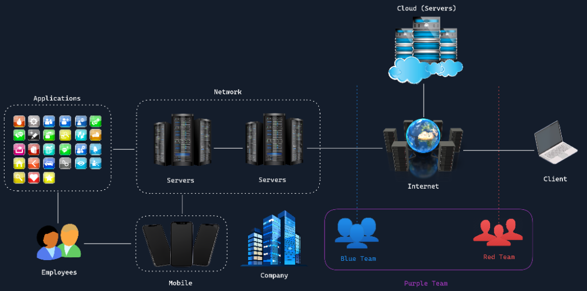

# 14. Insider Threat

Insider Threat (mối đe dọa từ nội bộ) chỉ những nguy cơ xuất phát từ chính những cá nhân được cấp quyền truy cập hợp pháp vào tài nguyên của tổ chức - chẳng hạn như nhân viên chính thức, nhà thầu ngoài (contractors) hoặc đối tác kinh doanh. Khác với các hacker bên ngoài phải tìm cách chọc thủng hàng rào phòng lửa từ ngoài vào, insider threat nảy sinh ngay từ bên trong lòng tổ chức. Những kẻ nội gián này lạm dụng đặc quyền truy cập được cấp để gây hại cho doanh nghiệp, dù là cố ý hay vô tình.

---

### 3 phân loại Insider Threat điển hình

Không phải mọi mối nguy nội bộ đều xuất phát từ lòng thù hận hay ác ý. Chúng thường được chia thành 3 nhóm rõ rệt:

1. **Malicious Insiders (Kẻ nội gián có ác ý)**: Những người cố tình tìm cách gây hại. Họ có thể đánh cắp dữ liệu mật, phá hoại hệ thống hoặc gian lận tài chính vì tư lợi cá nhân, vì muốn trả thù công ty, hoặc để tuồn tài liệu cho đối thủ cạnh tranh.
2. **Negligent Insiders (Người bất cẩn / thiếu cảnh giác)**: Những người này hoàn toàn không có ác ý nhưng lại gây hại do sự cẩu thả hoặc thiếu nhận thức an toàn thông tin. Ví dụ: một nhân viên vô ý gửi nhầm file bảng lương vào địa chỉ email bên ngoài, hoặc bấm vào đường link trong một email phishing khiến hệ thống bị nhiễm độc.
3. **Compromised Insiders (Nội bộ bị chiếm đoạt tài khoản)**: Trường hợp kẻ tấn công bên ngoài đánh cắp được credentials (username và password) của nhân viên nội bộ qua hacking hoặc social engineering. Kẻ gian sau đó thoải mái đi lại trong hệ thống công ty dưới danh tính của một nhân viên hoàn toàn hợp lệ.

---

### Ví von Insider Threat qua câu chuyện quán cà phê

Hãy tưởng tượng bạn là chủ một quán cà phê tấp nập khách, nổi tiếng khắp vùng nhờ các món đồ uống độc đáo pha chế theo công thức bí truyền. Bạn mạnh tay chi tiền lắp đặt hệ thống an ninh tối tân: camera sắc nét, chuông báo động và khóa chống trộm kiên cố để chặn đứng kẻ trộm đột nhập vào ban đêm. 

Thế nhưng, bạn lại không thể ngờ rằng chính người barista thân tín nhất của quán lại lén lút chép lại toàn bộ công thức bí mật để bán cho một quán cà phê đối thủ bên kia đường. Tình huống này lột tả chân thực bản chất của một Insider Threat: một mối nguy hiểm bắt nguồn từ ngay trong vòng tròn tin cậy của bạn, đâm sau lưng doanh nghiệp theo cách mà bạn khó lòng ngờ tới nhất.

Mối nguy lớn nhất của insider threat nằm ở khả năng **hoạt động hoàn toàn dưới radar quét an ninh (operate under the radar)**. Vì bản thân họ vốn đã có quyền truy cập hợp lệ vào hệ thống và dữ liệu, những hành vi mờ ám của họ dễ dàng trà trộn vào các hoạt động làm việc thường nhật, khiến việc phát hiện trở nên cực kỳ khó khăn. Họ biết rõ dữ liệu quý giá được cất ở đâu, nắm rõ quy trình vận hành và có thể dễ dàng khai thác những kẽ hở nội bộ mà kẻ bên ngoài chẳng hề hay biết.

---

### Cơ chế hoạt động: Chuỗi tấn công nội bộ (Insider Threat Kill Chain)

Các vụ tấn công từ nội bộ thường diễn tiến theo một chuỗi mắt xích gồm nhiều giai đoạn:

1. **Motivation (Động cơ)**: Người nội bộ bắt đầu nảy sinh lý do chống lại công ty - có thể do bất mãn cá nhân (bị đối xử bất công, trượt thăng tiến), vì cám dỗ tiền bạc hoặc bị thế lực bên ngoài đe dọa, tống tiền.
2. **Planning (Lên kế hoạch)**: Họ bắt đầu xem xét lại đặc quyền truy cập của mình, rà soát xem mình có thể chạm tay vào những tài sản giá trị nào để trục lợi.
3. **Preparation (Chuẩn bị)**: Thu thập công cụ hoặc chuẩn bị phương tiện để hành sự, như tìm cách cắm USB, cài phần mềm lén hoặc tìm hiểu cách lách qua các chính sách kiểm soát an ninh.
4. **Execution (Hành động)**: Giai đoạn trực tiếp thực hiện hành vi phá hoại - ví dụ như tải về hàng loạt dữ liệu nhạy cảm, cố tình xóa cơ sở dữ liệu hoặc tuồn thông tin mật ra ngoài.
5. **Concealment (Che giấu dấu vết)**: Kẻ nội gián tìm cách xóa sạch dấu vết để tránh bị phát hiện: xóa file log kiểm toán, mượn tạm tài khoản của đồng nghiệp khác để thao tác, hoặc ngụy trang các hành vi đánh cắp dưới vỏ bọc những tác vụ nghiệp vụ thường ngày.

Vì hoạt động trong vùng tin cậy nội bộ, hành vi của họ rất hiếm khi kích hoạt các cảnh báo an ninh tức thì (red flags). Họ hiểu rõ hệ thống giám sát hoạt động ra sao và biết cách né tránh các bẫy cảnh báo. Hơn nữa, nhiều doanh nghiệp chỉ mải mê dựng rào chắn ngăn kẻ thù bên ngoài mà vô tình bỏ quên việc canh chừng những rủi ro ngay bên trong nội bộ.

---

### Hậu quả và Rủi ro pháp lý nặng nề

Tác động từ một vụ Insider Threat thường rất đa chiều và để lại những vết sẹo sâu hoắm cho doanh nghiệp:

- **Tổn thất tài chính khổng lồ**: Từ việc bị bòn rút trực tiếp ngân sách cho đến chi phí khắc phục sau sự cố, chi phí downtime hệ thống và các khoản bồi thường pháp lý.
- **Mất lợi thế cạnh tranh**: Các vụ đánh cắp tài sản trí tuệ (intellectual property) và bí mật thương mại có thể phá hủy hoàn toàn ưu thế thị trường mà công ty đã dày công xây dựng suốt nhiều năm.
- **Khủng hoảng niềm tin nội bộ**: Khi xảy ra sự cố nội gián, bầu không khí làm việc sẽ bị đầu độc bởi sự nghi kỵ lẫn nhau, làm sụt giảm nghiêm trọng tinh thần và năng suất của toàn bộ nhân viên.

#### Áp lực từ các khung pháp lý và tiêu chuẩn quốc tế
Khi dữ liệu bị rò rỉ từ bên trong, doanh nghiệp sẽ phải đối mặt với hàng loạt rắc rối pháp lý khắt khe:
- **Án phạt tài chính khổng lồ**: Các đạo luật bảo vệ dữ liệu nghiêm ngặt như **GDPR** (General Data Protection Regulation của Châu Âu) hay **HIPAA** (Health Insurance Portability and Accountability Act trong ngành y tế Mỹ) áp mức phạt lên tới hàng chục triệu Euro/USD nếu doanh nghiệp lơ là trong khâu bảo vệ dữ liệu người dùng.
- **Đình chỉ hoạt động**: Việc không tuân thủ các tiêu chuẩn bảo mật thanh toán như **PCI DSS** (Payment Card Industry Data Security Standard) có thể khiến doanh nghiệp bị tước giấy phép xử lý giao dịch thẻ tín dụng.
- **Các vụ kiện tập thể (Class-action lawsuits)**: Khách hàng và đối tác bị lộ lọt thông tin có thể khởi kiện tập thể đòi bồi thường thiệt hại; các cổ đông có thể kiện ban lãnh đạo vì để cổ phiếu sụt giảm thê thảm.
- **Bị thanh tra và thắt chặt quản lý**: Các cơ quan quản lý nhà nước sẽ mở các đợt điều tra gắt gao, tiến hành audit toàn diện và áp đặt các biện pháp giám sát ngặt nghèo, bóp nghẹt sự linh hoạt trong vận hành của doanh nghiệp.

Những hệ lụy nhiều tầng lớp này càng khẳng định tầm quan trọng sống còn của việc xây dựng các cơ chế phát hiện và ngăn chặn Insider Threat ngay từ trong trứng nước.
