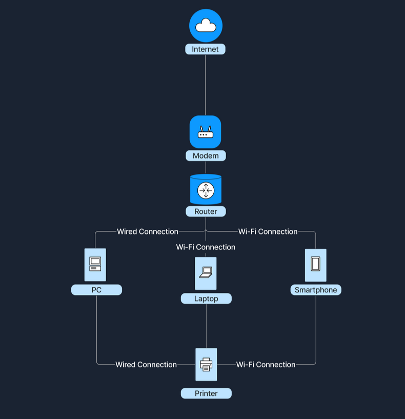
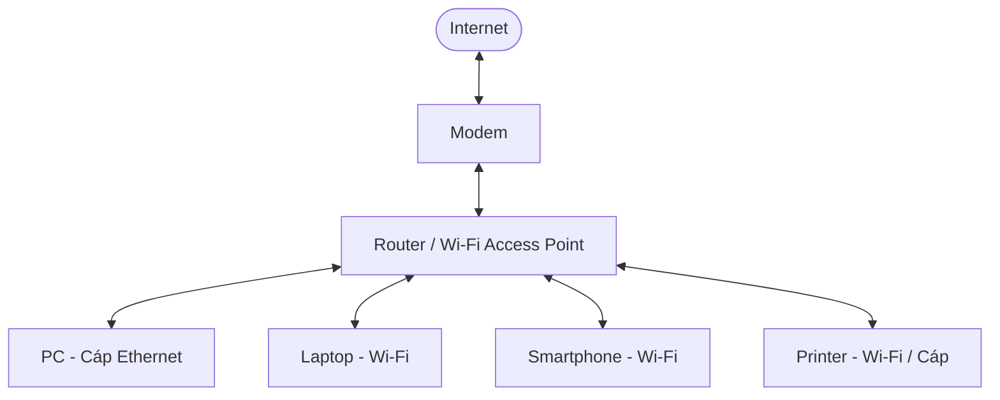
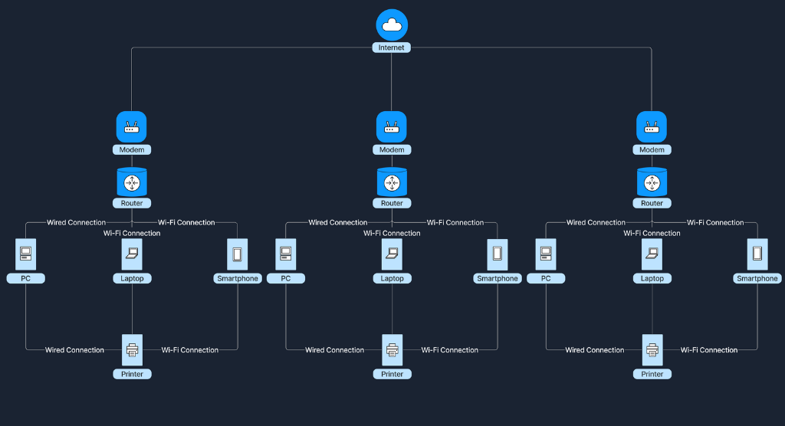
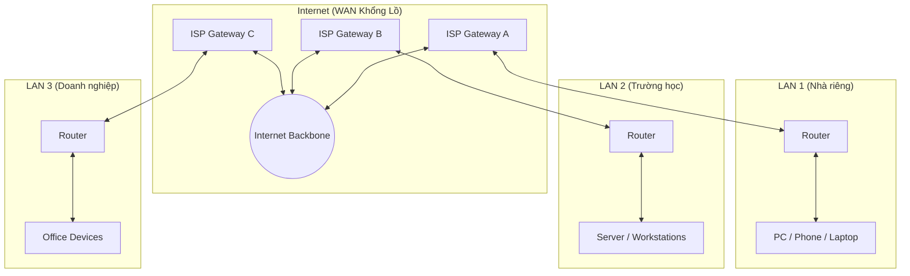

# 1. Introduction to Networks

Chào mừng bạn đến với module **Network Foundations**! Trong bài mở đầu này, chúng ta sẽ cùng khám phá công nghệ đằng sau mạng máy tính (computer networking) - hay thường gọi ngắn gọn là "networking" hoặc "network" - và lý do vì sao nó lại đóng vai trò thiết yếu trong cuộc sống hiện đại. Trọng tâm của bài học sẽ xoay quanh hai loại network phổ biến và quan trọng nhất: **Local Area Network (LAN)** và **Wide Area Network (WAN)**.

Hiểu được cách các thiết bị có thể giao tiếp với nhau - từ phạm vi bên trong ngôi nhà cho đến quy mô toàn cầu - là nền tảng cốt lõi bắt buộc đối với bất kỳ ai muốn bước chân vào lĩnh vực cybersecurity. Trong thế giới ngày nay, sự liên kết chặt chẽ của hầu hết mọi thiết bị thông minh chính là lý do khiến nhu cầu về các chuyên gia an ninh mạng không ngừng tăng cao.

---

### Network là gì?

Một **network** là một tập hợp các thiết bị được liên kết với nhau để có thể giao tiếp: gửi và nhận dữ liệu, cũng như chia sẻ tài nguyên cho nhau. Những thiết bị đầu cuối riêng lẻ này thường được gọi là các **node**, bao gồm máy tính, smartphone, máy in và server. Tuy nhiên, chỉ các node thôi thì chưa đủ để tạo nên một network hoàn chỉnh.

Bảng dưới đây tóm tắt một số khái niệm cốt lõi trong networking:

| Khái niệm | Mô tả |
| :--- | :--- |
| **Nodes** | Các thiết bị riêng lẻ được kết nối vào network. |
| **Links** | Các đường truyền liên lạc kết nối các node với nhau (có thể là có dây - wired hoặc không dây - wireless). |
| **Data Sharing** | Mục đích cốt lõi của một network là cho phép trao đổi dữ liệu qua lại giữa các node. |

> **Ví dụ thực tế dễ hình dung:**  
> Hãy tưởng tượng một nhóm bạn đang trò chuyện cùng nhau trong một căn phòng. Mỗi người đại diện cho một thiết bị (**node**), khả năng nói và lắng nghe của mỗi người đại diện cho các đường truyền liên lạc (**link**). Còn nội dung cuộc trò chuyện chính là dữ liệu (**data**) đang được chia sẻ qua lại.

---

### Vì sao Network lại quan trọng?

Kể từ khi Internet ra đời, các network đã làm thay đổi hoàn toàn bộ mặt xã hội, mở ra vô vàn tiện ích thiết yếu cho cuộc sống hiện đại:

| Chức năng | Mô tả giá trị mang lại |
| :--- | :--- |
| **Chia sẻ tài nguyên (Resource Sharing)** | Nhiều thiết bị có thể dùng chung tài nguyên phần cứng (như máy in) và các tài nguyên phần mềm. |
| **Giao tiếp liên lạc (Communication)** | Tin nhắn tức thời (instant messaging), email và các cuộc gọi video đều vận hành dựa trên nền tảng network. |
| **Truy cập dữ liệu (Data Access)** | Truy cập các tệp tin và database từ bất kỳ thiết bị nào có kết nối mạng. |
| **Hợp tác làm việc (Collaboration)** | Làm việc nhóm theo thời gian thực (real-time) mượt mà, ngay cả khi các thành viên cách xa nhau hàng nghìn cây số. |

---

### Phân loại Network

Network rất đa dạng về quy mô và phạm vi hoạt động. Trong đó, hai loại hình chính và phổ biến nhất là:
1. **Local Area Network (LAN)**
2. **Wide Area Network (WAN)**

---

### 1. Local Area Network (LAN)

**Local Area Network (LAN)** là mạng kết nối các thiết bị trong một khoảng cách địa lý ngắn, chẳng hạn như bên trong một ngôi nhà, trường học hoặc một văn phòng nhỏ.

Các đặc trưng cốt lõi của LAN:

| Đặc trưng | Chi tiết |
| :--- | :--- |
| **Phạm vi địa lý (Geographical Scope)** | Bao phủ một khu vực nhỏ, cục bộ. |
| **Quyền sở hữu (Ownership)** | Thường thuộc quyền sở hữu và quản lý của một cá nhân hoặc một tổ chức đơn lẻ. |
| **Tốc độ (Speed)** | Tốc độ truyền tải dữ liệu (data transfer rate) rất cao. |
| **Môi trường truyền dẫn (Media)** | Sử dụng kết nối có dây (cáp Ethernet) hoặc không dây (Wi-Fi). |

Sơ đồ dưới đây minh họa cách một mạng Wi-Fi gia đình kết nối các thiết bị như PC, laptop, smartphone và máy in, cho phép chúng chia sẻ dữ liệu nội bộ và truy cập ra Internet:

---

### 2. Wide Area Network (WAN)

**Wide Area Network (WAN)** trải rộng trên một phạm vi địa lý rộng lớn, kết nối nhiều mạng LAN lại với nhau.

Các đặc trưng cốt lõi của WAN:

| Đặc trưng | Chi tiết |
| :--- | :--- |
| **Phạm vi địa lý (Geographical Scope)** | Bao phủ các thành phố, quốc gia hoặc thậm chí xuyên lục địa. |
| **Quyền sở hữu (Ownership)** | Thường thuộc quyền sở hữu tập thể hoặc phân tán (ví dụ: các nhà cung cấp dịch vụ Internet - ISP). |
| **Tốc độ (Speed)** | Tốc độ truyền dữ liệu thường chậm hơn so với LAN do khoảng cách truyền tải địa lý rất xa. |
| **Môi trường truyền dẫn (Media)** | Sử dụng cáp quang (fiber optics), đường truyền vệ tinh (satellite links) và các đường truyền viễn thông thuê riêng (leased lines). |

**Internet** chính là ví dụ điển hình và quy mô lớn nhất của một WAN, kết nối hàng triệu mạng LAN trên toàn cầu:

---

### So sánh giữa LAN và WAN

| Khía cạnh | Local Area Network (LAN) | Wide Area Network (WAN) |
| :--- | :--- | :--- |
| **Quy mô (Size)** | Khu vực nhỏ, giới hạn cục bộ | Khu vực rộng lớn, bao quát diện rộng |
| **Quyền sở hữu (Ownership)** | Một cá nhân hoặc một tổ chức quản lý | Nhiều tổ chức / nhà cung cấp dịch vụ (ISP) liên kết |
| **Tốc độ (Speed)** | Rất cao | Thấp hơn so với LAN |
| **Chi phí bảo trì (Maintenance)** | Dễ dàng và chi phí thấp | Phức tạp và tốn kém |
| **Ví dụ điển hình** | Mạng gia đình, mạng văn phòng | Mạng Internet toàn cầu |

---

### LAN và WAN phối hợp hoạt động như thế nào?

Các mạng **LAN** có thể kết nối vào mạng **WAN** để tiếp cận với các mạng diện rộng nằm ngoài phạm vi cục bộ của chúng. Sự liên kết này mở ra khả năng liên lạc và chia sẻ tài nguyên trên quy mô toàn cầu.

- **Trong môi trường gia đình**: Khi truy cập Internet, mạng LAN tại nhà bạn sẽ kết nối tới WAN của một **Internet Service Provider (ISP)** - công ty cung cấp dịch vụ Internet. Trong mô hình này, thiết bị **modem** (modulator-demodulator) đóng vai trò then chốt: làm chiếc cầu nối giữa mạng nội bộ và hạ tầng của ISP, chuyển đổi các tín hiệu số (digital signals) từ router sang định dạng phù hợp để truyền tải qua đường dây điện thoại, cáp đồng trục hay cáp quang. Nhờ đó, một mạng nội bộ đơn giản được biến thành một cánh cổng mở ra kho tài nguyên khổng lồ trên mạng Internet.
- **Trong môi trường doanh nghiệp**: Các công ty liên kết nhiều văn phòng chi nhánh (mỗi chi nhánh là một LAN) thông qua mạng WAN để hợp nhất hạ tầng liên lạc và cộng tác giữa các vị trí địa lý khác nhau. Nhờ vậy, nhân viên ở các chi nhánh có thể chia sẻ tài liệu, truy cập database tập trung và làm việc cùng nhau theo thời gian thực, nâng cao năng suất của toàn bộ tổ chức.

> **Tình huống thực tế:**  
> Tại nhà bạn, các thiết bị - chẳng hạn như laptop, smartphone và tablet - cùng kết nối tới một home router để tạo thành một mạng LAN. Chiếc router này không chỉ quản lý luồng dữ liệu nội bộ trong nhà, mà còn giao tiếp trực tiếp với mạng WAN của ISP. Thông qua liên kết này, các thiết bị trong nhà bạn có thể truy cập mượt mà vào bất kỳ website hay dịch vụ trực tuyến nào được lưu trữ trên khắp thế giới.
