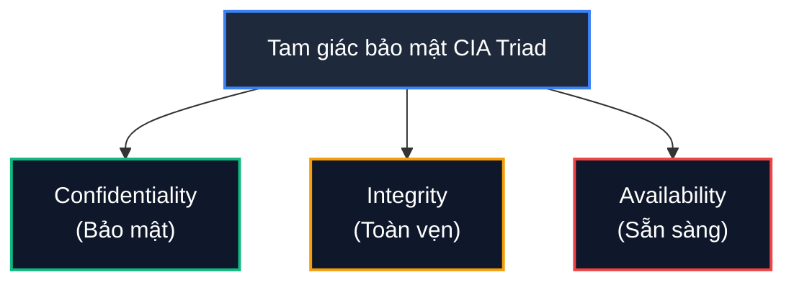
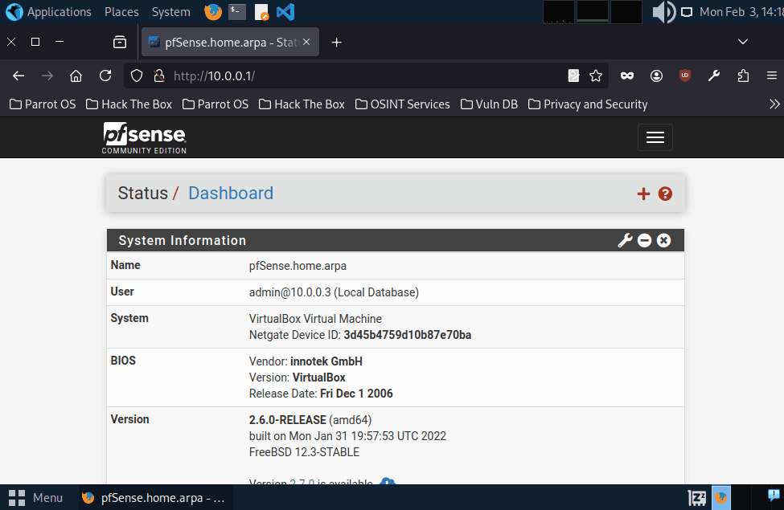
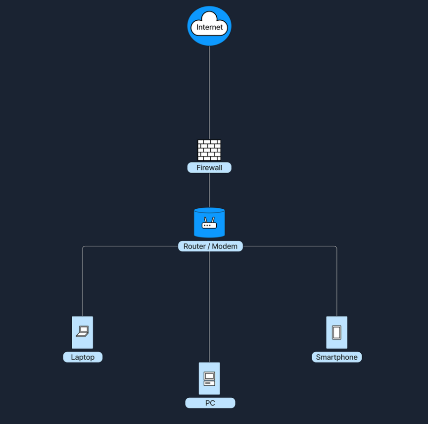
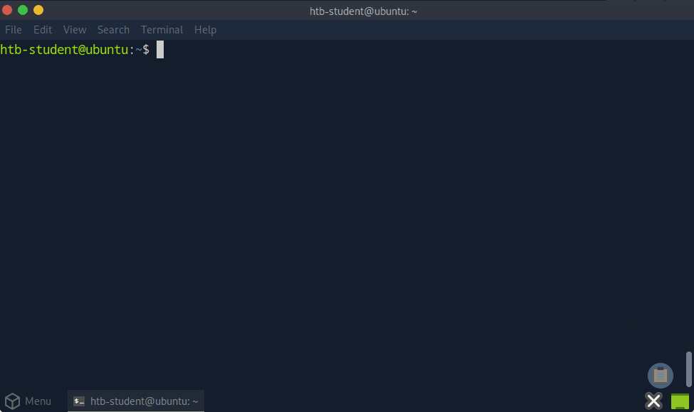
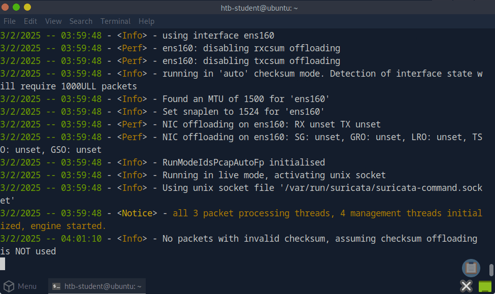
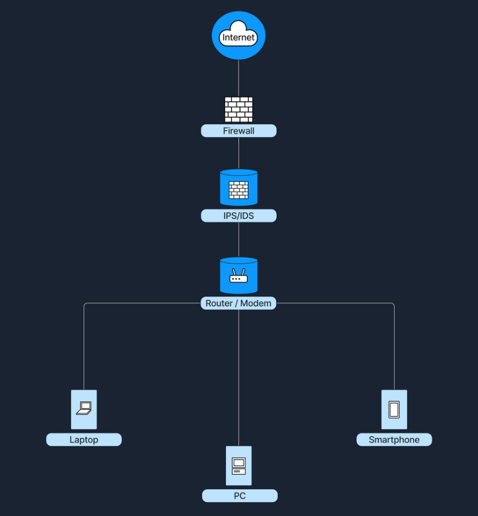
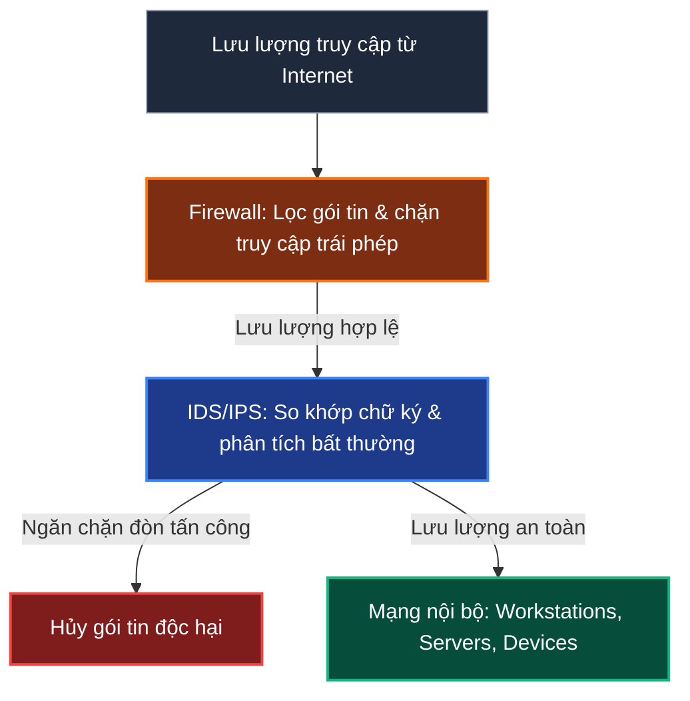

# Network Security

Trong lĩnh vực mạng máy tính, thuật ngữ **Network Security** (Bảo mật mạng) đề cập đến tập hợp các biện pháp, công nghệ và quy trình được triển khai nhằm bảo vệ dữ liệu, ứng dụng, thiết bị và toàn bộ hệ thống mạng khỏi các hành vi truy cập trái phép, tấn công hoặc phá hoại.

Mục tiêu tối thượng của bảo mật mạng là thiết lập, duy trì và củng cố mô hình tam giác bảo mật kinh điển **CIA Triad**:

| Nguyên tắc | Mô tả chi tiết |
| :--- | :--- |
| **Confidentiality** (Tính bảo mật) | Đảm bảo dữ liệu chỉ có thể được truy cập và đọc bởi những người dùng hoặc hệ thống đã được cấp quyền hợp lệ. Ngăn chặn rò rỉ thông tin nhạy cảm. |
| **Integrity** (Tính toàn vẹn) | Đảm bảo dữ liệu luôn chính xác, nhất quán và không bị chỉnh sửa, giả mạo hoặc xóa bỏ trái phép trong suốt quá trình lưu trữ hay truyền tải qua mạng. |
| **Availability** (Tính sẵn sàng) | Đảm bảo các tài nguyên mạng, hệ thống và dữ liệu luôn sẵn sàng phục vụ khi người dùng hợp pháp cần truy cập, không bị gián đoạn bởi sự cố hay tấn công từ chối dịch vụ. |

Để hiện thực hóa và bảo vệ tam giác CIA, hạ tầng mạng phụ thuộc rất lớn vào hai thành phần phòng thủ trọng yếu: **Firewall** và **Intrusion Detection/Prevention Systems (IDS/IPS)**.

---

## 1. Firewalls

### Firewall là gì?

**Firewall** là một thiết bị hoặc giải pháp bảo mật mạng (dưới dạng phần cứng chuyên dụng, phần mềm, hoặc sự kết hợp của cả hai) có nhiệm vụ giám sát, kiểm soát và điều phối toàn bộ lưu lượng mạng ra vào (**inbound** và **outbound traffic**).

Firewall hoạt động dựa trên một bộ quy tắc được định nghĩa trước, gọi là **Firewall Policies** hoặc **Access Control Lists (ACL)**, để đưa ra quyết định cho phép (**allow/permit**) hay chặn đứng (**block/deny**) các packet cụ thể.

> **Hình tượng thực tế:** Hãy tưởng tượng Firewall giống như một nhân viên bảo vệ túc trực tại cửa ngõ tòa nhà. Bảo vệ sẽ kiểm tra danh tính của từng người muốn ra vào dựa trên danh sách khách mời (Guest List). Bất kỳ ai không đáp ứng đúng tiêu chí quy định sẽ ngay lập tức bị từ chối vào cửa.

Một trong những giải pháp Firewall/Router mã nguồn mở phổ biến và mạnh mẽ nhất hiện nay là **pfSense**. Nhờ hệ thống plugin (gọi là "Packages") phong phú, pfSense có thể mở rộng tính năng không giới hạn từ định tuyến cơ bản đến bảo mật nâng cao:

---

### Cơ chế hoạt động của Firewall

Firewall kiểm tra các gói tin dữ liệu (**packets**) dựa trên các tiêu chí cốt lõi:
- **Source & Destination IP Address** (Địa chỉ IP nguồn và đích).
- **Source & Destination Port Number** (Cổng dịch vụ nguồn và đích).
- **Protocol type** (TCP, UDP, ICMP, v.v.).

Quá trình này được gọi là **Traffic Filtering**. Quản trị viên hệ thống sẽ cấu hình các điều kiện cụ thể để chỉ những kết nối hợp lệ mới được đi qua. Ngoài ra, Firewall còn thực hiện ghi nhật ký (**logging**) và phát cảnh báo (**alerts**) khi phát hiện các hành vi bất thường.

---

### Phân loại các dòng Firewall phổ biến

Dựa trên nguyên lý hoạt động và tầng trong mô hình OSI, Firewall được chia thành 4 loại chính:

#### 1. Packet Filtering Firewall
- **Tầng hoạt động:** Layer 3 (Network) và Layer 4 (Transport) trong mô hình OSI.
- **Cách thức:** Kiểm tra từng packet độc lập dựa trên source/destination IP, source/destination port và protocol. Firewall không theo dõi trạng thái phiên kết nối.
- **Ví dụ:** Cấu hình Access Control List (ACL) đơn giản trên Router chỉ cho phép cổng HTTP (port 80) và HTTPS (port 443), đồng thời chặn toàn bộ các cổng còn lại.

#### 2. Stateful Inspection Firewall
- **Cách thức:** Theo dõi toàn bộ trạng thái của một phiên kết nối mạng (State Table). Thiết bị ghi nhớ ngữ cảnh giao tiếp giữa hai máy chủ.
- **Ưu điểm:** Thông minh hơn hẳn Packet Filter vì hiểu được ngữ cảnh của cuộc hội thoại mạng.
- **Ví dụ:** Khi máy tính nội bộ gửi yêu cầu ra ngoài web server, Firewall ghi nhận trạng thái kết nối outbound này. Khi web server phản hồi về (inbound), Firewall nhận biết đây là luồng phản hồi hợp lệ cho yêu cầu trước đó và cho phép đi qua; ngược lại, nếu một luồng dữ liệu inbound từ bên ngoài tự ý gửi tới mà không khớp với bất kỳ phiên kết nối hợp lệ nào đã mở, nó sẽ bị chặn ngay lập tức.

#### 3. Application Layer Firewall (Proxy Firewall)
- **Tầng hoạt động:** Hoạt động lên đến Layer 7 (Application) của mô hình OSI.
- **Cách thức:** Đứng làm proxy giữa client nội bộ và server bên ngoài. Loại Firewall này có thể giải mã và kiểm tra sâu vào nội dung dữ liệu thực tế của ứng dụng (ví dụ: HTTP header, URL request, payload, cookie) để phát hiện và ngăn chặn các mã độc hoặc payload tấn công (như SQL Injection, XSS).
- **Ví dụ:** Một Web Application Proxy phân tích các HTTP request và chặn đứng các request chứa tham số độc hại hướng vào web server.

#### 4. Next-Generation Firewall (NGFW)
- **Cách thức:** Tích hợp sức mạnh của Stateful Inspection với hàng loạt tính năng bảo mật tiên tiến: kiểm tra gói tin sâu (**Deep Packet Inspection - DPI**), tích hợp sẵn IDS/IPS, kiểm soát ứng dụng (**Application Control**), nhận diện người dùng, và phân tích các luồng dữ liệu mã hóa (SSL/TLS Inspection).
- **Ví dụ:** Một thiết bị NGFW hiện đại có khả năng tự động chặn các IP độc hại từ Threat Intelligence feeds, giải mã lưu lượng mã hóa để quét malware, và thực thi chính sách cấm ứng dụng P2P hoặc mạng xã hội.

---

### Vị trí đặt Firewall trong mô hình mạng

Firewall đứng án ngữ tại ranh giới giữa Internet công cộng và mạng nội bộ, chịu trách nhiệm rà soát mọi luồng dữ liệu trước khi cho phép đi vào:

- **Trong môi trường mạng gia đình:** Router/Modem thường tích hợp sẵn một Firewall dạng phần mềm (software-based). Trong trường hợp này, toàn bộ chức năng định tuyến, phát Wi-Fi và tường lửa nằm gọn trong cùng một thiết bị vật lý.
- **Trong môi trường doanh nghiệp lớn:** Firewall thường là một thiết bị phần cứng độc lập chuyên dụng, được đặt ngay sau Router/Modem ngoài rìa và trước hệ thống mạng nội bộ. Thiết kế này bắt buộc 100% lưu lượng truy cập phải đi qua Firewall để kiểm duyệt.

---

## 2. Intrusion Detection and Prevention Systems (IDS/IPS)

### Khái niệm IDS và IPS

**Intrusion Detection and Prevention Systems (IDS/IPS)** là các giải pháp an ninh chuyên sâu được thiết kế để liên tục giám sát và phản ứng trước các hoạt động đáng ngờ trên mạng hoặc trên hệ thống máy chủ:

- **Intrusion Detection System (IDS):** Là hệ thống phát hiện xâm nhập. IDS theo dõi lưu lượng mạng hoặc các sự kiện hệ thống để nhận diện hành vi độc hại hoặc vi phạm chính sách an toàn. Khi phát hiện dấu hiệu bất thường, IDS sẽ ghi nhận và tạo cảnh báo (**alert**) gửi tới đội ngũ bảo mật (SOC/Admin), nhưng **không can thiệp trực tiếp để chặn** gói tin.
- **Intrusion Prevention System (IPS):** Là hệ thống ngăn chặn xâm nhập. IPS hoạt động tương tự như IDS nhưng tiến thêm một bước mang tính quyết định: **chủ động ngăn chặn, hủy bỏ hoặc từ chối gói tin độc hại theo thời gian thực (inline)** trước khi chúng kịp tiếp cận mục tiêu.

> **Điểm khác biệt cốt lõi:**  
> - **IDS:** Phát hiện và Cảnh báo (Detect & Alert - thụ động).  
> - **IPS:** Phát hiện và Chủ động ngăn chặn (Detect & Prevent - chủ động theo thời gian thực).

Một giải pháp an ninh nguồn mở nổi tiếng và được triển khai rộng rãi trên toàn cầu là **Suricata**. Suricata sở hữu kiến trúc đa luồng hiệu năng cao và có thể hoạt động linh hoạt ở cả hai chế độ IDS lẫn IPS.

Dưới đây là hình ảnh minh họa quản trị viên kích hoạt một rule nhận diện và bắt đầu tiến trình giám sát inline:

---

### Kỹ thuật phân tích và nhận diện của IDS/IPS

Cả IDS và IPS đều phân tích nội dung gói tin mạng và so sánh với hai cơ chế nhận diện cơ bản:

| Kỹ thuật | Mô tả chi tiết | Ưu điểm & Thách thức |
| :--- | :--- | :--- |
| **Signature-based detection** | So khớp lưu lượng mạng với một cơ sở dữ liệu lưu trữ các signature (mẫu nhận diện) hoặc dấu vết của các vụ tấn công, lỗ hổng và mã độc đã biết. | - **Ưu điểm:** Độ chính xác rất cao với các mối đe dọa đã có chữ ký, tỷ lệ báo động nhầm (False Positive) thấp. - **Thách thức:** Bất lực trước các cuộc tấn công Zero-day hoặc biến thể mã độc mới chưa kịp cập nhật signature. |
| **Anomaly-based detection** | Thiết lập một đường chuẩn hành vi bình thường (baseline) của hệ thống và mạng. Bất kỳ lưu lượng hay hoạt động nào sai lệch đáng kể so với mức bình thường này đều bị gắn cờ là đáng ngờ. | - **Ưu điểm:** Có khả năng phát hiện các mối đe dọa mới lạ, các đòn tấn công chưa từng xuất hiện. - **Thách thức:** Dễ phát sinh cảnh báo giả (False Positive) khi có sự thay đổi đột ngột nhưng hợp lệ trong lưu lượng mạng. |

Khi phát hiện hành vi nguy hiểm, IDS sẽ phát ra cảnh báo chi tiết để phục vụ điều tra và phân tích:

---

### Phân loại IDS/IPS theo phạm vi triển khai

1. **Network-Based IDS/IPS (NIDS/NIPS):**
   - Là thiết bị phần cứng chuyên dụng hoặc phần mềm được đặt tại các vị trí chiến lược trên hạ tầng mạng (ví dụ: kết nối với cổng SPAN/Mirror trên Switch trung tâm) để giám sát toàn bộ lưu lượng qua lại trên phân đoạn mạng đó.
   - *Ví dụ:* Một cảm biến NIDS kết nối vào Core Switch để giám sát luồng lưu lượng nội bộ trong Data Center.

2. **Host-Based IDS/IPS (HIDS/HIPS):**
   - Được cài đặt trực tiếp trên từng máy chủ (host) hoặc thiết bị đầu cuối cụ thể. HIDS/HIPS giám sát lưu lượng inbound/outbound của riêng thiết bị đó, đồng thời theo dõi các file hệ thống, registry, tiến trình và system logs để phát hiện hành vi xâm phạm nội tại máy.
   - *Ví dụ:* Agent Endpoint Detection & Response (EDR) hoặc phần mềm an ninh máy chủ giám sát tính toàn vẹn của các tệp tin cấu hình nhạy cảm.

---

### Vị trí triển khai IDS/IPS trong mạng

Để đạt hiệu quả phòng thủ tối ưu, IDS/IPS thường được bố trí tại các vị trí quan trọng:

1. **Đứng sau Firewall:** Đây là vị trí phổ biến nhất. Firewall ở vòng ngoài sẽ sàng lọc các mối đe dọa thô sơ hoặc lưu lượng rõ ràng không hợp lệ (lọc cổng, IP). Sau đó, IDS/IPS sẽ thực hiện kiểm tra sâu vào phần lưu lượng còn lại để phát hiện các kỹ thuật tấn công tinh vi ẩn giấu trong dữ liệu hợp lệ.
2. **Trong vùng DMZ (Demilitarized Zone):** DMZ là vùng mạng trung lập, cách ly với mạng nội bộ nhưng tiếp xúc trực tiếp với Internet để phục vụ các dịch vụ công cộng (Web Server, Mail Server, DNS Server). Đặt IDS/IPS tại DMZ giúp giám sát chặt chẽ mọi tương tác ra vào các máy chủ công khai này.
3. **Trực tiếp trên thiết bị đầu cuối (Endpoint / Server):** Triển khai HIDS/HIPS ngay trên máy chủ trọng yếu để phát hiện các cuộc tấn công đã vượt qua lớp phòng thủ mạng biên hoặc các mối đe dọa xuất phát từ chính bên trong mạng nội bộ.

Mô hình triển khai kết hợp Firewall và hệ thống IDS/IPS đứng sau để bảo vệ toàn diện các thiết bị nội bộ:

---

## 3. Best Practices (Các nguyên tắc bảo mật mạng tốt nhất)

Để xây dựng một hệ thống mạng kiên cố và giảm thiểu tối đa rủi ro an ninh, các chuyên gia an ninh mạng luôn áp dụng các nguyên tắc sau:

| Biện pháp | Mô tả chi tiết |
| :--- | :--- |
| **Define Clear Policies** (Thiết lập chính sách rõ ràng) | Xây dựng các quy tắc Firewall nhất quán, chặt chẽ dựa trên **Nguyên tắc đặc quyền tối thiểu (Principle of Least Privilege)**: chỉ mở những cổng, địa chỉ IP và dịch vụ thực sự cần thiết cho công việc, mặc định chặn tất cả còn lại (Default Deny). |
| **Regular Updates** (Cập nhật định kỳ) | Thường xuyên cập nhật hệ điều hành, firmware của Firewall, cũng như cập nhật liên tục bộ quy tắc và chữ ký (signatures) của IDS/IPS để chống lại các mối đe dọa và lỗ hổng mới nhất. |
| **Monitor and Log Events** (Giám sát và ghi nhận nhật ký) | Định kỳ xem xét các bản ghi nhật ký (logs) của Firewall, cảnh báo IDS/IPS và log hệ thống. Sử dụng các hệ thống tập trung như SIEM để tương quan dữ liệu và phát hiện sớm các dấu hiệu xâm nhập. |
| **Layered Security** (Bảo vệ đa lớp / Defense in Depth) | Áp dụng chiến lược phòng thủ theo chiều sâu bằng cách xếp chồng nhiều lớp bảo vệ độc lập: kết hợp Firewall biên, NIDS/NIPS, phân đoạn mạng (VLAN/DMZ), phần mềm diệt virus/EDR, và bảo mật danh tính người dùng. Khi một lớp bị chọc thủng, các lớp sau vẫn sẵn sàng bảo vệ tài sản quan trọng. |
| **Periodic Penetration Testing** (Kiểm thử xâm nhập định kỳ) | Thường xuyên tổ chức các cuộc kiểm thử xâm nhập (Penetration Testing) và đánh giá lỗ hổng bảo mật nhằm mô phỏng các đòn tấn công thực tế, từ đó kiểm định tính hiệu quả của các chính sách và thiết bị an ninh mạng đang vận hành. |

---

## Tóm tắt kiến thức cốt lõi

- **Mục tiêu an ninh mạng:** Luôn bảo vệ và duy trì bộ ba **Confidentiality**, **Integrity**, và **Availability** (CIA Triad).
- **Firewall:** Là người gác cổng kiểm soát luồng giao tiếp mạng ra vào theo bộ quy tắc định sẵn (IP, Port, Protocol).
- **IDS vs IPS:** IDS phát hiện và gửi cảnh báo; IPS phát hiện và trực tiếp ngăn chặn gói tin độc hại trong thời gian thực.
- **Kỹ thuật phát hiện:** Kết hợp **Signature-based** (chuẩn xác với mối đe dọa đã biết) và **Anomaly-based** (bắt được các hành vi bất thường, zero-day).
- **Chiến lược:** Luôn áp dụng tư duy **Defense in Depth** (Phòng thủ đa tầng) và **Least Privilege** để bảo vệ tối đa hệ thống.
