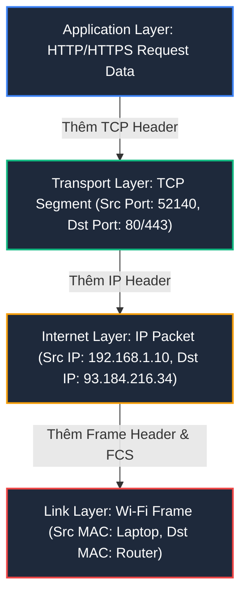
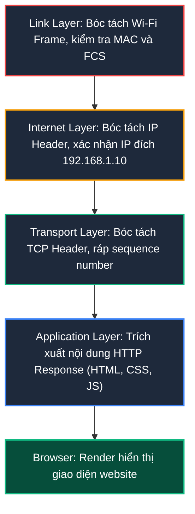
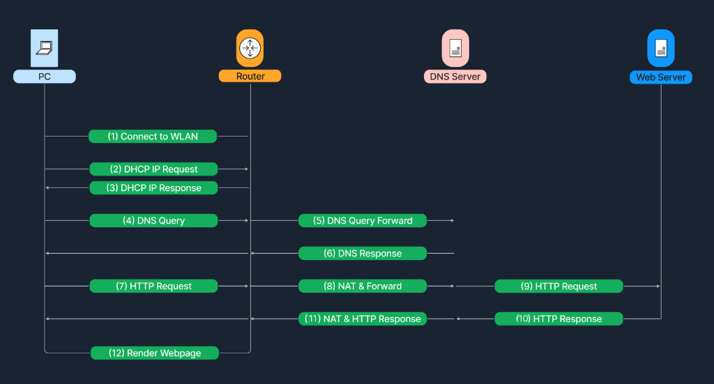
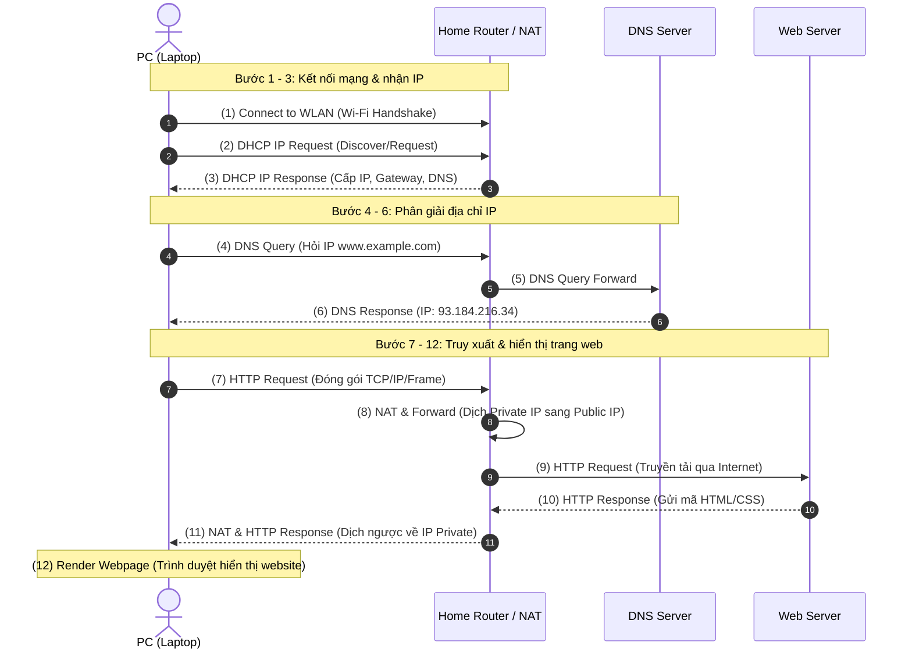

# Data Flow Example

Dựa trên toàn bộ nền tảng kiến thức mạng đã tích lũy từ các bài học trước (từ mô hình OSI/TCP-IP, địa chỉ IP/MAC, DHCP, DNS, NAT cho đến Firewall), bài học này sẽ xâu chuỗi mọi mảnh ghép lại với nhau. Chúng ta sẽ cùng theo dõi chi tiết **hành trình thực tế của dữ liệu (Data Flow)** khi một người dùng mở laptop và truy cập vào một trang web trên Internet theo mô hình Client - Server.

---

## Kịch bản thực tế

Hãy hình dung một nhân viên mở laptop tại nhà và chuẩn bị truy cập vào trang web `http://www.example.com` thông qua mạng Wi-Fi gia đình (Wireless LAN - WLAN).

Dưới đây là 7 giai đoạn diễn ra từ lúc thiết bị kết nối vào mạng cho đến khi trang web được hiển thị hoàn chỉnh trên màn hình.

---

## 1. Accessing the Internet

Trước khi bất kỳ dữ liệu web nào có thể truyền đi, laptop phải thiết lập kết nối với mạng Wi-Fi:

1. **Quét và nhận diện SSID:** Wireless NIC trên laptop quét và nhận diện đúng **SSID** của mạng.
2. **Xác thực:** Nếu mạng sử dụng **WPA2** hoặc **WPA3**, người dùng cung cấp mật khẩu/credentials để hoàn tất handshake.
3. **Thiết lập kết nối:** Khi xác thực thành công, kết nối ở tầng Data Link được hình thành, và **DHCP** sẽ tiếp quản để cấp cấu hình IP.

---

## 2. Checking Local Network Configuration (DHCP)

Khi người dùng mở browser và gõ `http://www.example.com`, browser chuẩn bị gửi HTTP request. Trước khi packet rời laptop, hệ điều hành kiểm tra xem máy đã có IP hợp lệ trong mạng LAN hay chưa:

| Bước | Mô tả chi tiết |
| :--- | :--- |
| **IP Address Assignment** | Nếu laptop chưa có IP, nó gửi yêu cầu đến DHCP Server trên Router qua tiến trình DORA (Discover - Offer - Request - Acknowledge). |
| **DHCP Acknowledgement** | DHCP Server cấp IP Private (ví dụ: `192.168.1.10`), kèm **Subnet Mask** (`255.255.255.0`), **Default Gateway** (`192.168.1.1`), và địa chỉ **DNS Server**. |

---

## 3. DNS Resolution

Laptop cần biết IP đích tương ứng với tên miền `www.example.com`:

| Bước | Mô tả chi tiết |
| :--- | :--- |
| **DNS Query** | Laptop gửi DNS Query hỏi địa chỉ IP của `www.example.com` đến DNS Server (của ISP hoặc Public DNS như `8.8.8.8`, `1.1.1.1`). |
| **DNS Response** | DNS Server phân giải tên miền và trả về IP tương ứng (ví dụ: `93.184.216.34`). |

---

## 4. Data Encapsulation & Local Network Transmission

Khi đã có IP đích (`93.184.216.34`), hệ điều hành bắt đầu tiến trình đóng gói dữ liệu (**Encapsulation**) qua các tầng của mô hình TCP/IP:

| Tầng mạng | Quá trình đóng gói cụ thể |
| :--- | :--- |
| **Application Layer** | Browser tạo **HTTP Request** (hoặc HTTPS Request). |
| **Transport Layer** | HTTP Request được bọc trong một **TCP Segment**, gắn thêm **Source Port** (port ngẫu nhiên tạm thời, ví dụ: `54321`) và **Destination Port** (port `80` cho HTTP hoặc `443` cho HTTPS). Tiến hành TCP Three-Way Handshake (SYN - SYN/ACK - ACK). |
| **Internet Layer** | TCP Segment được đặt vào bên trong một **IP Packet**, bổ sung **Source IP** (`192.168.1.10`) và **Destination IP** (`93.184.216.34`). |
| **Link Layer** | IP Packet được bọc vào **Wi-Fi Frame** (hoặc Ethernet Frame), gắn **Source MAC** (của laptop) và **Destination MAC** (của Router). |

> **Tìm kiếm địa chỉ MAC bằng ARP:**  
> Để biết Destination MAC của Router, laptop tra cứu bảng **ARP Table**. Nếu chưa có, laptop gửi **ARP Request** quảng bá trong mạng LAN để hỏi MAC address của Gateway `192.168.1.1`. Router phản hồi bằng **ARP Reply**. Sau khi hoàn tất frame, dữ liệu được truyền tới Router.

---

## 5. Network Address Translation (NAT)

Khi Router nhận được frame từ laptop:

1. **Xử lý Frame và IP Packet:** Router kiểm tra Destination MAC, thấy đúng địa chỉ của mình nên bóc Frame Header để lấy IP Packet bên trong.
2. **Thực thi NAT:** Vì IP Private (`192.168.1.10`) không thể định tuyến trên Internet, tính năng **NAT** trên Router thay thế Source IP `192.168.1.10` bằng **Public IP** của Router (ví dụ: `203.0.113.45`), đồng thời ghi nhận ánh xạ vào bảng NAT Table.
3. **Định tuyến ra Internet:** Router chuyển tiếp packet ra cổng WAN tới mạng của ISP.
4. **Truyền tải qua các Router trung gian:** Packet di chuyển qua các hop trên Internet để đến IP đích `93.184.216.34`.

---

## 6. Server Receives the Request & Responds

1. **Kiểm tra an ninh (Firewall):** Packet đi qua Firewall của server, kiểm tra xem cổng đến (Port 80/443) có được phép hay không.
2. **Xử lý ứng dụng:** Web server (Nginx, Apache, IIS) tiếp nhận request, chuẩn bị dữ liệu (HTML, CSS, JavaScript, ảnh) và gửi lại response.
3. **Đóng gói phản hồi:** Server tạo **HTTP Response** (`200 OK`) gửi ngược lại:
   - **Source IP:** `93.184.216.34` (Web Server).
   - **Destination IP:** `203.0.113.45` (Public IP của Router nhà người dùng).
4. **Reverse NAT:** Khi packet về đến Router gia đình, Router tra bảng NAT Table và đổi Destination IP `203.0.113.45` trở lại thành IP Private `192.168.1.10` rồi chuyển tiếp tới laptop qua Wi-Fi.

---

## 7. Decapsulation & Display

Khi laptop nhận được dữ liệu từ Router, tiến trình **Decapsulation** diễn ra theo chiều ngược lại:

1. **Link Layer:** Card mạng nhận tín hiệu, kiểm tra tính toàn vẹn (FCS/CRC), bóc bỏ Wi-Fi Frame Header.
2. **Internet Layer:** Bóc bỏ IP Header, xác nhận gói tin gửi đúng địa chỉ IP máy tính mình.
3. **Transport Layer:** Bóc bỏ TCP Header, sắp xếp lại các gói tin theo số thứ tự (Sequence Number) và chuyển dữ liệu tới đúng cổng mà trình duyệt đang lắng nghe.
4. **Application Layer:** Trình duyệt web trích xuất dữ liệu thô, thực thi JavaScript, áp dụng CSS, biên dịch HTML và kết xuất (render) giao diện trang web hoàn chỉnh lên màn hình người dùng.

---

## Data Flow Diagram (Sơ đồ tổng thể dòng dữ liệu)

Dưới đây là sơ đồ dòng dữ liệu (Flow Chart) mô tả 12 bước trong toàn bộ hành trình truy cập website từ thiết bị người dùng đến máy chủ web:

### Tóm tắt chuỗi tương tác 12 bước:

---

## Bảng đối chiếu các thành phần kỹ thuật tham gia

| Thành phần | Vai trò chính trong kịch bản | Giao thức / Công nghệ sử dụng |
| :--- | :--- | :--- |
| **WLAN** | Cung cấp kết nối vật lý không dây từ Laptop tới Router | Chuẩn Wi-Fi 802.11, mã hóa WPA2/WPA3 |
| **DHCP** | Tự động cấu hình IP, Subnet Mask, Gateway và DNS cho Client | DHCP (UDP Port 67/68) |
| **DNS** | Chuyển đổi tên miền thân thiện thành địa chỉ IP máy chủ | DNS (UDP/TCP Port 53) |
| **ARP** | Tìm địa chỉ MAC của Router (Default Gateway) trong mạng LAN | ARP (Address Resolution Protocol) |
| **TCP** | Đảm bảo truyền tải tin cậy, không mất gói giữa Client và Web Server | TCP (Port 80/443, cơ chế Three-Way Handshake) |
| **NAT** | Cho phép Laptop dùng IP Private giao tiếp với toàn thế giới qua 1 IP Public | NAPT / PAT trên Router |
| **Firewall** | Rà soát lưu lượng đến máy chủ để ngăn chặn lưu lượng trái phép | Firewall Rules, Stateful Inspection |
| **Web Server** | Tiếp nhận yêu cầu, xử lý và tạo nội dung phản hồi | HTTP/HTTPS (Nginx, Apache, IIS) |
