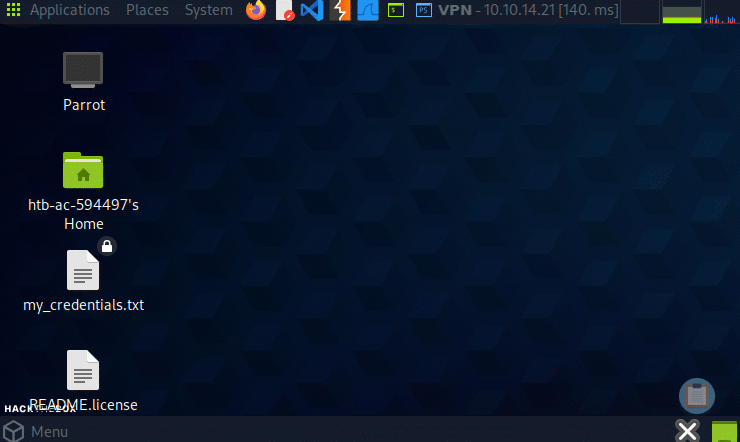
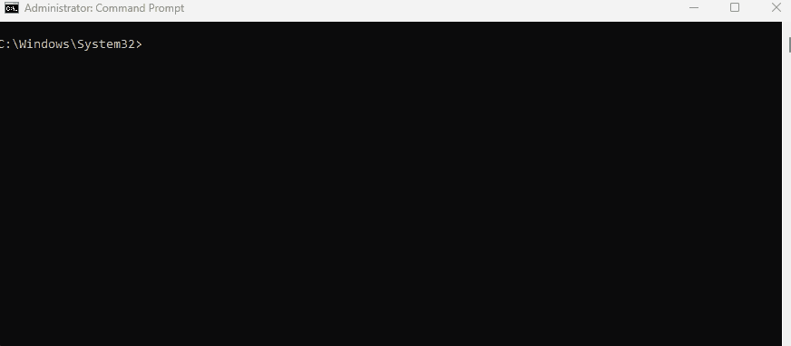
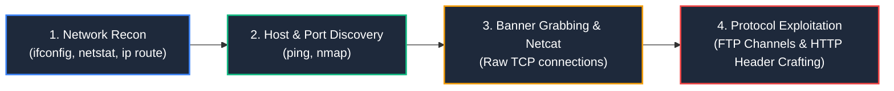

# Skills Assessment

Sau khi đã nắm vững các khái niệm nền tảng về mạng máy tính, đây là lúc chúng ta áp dụng toàn bộ kiến thức vào một kịch bản thực chiến. Trong bài đánh giá có hướng dẫn (Guided Assessment) này, chúng ta sẽ khám phá hạ tầng mạng đằng sau môi trường phòng thực hành (Lab Environment) của HTB Academy.

Bài đánh giá được chia thành 3 chương:
- **Chapter 1: Keep me in the Loop** (Tìm hiểu các interface mạng trên máy tấn công Pwnbox).
- **Chapter 2: Having Tuns of Fun** (Thiết lập kết nối VPN Tunnel và thăm dò mục tiêu).
- **Chapter 3: Target Acquired (Tùy chọn nâng cao)** (Tương tác thô với giao thức FTP và HTTP qua Netcat để tìm Flag).

---

## Chapter 1: Keep me in the Loop

Trong chương đầu tiên, chúng ta sẽ làm quen với **HTB Academy Pwnbox** - một cỗ máy Linux hoàn chỉnh chạy bản phân phối **Parrot OS**, có thể truy cập hoàn toàn thông qua trình duyệt web. Pwnbox đóng vai trò là trạm làm việc (Workstation / Attack Host) của bạn trong toàn bộ quá trình học tập.

Sau khi khởi chạy Pwnbox, hãy nhấn nút phóng to toàn màn hình và mở **Parrot Terminal** như hình minh họa:



---

### Khảo sát các Network Interface trên Pwnbox

Chúng ta bắt đầu bằng việc kiểm tra các card mạng (Network Interface) hiện có trên Pwnbox. Nhập lệnh sau vào Terminal và nhấn Enter:

```bash
ifconfig -a
```

> **Ghi chú về công cụ:** `ifconfig` được sử dụng để cấu hình và hiển thị trạng thái của các card mạng. Theo mặc định, lệnh chỉ hiển thị các interface đang hoạt động (active), nhưng tùy chọn `-a` sẽ buộc hiển thị tất cả các interface, bao gồm cả những card mạng đang tắt (down).

Kết quả hiển thị trên Terminal:

```text
┌─[eu-academy-1]─[10.10.14.21]─[htb-ac-594497@htb-5mix2gkv1a]─[~]
└──╼ [★]$ ifconfig -a
ens3: flags=4163<UP,BROADCAST,RUNNING,MULTICAST>  mtu 1500
        inet 209.50.61.235  netmask 255.255.252.0  broadcast 209.50.61.255
        inet6 fe80::a4ba:3bff:fe08:1e4e  prefixlen 64  scopeid 0x20<link>
        ether a6:ba:3b:08:1e:4e  txqueuelen 1000  (Ethernet)
        RX packets 30046  bytes 37369216 (35.6 MiB)
        RX errors 0  dropped 0  overruns 0  frame 0
        TX packets 20239  bytes 33367968 (31.8 MiB)
        TX errors 0  dropped 0  overruns 0  carrier 0  collisions 0

lo: flags=73<UP,LOOPBACK,RUNNING>  mtu 65536
        inet 127.0.0.1  netmask 255.0.0.0
        inet6 ::1  prefixlen 128  scopeid 0x10<host>
        loop  txqueuelen 1000  (Local Loopback)
        RX packets 44771  bytes 33774927 (32.2 MiB)
        RX errors 0  dropped 0  overruns 0  frame 0
        TX packets 44771  bytes 33774927 (32.2 MiB)
        TX errors 0  dropped 0  overruns 0  carrier 0  collisions 0

tun0: flags=4305<UP,POINTOPOINT,RUNNING,NOARP,MULTICAST>  mtu 1500
        inet 10.10.14.21  netmask 255.255.254.0  destination 10.10.14.21
        inet6 dead:beef:2::11bb  prefixlen 64  scopeid 0x0<global>
        inet6 fe80::3c16:f601:d437:d71b  prefixlen 64  scopeid 0x20<link>
        unspec 00-00-00-00-00-00-00-00-00-00-00-00-00-00-00-00  txqueuelen 500  (UNSPEC)
        RX packets 164  bytes 13776 (13.4 KiB)
        RX errors 0  dropped 0  overruns 0  frame 0
        TX packets 170  bytes 14064 (13.7 KiB)
        TX errors 0  dropped 0  overruns 0  carrier 0  collisions 0
```

Chúng ta thấy 3 interface riêng biệt:
1. `ens3`: Card mạng Ethernet vật lý kết nối ra Internet công cộng với địa chỉ Public IP `209.50.61.235`.
2. `lo`: Loopback interface nội bộ với địa chỉ IP `127.0.0.1`.
3. `tun0`: VPN tunnel interface với địa chỉ Private IP `10.10.14.21`.

---

### Tìm hiểu về Loopback Interface (`lo`)

Interface `lo` có những đặc điểm rất khác biệt so với các interface thông thường:
- **MTU (Maximum Transmission Unit):** Đạt tới `65536` bytes (lớn hơn rất nhiều so với chuẩn 1500 của Ethernet) vì dữ liệu chỉ luân chuyển trong bộ nhớ RAM máy tính, không bị giới hạn bởi cáp vật lý.
- **Địa chỉ IP:** Luôn gắn liền với `127.0.0.1` (IPv4) và `::1` (IPv6).
- **Phạm vi Scope:** Có `scopeid 0x10<host>` thay vì `<link>`.

**Mục đích của Loopback Address:**
- **Kiểm thử cục bộ (Testing):** Cho phép lập trình viên chạy thử nghiệm ứng dụng web hoặc dịch vụ mạng trên máy cá nhân mà không cần phát dữ liệu ra ngoài Internet.
- **Ẩn giấu và bảo vệ dịch vụ backend:** Các dịch vụ nhạy cảm như Cơ sở dữ liệu (Database) có thể được cấu hình chỉ lắng nghe trên `127.0.0.1`. Khi đó, người dùng từ bên ngoài Internet hoàn toàn không thể kết nối trực tiếp vào Database, mà phải đi qua ứng dụng web trung gian đóng vai trò API.

---

### Kiểm tra các cổng đang mở với `netstat`

Để xem những dịch vụ nào đang chạy và lắng nghe trên Pwnbox, chạy lệnh:

```bash
netstat -tulnp4
```

> **Giải thích tham số:**
> - `-t`: Hiển thị kết nối TCP.
> - `-u`: Hiển thị kết nối UDP.
> - `-l`: Chỉ liệt kê các cổng đang ở trạng thái lắng nghe (Listening).
> - `-n`: Hiển thị trực tiếp dạng số (IP:PORT) thay vì cố phân giải tên miền/tên dịch vụ.
> - `-p`: Hiển thị PID và tên chương trình (Program name).
> - `-4`: Chỉ lọc các kết nối IPv4.

Kết quả thu được:

```text
Active Internet connections (only servers)
Proto Recv-Q Send-Q Local Address           Foreign Address         State       PID/Program name    
tcp        0      0 127.0.0.1:5901          0.0.0.0:*               LISTEN      2814/Xtigervnc      
tcp        0      0 127.0.0.1:631           0.0.0.0:*               LISTEN      -                   
tcp        0      0 0.0.0.0:22              0.0.0.0:*               LISTEN      -                   
tcp        0      0 0.0.0.0:111             0.0.0.0:*               LISTEN      -                   
tcp        0      0 209.50.61.235:80        0.0.0.0:*               LISTEN      -                   
udp        0      0 0.0.0.0:5353            0.0.0.0:*                           -                   
udp        0      0 0.0.0.0:43446           0.0.0.0:*                           -                   
udp        0      0 0.0.0.0:68              0.0.0.0:*                           -                   
udp        0      0 0.0.0.0:111             0.0.0.0:*                           -                   
udp        0      0 10.10.14.21:123         0.0.0.0:*                           -                   
udp        0      0 209.50.62.174:123       0.0.0.0:*                           -                   
udp        0      0 127.0.0.1:123           0.0.0.0:*                           -                   
udp        0      0 0.0.0.0:123             0.0.0.0:*                           -                   
udp        0      0 0.0.0.0:631             0.0.0.0:*                           -                   
udp        0      0 0.0.0.0:33423           0.0.0.0:*                           -
```

Tiếp tục chạy lệnh khi bỏ tùy chọn `-n`:

```bash
netstat -tulp4
```

Khi bỏ `-n`, các địa chỉ số sẽ được phân giải thành tên:
- `127.0.0.1` được hiển thị thành `localhost`.
- Cổng `80` hiển thị thành `http`, cổng `22` thành `ssh`.
- `0.0.0.0` đại diện cho việc dịch vụ đang lắng nghe trên **tất cả** các interface mạng của máy.

**Phân tích kết nối Web của Pwnbox:**
1. Pwnbox đang lắng nghe trên cổng `80` với IP công cộng `209.50.61.235` (interface `ens3`). Đây chính là cách máy tính cá nhân của chúng ta kết nối và hiển thị Pwnbox thông qua trình duyệt web bằng giao thức HTTP.
2. Dịch vụ đồ họa `Xtigervnc` (VNC - Virtual Network Computing) đang chạy trên cổng `5901` gắn với địa chỉ `127.0.0.1`.
3. Để bạn có thể nhìn thấy màn hình máy tính từ xa trong trình duyệt, hệ thống đã sử dụng kỹ thuật **Port Forwarding**: Lưu lượng HTTP gửi tới cổng 80 được chuyển tiếp vào dịch vụ VNC trên loopback address.



---

## Chapter 2: Having Tuns of Fun

Sau khi tìm hiểu `ens3` (Public IP) và `lo` (Loopback), chúng ta còn một interface quan trọng: **`tun0`**.

`tun0` là viết tắt của **Tunnel Interface**, đại diện cho kết nối **VPN (Virtual Private Network)**. Vì các cỗ máy mục tiêu trong phòng lab của HTB nằm trong một mạng riêng biệt (Private Lab Network), Pwnbox phải thiết lập một đường hầm bảo mật mã hóa để chúng ta có thể định tuyến lưu lượng tới chúng.

---

### Kiểm tra bảng định tuyến với `ip route`

Khởi chạy máy mục tiêu trên HTB Academy và lấy địa chỉ IP mục tiêu (ví dụ: `10.129.233.197`).

Chạy lệnh sau trên Terminal để kiểm tra đường đi của gói tin:

```bash
ip route get 10.129.233.197
```

Kết quả:

```text
10.129.233.197 via 10.10.14.1 dev tun0 src 10.10.14.21 uid 1002 cache
```

Lệnh xác nhận rõ ràng: Mọi gói tin hướng tới mục tiêu `10.129.233.197` đều được chuyển hướng qua thiết bị `tun0` với địa chỉ nguồn là `10.10.14.21`.

---

### Kiểm tra khả năng tiếp cận mục tiêu bằng `ping`

`ping` là tiện ích mạng kinh điển dùng để kiểm tra tính khả dụng (reachability) của máy chủ đích. `ping` sử dụng giao thức **ICMP** (thuộc Layer 3 trong mô hình OSI, không sử dụng cổng TCP hay UDP).

Chạy lệnh ping 4 gói tin tới máy mục tiêu:

```bash
ping -c 4 10.129.233.197
```

> **Lưu ý:** Trên Linux, nếu không thêm cờ `-c 4`, lệnh `ping` sẽ chạy liên tục không ngừng cho đến khi bạn bấm tổ hợp phím `Ctrl + C`.

Kết quả:

```text
PING 10.129.233.197 (10.129.233.197) 56(84) bytes of data.
64 bytes from 10.129.233.197: icmp_seq=1 ttl=127 time=71.6 ms
64 bytes from 10.129.233.197: icmp_seq=2 ttl=127 time=71.3 ms
64 bytes from 10.129.233.197: icmp_seq=3 ttl=127 time=71.8 ms
64 bytes from 10.129.233.197: icmp_seq=4 ttl=127 time=71.2 ms

--- 10.129.233.197 ping statistics ---
4 packets transmitted, 4 received, 0% packet loss, time 3003ms
rtt min/avg/max/mdev = 71.205/71.470/71.776/0.223 ms
```

**Các thông số quan trọng:**
- **`0% packet loss`:** Kết nối thông suốt, máy mục tiêu đang hoạt động.
- **`time` (Latency / RTT):** Thời gian khứ hồi của gói tin (khoảng 71 ms).
- **`ttl` (Time To Live):** Giá trị TTL ban đầu bị giảm đi 1 sau mỗi lần qua một router (hop). Giá trị `ttl=127` gợi ý mục tiêu nhiều khả năng là một máy chủ chạy hệ điều hành **Windows** (Windows thường có TTL mặc định là 128).

---

### Quét cổng dịch vụ từ xa bằng `nmap`

Sau khi xác nhận máy mục tiêu đang hoạt động, bước tiếp theo là xác định các cổng TCP/UDP đang mở trên máy đó bằng công cụ **Nmap**:

```bash
nmap 10.129.233.197
```

Kết quả quét:

```text
Starting Nmap 7.94SVN ( https://nmap.org ) at 2025-02-08 18:07 CST
Nmap scan report for 10.129.233.197
Host is up (0.073s latency).
Not shown: 993 closed tcp ports (reset)
PORT     STATE SERVICE
21/tcp   open  ftp
80/tcp   open  http
135/tcp  open  msrpc
139/tcp  open  netbios-ssn
445/tcp  open  microsoft-ds
3389/tcp open  ms-wbt-server
5357/tcp open  wsdapi
```

**Phân tích các dịch vụ:**
- Các cổng `135`, `139`, `445`: Cụm dịch vụ chia sẻ file và RPC đặc trưng của hệ điều hành **Windows**.
- Cổng `3389`: Dịch vụ **RDP (Remote Desktop Protocol)** dùng để điều khiển máy tính từ xa trên Windows.
- Cổng `5357`: **WSDAPI (Web Services for Devices)** dùng cho việc dò tìm thiết bị trong mạng Windows.
- Cổng `21`: Dịch vụ truyền tệp **FTP**.
- Cổng `80`: Dịch vụ web **HTTP**.

---

## Chapter 3: Target Acquired (Tùy chọn nâng cao)

Trong chương này, chúng ta sẽ đào sâu vào hai cổng phổ biến nhất: **Port 21 (FTP)** và **Port 80 (HTTP)**.

Chạy lệnh Nmap nâng cao với các cờ phiên bản và script:

```bash
nmap -p21,80 -sC -sV 10.129.233.197
```

> **Giải thích:**
> - `-p21,80`: Chỉ định quét đích danh cổng 21 và 80.
> - `-sV`: Version detection (Xác định phiên bản phần mềm dịch vụ).
> - `-sC`: Chạy các bộ script mặc định (Default NSE scripts).

Kết quả quét chi tiết:

```text
PORT   STATE SERVICE VERSION
21/tcp open  ftp     Microsoft ftpd
| ftp-syst: 
|_  SYST: Windows_NT
|_ftp-anon: Anonymous FTP login allowed (FTP code 230)
80/tcp open  http    Microsoft HTTPAPI httpd 2.0 (SSDP/UPnP)
Service Info: OS: Windows; CPE: cpe:/o:microsoft:windows
```

Nmap phát hiện:
- Dịch vụ FTP cho phép **Anonymous Login** (đăng nhập ẩn danh mà không cần tài khoản cá nhân).
- Cổng 80 không hiển thị rõ thông tin web server như Apache hay Nginx. Điều này cho thấy máy chủ web có thể đang áp dụng một cơ chế lọc yêu cầu (**Request Filtering**).

> **Cảnh báo đạo đức:** Việc quét cổng (Port Scanning) hoặc can thiệp vào các hệ thống không thuộc quyền sở hữu của bạn hoặc chưa được cấp phép bằng văn bản rõ ràng là hành vi phi đạo đức và có thể vi phạm pháp luật. Chỉ thực hành trên các môi trường lab hợp pháp như HTB Academy.

---

### Khám phá dịch vụ FTP trên Port 21 bằng Netcat

Thay vì dùng phần mềm FTP Client đồ họa, chúng ta sử dụng **Netcat (`nc`)** để truyền nhận dữ liệu thô (Raw TCP) nhằm hiểu tận gốc giao thức FTP:

```bash
nc 10.129.233.197 21
```

Banner chào mừng xuất hiện: `220 Microsoft FTP Service`.

Giao thức FTP hoạt động trên **hai kênh riêng biệt**:
1. **Control Channel (Port 21):** Dùng để gửi các lệnh điều khiển (`USER`, `PASS`, `PASV`, `LIST`, `RETR`).
2. **Data Channel (Cổng động):** Dùng để truyền nội dung tệp tin hoặc danh sách thư mục.

Đăng nhập ẩn danh và yêu cầu chuyển sang chế độ **Passive Mode (`PASV`)**:

```text
USER anonymous
PASS anything
PASV
```

> **Lưu ý cú pháp:** Trong Netcat, giao thức FTP yêu cầu ký tự ngắt dòng chuẩn `\r\n`. Do đó, sau mỗi lệnh, bạn cần nhấn tổ hợp phím `[Ctrl + V]` rồi nhấn `[Enter]` hai lần để chèn ký tự `^M`.

Phản hồi từ FTP Server:

```text
227 Entering Passive Mode (10,129,233,197,194,40).
```

#### Công thức tính cổng Data Channel trong Passive Mode
FTP biểu diễn cổng động dưới dạng 2 số cuối `p1, p2`:
$$\text{Port} = (p1 \times 256) + p2$$

Với `194, 40`:
$$\text{Port} = (194 \times 256) + 40 = 49664 + 40 = 49704$$

Mở một cửa sổ Parrot Terminal thứ hai và kết nối vào Data Channel:

```bash
nc -v 10.129.233.197 49704
```

Quay lại Terminal đầu tiên (Control Channel) và gửi lệnh liệt kê file:

```text
LIST
```

Trên Terminal thứ hai (Data Channel), danh sách file xuất hiện:

```text
02-08-25  08:37PM                  438 Note-From-IT.txt
```

Chúng ta thấy file `Note-From-IT.txt`. Để tải file này:
1. Trên Control Channel, gửi tiếp lệnh `PASV` để lấy cổng dữ liệu mới:
   `227 Entering Passive Mode (10,129,233,197,194,50).`
2. Tính cổng mới: $194 \times 256 + 50 = 49714$.
3. Trên Terminal thứ hai, kết nối tới cổng mới: `nc -v 10.129.233.197 49714`.
4. Trên Control Channel, phát lệnh tải file: `RETR Note-From-IT.txt`.

Nội dung ghi chú hiện ra trên Terminal thứ hai:

```text
Bertolis,

The website is still under construction. To stop users from poking their nose 
where it doesn't belong, I've configured IIS to only allow requests containing 
a specific user-agent header. 

If you'd like to test it out, please provide the following header to your HTTP request.

User-Agent: Server Administrator

The site should be finished within the next couple of weeks. I'll keep you posted.

Cheers,
jarednexgent
```

Ghi chú tiết lộ một bí mật an ninh: Máy chủ web **Microsoft IIS** đã cấu hình bộ lọc chỉ chấp nhận các yêu cầu HTTP có chứa header đặc biệt:  
`User-Agent: Server Administrator`.

---

### Khai thác dịch vụ HTTP trên Port 80 bằng Netcat

Bây giờ chúng ta sẽ dùng Netcat gửi trực tiếp một HTTP Request tùy biến có chứa User-Agent hợp lệ tới cổng 80:

```bash
nc -v 10.129.233.197 80
```

Nhập cú pháp HTTP Request thủ công:

```http
GET / HTTP/1.1
Host: 10.129.233.197
User-Agent: Server Administrator

```

> **Lưu ý:** Sau dòng `User-Agent: Server Administrator`, nhấn Enter hai lần để biểu thị kết thúc phần HTTP Header.

Máy chủ phản hồi ngay lập tức:

```html
HTTP/1.1 200 OK
Content-Type: text/html
Accept-Ranges: bytes
ETag: "5acd7854a179db1:0"
Server: Microsoft-IIS/10.0
Date: Tue, 5 Feb 2025 00:44:43 GMT
Content-Length: 746

<!DOCTYPE html PUBLIC "-//W3C//DTD XHTML 1.0 Strict//EN" "http://www.w3.org/TR/xhtml1/DTD/xhtml1-strict.dtd">
<html xmlns="http://www.w3.org/1999/xhtml">
<head>
<meta http-equiv="Content-Type" content="text/html; charset=iso-8859-1" />
<title>IIS Windows Server</title>
<style type="text/css">
<!--
body {
	color:#000000;
	background-color:#0072C6;
	margin:0;
}
#container {
	margin-left:auto;
	margin-right:auto;
	text-align:center;
}
a img {
	border:none;
}
-->
</style>
</head>
<body>
<div id="container">
	<a href="http://go.microsoft.com/fwlink/?linkid=66138&amp;clcid=0x409"></a>
</div>
</body>
</html>
<!-- HTB{REDACTED} -->
```

Trong phần mã nguồn HTML trả về, chúng ta nhìn thấy một **Flag** nằm ẩn trong thẻ chú thích (comment):  
`<!-- HTB{REDACTED} -->`!

---

## Tóm tắt kỹ năng đạt được qua bài Lab



1. **Hiểu rõ các loại Network Interface:** `ens3` (Public/WAN), `lo` (Loopback 127.0.0.1 phục vụ IPC/testing), và `tun0` (VPN Tunnel kết nối mạng lab HTB).
2. **Kỹ thuật Port Forwarding:** Hiểu cách thức lưu lượng từ cổng công cộng được chuyển hướng vào các dịch vụ chạy trên loopback.
3. **Phân tích lưu lượng Layer 3 / Layer 4:** Sử dụng `ping` để đo độ trễ và ước lượng hệ điều hành qua TTL; dùng `nmap` để phát hiện các dịch vụ đang mở.
4. **Bản chất của giao thức mạng:**
   - **FTP:** Tách biệt giữa Control Channel (Port 21) và Data Channel (cổng động tính toán qua công thức $p1 \times 256 + p2$).
   - **HTTP:** Cấu trúc Header - Body và cơ chế lọc request (Request Filtering) qua User-Agent.
