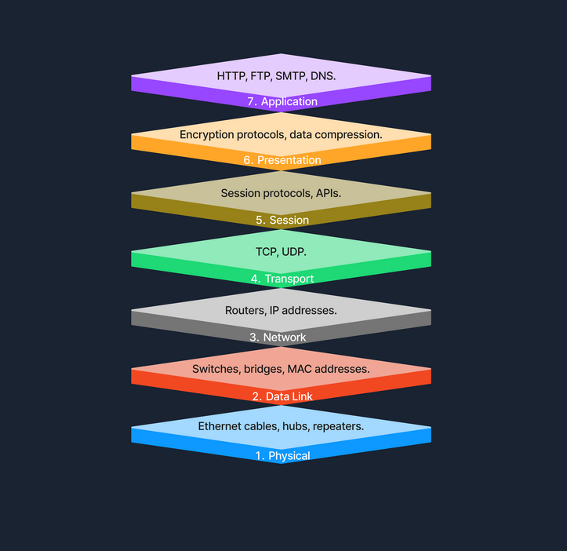
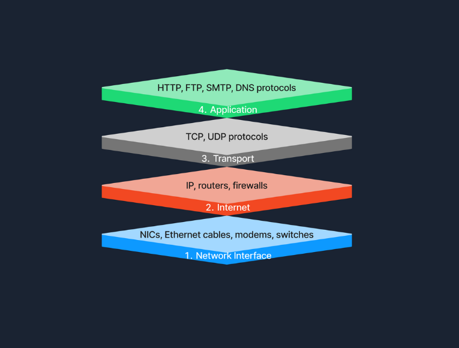
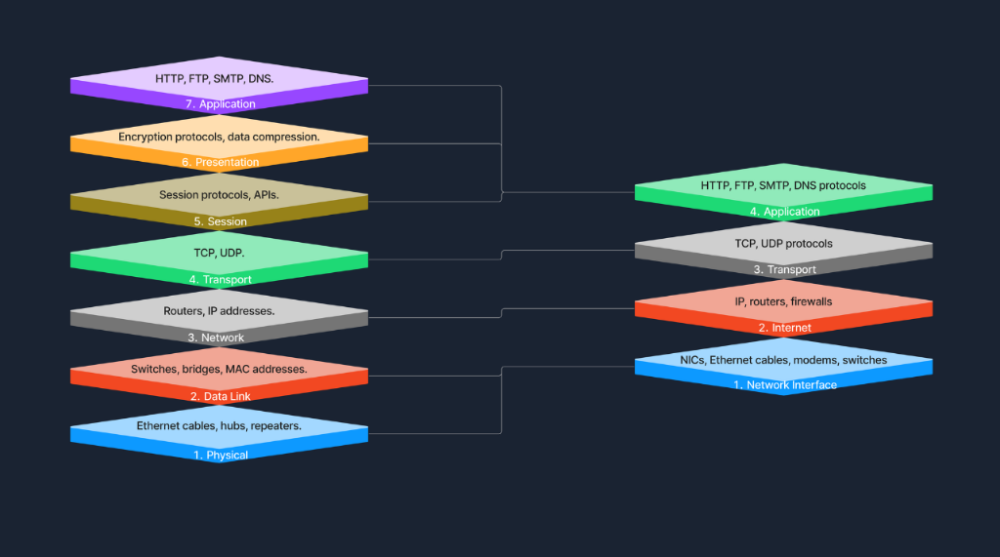

# 2. Network Concepts

Hiểu rõ những thành phần cốt lõi và cơ chế vận hành đằng sau networking là điều tối quan trọng trong an ninh mạng. Tuy nhiên, không phải ai cũng nhận thức được mức độ phổ biến đến mức hiển nhiên của network trong đời sống hiện đại. Toàn bộ hạ tầng công nghệ đồ sộ ngày nay - từ thiết bị điện tử tiêu dùng, thiết bị giải trí đa phương tiện, phần cứng, phần mềm cho đến firmware - đều được xây dựng song hành cùng (hoặc phát triển trên nền tảng của) giao thức **TCP/IP stack**.

Trong bài học này, chúng ta sẽ cùng đi qua những khái niệm trọng tâm giúp bạn hình dung rõ nét cách mà networking gắn kết vào bức tranh công nghệ rộng lớn hơn. Chúng ta sẽ cùng phân tích mô hình **OSI** và **TCP/IP**, tìm hiểu một số **network protocol** tiêu chuẩn phục vụ trao đổi dữ liệu, cũng như khám phá các phương thức truyền dẫn (transmission methods) giúp thông tin di chuyển an toàn, hiệu quả xuyên suốt network.

---

### Mô hình OSI (OSI Model)

Mô hình **Open Systems Interconnection (OSI)** là một khung kiến trúc lý thuyết chuẩn hóa các chức năng của một hệ thống viễn thông hoặc máy tính thành 7 tầng trừu tượng (7 abstract layers). Khung tham chiếu này giúp các nhà sản xuất phần cứng và nhà phát triển phần mềm tạo ra những thiết bị và ứng dụng có khả năng tương thích và giao tiếp mượt mà với nhau.

Dưới đây là 7 tầng của mô hình OSI:

#### 1. Physical Layer (Layer 1)
Physical Layer là tầng đầu tiên và là tầng thấp nhất trong mô hình OSI. Tầng này chịu trách nhiệm truyền tải các luồng bit thô (raw bitstreams) qua môi trường vật lý. Nó quản lý các kết nối vật lý thực tế giữa các thiết bị, bao gồm các thành phần phần cứng như cáp Ethernet, hub và repeater.

#### 2. Data Link Layer (Layer 2)
Data Link Layer đảm nhiệm việc truyền dữ liệu trực tiếp giữa hai node được kết nối vật lý với nhau (node-to-node). Tầng này đảm bảo các khung dữ liệu (**frame**) được truyền đi với sự đồng bộ chuẩn xác, kèm theo cơ chế phát hiện và sửa lỗi. Các thiết bị mạng như switch và bridge hoạt động tại tầng này, sử dụng địa chỉ [MAC (Media Access Control)](https://en.wikipedia.org/wiki/MAC_address) để định danh các thiết bị trong mạng cục bộ.

#### 3. Network Layer (Layer 3)
Network Layer xử lý việc chuyển tiếp gói tin (packet forwarding), bao gồm cả việc định tuyến (routing) các packet qua nhiều router khác nhau để đến được mạng đích. Tầng này chịu trách nhiệm về địa chỉ logic (logical addressing) và lựa chọn đường đi tối ưu (path determination), đảm bảo dữ liệu tìm đúng đích đến xuyên qua nhiều network khác nhau. Router là thiết bị hoạt động chủ yếu ở tầng này, sử dụng [địa chỉ IP (Internet Protocol)](https://usa.kaspersky.com/resource-center/definitions/what-is-an-ip-address?srsltid=AfmBOoq0TltVlJi8PKDn6j4yNB0V5Av5Y4srTxb32Bbbg4TcAfZ5FG8H) để định danh thiết bị và xác định tuyến đường truyền tải hiệu quả nhất.

#### 4. Transport Layer (Layer 4)
Transport Layer cung cấp các dịch vụ liên lạc đầu-cuối (end-to-end communication) cho các ứng dụng. Tầng này chịu trách nhiệm phân mảnh dữ liệu (**segmentation**), ghép nối lại thông điệp (reassembly), kiểm soát luồng (flow control), kiểm tra lỗi và đảm bảo việc phân phát dữ liệu tin cậy (hoặc không tin cậy tùy giao thức). Hai giao thức tiêu biểu nhất hoạt động ở tầng này là **TCP** (Transmission Control Protocol) và **UDP** (User Datagram Protocol). Trong khi TCP cung cấp đường truyền tin cậy, hướng kết nối (connection-oriented) với khả năng phục hồi lỗi, thì UDP lại cung cấp đường truyền không kết nối (connectionless), hy sinh sự bảo đảm toàn vẹn để đạt tốc độ truyền tải tối đa.

#### 5. Session Layer (Layer 5)
Session Layer quản lý các phiên làm việc (session) giữa các ứng dụng. Tầng này chịu trách nhiệm thiết lập, duy trì và giải phóng kết nối, cho phép các thiết bị duy trì một chuỗi hội thoại liên tục. Nó đóng vai trò thiết yếu trong việc tạo điểm kiểm tra (checkpointing) và phục hồi phiên, đảm bảo quá trình truyền dữ liệu có thể tiếp tục ngay tại điểm gián đoạn mà không cần gửi lại từ đầu. Các giao thức và API hoạt động tại tầng này giúp điều phối việc giao tiếp đồng bộ giữa các hệ thống và ứng dụng.

#### 6. Presentation Layer (Layer 6)
Presentation Layer đóng vai trò như một người phiên dịch giữa Application Layer và định dạng chuẩn của network. Tầng này xử lý việc biểu diễn dữ liệu (data representation), đảm bảo thông tin gửi đi từ Application Layer của hệ thống này có thể đọc và hiểu được bởi Application Layer của hệ thống khác. Nhiệm vụ cốt lõi tại đây bao gồm mã hóa và giải mã dữ liệu (encryption/decryption), nén dữ liệu (compression) và chuyển đổi định dạng dữ liệu (data format conversion).

#### 7. Application Layer (Layer 7)
Application Layer là tầng trên cùng của mô hình OSI, trực tiếp cung cấp các dịch vụ mạng cho các ứng dụng của người dùng cuối. Tầng này cho phép chia sẻ tài nguyên, truy cập tệp từ xa và vô số dịch vụ trực tuyến khác. Các giao thức phổ biến nhất hoạt động ở tầng này gồm: **HTTP** cho duyệt web, **FTP** cho truyền tải file, **SMTP** cho gửi nhận email, và **DNS** để phân giải tên miền thành địa chỉ IP. Tầng 7 đóng vai trò là giao diện kết nối giữa thế giới phần mềm người dùng và hạ tầng mạng bên dưới.

---

### Quá trình truyền một file qua các tầng OSI diễn ra như thế nào?

Khi bạn gửi một tệp tin qua mạng, dữ liệu sẽ trải qua một chuỗi biến đổi tuần tự qua từng tầng:
1. **Application Layer**: Tiếp nhận yêu cầu truyền file từ người dùng hoặc ứng dụng.
2. **Presentation Layer**: Mã hóa tệp tin để đảm bảo an toàn tuyệt đối trong quá trình di chuyển trên mạng.
3. **Session Layer**: Thiết lập một phiên liên lạc chính thức với thiết bị nhận.
4. **Transport Layer**: Chia nhỏ tệp tin thành các segment có đánh số thứ tự để kiểm soát lỗi và đảm bảo truyền tải chính xác.
5. **Network Layer**: Đóng gói các segment thành packet và xác định tuyến đường định tuyến tối ưu nhất để dữ liệu đi qua các router trên mạng.
6. **Data Link Layer**: Đóng gói các packet thành các **frame**, thêm địa chỉ MAC để sẵn sàng truyền trực tiếp giữa các thiết bị liền kề (node-to-node).
7. **Physical Layer**: Chuyển đổi các frame thành chuỗi bit nhị phân (0 và 1) và phát chúng qua môi trường truyền dẫn vật lý (dây cáp, sóng vô tuyến).

---

### Mô hình TCP/IP (TCP/IP Model)

Mô hình **Transmission Control Protocol/Internet Protocol (TCP/IP)** là phiên bản cô đọng, thực dụng hơn của mô hình OSI, được thiết kế riêng cho việc triển khai thực tế trên mạng Internet và các hệ thống mạng doanh nghiệp hiện nay.

Mô hình TCP/IP được rút gọn thành 4 tầng:

#### 1. Link Layer (Network Interface Layer)
Tầng này chịu trách nhiệm xử lý các khía cạnh vật lý của phần cứng mạng và môi trường truyền dẫn, bao gồm các công nghệ như cáp Ethernet (kết nối có dây) và Wi-Fi (kết nối không dây). Link Layer tương ứng với cả hai tầng **Physical** và **Data Link** của mô hình OSI, bao quát từ kết nối dây cáp/sóng cho đến việc đóng khung dữ liệu (data framing).

#### 2. Internet Layer
Internet Layer quản lý việc đánh địa chỉ logic cho các thiết bị và định tuyến các gói tin (packet) xuyên qua nhiều mạng khác nhau. Các giao thức chủ chốt như **IP** (Internet Protocol) và **ICMP** (Internet Control Message Protocol) hoạt động tại đây, đảm bảo dữ liệu đến đúng đích bằng cách tìm đường đi logic tối ưu cho packet. Tầng này tương đương với **Network Layer** trong mô hình OSI.

#### 3. Transport Layer
Tại Transport Layer, mô hình TCP/IP cung cấp các dịch vụ liên lạc đầu-cuối (end-to-end), đóng vai trò sống còn đối với sự vận hành của toàn bộ Internet. Tầng này sử dụng **TCP** cho các nhu cầu liên lạc tin cậy, bảo đảm toàn vẹn và **UDP** cho các dịch vụ đòi hỏi tốc độ cao, không cần duy trì kết nối. Nó đảm bảo các packet dữ liệu được phân phát tuần tự và không xảy ra lỗi, tương đương với **Transport Layer** của mô hình OSI.

#### 4. Application Layer
Application Layer trong mô hình TCP/IP chứa các giao thức cung cấp dịch vụ giao tiếp dữ liệu cụ thể cho các ứng dụng người dùng. Các giao thức như **HTTP**, **FTP** và **SMTP** cho phép thực hiện các chức năng như lướt web, gửi file và truyền tải email. Tầng này gộp chung chức năng của 3 tầng trên cùng trong mô hình OSI (**Session**, **Presentation** và **Application**), cung cấp đầy đủ giao diện và giao thức cần thiết cho việc trao đổi dữ liệu giữa các hệ thống.

---

### So sánh giữa mô hình OSI và TCP/IP

Mô hình TCP/IP đơn giản hóa cấu trúc phân tầng phức tạp của mô hình OSI bằng cách tích hợp một số tầng lại với nhau nhằm tối ưu hóa cho việc triển khai thực tế. Được thiết kế xoay quanh các giao thức vận hành trực tiếp trên Internet, mô hình TCP/IP hướng trọng tâm vào ứng dụng thực tiễn, đáp ứng trọn vẹn nhu cầu giao tiếp mạng hiện đại.

#### Ví dụ thực tế: Quá trình truy cập một Website
Khi bạn mở trình duyệt và truy cập vào một website, các tầng của mô hình TCP/IP phối hợp nhịp nhàng như sau:
- **Application Layer**: Trình duyệt sử dụng giao thức HTTP/HTTPS để gửi yêu cầu (request) tải trang web.
- **Transport Layer**: Giao thức TCP tiếp nhận yêu cầu, thiết lập kết nối tin cậy và chia dữ liệu thành các segment.
- **Internet Layer**: Giao thức IP chịu trách nhiệm gắn địa chỉ IP nguồn/đích và định tuyến các packet từ máy tính của bạn đến web server.
- **Link Layer**: Dữ liệu được mã hóa thành các tín hiệu vật lý và truyền qua mạng, hoàn tất kết nối giúp trang web hiển thị trên màn hình của bạn.

#### Vai trò của hai mô hình
Trong thực tế, **TCP/IP** chính là xương sống của truyền tải dữ liệu mạng và được ứng dụng trực tiếp trong mọi hệ thống mạng hiện nay. Trong khi đó, mô hình **OSI** - dù không được áp dụng nguyên bản trong phần cứng - lại đóng vai trò là một **khung lý thuyết chuẩn mực và toàn diện**. Nó giúp bóc tách sự phức tạp trong hoạt động của mạng máy tính thành từng phần dễ hiểu và có cấu trúc. Hai mô hình này bổ trợ cho nhau: một bên mang lại nền tảng kiến thức lý thuyết vững vàng, một bên là công cụ thực chiến hàng ngày.

---

### Các giao thức mạng phổ biến (Protocols)

**Protocol** (giao thức) là tập hợp các quy tắc chuẩn hóa quy định cách dữ liệu được định dạng, truyền tải và xử lý để các thiết bị trong network có thể giao tiếp với nhau. Các protocol hoạt động ở những tầng khác nhau, phục vụ những nhu cầu trao đổi dữ liệu đặc thù:

| Protocol | Tầng hoạt động | Chức năng chính |
| :--- | :--- | :--- |
| **HTTP (Hypertext Transfer Protocol)** | Application Layer | Dùng để truyền tải nội dung trang web, cho phép trình duyệt và server giao tiếp để hiển thị website. |
| **FTP (File Transfer Protocol)** | Application Layer | Hỗ trợ truyền tải tệp tin giữa các hệ thống, cho phép người dùng upload hoặc download dữ liệu lên/về server. |
| **SMTP (Simple Mail Transfer Protocol)** | Application Layer | Xử lý việc gửi email, chịu trách nhiệm chuyển tiếp thông điệp giữa các mail server để đến đúng hòm thư người nhận. |
| **TCP (Transmission Control Protocol)** | Transport Layer | Đảm bảo truyền tải dữ liệu tin cậy thông qua cơ chế kiểm tra và phục hồi lỗi, thiết lập kết nối trước khi truyền để đảm bảo dữ liệu đến đúng thứ tự. |
| **UDP (User Datagram Protocol)** | Transport Layer | Cho phép truyền tải nhanh, không hướng kết nối và không có cơ chế phục hồi lỗi; lý tưởng cho các ứng dụng ưu tiên tốc độ như streaming video hay game online. |
| **IP (Internet Protocol)** | Internet / Network Layer | Cốt lõi cho việc định tuyến các packet vượt qua ranh giới giữa các mạng khác nhau, quản lý việc đánh địa chỉ để dữ liệu đi từ nguồn đến đích chính xác. |

---

### Cơ chế truyền dẫn (Transmission)

**Transmission** trong mạng máy tính chỉ quá trình truyền các tín hiệu dữ liệu qua một môi trường truyền dẫn từ thiết bị này sang thiết bị khác. Để hiểu sâu hơn, chúng ta xem xét ba khía cạnh: loại tín hiệu truyền dẫn, chế độ truyền dẫn và môi trường vật lý.

#### 1. Các loại truyền dẫn (Transmission Types)
- **Truyền dẫn tương tự (Analog Transmission)**: Sử dụng các tín hiệu sóng liên tục để biểu diễn thông tin, điển hình như sóng phát thanh radio truyền thống.
- **Truyền dẫn số (Digital Transmission)**: Sử dụng các tín hiệu rời rạc (chuỗi bit 0 và 1) để mã hóa dữ liệu. Đây là tiêu chuẩn trong hầu hết các công nghệ liên lạc hiện đại như mạng máy tính và viễn thông số.

#### 2. Các chế độ truyền dẫn (Transmission Modes)
Chế độ truyền dẫn quy định chiều hướng di chuyển của dữ liệu giữa hai thiết bị:
- **Simplex (Đơn công)**: Dữ liệu chỉ có thể truyền theo một chiều duy nhất. Ví dụ: tín hiệu truyền từ bàn phím vào máy tính.
- **Half-duplex (Bán song công)**: Dữ liệu có thể truyền theo cả hai chiều nhưng không thể diễn ra đồng thời tại cùng một thời điểm. Ví dụ: máy bộ đàm (walkie-talkie), người này nói xong thì người kia mới được bấm nút để nói.
- **Full-duplex (Song công toàn phần)**: Dữ liệu có thể truyền theo cả hai chiều đồng thời cùng một lúc. Ví dụ: cuộc gọi điện thoại, cả hai bên có thể vừa nói vừa nghe cùng một lúc.

#### 3. Môi trường truyền dẫn (Transmission Media)
Phương tiện vật lý để truyền tải dữ liệu trong network được chia làm hai nhóm:

- **Môi trường có dây (Wired Media)**:
  - **Cáp xoắn đôi (Twisted Pair Cables)**: Loại cáp phổ biến nhất trong các mạng LAN Ethernet văn phòng và gia đình (cáp Cat5e, Cat6).
  - **Cáp đồng trục (Coaxial Cables)**: Dùng cho truyền hình cáp và các chuẩn Ethernet đời đầu.
  - **Cáp quang (Fiber Optic Cables)**: Truyền dữ liệu bằng các xung ánh sáng với tốc độ cực cao, là xương sống của hạ tầng Internet đường dài.

- **Môi trường không dây (Wireless Media)**:
  - **Sóng vô tuyến (Radio Waves)**: Ứng dụng trong Wi-Fi và mạng di động (cellular networks: 4G, 5G).
  - **Sóng viba (Microwaves)**: Dùng cho các đường truyền viễn thông vệ tinh và đường truyền không dây diện rộng.
  - **Sóng hồng ngoại (Infrared)**: Dùng cho liên lạc khoảng cách cực ngắn và không có vật cản, chẳng hạn như điều khiển từ xa (remote control).
