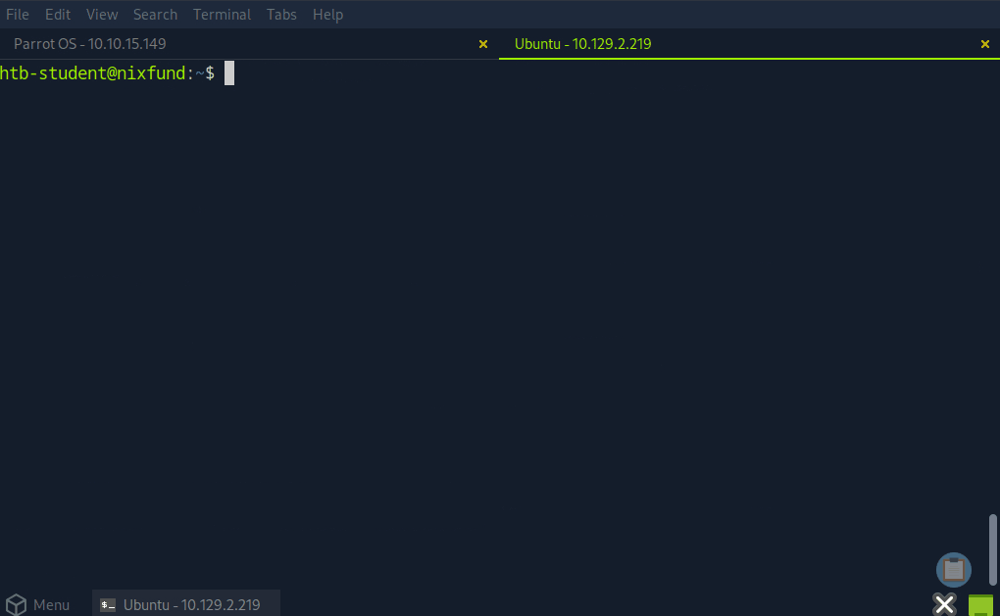

# 3. Components of a Network

Trên hành trình tiến sâu vào thế giới InfoSec, việc hiểu rõ các thành phần cấu tạo nên một network là điều cốt yếu. Ngày nay, các thiết bị có thể liên lạc với nhau, chia sẻ tài nguyên và truy cập Internet với sự đồng bộ và ổn định gần như tuyệt đối. Vậy chính xác điều gì đã tạo nên khả năng này? 

Về cơ bản, một network hoàn chỉnh được cấu thành từ các nhóm thành phần chính sau:

| Thành phần (Component) | Ví dụ & Mô tả |
| :--- | :--- |
| **End Devices** | Máy tính, smartphone, tablet, thiết bị IoT / Smart Device. |
| **Intermediary Devices** | Switch, router, modem, wireless access point. |
| **Network Media & Software Components** | Dây cáp, giao thức mạng (protocol), phần mềm quản trị và software firewall. |
| **Servers** | Web server, file server, mail server, database server. |

Hãy cùng phân tích chi tiết từng thành phần.

---

### 1. End Devices (Thiết bị đầu cuối)

Một **end device** (còn được gọi là **host**) là bất kỳ thiết bị nào đảm nhận việc gửi hoặc nhận dữ liệu cuối cùng bên trong một network. Máy tính cá nhân (PC), laptop và các smart device (smartphone, smart TV) là những end device phổ biến nhất mà người dùng tương tác trực tiếp hàng ngày để lướt web, gửi tin nhắn hay tạo lập tài liệu. 

Trong hầu hết các hệ thống mạng, các thiết bị này đóng vai trò kép: vừa là nơi sản sinh dữ liệu (data generation), vừa là nơi tiêu thụ dữ liệu (data consumption) - chẳng hạn khi bạn xem video trực tuyến hoặc đọc nội dung trên một trang báo điện tử. End device đóng vai trò là giao diện người dùng chính đối với thế giới web, cho phép người dùng truy cập tài nguyên và dịch vụ mạng một cách liền mạch thông qua cả kết nối có dây (cáp Ethernet) lẫn không dây (Wi-Fi). 

> **Ví dụ thực tế:** Một học sinh dùng laptop kết nối vào mạng Wi-Fi của trường để truy cập tài liệu học tập trực tuyến, nộp bài tập và trao đổi với giáo viên. Chiếc laptop đó chính là một end device.

---

### 2. Intermediary Devices (Thiết bị trung gian)

Một **intermediary device** đảm nhận vai trò kết nối và điều phối luồng dữ liệu luân chuyển giữa các end device, dù là bên trong cùng một mạng LAN hay giữa các network hoàn toàn khác nhau. Nhóm thiết bị này bao gồm: router, switch, modem và access point - tất cả đều đóng vai trò sống còn trong việc đảm bảo dữ liệu được truyền tải hiệu quả, an toàn và chính xác.

Các chức năng then chốt của Intermediary Device:
- **Chuyển tiếp gói tin (Packet Forwarding)**: Đọc thông tin địa chỉ mạng trong các data packet để điều hướng chúng đến đúng đích thông qua tuyến đường tối ưu nhất.
- **Kết nối mạng và kiểm soát lưu lượng (Traffic Management)**: Liên kết các phân đoạn mạng khác nhau, điều tiết lưu lượng bằng các giao thức chuẩn mực nhằm ngăn ngừa tình trạng tắc nghẽn (congestion) và duy trì hiệu năng cao cho hệ thống.
- **Tích hợp cơ chế bảo mật**: Rất nhiều thiết bị trung gian được tích hợp sẵn các tính năng an ninh (như firewall, access control list) để ngăn chặn truy cập trái phép và các mối đe dọa tiềm ẩn.

Các thiết bị này vận hành ở những tầng khác nhau trong mô hình OSI: ví dụ, router hoạt động ở **Network Layer (Layer 3)** trong khi switch hoạt động ở **Data Link Layer (Layer 2)**, sử dụng routing table và protocol để đưa ra quyết định chuyển tiếp dữ liệu chính xác.

Dưới đây là các thiết bị phần cứng tiêu biểu trong nhóm này:

#### Network Interface Card (NIC)
**Network Interface Card (NIC - Card mạng)** là linh kiện phần cứng được cài đặt bên trong máy tính hoặc thiết bị, cho phép thiết bị đó kết nối vật lý vào network. NIC đóng vai trò là giao diện vật lý giữa thiết bị và môi trường truyền dẫn, trực tiếp đảm nhận việc gửi và nhận dữ liệu qua mạng. Mỗi chiếc NIC đều mang một địa chỉ vật lý duy nhất trên thế giới gọi là **MAC (Media Access Control) address**, giúp các thiết bị định danh lẫn nhau tại Data Link Layer. NIC có thể là dạng có dây (Ethernet card cắm cáp mạng) hoặc không dây (Wi-Fi adapter thu nhận sóng vô tuyến).

#### Router
Router là thiết bị trung gian cực kỳ quan trọng: chịu trách nhiệm chuyển tiếp các packet giữa các mạng khác nhau và điều hướng luồng traffic của toàn bộ Internet. Hoạt động tại **Network Layer (Layer 3)** của mô hình OSI, router đọc thông tin địa chỉ logic trong header của gói tin để xác định đích đến. Router sử dụng routing table và các routing protocol tiên tiến như **OSPF (Open Shortest Path First)** hoặc **BGP (Border Gateway Protocol)** để tìm ra con đường ngắn và hiệu quả nhất cho dữ liệu vượt qua muôn vàn mạng liên kết. 

Bên cạnh nhiệm vụ định tuyến dựa trên IP address, router còn nâng cao an ninh mạng thông qua việc tích hợp firewall và Access Control List (ACL), giúp che chắn mạng nội bộ trước các đợt tấn công từ bên ngoài.

> **Ví dụ:** Trong mạng gia đình, router kết nối tất cả máy tính, điện thoại, smart TV với đường truyền Internet do ISP cung cấp. Router quản lý toàn bộ lưu lượng ra/vào, đảm bảo từng thiết bị có thể liên lạc với nhau và truy cập Internet thuận lợi.

#### Switch
Switch là một thành phần then chốt khác, với nhiệm vụ chính là kết nối nhiều thiết bị trong cùng một mạng cục bộ (LAN). Hoạt động tại **Data Link Layer (Layer 2)** của mô hình OSI, switch sử dụng **MAC address** để chỉ chuyển tiếp dữ liệu đến đúng cổng của thiết bị nhận đích danh, thay vì phát tán bừa bãi. Nhờ khả năng quản lý lưu lượng thông minh này, switch giảm thiểu xung đột dữ liệu, tránh tắc nghẽn mạng và gia tăng đáng kể hiệu năng tổng thể của LAN văn phòng.

#### Hub
Hub là một thiết bị mạng sơ khai (và ngày nay gần như đã tuyệt chủng). Hub kết nối các thiết bị trong một phân đoạn mạng nhưng hoạt động bằng cách phát tán (broadcast) dữ liệu đến **tất cả** các cổng kết nối, bất kể đích đến thực sự là đâu. Hoạt động ở **Physical Layer (Layer 1)** của mô hình OSI, hub không có bất kỳ trí thông minh nào để quản lý lưu lượng. Việc phát tán dữ liệu mù quáng này dẫn đến xung đột gói tin (collision) và suy giảm hiệu năng nghiêm trọng, khiến hub hoàn toàn bị thay thế bởi switch trong các hệ thống mạng hiện đại.

---

### 3. Network Media & Software Components (Môi trường truyền dẫn và Thành phần phần mềm)

Đây là những yếu tố nền tảng giúp duy trì quá trình liên lạc thông suốt trong mạng:

#### Cáp mạng và Đầu nối (Cabling and Connectors)
Cáp mạng và đầu nối là các vật liệu vật lý tạo nên con đường dẫn truyền tín hiệu giữa các thiết bị. Bao gồm cáp xoắn đôi (Ethernet cable), cáp quang (fiber optic), cùng các đầu nối chuẩn mực như giắc **RJ-45** cắm vào card mạng, switch và router. Chất lượng của hệ thống cáp và đầu nối quyết định trực tiếp tới tốc độ truyền dẫn, độ suy hao tín hiệu và độ ổn định của toàn hệ thống mạng.

#### Giao thức mạng (Network Protocols)
Network Protocol là bộ quy tắc và quy chuẩn chi phối cách thức dữ liệu được định dạng, truyền tải, tiếp nhận và giải mã trên mạng. Chúng đảm bảo các thiết bị từ nhiều nhà sản xuất khác nhau với hệ điều hành khác nhau vẫn có thể giao tiếp đồng bộ. Các khía cạnh mà protocol đảm nhiệm gồm:
- **Phân mảnh dữ liệu (Data Segmentation)**
- **Đánh địa chỉ (Addressing)**
- **Định tuyến (Routing)**
- **Kiểm tra lỗi (Error Checking)**
- **Đồng bộ hóa (Synchronization)**

Một số bộ giao thức cốt lõi:
- **TCP/IP**: Xương sống chi phối toàn bộ giao tiếp trên Internet.
- **HTTP / HTTPS**: Chuẩn mực truyền tải dữ liệu web.
- **FTP**: Truyền tải tệp tin dung lượng lớn.
- **SMTP**: Chuẩn giao thức gửi và chuyển tiếp email.

#### Phần mềm quản trị mạng (Network Management Software)
Bao gồm các bộ công cụ và phần mềm chuyên dụng giúp network administrator giám sát, cấu hình và duy trì hoạt động của hệ thống mạng. Các phần mềm này cung cấp các tính năng: giám sát hiệu năng (performance monitoring), quản lý cấu hình (configuration management), phân tích và cảnh báo sự cố (fault analysis), cũng như quản trị an ninh mạng (security management).

#### Software Firewall (Firewall phần mềm)
**Software Firewall** (hay còn gọi là **Host-based Firewall**) là ứng dụng an ninh được cài đặt trực tiếp trên từng máy tính hoặc thiết bị cá nhân. Nó giám sát và kiểm soát toàn bộ luồng lưu lượng mạng vào/ra (inbound/outbound traffic) dựa trên các quy tắc bảo mật được thiết lập trước. 

Khác với hardware firewall bảo vệ toàn bộ ranh giới mạng của tổ chức, software firewall cung cấp lớp bảo vệ chuyên biệt ở cấp độ từng thiết bị, ngăn chặn các mối đe dọa đã vượt qua được tuyến phòng thủ chu vi. Hầu hết các hệ điều hành hiện đại (Windows, Linux, macOS) đều tích hợp sẵn software firewall để chặn đứng các kết nối đáng ngờ từ nguồn không tin cậy.

Hình dưới đây minh họa software firewall trên Linux là [IPTables](https://linux.die.net/man/8/iptables) đang được thiết lập quy tắc để loại bỏ (DROP) lưu lượng ICMP (ping) gửi đến máy:

---

### 4. Servers (Máy chủ)

**Server** là một máy tính có cấu hình mạnh mẽ được thiết kế để cung cấp dịch vụ, dữ liệu và tài nguyên cho các máy tính khác (gọi là **client**) thông qua mạng. Server chính là xương sống vận hành website, hệ thống email, lưu trữ tệp tin và các ứng dụng doanh nghiệp.

Các vai trò chủ đạo của Server trong mạng máy tính:
- **Cung cấp dịch vụ (Hosting Services)**: Lưu trữ các website (web server) và dịch vụ thư điện tử (mail server) để client truy cập từ xa.
- **Chia sẻ tài nguyên (Resource Sharing)**: Cho phép hàng nghìn người dùng truy cập chung vào kho lưu trữ tệp (file server) hoặc thiết bị in ấn.
- **Quản lý dữ liệu tập trung (Data Management)**: Lưu trữ và quản lý dữ liệu trên hệ thống database server tập trung, giúp việc sao lưu (backup) và kiểm soát an ninh diễn ra dễ dàng, an toàn hơn.
- **Xác thực và phân quyền (Authentication)**: Kiểm soát danh tính người dùng và phân quyền truy cập tài nguyên mạng.

Server vận hành trên mô hình **Client-Server Model** - nơi server luôn ở trạng thái lắng nghe và sẵn sàng phản hồi các yêu cầu từ client gửi tới. Lần gần nhất bạn dùng laptop mở một website, trình duyệt (client) đã gửi một HTTP request tới web server lưu trữ trang web đó; server xử lý yêu cầu và gửi trả lại dữ liệu trang web để hiển thị trước mắt bạn.

---

### Kết luận

Hạ tầng công nghệ mạng toàn cầu là sự kết hợp nhịp nhàng giữa nhiều thành phần thiết yếu: **End Devices** đóng vai trò là giao diện tương tác của người dùng, **Intermediary Devices** điều phối lưu lượng và kết nối các phân đoạn mạng, **Network Media & Protocols** tạo ra đường truyền và tiếng nói chung, còn **Servers** là nơi cung cấp tài nguyên và dịch vụ. Sự phối hợp chặt chẽ này tạo nên dòng chảy thông tin liền mạch, cung cấp sức mạnh cho toàn bộ thế giới số ngày nay.
