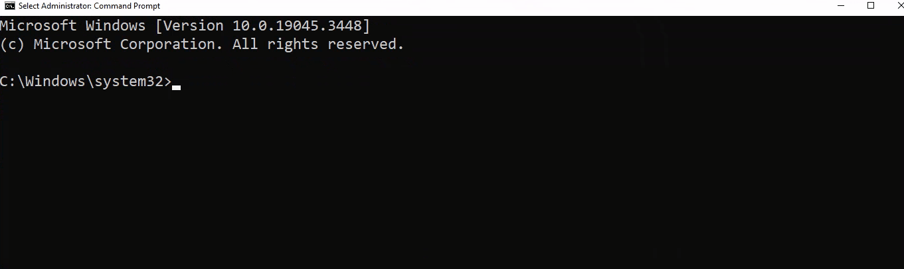
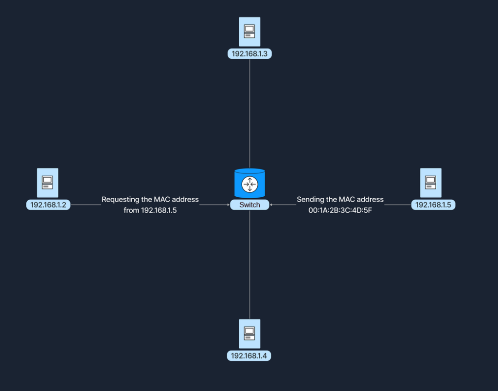
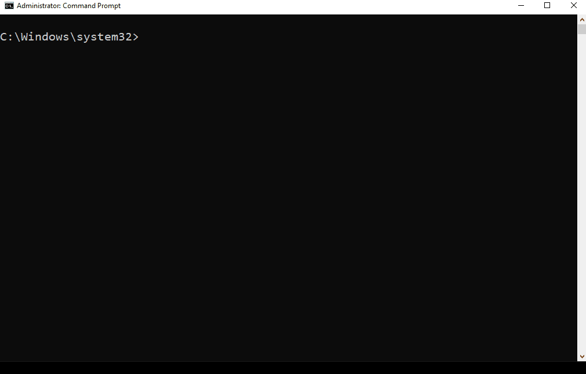

# 4. Network Communication

Để một network có thể vận hành và duy trì liên lạc ổn định, có ba thành phần tối quan trọng không thể tách rời: **MAC address**, **IP address** và **port**. Bộ ba này phối hợp chặt chẽ với nhau để đảm bảo dữ liệu được gửi và nhận chính xác giữa các thiết bị xuyên suốt cả mạng cục bộ lẫn mạng toàn cầu, tạo nên xương sống cho mọi hoạt động giao tiếp mạng liền mạch.

---

### MAC Address (Địa chỉ vật lý)

#### MAC Address là gì?
**Media Access Control (MAC) address** là một định danh duy nhất được gán trực tiếp cho **Network Interface Card (NIC)** của thiết bị, cho phép thiết bị được nhận diện chính xác trong mạng cục bộ. Hoạt động tại **Data Link Layer (Layer 2)** của mô hình OSI, MAC address là yếu tố sống còn cho quá trình liên lạc trong một phân đoạn mạng nội bộ, đảm bảo dữ liệu truyền đến đúng thiết bị vật lý đích danh.

Mỗi MAC address có độ dài **48 bit** và thường được biểu diễn dưới dạng hệ thập lục phân (**hexadecimal**), gồm 6 cặp ký tự phân tách nhau bằng dấu hai chấm hoặc dấu gạch nối (ví dụ: `00:1A:2B:3C:4D:5E`). Tính duy nhất trên toàn cầu của MAC address đến từ cấu trúc của nó:
- **24 bit đầu tiên**: Đại diện cho **Organizationally Unique Identifier (OUI)** - mã định danh được tổ chức IEEE cấp riêng cho từng nhà sản xuất phần cứng.
- **24 bit còn lại**: Là số định danh duy nhất do nhà sản xuất gán cho từng chiếc card mạng riêng biệt.

Cấu trúc này đảm bảo rằng mỗi chiếc NIC xuất xưởng đều sở hữu một địa chỉ MAC độc nhất vô nhị trên thế giới, giúp các thiết bị kết nối mà không bao giờ lo trùng lặp địa chỉ vật lý.

Trên hệ điều hành Windows, lệnh [GETMAC](https://learn.microsoft.com/en-us/windows-server/administration/windows-commands/getmac) trong dòng lệnh cho phép hiển thị MAC address của mọi card mạng hiện có trên máy tính:

#### Cách thức MAC Address vận hành trong giao tiếp mạng
MAC address là nền tảng cho việc truyền thông nội bộ trong mạng **LAN**, chịu trách nhiệm đưa các khung dữ liệu (**frame**) đến đúng thiết bị vật lý. Khi một thiết bị gửi dữ liệu, nó sẽ đóng gói thông tin vào một frame chứa **destination MAC address**; các network switch sau đó sẽ đọc địa chỉ này để chuyển tiếp frame đến đúng cổng kết nối của thiết bị nhận.

Bên cạnh đó, **Address Resolution Protocol (ARP)** đóng vai trò cầu nối cực kỳ quan trọng bằng cách phân giải (ánh xạ) giữa IP address và MAC address. ARP cho phép một thiết bị tìm ra địa chỉ MAC tương ứng với một địa chỉ IP đã biết trong cùng mạng LAN, kết nối khoảng cách giữa việc đánh địa chỉ logic (IP) và địa chỉ phần cứng vật lý (MAC).

> **Ví dụ thực tế:**  
> Giả sử có hai máy tính: Computer A (địa chỉ IP `192.168.1.2`, MAC `00:1A:2B:3C:4D:5E`) và Computer B (địa chỉ IP `192.168.1.5`, MAC `00:1A:2B:3C:4D:5F`) cùng cắm vào một switch. Khi Computer A muốn gửi dữ liệu sang Computer B, trước tiên nó dùng giao thức **ARP** để hỏi: *"Ai đang giữ IP 192.168.1.5, hãy cho tôi xin địa chỉ MAC?"*.  
> 
> Sau khi nhận được phản hồi địa chỉ MAC của Computer B là `00:1A:2B:3C:4D:5F`, Computer A sẽ đóng gói data frame với destination MAC address là `00:1A:2B:3C:4D:5F`. Switch nhận frame này, tra cứu bảng MAC và chuyển tiếp chính xác đến cổng mà Computer B đang kết nối.

Quá trình này được minh họa chi tiết trong sơ đồ dưới đây:

---

### IP Address (Địa chỉ logic)

#### IP Address là gì?
**Internet Protocol (IP) address** là một nhãn số được gán cho mỗi thiết bị tham gia vào mạng sử dụng bộ giao thức Internet Protocol để liên lạc. Hoạt động tại **Network Layer (Layer 3)** của mô hình OSI, IP address cho phép các thiết bị định vị và giao tiếp với nhau xuyên qua nhiều hệ thống mạng khác nhau trên toàn thế giới.

Hiện nay có hai phiên bản IP address:
- **IPv4**: Sử dụng không gian địa chỉ **32-bit**, thường được biểu diễn dưới dạng 4 số thập phân phân tách bằng dấu chấm (ví dụ: `192.168.1.1`).
- **IPv6**: Được phát triển nhằm giải quyết tình trạng cạn kiệt địa chỉ của IPv4, sở hữu không gian địa chỉ khổng lồ lên tới **128-bit**, được biểu diễn bằng 8 nhóm ký tự thập lục phân phân tách bằng dấu hai chấm (ví dụ: `2001:0db8:85a3:0000:0000:8a2e:0370:7334`).

#### Cách thức IP Address vận hành trong giao tiếp mạng
Các router sử dụng IP address để xác định tuyến đường truyền tải tối ưu nhất cho dữ liệu vượt qua ranh giới giữa các mạng liên kết. Khác với MAC address được gắn chết vĩnh viễn trên phần cứng của card mạng (hardcoded), IP address mang tính logic và linh hoạt hơn rất nhiều: chúng có thể thay đổi và được cấp phát dựa trên cấu trúc mạng (network topology) cũng như chính sách mạng của tổ chức (thông qua cấu hình tĩnh hoặc cấp động qua DHCP).

---

### Ports (Cổng giao tiếp)

Một **port** là một con số logic được gán cho các tiến trình (process) hoặc dịch vụ (service) cụ thể đang chạy trên máy tính, giúp hệ điều hành phân loại và định tuyến lưu lượng mạng vào đúng ứng dụng mong muốn. Port hoạt động tại **Transport Layer (Layer 4)** của mô hình OSI và vận hành song hành cùng các giao thức như **TCP** và **UDP**.

Nhờ có port, một thiết bị với một địa chỉ IP duy nhất có thể chạy đồng thời hàng chục dịch vụ mạng khác nhau (vừa lướt web, vừa nghe nhạc trực tuyến, vừa tải file) mà các luồng dữ liệu không hề bị trộn lẫn vào nhau.

Khi một ứng dụng client khởi tạo kết nối, nó sẽ chỉ định **destination port** tương ứng với dịch vụ mà nó muốn tiếp cận:
- **Client Application**: Là bên gửi yêu cầu dữ liệu hoặc dịch vụ (như trình duyệt web).
- **Server Application**: Là bên lắng nghe, phản hồi yêu cầu và cung cấp tài nguyên (như web server).

Ví dụ: Khi bạn mở website thông thường, trình duyệt sẽ kết nối tới IP của web server qua **port 80** (chuẩn mặc định của HTTP). Server đang lắng nghe trên port 80 sẽ tiếp nhận và phản hồi nội dung. Nếu bạn truy cập một website bảo mật, trình duyệt sẽ kết nối qua **port 443** (chuẩn mặc định của HTTPS).

Dải số port trải rộng từ **0 đến 65535** và được phân chia thành ba nhóm tiêu chuẩn bởi tổ chức **IANA (Internet Assigned Numbers Authority)**:

Công cụ dòng lệnh [netstat](https://learn.microsoft.com/en-us/windows-server/administration/windows-commands/netstat) giúp kiểm tra danh sách các kết nối mạng đang hoạt động cũng như các port đang mở lắng nghe (listening) trên hệ thống:

#### 1. Well-Known Ports (0 - 1023)
Đây là các port được bảo lưu cho những dịch vụ và giao thức mạng phổ biến, cốt lõi nhất trên toàn cầu, được tiêu chuẩn hóa và quản lý chặt chẽ bởi [Internet Assigned Numbers Authority (IANA)](https://www.iana.org/). 
- **Port 80**: Giao thức HTTP (World Wide Web thông thường).
- **Port 443**: Giao thức HTTPS (truyền thông web bảo mật qua mã hóa SSL/TLS).
- **Port 20 / 21**: Giao thức FTP (truyền tải tệp tin giữa client và server).
- **Port 22**: SSH (truy cập dòng lệnh từ xa bảo mật).
- **Port 53**: DNS (phân giải tên miền).

*(Lưu ý: Các trình duyệt web thường tự động ẩn số port 80 và 443 trên thanh địa chỉ để giao diện trông gọn gàng, thân thiện hơn với người dùng).*

#### 2. Registered Ports (1024 - 49151)
Các port này không bị kiểm soát nghiêm ngặt như Well-Known Ports nhưng vẫn được đăng ký với IANA để gán cho các ứng dụng và dịch vụ chuyên biệt của bên thứ ba. Nhóm này thường được sử dụng bởi các phần mềm và server chuyên dụng mà người dùng cài đặt thêm:
- **Port 1433**: Microsoft SQL Server database.
- **Port 3306**: MySQL database.
- **Port 3389**: Remote Desktop Protocol (RDP).

Việc đăng ký này giúp phần mềm luôn sử dụng một port nhất quán trên mọi hệ thống, tránh nguy cơ xung đột port giữa các ứng dụng khác nhau.

#### 3. Dynamic / Private Ports (49152 - 65535)
Còn được gọi là **Ephemeral Ports** (cổng tạm thời), nhóm port này được hệ điều hành của client tự động chọn ngẫu nhiên và cấp phát tạm thời cho các ứng dụng client khi chúng cần gửi yêu cầu đến server. Khi phiên kết nối kết thúc, port này sẽ lập tức được đóng lại và thu hồi. Ngoài ra, dynamic port cũng có thể được dùng cho các ứng dụng server tự phát triển nội bộ để xử lý các kết nối ngắn hạn.

---

### Ví dụ tổng hợp: Hành trình của một lượt truy cập Website

Để hình dung cách MAC address, IP address và port phối hợp tác chiến, hãy theo dõi các bước diễn ra từ lúc bạn gõ một địa chỉ web cho đến khi trang web hiển thị:

#### 1. DNS Lookup (Phân giải tên miền)
Máy tính của bạn gửi yêu cầu đến DNS server để phân giải tên miền (ví dụ: `example.com`) thành địa chỉ IP tương ứng (ví dụ: `93.184.216.34`).

#### 2. Data Encapsulation (Đóng gói dữ liệu)
- Trình duyệt tạo một HTTP request.
- Request được đóng gói tại Transport Layer bằng giao thức TCP, gán **destination port là 80** (hoặc 443 nếu là HTTPS), đồng thời hệ điều hành cấp một **source port ngẫu nhiên** (ví dụ: `54321` thuộc dải Dynamic Port).
- Gói tin tiếp tục được đóng gói tại Network Layer với **destination IP address là 93.184.216.34** và **source IP address** là IP của máy bạn.
- Trong mạng cục bộ, máy tính sử dụng **ARP** để tìm ra MAC address của **default gateway** (chính là router gia đình).
- Gói tin được đóng thành frame với destination MAC address là MAC của router.

#### 3. Data Transmission (Truyền tải dữ liệu)
- Data frame được gửi qua dây cáp hoặc sóng Wi-Fi tới router.
- Router bóc lớp frame, đọc destination IP và chuyển tiếp packet ra ngoài Internet hướng tới địa chỉ `93.184.216.34`.
- Các router trung gian trên Internet tiếp tục định tuyến gói tin dựa trên địa chỉ IP cho đến khi đến đích.

#### 4. Server Processing (Máy chủ xử lý)
- Web server đích tiếp nhận gói tin, bóc tách IP header và chuyển dữ liệu tới ứng dụng đang lắng nghe trên port 80/443 (chính là phần mềm web server như Nginx hoặc Apache).
- Web server xử lý HTTP request, đóng gói dữ liệu phản hồi (HTML, hình ảnh) và gửi ngược trở lại theo lộ trình tương tự.

#### 5. Response Transmission (Truyền phản hồi về Client)
- Web server gửi gói tin phản hồi với destination IP là IP máy bạn và **destination port là cổng tạm thời** (`54321`) mà máy bạn đã mở ban đầu.
- Gói tin di chuyển ngược lại qua các router Internet về đến mạng LAN của bạn.
- Router LAN chuyển tiếp frame tới đúng card mạng của máy bạn dựa trên MAC address.
- Hệ điều hành máy bạn nhìn vào port `54321`, chuyển thẳng dữ liệu phản hồi cho đúng tab trình duyệt đang chờ, hoàn tất quá trình tải trang web.
