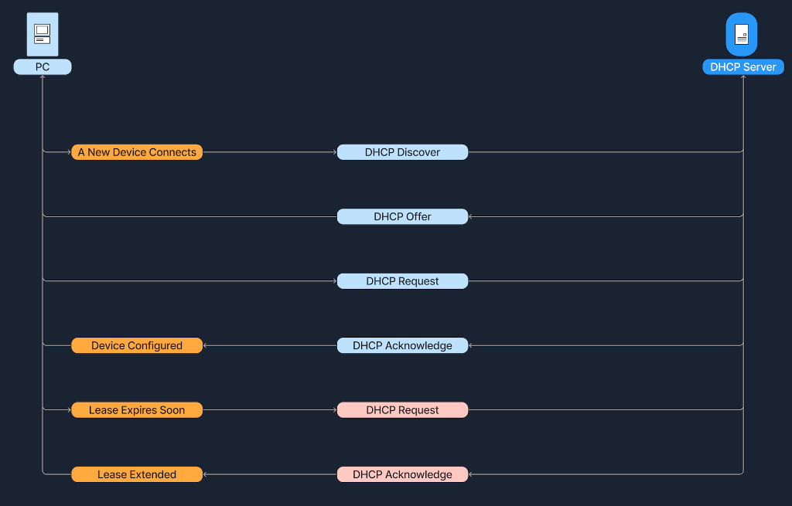
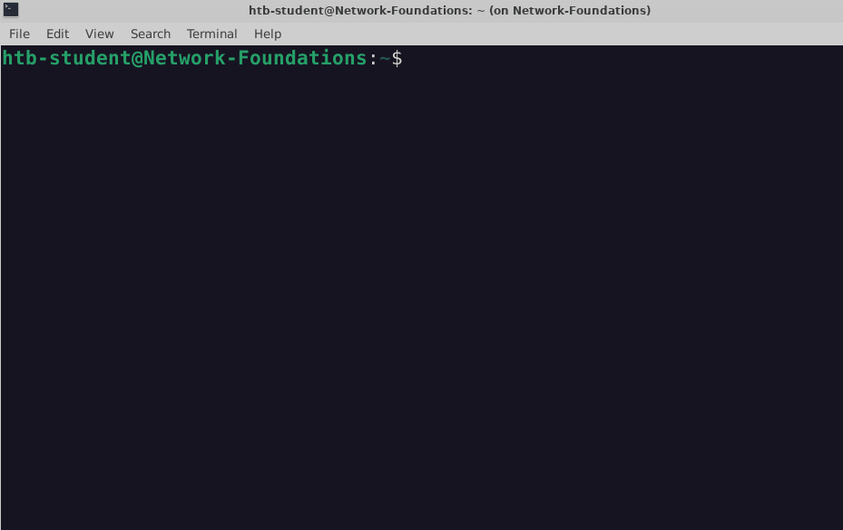

# 5. Dynamic Host Configuration Protocol (DHCP)

### Giới thiệu về DHCP

Trong bất kỳ hệ thống mạng máy tính nào, mỗi thiết bị muốn liên lạc được với các thiết bị khác đều bắt buộc phải sở hữu một **IP (Internet Protocol) address** duy nhất. Nếu quản trị viên phải cấu hình địa chỉ IP thủ công (manual) cho từng thiết bị, công việc này sẽ cực kỳ tốn thời gian và rất dễ phát sinh lỗi trùng lặp IP, đặc biệt là trong các mạng doanh nghiệp quy mô lớn. 

Để giải quyết triệt để bài toán này, các hệ thống mạng sử dụng **Dynamic Host Configuration Protocol (DHCP)**. DHCP là một giao thức quản trị mạng dùng để tự động hóa hoàn toàn quy trình cấu hình mạng cho các thiết bị kết nối vào mạng IP. Giao thức này cho phép thiết bị tự động nhận địa chỉ IP cùng các thông số cấu hình mạng cần thiết khác như: **subnet mask**, **default gateway** và **DNS server** mà không cần bất kỳ sự can thiệp thủ công nào từ con người.

DHCP giúp tinh giản tối đa công tác quản trị mạng, giảm tải áp lực cho đội ngũ IT:
- **Tự động hóa hoàn toàn**: Đảm bảo mỗi thiết bị khi cắm vào mạng đều nhận được một địa chỉ IP duy nhất, ngăn chặn tuyệt đối tình trạng xung đột và trùng lặp IP (IP conflict).
- **Tối ưu hóa tài nguyên mạng**: Tự động thu hồi và tái sử dụng (recycle) các địa chỉ IP khi thiết bị ngắt kết nối khỏi mạng, giúp tối ưu hóa kho địa chỉ IP (address pool) sẵn có.

---

### Cơ chế hoạt động của DHCP: Quy trình DORA

Quá trình DHCP vận hành thông qua một chuỗi tương tác tuần tự giữa **client** (thiết bị đang xin cấp IP) và **DHCP server** (dịch vụ chạy trên router hoặc server chuyên dụng chịu trách nhiệm phân phát IP). 

Trước khi đi sâu vào các bước cụ thể, hãy phân biệt rõ vai trò của hai bên:

| Vai trò | Mô tả |
| :--- | :--- |
| **DHCP Server** | Thiết bị mạng (như router hoặc máy chủ chuyên dụng) quản lý việc phân bổ địa chỉ IP. Server duy trì một dải IP sẵn có (pool) và các thông số cấu hình mạng. |
| **DHCP Client** | Bất kỳ thiết bị đầu cuối nào khi tham gia vào mạng và gửi yêu cầu xin cấp cấu hình mạng từ DHCP server. |

Quy trình cấp phát IP tự động này thường được gọi tắt là **DORA** - viết tắt của 4 giai đoạn: **Discover**, **Offer**, **Request** và **Acknowledge**.

| Bước | Tên bước | Chi tiết hoạt động |
| :--- | :--- | :--- |
| **1** | **Discover** | Khi thiết bị vừa kết nối vào mạng, nó sẽ phát tán một bản tin quảng bá (**DHCP Discover** broadcast) ra toàn mạng để tìm kiếm xem có DHCP server nào đang hoạt động hay không. |
| **2** | **Offer** | Các DHCP server trên mạng khi nghe thấy bản tin Discover sẽ phản hồi lại bằng một bản tin **DHCP Offer**, đề xuất một địa chỉ IP kèm thời hạn thuê (lease) cho client. |
| **3** | **Request** | Client tiếp nhận lời đề nghị và phản hồi lại bằng một bản tin **DHCP Request**, xác nhận đồng ý thuê địa chỉ IP vừa được đề xuất. |
| **4** | **Acknowledge** | DHCP server gửi bản tin **DHCP Acknowledge** (ACK) cuối cùng để chốt việc gán IP. Kể từ thời điểm này, client chính thức sở hữu IP và có thể bắt đầu liên lạc trên mạng. |

Sơ đồ tuần tự dưới đây thể hiện toàn bộ chu trình DORA từ lúc kết nối ban đầu cho đến quá trình gia hạn thời gian thuê (lease renewal):

Dưới đây là hình ảnh thực tế ghi lại quá trình một máy chủ Linux khi kết nối vào mạng không dây và kích hoạt chu trình DORA để nhận địa chỉ IP:

---

### Thời hạn thuê IP (Lease Time) và Quá trình gia hạn (Lease Renewal)

Địa chỉ IP do DHCP cấp phát **không phải là vĩnh viễn**, mà chỉ được cấp theo một khoảng thời gian nhất định gọi là **lease time**. 

Ví dụ: DHCP server có thể cấp địa chỉ IP cho một chiếc smartphone với thời hạn thuê là 24 giờ. Sau khoảng thời gian này, chiếc smartphone phải gửi yêu cầu gia hạn để được tiếp tục sử dụng địa chỉ IP đó:
- **Chủ động gia hạn**: Trước khi hợp đồng thuê hết hạn (thường khi đạt 50% thời gian thuê), client sẽ chủ động gửi một bản tin **DHCP Request** đến DHCP server để xin kéo dài thời gian thuê.
- **Phản hồi từ Server**: Nếu DHCP server chấp thuận, nó sẽ gửi lại bản tin **DHCP Acknowledge**, tiếp tục gia hạn thời gian sử dụng địa chỉ IP cho thiết bị mà không làm gián đoạn kết nối mạng.

---

### Tình huống ví dụ thực tế

Hãy cùng hình dung kịch bản cụ thể:
Alice mang chiếc laptop mới đến văn phòng làm việc và cắm dây mạng vào hệ thống:
1. Chiếc laptop chưa hề có địa chỉ IP, vì vậy nó lập tức phát tán bản tin **DHCP Discover** ra toàn mạng để tìm DHCP server.
2. DHCP server của công ty tiếp nhận bản tin này và phản hồi bằng một bản tin **DHCP Offer**, đề xuất cấp địa chỉ IP `192.168.1.10`.
3. Laptop của Alice nhận được lời mời và gửi lại bản tin **DHCP Request** để chấp nhận dùng địa chỉ `192.168.1.10`.
4. Cuối cùng, DHCP server gửi bản tin **DHCP Acknowledge** để xác nhận quyền sử dụng. Lúc này chiếc laptop của Alice đã được cấu hình hoàn chỉnh với IP `192.168.1.10` và sẵn sàng truy cập mạng nội bộ cũng như Internet.

Địa chỉ `192.168.1.10` của Alice gắn liền với một thời hạn thuê (lease time) nhất định. Khi thời hạn thuê sắp hết, laptop của Alice sẽ tự động gửi một bản tin **DHCP Request** khác đến DHCP server đề nghị gia hạn. DHCP server sẽ phản hồi bằng bản tin **DHCP Acknowledge** để tiếp tục duy trì địa chỉ IP đó cho Alice một cách hoàn toàn trong suốt với người dùng.
