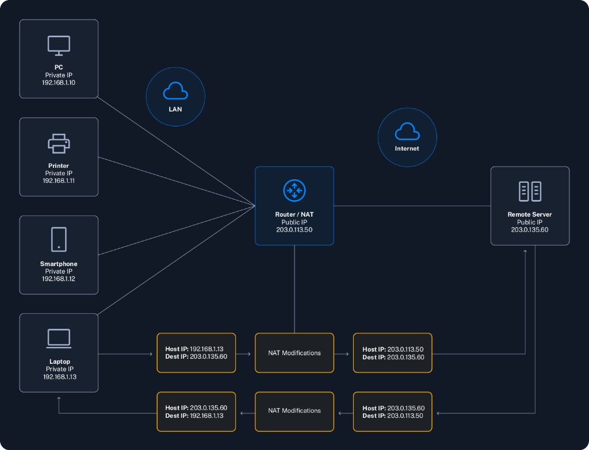

# 6. Network Address Translation (NAT)

Mạng Internet vận hành dựa trên một hệ thống địa chỉ số gọi là **IP address** để định tuyến và vận chuyển dữ liệu từ thiết bị này sang thiết bị khác. Không gian đánh địa chỉ nguyên bản - **IPv4** - chỉ cung cấp một lượng địa chỉ có giới hạn (khoảng 4,3 tỷ địa chỉ IP). Dù 4,3 tỷ nghe có vẻ là con số khổng lồ, nhưng với sự bùng nổ vũ bão của Internet và các thiết bị thông minh, nguồn tài nguyên này đã nhanh chóng rơi vào tình trạng cạn kiệt.

Một trong những giải pháp cứu cánh hàng đầu cho bài toán thiếu hụt này chính là **Network Address Translation (NAT)**. Ý tưởng cốt lõi của NAT là cho phép nhiều thiết bị trong một mạng nội bộ (**private network**) cùng dùng chung một địa chỉ IP công cộng (**public IP address**) duy nhất khi truy cập ra ngoài Internet. Cơ chế này không chỉ giúp bảo tồn nguồn địa chỉ public IP quý giá mà còn tạo thêm một lớp bảo vệ tự nhiên cho mạng nội bộ.

---

### Phân biệt Private IP và Public IP

#### Public IP Address
**Public IP address** là các địa chỉ định danh duy nhất trên phạm vi toàn cầu, được phân bổ và quản lý bởi các **Internet Service Provider (ISP)**. 
- Bất kỳ thiết bị nào sở hữu public IP đều có thể được nhìn thấy và truy cập từ bất kỳ đâu trên Internet, cho phép chúng liên lạc xuyên biên giới mạng toàn cầu.
- Ví dụ: `8.8.8.8` là public IP của DNS server thuộc Google, và `142.251.46.174` là một trong những web server của Google. 
- Nhờ có public IP, các máy chủ và dịch vụ trực tuyến có thể định vị và kết nối với nhau trên toàn thế giới mà không bao giờ bị nhầm lẫn.

#### Private IP Address
Ngược lại, **Private IP address** được quy hoạch riêng để sử dụng bên trong các mạng cục bộ như gia đình, trường học và văn phòng công ty.
- Các địa chỉ này **hoàn toàn không thể định tuyến (non-routable)** trên mạng Internet công cộng; các router xương sống của Internet sẽ tự động loại bỏ (drop) mọi gói tin có đích đến là dải private IP.
- Được định nghĩa chính thức trong tiêu chuẩn **RFC 1918**, ba dải địa chỉ IPv4 private phổ biến bao gồm:
  - **Lớp A**: `10.0.0.0` đến `10.255.255.255`
  - **Lớp B**: `172.16.0.0` đến `172.31.255.255`
  - **Lớp C**: `192.168.0.0` đến `192.168.255.255`

Thiết kế này đảm bảo các mạng nội bộ có thể vận hành độc lập, tự do gán dải địa chỉ IP cho thiết bị bên trong mà không lo xung đột với các mạng nội bộ khác trên thế giới.

#### Sự kết hợp giữa Private IP và NAT
Việc sử dụng private IP đóng góp to lớn vào việc tiết kiệm tài nguyên public IP. Thông qua kỹ thuật **Network Address Translation (NAT)**, toàn bộ các thiết bị trong mạng LAN dù đều mang địa chỉ private IP riêng nhưng vẫn có thể dùng chung một public IP duy nhất khi gửi nhận dữ liệu ra ngoài Internet. Nhờ vậy, thiết bị nội bộ vẫn lướt web, xem video bình thường mà tổ chức không cần tốn chi phí mua hàng trăm public IP. Đồng thời, do private IP không bị lộ trực tiếp ra Internet, các thiết bị bên trong được che giấu an toàn trước các đợt quét cổng và dòm ngó từ các tin tặc bên ngoài.

---

### NAT là gì?

**Network Address Translation (NAT)** là một tiến trình được thực thi bởi router (hoặc firewall/thiết bị mạng tương đương), nhằm chỉnh sửa thông tin **source IP** hoặc **destination IP** trong phần header của gói tin IP khi nó đi qua thiết bị. Tiến trình biến đổi này dùng để chuyển đổi địa chỉ private IP của thiết bị trong mạng nội bộ thành địa chỉ public IP duy nhất được ISP cấp cho router (và ngược lại).

---

### Cơ chế hoạt động của NAT

Hãy hình dung một mạng gia đình gồm nhiều thiết bị: laptop (`192.168.1.13`), smartphone (`192.168.1.12`), máy in (`192.168.1.11`) và PC (`192.168.1.10`). Chiếc home router quản lý mạng này sở hữu hai interface vật lý:
- **LAN Interface**: Kết nối với mạng nội bộ, mang địa chỉ private IP là `192.168.1.1`.
- **WAN Interface**: Kết nối với đường truyền của ISP ra Internet, mang địa chỉ public IP là `203.0.113.50`.

Quá trình biên dịch NAT diễn ra qua các bước nhịp nhàng sau:
1. **Khởi tạo yêu cầu**: Chiếc laptop (`192.168.1.13`) gửi yêu cầu truy cập một web server từ xa trên Internet (`203.0.135.60` - ví dụ như [www.google.com](http://www.google.com/)). Gói tin xuất phát từ laptop mang:
   - Source IP: `192.168.1.13`
   - Destination IP: `203.0.135.60`
2. **Biến đổi qua NAT**: Khi gói tin đi tới router, tính năng NAT của router sẽ ghi nhận thông tin này vào một bảng theo dõi gọi là **NAT table**, đồng thời sửa đổi trường Source IP trong IP header từ private IP (`192.168.1.13`) thành public IP của router (`203.0.113.50`).
3. **Truyền ra ngoài Internet**: Gói tin sau khi biến đổi sẽ đi qua hạ tầng mạng Internet và tới web server đích (`203.0.135.60`).
4. **Máy chủ phản hồi**: Web server xử lý yêu cầu và gửi gói tin phản hồi về cho địa chỉ người gửi (chính là public IP của router `203.0.113.50`).
5. **Dịch ngược và trả về máy đích**: Khi gói tin phản hồi về tới router, router tra cứu trong **NAT table** và nhận ra gói tin này thực chất là để trả lời cho yêu cầu của laptop (`192.168.1.13`). Router lập tức thay thế Destination IP từ public IP (`203.0.113.50`) thành private IP (`192.168.1.13`) và chuyển tiếp gói tin vào mạng LAN cho laptop, hoàn tất chu trình liên lạc.

Sơ đồ dưới đây minh họa toàn bộ quá trình biến đổi địa chỉ của NAT:

---

### Các phân loại NAT (Types of NAT)

Tùy vào nhu cầu triển khai thực tế, NAT được chia thành 3 loại chính:

| Loại NAT | Mô tả cơ chế |
| :--- | :--- |
| **Static NAT** | Ánh xạ tĩnh 1:1, trong đó một địa chỉ private IP cố định sẽ luôn tương ứng trực tiếp với một địa chỉ public IP cố định. Thường dùng khi cần công khai một máy chủ nội bộ (như web server công ty) ra ngoài Internet. |
| **Dynamic NAT** | Phân bổ động theo nhu cầu: router duy trì một nhóm (pool) gồm nhiều public IP sẵn có. Khi một thiết bị private cần ra Internet, router sẽ bốc một public IP còn trống để gán cho thiết bị đó trong suốt phiên làm việc. |
| **Port Address Translation (PAT)** | Còn gọi là **NAT Overload** - đây là dạng NAT phổ biến nhất trên toàn cầu, được áp dụng trong hầu hết các mạng gia đình và văn phòng nhỏ. Rất nhiều private IP cùng dùng chung một public IP duy nhất, và router phân biệt các luồng kết nối khác nhau bằng cách sử dụng các số cổng (**port number**) duy nhất cho từng phiên. |

---

### Lợi ích và Đánh đổi (Benefits and Trade-Offs)

Dù là một giải pháp mang tính đột phá và không thể thiếu của kỷ nguyên Internet, NAT cũng có những điểm mạnh và sự đánh đổi nhất định:

#### Lợi ích (Benefits)
- **Tiết kiệm không gian địa chỉ IPv4**: Kéo dài tuổi thọ của giao thức IPv4 trong nhiều thập kỷ, cho phép hàng triệu thiết bị cùng vào mạng chỉ với một số lượng nhỏ public IP.
- **Tăng cường an ninh mạng cơ bản**: Ngăn chặn sự dòm ngó trực tiếp từ bên ngoài bằng cách ẩn giấu hoàn toàn sơ đồ mạng và địa chỉ IP thực của các thiết bị nội bộ.
- **Linh hoạt trong quy hoạch IP**: Doanh nghiệp có thể tùy ý quy hoạch dải private IP nội bộ theo ý muốn mà không cần xin cấp phép từ các tổ chức quản lý địa chỉ Internet quốc tế.

#### Điểm đánh đổi (Trade-Offs)
- **Phức tạp khi triển khai dịch vụ công khai**: Nếu bạn muốn đặt một web server hoặc game server bên trong mạng nội bộ và muốn người ngoài truy cập vào, bạn phải cấu hình thêm các tính năng nâng cao như **port forwarding** (mở cổng).
- **Phá vỡ tính kết nối đầu-cuối (End-to-End Connectivity)**: Một số giao thức mạng đòi hỏi liên lạc trực tiếp không qua biến đổi (như một số giao thức VoIP, IPSec VPN) có thể gặp lỗi hoặc cần cơ chế xử lý phụ trợ phức tạp khi đi qua thiết bị NAT.
- **Gia tăng độ phức tạp khi khắc phục sự cố**: Việc địa chỉ IP liên tục bị thay đổi qua các chặng khiến quá trình theo dõi gói tin (packet tracing) và xử lý sự cố mạng (troubleshooting) trở nên thách thức hơn đối với các kỹ sư mạng và chuyên gia bảo mật.
