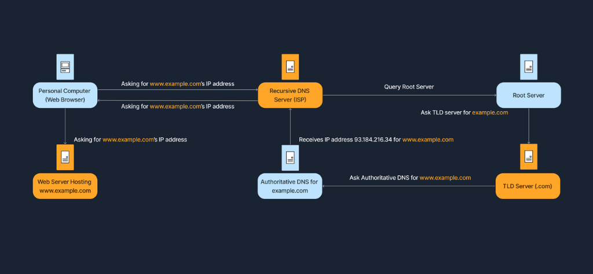

# 7. Domain Name System (DNS)

**Domain Name System (DNS)** thường được ví như cuốn danh bạ điện thoại khổng lồ của toàn bộ mạng Internet. Hệ thống này giúp chúng ta tra cứu ra đúng "số điện thoại" (một địa chỉ **IP address**) tương ứng với một "tên người dùng" cụ thể (một tên miền - **domain name**, ví dụ: `www.google.com`). 

Nếu không có DNS, chúng ta sẽ phải ghi nhớ hàng loạt chuỗi số IP dài dòng và phức tạp cho mỗi trang web mình muốn ghé thăm. DNS giúp cuộc sống số trở nên dễ dàng và thuận tiện hơn rất nhiều bằng cách cho phép con người sử dụng những cái tên quen thuộc, dễ nhớ để truy cập các tài nguyên trực tuyến.

---

### So sánh Domain Name và IP Address

| Loại địa chỉ | Đặc điểm & Mô tả |
| :--- | :--- |
| **Domain Name** | Một địa chỉ dạng chữ dễ đọc, dễ nhớ cho con người (ví dụ: `www.example.com`). |
| **IP Address** | Một nhãn số định danh kỹ thuật mà máy tính và router dùng để liên lạc (ví dụ: `93.184.216.34`). |

DNS chính là chiếc cầu nối xóa nhòa khoảng cách giữa hai loại địa chỉ này, giúp bạn chỉ cần gõ `www.google.com` vào thanh địa chỉ của trình duyệt mà không cần bận tâm đến địa chỉ IP thực sự ẩn bên dưới là gì.

---

### Cấu trúc phân cấp của DNS (DNS Hierarchy)

Hệ thống DNS được tổ chức theo mô hình cây phân cấp (tree structure), bắt đầu từ đỉnh gốc (**Root**) và phân nhánh xuống các tầng thấp hơn:

| Tầng (Layer) | Mô tả & Ví dụ |
| :--- | :--- |
| **Root Servers** | Tầng cao nhất trên đỉnh của cấu trúc phân cấp DNS, quản lý thông tin về các TLD server. |
| **Top-Level Domains (TLDs)** | Các phần mở rộng tên miền cấp cao nhất như `.com`, `.org`, `.net`, hoặc mã quốc gia như `.uk`, `.vn`, `.de`. |
| **Second-Level Domains** | Phần tên miền chính do tổ chức hoặc cá nhân đăng ký, ví dụ: `example` trong `example.com`. |
| **Subdomains / Hostname** | Tên miền phụ hoặc tên máy chủ cụ thể, ví dụ: `www` trong `www.example.com`, hoặc `accounts` trong `accounts.google.com`. |

Sơ đồ dưới đây phân tích cấu trúc giải phẫu chi tiết của một đường dẫn URL hoàn chỉnh:

Cấu trúc gồm các thành phần:
- **Scheme**: Giao thức truyền tải (ví dụ: `https://`).
- **Subdomain**: Tên miền phụ phân định dịch vụ (ví dụ: `www`).
- **2nd-Level Domain**: Tên định danh cốt lõi của website (ví dụ: `example`).
- **Top-Level Domain**: Phần mở rộng tên miền cấp cao nhất (ví dụ: `com`).
- **Root**: Dấu chấm gốc `.` nằm ở cuối cùng (thường được ngầm hiểu và tự động ẩn đi).
- **Page name**: Đường dẫn tài nguyên hoặc trang cụ thể trên máy chủ (ví dụ: `/home.html`).

---

### Quá trình phân giải DNS (DNS Resolution Process)

Khi bạn nhập một tên miền vào trình duyệt web, máy tính cần tìm ra địa chỉ IP tương ứng để có thể kết nối tới máy chủ lưu trữ. Quy trình này được gọi là **DNS resolution** (hay **domain translation**).

Quy trình phân giải diễn ra qua 7 bước tuần tự:

| Bước | Diễn biến chi tiết |
| :--- | :--- |
| **Bước 1** | Bạn gõ địa chỉ `www.example.com` vào trình duyệt web và nhấn Enter. |
| **Bước 2** | Máy tính kiểm tra trước tiên trong **local DNS cache** (bộ nhớ tạm của hệ điều hành và trình duyệt) xem đã lưu sẵn địa chỉ IP của trang này gần đây hay chưa. |
| **Bước 3** | Nếu không tìm thấy trong bộ nhớ đệm nội bộ, máy tính gửi câu hỏi tới một **recursive DNS server** (thường do nhà mạng ISP cung cấp hoặc các dịch vụ DNS công cộng của bên thứ ba như Google DNS `8.8.8.8` hay Cloudflare `1.1.1.1`). |
| **Bước 4** | Recursive DNS server liên hệ với một **Root Server**, và Root Server sẽ chỉ dẫn nó tìm đến đúng **TLD Name Server** quản lý phần mở rộng đó (trong trường hợp này là máy chủ quản lý dải `.com`). |
| **Bước 5** | TLD Name Server tiếp tục chỉ dẫn recursive server tìm đến đúng **Authoritative Name Server** chịu trách nhiệm quản trị tên miền `example.com`. |
| **Bước 6** | Authoritative Name Server tra cứu bản ghi và phản hồi lại địa chỉ IP chính xác cho `www.example.com` (ví dụ: `93.184.216.34`). |
| **Bước 7** | Recursive DNS server chuyển kết quả IP này về cho máy tính của bạn. Lúc này, trình duyệt có thể trực tiếp thiết lập kết nối tới web server của trang web. |

Toàn bộ quá trình tra cứu phân tầng phức tạp này diễn ra chỉ trong một phần rất nhỏ của giây (vài mili-giây).

> **Tình huống tóm lược:**  
> Giả sử bạn muốn truy cập `www.example.com`. Nếu không có DNS, mỗi lần muốn đọc tin, bạn sẽ phải nhớ và gõ chuỗi số `93.184.216.34`. Nhưng nhờ có DNS, bạn chỉ cần gõ tên miền quen thuộc. Ở hậu trường, hệ thống DNS tự động dò tìm và biên dịch tên miền thành địa chỉ IP chuẩn xác, mang lại trải nghiệm duyệt web mượt mà và trực quan.

Sơ đồ dưới đây minh họa toàn bộ dòng chảy truy vấn trong quy trình DNS Query:

