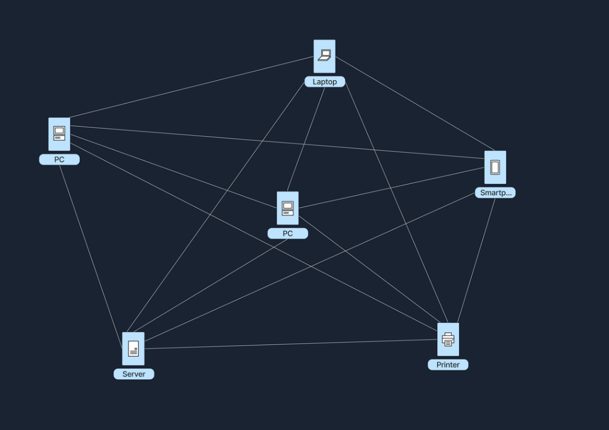
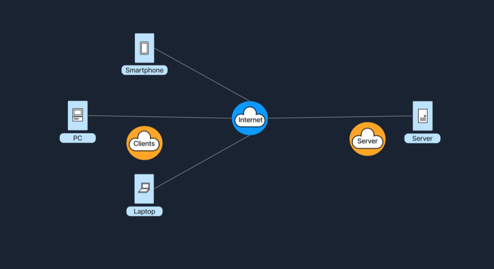
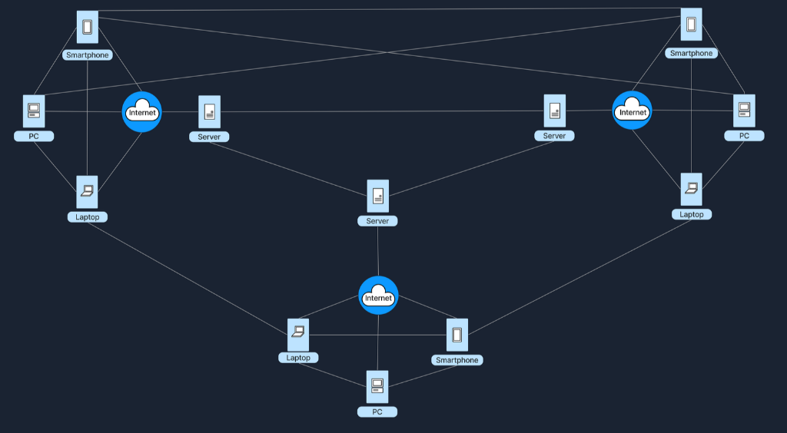
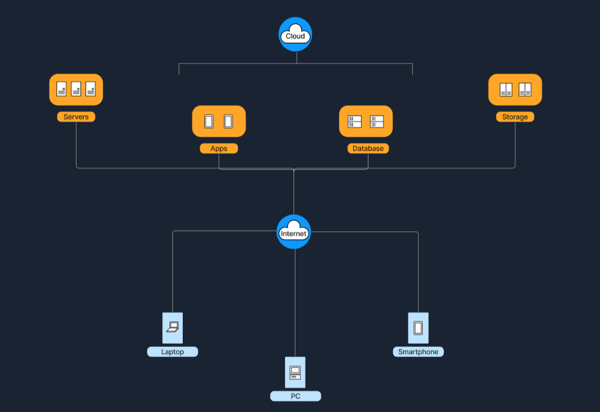
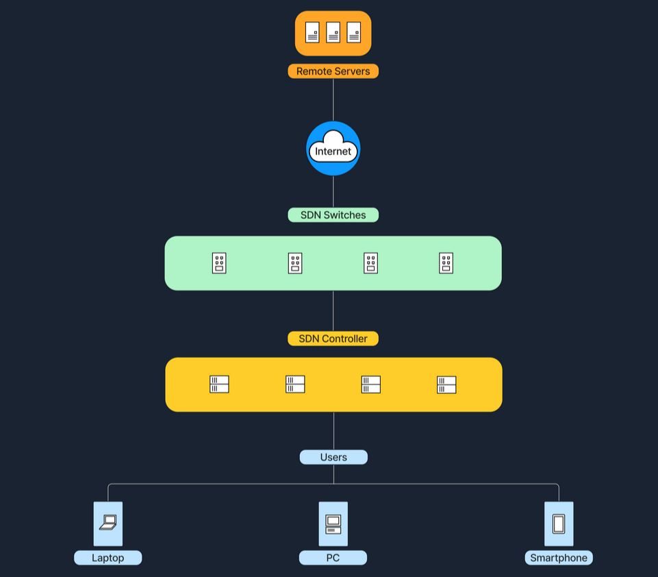

# 8. Internet Architecture

**Internet Architecture** (Kiến trúc mạng Internet) mô tả cách thức dữ liệu được tổ chức, truyền tải và quản lý xuyên suốt các hệ thống mạng. Các mô hình kiến trúc khác nhau được sinh ra để phục vụ những nhu cầu chuyên biệt: một số mang lại mô hình client-server trực diện và tập trung (như một website thông thường), trong khi số khác lại dựa trên cách tiếp cận phân tán (như các nền tảng chia sẻ tệp tin P2P). 

Việc thấu hiểu các mô hình kiến trúc này giúp chúng ta nắm bắt được lý do vì sao các hệ thống mạng lại được thiết kế và vận hành theo cách của chúng. Mỗi kiến trúc giải quyết một bài toán riêng, và trong thực tế chúng ta thường thấy sự kết hợp của nhiều kiến trúc để tạo nên các mô hình lai (hybrid model). Mỗi mô hình đều mang lại một tập hợp những điểm mạnh và sự đánh đổi riêng về khả năng mở rộng (scalability), hiệu năng (performance), an ninh bảo mật (security) và tính dễ quản trị (manageability).

Dưới đây là phân tích chi tiết về từng mô hình kiến trúc mạng phổ biến.

---

### 1. Kiến trúc Peer-to-Peer (P2P)

Trong một mạng **Peer-to-Peer (P2P - Mạng ngang hàng)**, mỗi node (dù là máy tính hay bất kỳ thiết bị nào) đều đồng thời đóng vai trò là cả **client lẫn server**. Thiết lập này cho phép các node giao tiếp trực tiếp với nhau, chia sẻ tài nguyên như tệp tin, năng lực xử lý (CPU) hoặc băng thông mà không cần phụ thuộc vào một máy chủ trung tâm. Mạng P2P có thể hoàn toàn phi tập trung (fully decentralized - không hề có máy chủ trung tâm nào) hoặc bán tập trung (partially centralized - có một máy chủ điều phối một số tác vụ danh mục nhưng không trực tiếp lưu trữ dữ liệu).

> **Ví dụ thực tế dễ hình dung:**  
> Hãy tưởng tượng một nhóm bạn muốn chia sẻ ảnh du lịch với nhau. Thay vì tải toàn bộ ảnh lên một trang web hoặc một máy chủ duy nhất, mỗi người tự thiết lập một thư mục chia sẻ trên máy tính của mình để những người khác có thể truy cập. Họ sử dụng một phần mềm chia sẻ file kết nối trực tiếp các máy tính với nhau.  
> 
> Đầu tiên, tất cả cài đặt ứng dụng chia sẻ file P2P trên máy tính của mình. Tiếp theo, họ chọn thư mục chứa ảnh du lịch muốn chia sẻ. Khi mọi người cùng bật ứng dụng P2P, họ có thể duyệt và tải ảnh trực tiếp từ thư mục của nhau mà không cần chuyển qua bất kỳ máy chủ lưu trữ trung gian nào.

Một ví dụ kinh điển và phổ biến nhất của kiến trúc P2P chính là mạng chia sẻ file qua **torrent** (như ứng dụng BitTorrent). Trong hệ thống này, bất kỳ ai đang nắm giữ file (được gọi là **seeder**) đều có thể tải lên (upload), cho phép những người khác cùng lúc tải về (download) từ nhiều nguồn khác nhau.

Sơ đồ dưới đây minh họa mô hình mạng ngang hàng kết nối trực tiếp giữa các thiết bị:

#### Ưu điểm và Nhược điểm của kiến trúc P2P

| Ưu điểm (Advantages) | Mô tả chi tiết |
| :--- | :--- |
| **Khả năng mở rộng (Scalability)** | Càng nhiều node tham gia thì tổng tài nguyên của mạng (dung lượng lưu trữ, CPU, băng thông tải) càng tăng lên. |
| **Khả năng phục hồi (Resilience)** | Nếu một node mất kết nối hoặc bị sập, các node còn lại vẫn tiếp tục hoạt động và duy trì mạng bình thường mà không làm gián đoạn toàn bộ hệ thống. |
| **Phân tán chi phí (Cost Distribution)** | Gánh nặng về tài nguyên (băng thông, lưu trữ) được san sẻ đều cho các peer, giúp tiết kiệm chi phí hạ tầng máy chủ cho đơn vị phát triển. |

| Nhược điểm (Disadvantages) | Mô tả chi tiết |
| :--- | :--- |
| **Độ phức tạp trong quản trị** | Rất khó để kiểm soát, cập nhật phần mềm và thực thi các chính sách an ninh mạng (security policy) đồng nhất trên tất cả các node. |
| **Rủi ro về độ sẵn sàng của dữ liệu** | Nếu quá nhiều peer rời khỏi mạng (hoặc không còn seeder nào), tài nguyên và tệp tin đó có thể biến mất hoặc không thể tải về được nữa. |
| **Thách thức an ninh bảo mật** | Mỗi node tham gia vào mạng đều phải đối mặt với nguy cơ bị tấn công hoặc phơi nhiễm các vulnerability do kết nối trực tiếp với các máy lạ. |

---

### 2. Kiến trúc Client-Server

Mô hình **Client-Server** là một trong những kiến trúc kinh điển và được ứng dụng rộng rãi nhất trên toàn cầu hiện nay. Trong mô hình này:
- **Client**: Là các thiết bị của người dùng cuối, đóng vai trò gửi yêu cầu (requests) - ví dụ như trình duyệt web gửi yêu cầu tải trang web.
- **Server**: Là máy chủ tập trung lưu trữ dữ liệu và ứng dụng, đóng vai trò tiếp nhận và phản hồi các yêu cầu từ client (như web server gửi trả nội dung HTML của trang web).

Nhiều client có thể cùng lúc kết nối tới một cụm server tập trung để sử dụng dịch vụ và khai thác tài nguyên số.

> **Ví dụ thực tế:**  
> Giả sử bạn muốn xem dự báo thời tiết trên mạng. Bạn mở trình duyệt trên điện thoại hoặc máy tính, gõ tên trang web (ví dụ: `weatherexample.com`) và nhấn Enter. Trình duyệt gửi một HTTP request qua Internet tới máy chủ lưu trữ `weatherexample.com`. Máy chủ này - một cỗ máy mạnh mẽ được thiết kế riêng để xử lý lượng lớn yêu cầu - sẽ tiếp nhận, tra cứu dữ liệu thời tiết mới nhất và gửi gói tin phản hồi về máy bạn. Trình duyệt tiếp nhận dữ liệu và hiển thị giao diện trang web hoàn chỉnh.

Sơ đồ dưới đây minh họa kết nối tập trung từ các Client tới Server qua mạng Internet:

#### Mô hình phân tầng (Tier Model) trong Client-Server
Để nâng cao khả năng mở rộng, tính bảo mật, hiệu năng và khả năng quản lý, kiến trúc Client-Server thường được phân tách thành các tầng (tiers):

- **Single-Tier Architecture (Kiến trúc 1 tầng)**: Toàn bộ thành phần - gồm giao diện người dùng (client), xử lý nghiệp vụ (server) và cơ sở dữ liệu (database) - đều nằm chung trên cùng một máy tính duy nhất. Cấu trúc này đơn giản nhưng hầu như không thể mở rộng và tiềm ẩn rủi ro bảo mật cao, hiếm khi dùng cho ứng dụng thực tế.
- **Two-Tier Architecture (Kiến trúc 2 tầng)**: Tách rời môi trường ứng dụng thành 2 phần: Client đảm nhận tầng giao diện (presentation layer) và Server quản lý tầng dữ liệu (data layer/database). Thường gặp ở các phần mềm desktop văn phòng nội bộ, nơi giao diện chạy trên PC nhân viên và kết nối trực tiếp vào database server chung của công ty.
  - *Lưu ý quan trọng:* Trong các ứng dụng web thông thường, trình duyệt của người dùng không bao giờ kết nối trực tiếp vào database server. Trình duyệt chỉ gửi request tới **web server** để nhận về HTML/CSS/JS. Do đó, một người lướt website thông thường không cấu thành mô hình Two-Tier.
- **Three-Tier Architecture (Kiến trúc 3 tầng)**: Bổ sung thêm một tầng trung gian nằm giữa Client và Database Server gọi là **Application Server**:
  - *Tầng 1 (Client)*: Quản lý giao diện hiển thị (presentation layer).
  - *Tầng 2 (Application Server)*: Xử lý toàn bộ logic nghiệp vụ (business logic) và xử lý dữ liệu trung gian.
  - *Tầng 3 (Database Server)*: Chuyên trách lưu trữ và truy xuất cơ sở dữ liệu an toàn.  
  Sự phân tách này mang lại tính linh hoạt và khả năng mở rộng vượt trội, cho phép lập trình viên phát triển và bảo trì độc lập từng tầng.
- **N-Tier Architecture (Kiến trúc N tầng)**: Trong các hệ thống doanh nghiệp lớn và phức tạp, kiến trúc N-tier được sử dụng (với N là số tầng lớn hơn 3). Hệ thống có thể chia nhỏ thành nhiều lớp application server đảm nhận vi dịch vụ (microservices), xử lý thanh toán, cache, quản lý phiên... Kiến trúc này có khả năng mở rộng quy mô khổng lồ và phân tán chịu tải tối ưu.

#### Ưu điểm và Nhược điểm của Client-Server

| Ưu điểm (Advantages) | Mô tả chi tiết |
| :--- | :--- |
| **Kiểm soát tập trung (Centralized Control)** | Rất dễ dàng quản lý, cập nhật phần mềm và kiểm soát dữ liệu trên một vài máy chủ trung tâm. |
| **Bảo mật cao (Security)** | Có thể áp dụng các chính sách an ninh mạng nghiêm ngặt và quản lý phân quyền tập trung. |
| **Hiệu năng tối ưu (Performance)** | Các server chuyên dụng được tối ưu hóa phần cứng mạnh mẽ để hoàn thành xuất sắc các tác vụ nặng. |

| Nhược điểm (Disadvantages) | Mô tả chi tiết |
| :--- | :--- |
| **Điểm lỗi đơn lẻ (Single Point of Failure)** | Nếu máy chủ trung tâm gặp sự cố hoặc bị sập, toàn bộ các client kết nối đến sẽ mất hoàn toàn quyền truy cập dịch vụ. |
| **Chi phí và bảo trì tốn kém** | Việc mua sắm, thiết lập và duy trì hạ tầng máy chủ doanh nghiệp đòi hỏi ngân sách lớn và đội ngũ kỹ sư chuyên môn cao vận hành 24/7. |
| **Nghẽn mạng (Network Congestion)** | Khi lượng traffic đột biến và quá nhiều client cùng truy cập đồng thời, server có thể bị quá tải, dẫn đến chậm chạp hoặc từ chối kết nối. |

---

### 3. Kiến trúc lai (Hybrid Architecture)

**Hybrid Architecture** là sự kết hợp khéo léo giữa thế mạnh của cả hai mô hình **Client-Server** và **Peer-to-Peer (P2P)**. Trong thiết lập này, các server trung tâm được sử dụng để điều phối, quản trị danh bạ và xác thực người dùng, trong khi việc truyền tải dữ liệu dung lượng lớn thực tế lại diễn ra trực tiếp giữa các peer với nhau.

> **Ví dụ ứng dụng thực tế:**  
> Khi bạn mở một ứng dụng họp trực tuyến (video conference) và đăng nhập:
> - Tên đăng nhập và mật khẩu của bạn được gửi lên các **server trung tâm** để xác thực danh tính. Server trung tâm cũng phụ trách việc tạo phòng họp, điều phối danh sách người tham gia và cấp quyền truy cập.
> - Tuy nhiên, khi cuộc họp bắt đầu, luồng dữ liệu video và âm thanh thực tế lại được truyền trực tiếp (**peer-to-peer**) giữa máy tính của bạn và các thành viên khác, bỏ qua server trung tâm. Cách làm này giảm thiểu độ trễ (lag), nâng cao độ nét của hình ảnh và giải phóng gánh nặng băng thông khổng lồ cho server.

Sơ đồ dưới đây minh họa kiến trúc lai kết hợp giữa máy chủ trung tâm và kết nối ngang hàng giữa các thiết bị:

#### Ưu điểm và Nhược điểm của Hybrid Architecture

| Ưu điểm (Advantages) | Mô tả chi tiết |
| :--- | :--- |
| **Hiệu quả cao (Efficiency)** | Giảm tải khối lượng công việc và băng thông khổng lồ cho server nhờ việc các peer tự trao đổi dữ liệu cho nhau. |
| **Vẫn giữ được khả năng kiểm soát (Control)** | Máy chủ trung tâm vẫn quản lý tốt khâu xác thực người dùng, danh bạ và chỉ mục tìm kiếm. |

| Nhược điểm (Disadvantages) | Mô tả chi tiết |
| :--- | :--- |
| **Triển khai phức tạp** | Đòi hỏi thiết kế kiến trúc phần mềm tinh vi hơn nhiều để xử lý mượt mà cả thành phần tập trung lẫn phân tán. |
| **Rủi ro ở mắt xích trung tâm** | Nếu máy chủ điều phối trung tâm bị sập, các peer có thể sẽ không thể tìm thấy nhau để khởi tạo liên lạc. |

---

### 4. Kiến trúc điện toán đám mây (Cloud Architecture)

**Cloud Architecture** là mô hình hạ tầng điện toán được lưu trữ, cung cấp và quản lý bởi các nhà cung cấp bên thứ ba (như AWS, Microsoft Azure, Google Cloud). Kiến trúc này vận hành trên nền tảng ảo hóa quy mô lớn dựa trên mô hình Client-Server, cung cấp quyền truy cập theo nhu cầu (on-demand) tới các tài nguyên như máy chủ ảo, bộ nhớ lưu trữ, cơ sở dữ liệu và ứng dụng thông qua Internet. Người dùng chỉ việc khai thác dịch vụ mà không cần bận tâm quản lý phần cứng vật lý bên dưới.

Các dịch vụ như Google Drive hay Dropbox là ví dụ điển hình của mô hình điện toán đám mây hoạt động dưới dạng **SaaS (Software as a Service)**.

Sơ đồ dưới đây minh họa hệ sinh thái Cloud kết nối các tài nguyên tập trung tới các thiết bị của người dùng:

#### 5 Đặc trưng cốt lõi của Cloud Architecture:
1. **On-demand self-service (Tự phục vụ theo nhu cầu)**: Người dùng có thể tự động khởi tạo và cấu hình tài nguyên (như bật một máy chủ mới) chỉ bằng vài cú nhấp chuột mà không cần sự can thiệp thủ công từ nhà cung cấp.
2. **Broad network access (Truy cập mạng rộng rãi)**: Dịch vụ có thể truy cập mượt mà từ bất kỳ thiết bị nào (laptop, PC, smartphone) thông qua kết nối Internet tiêu chuẩn.
3. **Resource pooling (Dùng chung tài nguyên)**: Tài nguyên tính toán được gom lại để phục vụ linh hoạt cho nhiều khách hàng khác nhau theo mô hình đa người thuê (multi-tenant).
4. **Rapid elasticity (Co giãn linh hoạt)**: Dễ dàng mở rộng tăng vọt tài nguyên khi nhu cầu tăng cao và thu hẹp lại khi nhu cầu giảm, diễn ra gần như tức thì.
5. **Measured service (Đo lường chi phí chuẩn xác)**: Bạn dùng bao nhiêu trả bấy nhiêu (pay-as-you-go), hệ thống tự động theo dõi và thanh toán theo mức tiêu thụ tài nguyên thực tế.

#### Ưu điểm và Nhược điểm của Cloud Architecture

| Ưu điểm (Advantages) | Mô tả chi tiết |
| :--- | :--- |
| **Khả năng mở rộng vượt bậc (Scalability)** | Dễ dàng bổ sung hoặc cắt giảm hàng trăm server chỉ trong vài phút. |
| **Tiết kiệm chi phí đầu tư & bảo trì** | Toàn bộ hạ tầng phần cứng, bảo trì, điện lưới và làm mát đều do nhà cung cấp Cloud chịu trách nhiệm. |
| **Linh hoạt tối đa** | Nhân viên có thể làm việc và truy cập tài nguyên công ty từ bất kỳ đâu trên thế giới. |

| Nhược điểm (Disadvantages) | Mô tả chi tiết |
| :--- | :--- |
| **Bị phụ thuộc vào nhà cung cấp (Vendor Lock-in)** | Việc di chuyển toàn bộ dữ liệu và ứng dụng từ một nhà cung cấp đám mây này sang nhà cung cấp khác có thể rất phức tạp và tốn kém. |
| **Mối lo về Bảo mật và Tuân thủ (Security/Compliance)** | Việc đặt dữ liệu quan trọng trên máy chủ của bên thứ ba đòi hỏi doanh nghiệp phải kiểm soát chặt chẽ các quy định về quyền riêng tư và bảo vệ dữ liệu. |
| **Phụ thuộc vào đường truyền mạng** | Đòi hỏi kết nối Internet phải luôn ổn định; nếu mất mạng Internet, việc truy cập vào toàn bộ dịch vụ đám mây sẽ bị tê liệt. |

---

### 5. Kiến trúc mạng điều khiển bằng phần mềm (Software-Defined Architecture - SDN)

**Software-Defined Networking (SDN)** là một cách tiếp cận kiến trúc mạng hiện đại, tách biệt hoàn toàn giữa hai mặt phẳng:
- **Control Plane (Mặt phẳng điều khiển)**: Nơi đưa ra các quyết định thông minh về việc lưu lượng mạng sẽ được định tuyến đi đâu.
- **Data Plane (Mặt phẳng dữ liệu)**: Nơi trực tiếp chuyển tiếp các gói tin theo chỉ thị.

Trong mạng truyền thống, cả hai mặt phẳng này đều nằm tích hợp bên trong từng thiết bị phần cứng riêng lẻ (như router, switch). Nhưng trong SDN, Control Plane được tách ra và tập trung hóa vào một **software-based controller** (bộ điều khiển phần mềm). Các thiết bị mạng bên dưới chỉ đóng vai trò thuần túy là thực thi chỉ thị nhận được từ controller trung tâm. 

SDN mang lại một môi trường quản trị mạng có thể lập trình được (**programmable**), cho phép các kỹ sư mạng điều chỉnh linh hoạt chính sách định tuyến và an ninh mạng bằng phần mềm mà không cần đăng nhập cấu hình thủ công từng thiết bị phần cứng.

Sơ đồ dưới đây minh họa cấu trúc của SDN với bộ điều khiển trung tâm quản lý các switch:

#### Ưu điểm và Nhược điểm của SDN

| Ưu điểm (Advantages) | Mô tả chi tiết |
| :--- | :--- |
| **Quản trị tập trung (Centralized Control)** | Đơn giản hóa toàn bộ công tác quản lý mạng thông qua một giao diện phần mềm điều khiển duy nhất. |
| **Tự động hóa và lập trình linh hoạt** | Có thể thay đổi cấu hình mạng toàn doanh nghiệp trong tích tắc bằng code hoặc script tự động. |
| **Tối ưu hóa tài nguyên & hiệu năng** | Cho phép điều phối lưu lượng mạng linh hoạt theo thời gian thực, tối ưu hóa băng thông cho các ứng dụng trọng yếu. |

| Nhược điểm (Disadvantages) | Mô tả chi tiết |
| :--- | :--- |
| **Lỗ hổng tại Controller trung tâm** | Bộ điều khiển SDN Controller là trung tâm đầu não; nếu controller này bị tấn công hoặc bị sập, toàn bộ hệ thống mạng có thể bị tê liệt. |
| **Độ phức tạp khi triển khai** | Đòi hỏi đội ngũ kỹ sư phải có bộ kỹ năng mới (vừa hiểu mạng vừa biết lập trình phần mềm) cùng các thiết bị phần cứng chuyên biệt hỗ trợ SDN. |

---

### Bảng so sánh tổng quan các kiến trúc mạng

| Kiến trúc | Tính chất tập trung | Khả năng mở rộng (Scalability) | Độ khó trong quản lý | Tình huống sử dụng điển hình |
| :--- | :--- | :--- | :--- | :--- |
| **P2P** | Phi tập trung (hoặc bán tập trung) | Rất cao (khi số lượng peer tăng) | Phức tạp (không có quyền kiểm soát tập trung) | Chia sẻ tệp tin, công nghệ Blockchain |
| **Client-Server** | Tập trung | Trung bình | Tương đối dễ (quản lý từ máy chủ) | Website, hệ thống email doanh nghiệp |
| **Hybrid** | Bán tập trung | Cao hơn Client-Server thuần túy | Phức tạp hơn Client-Server | Ứng dụng chat, họp video trực tuyến |
| **Cloud** | Tập trung tại hạ tầng nhà cung cấp | Rất cao | Dễ dàng (được bên thứ ba quản trị phần cứng) | Lưu trữ đám mây, SaaS, PaaS, IaaS |
| **SDN** | Tập trung ở Control Plane | Rất cao (điều khiển bằng chính sách) | Trung bình (cần công cụ chuyên biệt) | Trung tâm dữ liệu (Data Center), mạng doanh nghiệp lớn |

---

### Kết luận

Mỗi mô hình kiến trúc mạng đều sở hữu những thế mạnh riêng biệt đi kèm với những thách thức cụ thể. Trong thực tế, các kiến trúc sư mạng thường khéo léo kết hợp nhiều mô hình lại với nhau để dung hòa hoàn hảo giữa hiệu năng, khả năng mở rộng, chi phí và mức độ an toàn thông tin.
