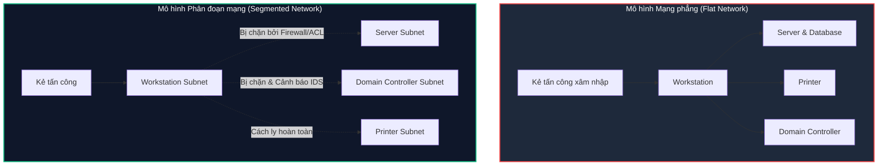
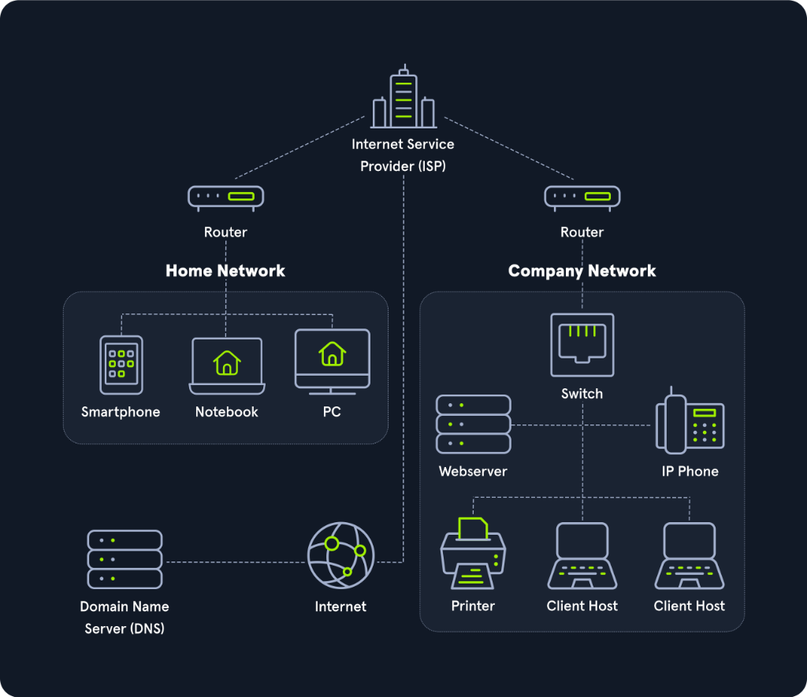

# Networking Overview

Mạng máy tính (Computer Network) là nền tảng cho phép hai hoặc nhiều thiết bị kết nối và trao đổi thông tin với nhau. Có rất nhiều dạng kiến trúc mạng (Topologies: Mesh, Tree, Star), phương tiện truyền dẫn (Mediums: Cáp Ethernet, Cáp quang Fiber, Cáp đồng trục Coaxial, Sóng không dây Wireless), và các giao thức truyền tải (Protocols: TCP, UDP, IPX) được triển khai trên thực tế.

Đối với một chuyên gia an ninh mạng (Security Professional), việc hiểu sâu về hạ tầng mạng là điều tối quan trọng. Khi hệ thống mạng gặp sự cố hoặc bị tấn công, các lỗi có thể diễn ra trong âm thầm (**silent error**), và nếu thiếu kiến thức vững chắc về mạng, chúng ta sẽ rất dễ bỏ lỡ những dấu vết xâm nhập sống còn.

---

## 1. Flat Network vs. Network Segmentation (Mạng phẳng và Phân đoạn mạng)

Việc thiết lập một mạng phẳng quy mô lớn (**Flat Network**) về mặt kỹ thuật không quá phức tạp và có thể hoạt động khá ổn định xét thuần túy về khía cạnh vận hành (Operations). Tuy nhiên, về mặt bảo mật:

> **Phép ẩn dụ thực tế:** Một mạng phẳng giống như việc bạn xây dựng một ngôi nhà lớn trên mảnh đất trống, rồi tự tin rằng ngôi nhà hoàn toàn an toàn chỉ vì cửa chính có một chiếc ổ khóa. Nếu kẻ gian đã vượt qua được ổ khóa cửa chính, họ có thể tự do đi lại trong mọi phòng, lục lọi tủ tiền hay phòng ngủ mà không gặp bất kỳ rào cản nào nữa.

Ngược lại, bằng cách chia nhỏ mạng thành nhiều subnet độc lập và thiết lập các chính sách kiểm soát luồng giao tiếp giữa chúng, chúng ta đã bổ sung nhiều tầng phòng thủ (**Defense in Depth**). Việc kẻ tấn công thực hiện **Pivoting** (di chuyển ngang trong mạng) không phải là bất khả thi, nhưng việc di chuyển lén lút và nhanh chóng qua các lớp kiểm soát mạng là cực kỳ khó khăn, từ đó giúp đội ngũ phòng thủ dễ dàng phát hiện và ngăn chặn.

Hãy đối chiếu với 3 ví dụ an ninh ngôi nhà:

### Ví dụ 1: Hàng rào và Cổng kiểm soát (Access Control Lists)
- **Trong đời thực:** Xây dựng hàng rào bao quanh mảnh đất và chỉ mở một số cổng ra vào nhất định. Kẻ gian hoàn toàn có thể trèo qua rào, nhưng hành động trèo rào rất lộ liễu và bất thường, giúp bảo vệ lập tức phát hiện.
- **Trong mạng máy tính:** Chia mạng thành các subnet nhỏ và áp đặt **Access Control Lists (ACL)**. Khi đó, những hành vi bất thường sẽ bị bắt ngay lập tức.  
  *Câu hỏi an ninh:* **Tại sao printer network lại phát sinh traffic HTTP tới các server?**

### Ví dụ 2: Hệ thống chiếu sáng (Network Mapping & Documentation)
- **Trong đời thực:** Lắp đặt đèn chiếu sáng xung quanh khuôn viên để mọi hoạt động ban đêm đều được quan sát rõ ràng.
- **Trong mạng máy tính:** Lập sơ đồ mạng chi tiết và tài liệu hóa rõ ràng mục đích của từng phân đoạn mạng.  
  *Câu hỏi an ninh:* **Tại sao máy in trong văn phòng lại kết nối thẳng ra Internet?**

### Ví dụ 3: Bụi gai dưới cửa sổ (Hệ thống IDS/IPS)
- **Trong đời thực:** Trồng các bụi cây gai rậm rạp ngay dưới bậu cửa sổ để làm nản lòng bất kỳ ai có ý định cạy cửa đột nhập.
- **Trong mạng máy tính:** Triển khai các hệ thống phát hiện xâm nhập (**Intrusion Detection Systems**) như **Suricata** hoặc **Snort** để ngăn chặn và cảnh báo các hành vi thăm dò mạng.  
  *Câu hỏi an ninh:* **Tại sao một đợt port scan lại có nguồn phát xuất phát từ một máy in?**

> **Thách thức:** Những ví dụ trên nghe có vẻ là những nguyên tắc hiển nhiên (Common Sense). Tuy nhiên, nếu một chiếc máy in được cắm vào một flat network `/24` và nhận IP tự động từ DHCP, việc áp đặt các chính sách hạn chế như trên sẽ cực kỳ phức tạp.

---

## 2. Câu chuyện thực chiến: Sơ suất của Pentester vì hổng kiến thức mạng

Hầu hết các mạng phổ thông sử dụng subnet `/24` (Subnet Mask `255.255.255.0`), phổ biến đến mức nhiều **Penetration Tester (Pentester)** thường chủ quan đặt mặc định subnet mask này vào máy của mình mà không kiểm tra thực tế cấu hình mạng của mục tiêu.

Mạng `/24` cho phép các máy tính nói chuyện trực tiếp với nhau miễn là 3 octet đầu của IP giống nhau (ví dụ: từ `192.168.1.1` đến `192.168.1.254`). Tuy nhiên, nếu quản trị viên sử dụng subnet `/25` (`255.255.255.128`), dải IP sẽ bị chia làm đôi:
- Nửa đầu: từ `.1` đến `.126`.
- Nửa sau: từ `.129` đến `.254`.
Các máy ở nửa này hoàn toàn không thể giao tiếp trực tiếp ở Layer 2 với các máy ở nửa kia nếu không đi qua Gateway!

### Tình huống thực tế:
Trong một báo cáo Penetration Test, pentester đã kết luận rằng **Domain Controller** của khách hàng bị offline. Nhưng trên thực tế, Domain Controller vẫn hoạt động bình thường, nó chỉ nằm ở một subnet khác:

- **Server Gateway:** `10.20.0.1/25`
- **Domain Controller:** `10.20.0.10/25` (Nửa subnet đầu: `.1` - `.126`)
- **Client Gateway:** `10.20.0.129/25`
- **Client Workstation:** `10.20.0.200/25` (Nửa subnet sau: `.129` - `.254`)
- **Pentester IP:** `10.20.0.252/24` (Tự ý đặt Gateway tới `10.20.0.1`)

Pentester chỉ giao tiếp được với các workstation của client và tưởng mình đã hoàn thành xuất sắc bài test khi dump được hash/mật khẩu workstation bằng Impacket. Tuy nhiên, do không hiểu về subnet mask `/25`, họ không bao giờ thoát ra khỏi mạng Client để tiếp cận các mục tiêu giá trị cao (**High-Value Targets**) như database server hay Domain Controller!

---

## 3. Mô hình mạng làm việc từ xa (Work From Home - WFH)

Để hình dung cách thức các mạng giao tiếp với nhau trên quy mô toàn cầu, hãy xem xét sơ đồ kiến trúc kết nối giữa mạng gia đình (**Home Network**) và mạng doanh nghiệp (**Company Network**):

Hạ tầng Internet toàn cầu thực chất được xây dựng từ hàng triệu mạng con được phân chia như trên. Chúng ta có thể hình dung việc truyền thông tin trong mạng máy tính giống như việc **gửi thư hoặc chuyển phát bưu kiện**:

### Phép ẩn dụ Bưu chính: FQDN vs. URL

Khi chúng ta ngồi tại Home Network và muốn truy cập vào website của công ty, chúng ta gửi các gói tin dữ liệu (packets) sang máy chủ web đặt tại Company Network.

Chúng ta nhập địa chỉ website vào trình duyệt. Địa chỉ này có thể là FQDN hoặc URL:

| Khái niệm | Ví dụ cụ thể | Ẩn dụ thực tế |
| :--- | :--- | :--- |
| **FQDN** (Fully Qualified Domain Name) | `www.hackthebox.eu` | Chỉ định địa chỉ của **tòa nhà trụ sở**. |
| **URL** (Uniform Resource Locator) | `https://www.hackthebox.eu/example?floor=2&office=dev&employee=17` | Chỉ định chính xác đến **tầng**, **phòng làm việc**, **hộp thư** và đích danh **nhân viên** nhận thư. |

### Hành trình chuyển phát bưu kiện qua Router, ISP và DNS:

1. **Bưu cục địa phương (Home Router):** Bạn giao gói tin cho Router nhà mình. Router đóng vai trò là bưu điện khu vực kết nối bạn với Internet.
2. **Bưu điện trung tâm (ISP):** Router chuyển tiếp gói tin đến nhà cung cấp dịch vụ mạng (ISP).
3. **Danh bạ địa chỉ (DNS Server):** Bưu điện trung tâm tra cứu trong cuốn danh bạ điện thoại toàn cầu (Domain Name System - DNS) xem tên miền này tương ứng với tọa độ địa lý số nào trên mạng, và nhận về địa chỉ **IP Address**.
4. **Vận chuyển chuyến bay thẳng:** Sau khi đã có tọa độ IP đích, gói tin được định tuyến qua các đường trục Internet để đến đúng mạng của công ty.
5. **Phản hồi từ Web Server:** Sau khi Web Server xử lý yêu cầu, nó sẽ gửi ngược bưu kiện chứa mã nguồn trang web thông qua Router của Company Network về địa chỉ người gửi (IP công cộng của gia đình bạn).

---

## 4. Góc nhìn an ninh chuyên sâu: Phân tách 5 vùng mạng chuẩn mực

Quan sát sơ đồ mạng công ty (Company Network) ở trên, một chuyên gia bảo mật sẽ không bao giờ để toàn bộ các thiết bị (Webserver, IP Phone, Printer, Workstations, Switch/Router) trong cùng một mạng. Một mạng doanh nghiệp an toàn cần được chia thành ít nhất **5 phân vùng mạng độc lập**:

| Phân vùng mạng | Lý do an ninh & Thiết kế kỹ thuật |
| :--- | :--- |
| **1. Web Server trong vùng DMZ** | Web Server tiếp xúc trực tiếp với Internet công cộng để người dùng bên ngoài truy cập, do đó có nguy cơ bị tấn công cao nhất. Đặt Web Server trong **DMZ (Demilitarized Zone)** giúp ngăn chặn kẻ tấn công lợi dụng lỗ hổng trên web server làm bàn đạp tấn công sang mạng nội bộ. |
| **2. Workstations (Mạng máy trạm)** | Các máy tính của nhân viên phải nằm trong mạng riêng. Mỗi máy trạm cần có quy tắc **Host-Based Firewall** cấm giao tiếp ngang hàng trực tiếp với máy trạm khác. Nếu máy trạm nằm chung mạng với máy chủ, các đòn tấn công như **ARP Spoofing** hoặc **Man-in-the-Middle (MitM)** sẽ trở nên cực kỳ nguy hiểm. |
| **3. Management Network (Mạng quản trị cho Switch & Router)** | Switch và Router phải nằm trong một dải mạng quản trị cách ly hoàn toàn. Điều này ngăn chặn người dùng thông thường nghe lén các bản tin định tuyến (ví dụ: OSPF advertisements). Kẻ tấn công trên mạng nội bộ có thể lợi dụng bản tin OSPF không được bảo vệ để giả mạo bảng định tuyến và thực hiện tấn công nghe lén toàn bộ mạng. |
| **4. IP Phones (Mạng điện thoại VoIP)** | Điện thoại IP cần nằm trên mạng riêng để ngăn chặn kẻ tấn công trên máy tính bắt gói tin âm thanh và nghe lén cuộc gọi. Ngoài ra, việc tách riêng còn giúp cấu hình chính sách **QoS (Quality of Service)** ưu tiên băng thông, tránh tình trạng giật lag cho thoại. |
| **5. Printers (Mạng máy in)** | Máy in là thiết bị cực kỳ khó vá lỗi và bảo mật. Do cơ chế hoạt động của Windows, nếu máy in yêu cầu xác thực trong phiên in, máy tính người dùng có thể gửi mã băm xác thực **NTLMv2**, tạo cơ hội cho kẻ tấn công đánh cắp mật khẩu. Máy in cũng là nơi chứa nhiều tài liệu nội bộ nhạy cảm và là bàn đạp lý tưởng để cài cắm mã độc duy trì quyền truy cập (**Persistence**). |

---

## 5. Câu chuyện thực tế: Đòn tấn công vật lý bằng chiếc máy in trong đại dịch COVID

Trong giai đoạn đại dịch COVID, một chuyên gia bảo mật được giao nhiệm vụ thực hiện kiểm thử xâm nhập vật lý (**Physical Penetration Test**) cho một công ty ở bang khác, trong bối cảnh các lệnh phong tỏa đi lại đang được áp dụng và văn phòng công ty chỉ có rất ít nhân sự trực.

Chuyên gia này đã lên một kế hoạch táo bạo:
1. Mua một chiếc máy in cao cấp đắt tiền, can thiệp vào phần mềm của máy in để cấy sẵn một **Reverse Shell** (kết nối điều khiển từ xa bí mật).
2. Đóng gói máy in cẩn thận và gửi chuyển phát nhanh tới văn phòng công ty mục tiêu.
3. Đồng thời gửi một email giả mạo (Phishing) cảm ơn những nhân viên đã chăm chỉ đến văn phòng làm việc trong mùa dịch, giới thiệu chiếc máy in mới được trang bị tính năng scan/in nhanh chóng để hỗ trợ công việc.
4. Nhân viên văn phòng hào hứng mở hộp và cắm ngay chiếc máy in vào hệ thống mạng nội bộ!
5. Chiếc máy in vừa khởi động liền kích hoạt Reverse Shell kết nối ngược về máy của Pentester qua Internet.
6. Ngay sau đó, máy tính của Quản trị viên hệ thống (**Domain Administrator**) gửi lệnh in và "hào phóng" chuyển luôn thông tin xác thực (Credentials) sang cho máy in!

> **Bài học rút ra:** Nếu công ty áp dụng thiết kế phân đoạn mạng an toàn, đòn tấn công trên đã hoàn toàn thất bại:
> - **Máy in không bao giờ được phép kết nối tự do ra Internet** (chặn đường gửi Reverse Shell).
> - **Máy trạm không được phép kết nối tới máy in qua cổng SMB 445**.
> - **Máy in không bao giờ được phép chủ động khởi tạo kết nối (Initiate Connection) tới các máy trạm**. Máy in/máy scan chỉ được phép giao tiếp giới hạn tới Mail Server để gửi tài liệu đã quét qua email.

---

## Tóm tắt kiến thức cốt lõi

- **Mạng máy tính:** Là phương tiện kết nối, nhưng sự cố mạng có thể che giấu các cuộc tấn công tinh vi.
- **Mạng phẳng (Flat Network):** Cực kỳ nguy hiểm vì thiếu chiều sâu phòng ngự.
- **Phân đoạn mạng (Network Segmentation):** Bắt buộc phải triển khai bằng cách chia nhỏ Subnet/VLAN và áp đặt ACL/Firewall giữa các vùng.
- **Kỹ năng mạng của Security Professional:** Phải nắm vững Subnet Mask (`/24`, `/25`) để không bỏ sót các máy chủ và dịch vụ quan trọng trong mạng mục tiêu.
- **Phân tách vùng chức năng:** Tách biệt tối thiểu DMZ (Web), Client Workstations, Management, VoIP và Printers để triệt tiêu các đòn tấn công lan truyền nội bộ.
