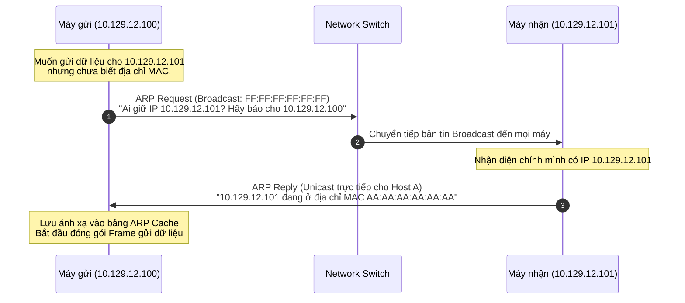
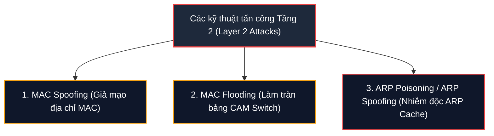

# MAC Addresses

Nếu như địa chỉ IP đóng vai trò là địa chỉ logic có thể thay đổi linh hoạt tùy theo vị trí địa lý của thiết bị, thì địa chỉ **MAC (Media Access Control)** chính là "tấm thẻ căn cước" vật lý độc nhất vô nhị gắn liền với từng giao diện mạng (**Network Interface**).

Tại tầng liên kết dữ liệu (**Layer 2 - Data Link Layer**), mọi thiết bị mạng (từ máy tính, máy in, card Wi-Fi cho đến cổng chuyển tiếp trên Router) đều nhận diện và trao đổi khung dữ liệu (**Frames**) với nhau thông qua địa chỉ MAC.

Địa chỉ MAC được áp dụng trên nhiều chuẩn công nghệ phần cứng quốc tế do IEEE ban hành:
* **Ethernet:** Chuẩn IEEE 802.3 (Cáp mạng LAN có dây)
* **Wi-Fi / WLAN:** Chuẩn IEEE 802.11 (Mạng không dây)
* **Bluetooth:** Chuẩn IEEE 802.15 (Mạng cá nhân không dây WPAN)

Mặc dù được nhà sản xuất nạp cố định vào chip nhớ của card mạng (thường gọi là **BIA - Burned-In Address**), nhưng trên thực tế, hệ điều hành hoàn toàn cho phép chúng ta thay đổi hoặc giả mạo địa chỉ MAC tạm thời bằng phần mềm (**MAC Spoofing**).

---

## 1. Cấu trúc 48-bit của Địa chỉ MAC (MAC Structure)

Một địa chỉ MAC tiêu chuẩn có độ dài **48 bit (tương đương 6 byte hay 6 Octet)**, thường được biểu diễn dưới dạng số thập lục phân (**Hexadecimal**) để thuận tiện cho việc quản trị:

### Các định dạng hiển thị phổ biến trong thực tế:
* **Dạng chuẩn IEEE / Linux / macOS / Wireshark:** `DE:AD:BE:EF:13:37`
* **Dạng gạch nối (Windows Command Prompt):** `DE-AD-BE-EF-13-37`
* **Dạng Cisco System (Router / Switch):** `DEAD.BEEF.1337`

### Bảng phân tích chi tiết từng Octet từ Nhị phân sang Hex:

| Thành phần | Octet 1 | Octet 2 | Octet 3 | Octet 4 | Octet 5 | Octet 6 |
| :--- | :---: | :---: | :---: | :---: | :---: | :---: |
| **Dạng nhị phân (Binary)** | `1101 1110` | `1010 1101` | `1011 1110` | `1110 1111` | `0001 0011` | `0011 0111` |
| **Dạng Hexadecimal** | `DE` | `AD` | `BE` | `EF` | `13` | `37` |
| **Phân vùng cấu trúc** | <center>**OUI (3 Bytes đầu)**</center> | <center>**OUI**</center> | <center>**OUI**</center> | <center>**NIC Specific (3 Bytes sau)**</center> | <center>**NIC Specific**</center> | <center>**NIC Specific**</center> |

Toàn bộ 48 bit của địa chỉ MAC được chia làm hai nửa mang ý nghĩa kỹ thuật chuẩn hóa:

```shellsession
      +-----------------------------+-----------------------------+
      |      3 Bytes đầu (24-bit)    |     3 Bytes sau (24-bit)    |
      +-----------------------------+-----------------------------+
      |  OUI (Organizationally      |  NIC Specific / Device ID   |
      |  Unique Identifier)         |  (Nhà sản xuất tự đánh số)  |
      +-----------------------------+-----------------------------+
      Ví dụ: DE : AD : BE           Ví dụ: EF : 13 : 37
```

1. **OUI (Organizationally Unique Identifier - 24 bit đầu):**
   - Được tổ chức **IEEE** quản lý và cấp phát độc quyền cho từng hãng sản xuất phần cứng mạng (như Intel, Cisco, Apple, Realtek, v.v.).
   - Khi phân tích gói tin, chỉ cần đọc 3 byte đầu của địa chỉ MAC, chuyên viên an ninh mạng có thể nhận diện ngay nhà sản xuất phần cứng của thiết bị đó.
2. **NIC Specific / Individual Address Part (24 bit sau):**
   - Do chính nhà sản xuất thiết bị tự đánh số tuần tự trên dây chuyền sản xuất.
   - Quy trình này đảm bảo không có hai card mạng xuất xưởng nào của cùng một hãng bị trùng lặp địa chỉ vật lý.

---

## 2. Hai bit đặc biệt trong Octet đầu tiên (Special Bits)

Bên trong byte đầu tiên của địa chỉ MAC, có **2 bit cực kỳ quan trọng** tại vị trí hai bit có trọng số thấp nhất (Least Significant Bits):

```shellsession
Octet 1 (Ví dụ DE = 1101 1110 nhị phân):
Bit position:  7   6   5   4   3   2   1   0
Bit value:     1   1   0   1   1   1   1   0
                                       ^   ^
                                       |   +---> Bit 0: I/G Bit (Unicast vs Multicast)
                                       +-------> Bit 1: U/L Bit (Universal vs Local)
```

### 1. Bit I/G (Individual / Group - Bit 0): Phân biệt Unicast hay Multicast
* **Giá trị = 0 (Unicast):** Địa chỉ MAC đại diện cho duy nhất một card mạng vật lý cụ thể. Gói tin gửi tới địa chỉ này chỉ được tiếp nhận bởi đúng một thiết bị đích.
* **Giá trị = 1 (Multicast):** Địa chỉ MAC đại diện cho một nhóm thiết bị cùng lắng nghe chung một luồng lưu lượng (ví dụ: các giao thức định tuyến OSPF, RIPv2 hoặc dịch vụ truyền hình mạng).
  * Ví dụ chuẩn MAC Multicast IPv4: luôn bắt đầu bằng tiền tố `01:00:5E:...` (Octet đầu tiên là `01` -> bit cuối cùng là `1`).
* **Trường hợp ngoại lệ đặc biệt - Broadcast:** Khi toàn bộ 48 bit đều được bật lên thành `1` (`FF:FF:FF:FF:FF:FF`), đây là địa chỉ **MAC Broadcast**. Khung dữ liệu sẽ được Switch chuyển tiếp ra tất cả các cổng trong mạng nội bộ.

### 2. Bit U/L (Universal / Local - Bit 1): Phân biệt Địa chỉ Toàn cầu hay Cục bộ
* **Giá trị = 0 (Universal / Global OUI):** Địa chỉ MAC chuẩn hóa quốc tế do IEEE cấp phát cho nhà sản xuất.
* **Giá trị = 1 (Locally Administered):** Địa chỉ MAC do người quản trị cấu hình thủ công hoặc do phần mềm tự sinh (như card mạng ảo của VMware, Docker, hoặc khi sử dụng công cụ ẩn danh `macchanger`).

---

## 3. Giao thức phân giải địa chỉ ARP (Address Resolution Protocol)

Trong mô hình TCP/IP, ứng dụng làm việc với địa chỉ IP (Layer 3), nhưng card mạng vật lý trên switch lại chỉ hiểu địa chỉ MAC (Layer 2). Để kết nối hai tầng này lại với nhau, giao thức **ARP (Address Resolution Protocol)** ra đời.

> **Nhiệm vụ của ARP:** Dịch địa chỉ logic IP (Layer 3) thành địa chỉ vật lý MAC (Layer 2) tương ứng trong mạng nội bộ.



### Tiến trình trao đổi ARP gồm 2 bước cốt lõi:
1. **ARP Request:** Khi máy gửi muốn liên lạc với một IP trong cùng subnet mà chưa có MAC của máy đó, nó phát một bản tin **Broadcast** (`FF:FF:FF:FF:FF:FF`) hỏi toàn mạng: *"Ai sở hữu IP này, hãy trả lời cho tôi!"*.
2. **ARP Reply:** Máy sở hữu đúng địa chỉ IP đó sẽ gửi trả lời bằng một bản tin **Unicast** trực tiếp cho máy hỏi: *"Tôi đây, địa chỉ MAC của tôi là..."*.

### Phân tích gói tin ARP thực tế với `tshark`:

```shellsession
1 0.000000 10.129.12.100 -> 10.129.12.255 ARP 60 Who has 10.129.12.101? Tell 10.129.12.100
2 0.000015 10.129.12.101 -> 10.129.12.100 ARP 60 10.129.12.101 is at AA:AA:AA:AA:AA:AA
3 0.000030 10.129.12.102 -> 10.129.12.255 ARP 60 Who has 10.129.12.103? Tell 10.129.12.102
4 0.000045 10.129.12.103 -> 10.129.12.102 ARP 60 10.129.12.103 is at BB:BB:BB:BB:BB:BB
```

* **Dòng 1 & 3 (ARP Request):** Thông điệp `"Who has ... Tell ..."` được phát ra địa chỉ broadcast để tìm kiếm card mạng tương ứng.
* **Dòng 2 & 4 (ARP Reply):** Thông điệp phản hồi `"is at ..."` chứa chính xác địa chỉ MAC của mục tiêu để máy gửi lưu vào bộ nhớ đệm (**ARP Cache**).

---

## 4. Các véc-tơ tấn công tầng Layer 2 (Attack Vectors & Exploitations)

Tầng 2 vốn được thiết kế từ thời kỳ sơ khai của mạng máy tính với giả định rằng tất cả các thiết bị trong mạng nội bộ đều tin cậy lẫn nhau. Điều này tạo ra những điểm mù chí mạng mà các Pentester và Hacker thường khai thác:



### 1. MAC Spoofing (Giả mạo địa chỉ MAC)
- **Kịch bản:** Kẻ tấn công thay đổi địa chỉ MAC của máy mình để trùng khớp với địa chỉ MAC của một thiết bị được phép trong mạng (ví dụ: máy in mạng hoặc máy của sếp).
- **Mục tiêu:** Vượt qua cơ chế kiểm soát truy cập **MAC Address Filtering** trên Access Point Wi-Fi hoặc các cổng mạng phòng họp.

### 2. MAC Flooding (Tấn công làm tràn bảng CAM của Switch)
- **Kịch bản:** Sử dụng công cụ (như `macof`) để bơm liên tục hàng chục nghìn khung dữ liệu chứa các địa chỉ MAC nguồn ngẫu nhiên vào Switch.
- **Hậu quả:** Bộ nhớ lưu trữ bảng **CAM Table (Content Addressable Memory)** của Switch nhanh chóng bị cạn kiệt. 
- Khi không còn chỗ để lưu địa chỉ mới, Switch sẽ chuyển sang chế độ dự phòng (**Fail-Open / Hub mode**): phát tán toàn bộ gói tin nhận được ra tất cả các cổng còn lại (**Unicast Flooding**). Khi đó, kẻ tấn công cắm vào bất kỳ cổng nào cũng có thể nghe lén được lưu lượng của toàn công ty.

### 3. ARP Cache Poisoning / ARP Spoofing (Đầu độc bộ nhớ ARP)
Đây là một trong những đòn tấn công kinh điển và nguy hiểm nhất trong mạng LAN:
- **Lỗ hổng của ARP:** Giao thức ARP **không hề có cơ chế xác thực**. Hệ điều hành sẽ tự động cập nhật bảng ARP Cache ngay cả khi nó không hề phát lệnh hỏi trước đó (**Gratuitous ARP**).
- **Cách thức thực hiện (sử dụng công cụ như Ettercap, Bettercap hoặc arpspoof):**
  - Kẻ tấn công gửi liên tục các bản tin ARP giả mạo đến máy nạn nhân, khẳng định rằng: *"Tôi là Default Gateway (Router), hãy gửi dữ liệu đến MAC của tôi"*.
  - Đồng thời gửi bản tin ARP giả mạo đến Default Gateway: *"Tôi là máy nạn nhân, hãy gửi phản hồi đến MAC của tôi"*.

```shellsession
# Ví dụ log bắt gói ARP Spoofing bằng tshark:
1 0.000000 10.129.12.100 -> 10.129.12.101 ARP 60 10.129.12.255 is at CC:CC:CC:CC:CC:CC
2 0.000015 10.129.12.101 -> Broadcast      ARP 60 Who has 10.129.12.100? Tell 10.129.12.101
3 0.000030 10.129.12.100 -> 10.129.12.101 ARP 60 10.129.12.100 is at CC:CC:CC:CC:CC:CC
4 0.000045 10.129.12.101 -> 10.129.12.100 ARP 60 Who has 10.129.12.255? Tell 10.129.12.101
```

* **Dòng 1:** Kẻ tấn công (`10.129.12.100`) tự động gửi bản tin ARP giả mạo tới nạn nhân (`10.129.12.101`), tuyên bố địa chỉ của Gateway (`10.129.12.255`) hiện gắn với địa chỉ MAC của tin tặc (`CC:CC:CC:CC:CC:CC`).
* **Hậu quả:** Nạn nhân hoàn toàn bị đánh lừa. Toàn bộ lưu lượng duyệt web, tài khoản, mật khẩu của nạn nhân khi gửi ra ngoài Internet đều đi qua máy tin tặc trước, biến tin tặc thành kẻ đứng giữa (**Man-in-the-Middle - MITM**).

---

## 5. Giải pháp Phòng vệ Tầng 2 cho Blue Team (Defensive Measures)

Để ngăn chặn các cuộc tấn công Layer 2, chuyên viên an ninh mạng cần triển khai các chính sách bảo mật chuyên sâu trên hạ tầng Switch:

1. **Port Security (Chống MAC Spoofing & MAC Flooding):**
   - Cấu hình trên từng cổng của Switch để giới hạn số lượng địa chỉ MAC được phép kết nối (ví dụ: tối đa 1 MAC/cổng).
   - Thiết lập tính năng **Sticky MAC**: Cổng switch chỉ học và khóa chặt với đúng địa chỉ MAC đầu tiên cắm vào. Nếu phát hiện MAC lạ, cổng switch sẽ lập tức tự động ngắt kết nối (**Shutdown / err-disable**) và gửi cảnh báo về máy chủ giám sát.
2. **Dynamic ARP Inspection (DAI - Chống ARP Spoofing):**
   - Switch kiểm tra tính hợp lệ của tất cả các gói tin ARP lưu thông qua các cổng.
   - Switch đối chiếu thông tin trong gói tin ARP với bảng cơ sở dữ liệu **DHCP Snooping Binding**. Nếu phát hiện gói tin ARP chứa IP và MAC không khớp với hợp đồng cấp phát DHCP, Switch sẽ lập tức hủy bỏ gói tin giả mạo.
3. **Mã hóa lưu lượng toàn diện (End-to-End Encryption):**
   - Triển khai HTTPS/TLS cho toàn bộ dịch vụ web, SSH cho quản trị từ xa, và IPsec VPN. 
   - Ngay cả khi tin tặc thực hiện thành công ARP Poisoning và đứng giữa đường truyền, toàn bộ dữ liệu thu thập được cũng chỉ là các khối mã hóa vô nghĩa.
