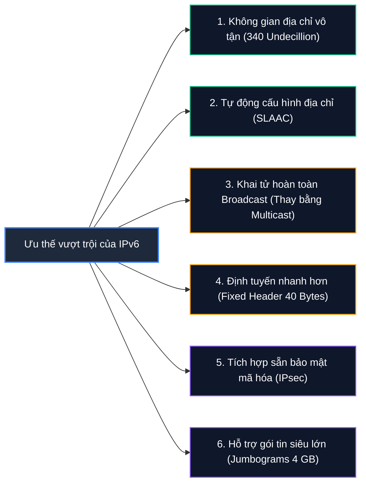

# IPv6 Addresses

**IPv6 (Internet Protocol version 6)** là thế hệ giao thức mạng kế thừa chính thức của IPv4. Được thiết kế từ nền móng để giải quyết triệt để cuộc khủng hoảng cạn kiệt địa chỉ IPv4 (vốn chỉ có 32 bit, tương đương khoảng 4.3 tỷ địa chỉ), IPv6 mở rộng không gian địa chỉ lên tới **128 bit**.

Cơ quan cấp phát số hiệu Internet (**IANA**) chịu trách nhiệm quản lý và phân bổ các khối địa chỉ IPv6 toàn cầu. Về mặt dài hạn, IPv6 được kỳ vọng sẽ thay thế hoàn toàn IPv4. Tuy nhiên, trong giai đoạn chuyển giao hiện nay, hai giao thức này cùng vận hành song song trên hầu hết các hệ thống mạng thông qua cơ chế **Dual Stack (Ngăn xếp kép)**.

---

## 1. Triết lý End-to-End và Các ưu thế vượt trội của IPv6

Khác với IPv4 phải phụ thuộc nặng nề vào kỹ thuật chuyển đổi địa chỉ mạng (**NAT**) để dùng chung các IP công cộng hiếm hoi, IPv6 quay trở lại nguyên lý kết nối đầu - cuối nguyên bản (**End-to-End Principle**):
* **Mọi thiết bị đều có thể sở hữu địa chỉ IP công cộng (Public IP) định tuyến toàn cầu:** Không còn cần NAT để che giấu hay chuyển tiếp cổng phức tạp.
* **Đa địa chỉ trên một giao diện mạng (Multiple IPv6 addresses per interface):** Một card mạng có thể sở hữu đồng thời nhiều địa chỉ IPv6 phục vụ các mục đích khác nhau (Link-Local cho giao tiếp nội bộ, Global Unicast để ra Internet, Temporary Address để bảo vệ danh tính).



### Bảng đối chiếu chi tiết: IPv4 vs. IPv6

| Tiêu chí so sánh | IPv4 | IPv6 |
| :--- | :--- | :--- |
| **Độ dài bit (Bit length)** | 32-bit (4 Octets) | 128-bit (16 Bytes / 8 Hextets) |
| **Tầng trong mô hình OSI** | Layer 3 (Network Layer) | Layer 3 (Network Layer) |
| **Không gian địa chỉ** | Khoảng 4.29 tỷ ($2^{32}$) | Khoảng 340 undecillion ($2^{128} \approx 3.4 \times 10^{38}$) |
| **Định dạng biểu diễn** | Thập phân có dấu chấm (`192.168.1.1`) | Thập lục phân có dấu hai chấm (`fe80::1`) |
| **Ký hiệu tiền tố (Prefix)** | `10.10.10.0/24` | `fe80::dd80:b1a9:6687:2d3b/64` |
| **Cấp phát IP động** | DHCP | SLAAC (Stateless) hoặc DHCPv6 (Stateful) |
| **Bảo mật IPsec** | Tùy chọn (Optional) | Bắt buộc hỗ trợ trong tiêu chuẩn (Mandatory) |
| **Cơ chế Broadcast** | Sử dụng rộng rãi (`255.255.255.255`) | **Hoàn toàn bị bãi bỏ**, thay thế bằng Multicast |

---

## 2. Ba kiểu truyền thông trong IPv6 (Address Types)

IPv6 phân loại địa chỉ thành 3 dạng thức truyền tin cốt lõi:

| Kiểu địa chỉ | Cơ chế truyền nhận | Trường hợp sử dụng tiêu biểu |
| :--- | :--- | :--- |
| **Unicast** | **Một - Một (One-to-One):** Gói tin được gửi đến duy nhất một giao diện mạng cụ thể. | Giao tiếp thông thường giữa hai máy trạm hoặc máy trạm với máy chủ web. |
| **Anycast** | **Một - Gần nhất (One-to-Nearest):** Một địa chỉ IP được gán chung cho nhiều máy chủ tại các vị trí địa lý khác nhau. Router sẽ chuyển gói tin tới máy chủ gần nhất theo bảng định tuyến. | Hệ thống mạng phân phối nội dung (CDN), máy chủ DNS Root Server. |
| **Multicast** | **Một - Nhiều (One-to-Many):** Gói tin được gửi đến một nhóm các giao diện mạng cùng đăng ký chung một địa chỉ Multicast. | Cập nhật bảng định tuyến giữa các router, truyền hình IPTV, phát hiện dịch vụ mạng. |

> **Lưu ý quan trọng:** Trong IPv4, các gói tin **Broadcast** được phát bừa bãi đến mọi thiết bị trong mạng, dễ gây ra hiện tượng bão mạng (**Broadcast Storm**). Trong IPv6, **địa chỉ Broadcast đã hoàn toàn bị xóa sổ**. Khi cần liên lạc với toàn mạng, IPv6 sử dụng địa chỉ Multicast chuyên biệt: ví dụ `ff02::1` (All-Nodes Multicast - tất cả các thiết bị trong link mạng cục bộ).

---

## 3. Hệ thập lục phân và Cấu trúc Địa chỉ IPv6

Hệ thập lục phân (**Hexadecimal / Hex**) sử dụng 16 ký tự (`0` đến `9` và `A` đến `F`) để biểu diễn gọn gàng các chuỗi nhị phân dài:

| Thập phân | Hex | Nhị phân (4-bit Nibble) | Thập phân | Hex | Nhị phân (4-bit Nibble) |
| :-: | :-: | :-: | :-: | :-: | :-: |
| 0 | **0** | `0000` | 8 | **8** | `1000` |
| 1 | **1** | `0001` | 9 | **9** | `1001` |
| 2 | **2** | `0010` | 10 | **A** | `1010` |
| 3 | **3** | `0011` | 11 | **B** | `1011` |
| 4 | **4** | `0100` | 12 | **C** | `1100` |
| 5 | **5** | `0101` | 13 | **D** | `1101` |
| 6 | **6** | `0110` | 14 | **E** | `1110` |
| 7 | **7** | `0111` | 15 | **F** | `1111` |

### Quy đổi địa chỉ IPv4 `192.168.12.160` sang Hexadecimal:
```shellsession
Octet:           1st (192)     2nd (168)     3rd (12)      4th (160)
Nhị phân:        1100 0000  .  1010 1000  .  0000 1100  .  1010 0000
Hexadecimal:        C0      .     A8      .     0C      .     A0
```

### Cấu trúc khối của IPv6:
Địa chỉ IPv6 có độ dài 128 bit = 16 byte, được chia thành **8 nhóm (Blocks / Hextets)**. Mỗi nhóm gồm 16 bit (biểu diễn bằng **4 ký tự hex**), ngăn cách nhau bằng dấu hai chấm (`:`):

```shellsession
fe80 : 0000 : 0000 : 0000 : dd80 : b1a9 : 6687 : 2d3b / 64
[ 1 ]  [ 2 ]  [ 3 ]  [ 4 ]  [ 5 ]  [ 6 ]  [ 7 ]  [ 8 ]
```

---

## 4. Quy tắc rút gọn địa chỉ IPv6 theo tiêu chuẩn RFC 5952

Việc gõ đầy đủ cả 32 ký tự hex của địa chỉ IPv6 rất dài và dễ nhầm lẫn. Tiêu chuẩn **RFC 5952** quy định 4 quy tắc bắt buộc để chuẩn hóa và rút gọn:

1. **Chữ cái viết thường:** Toàn bộ các ký tự chữ cái trong địa chỉ hex phải được viết dưới dạng chữ thường (`a-f`, không dùng `A-F`).
2. **Loại bỏ các số 0 ở đầu nhóm (Leading Zeros):** Trong từng nhóm 4 ký tự hex, các số `0` nằm ở phía trước được phép lược bỏ:
   - Nhóm `:0000:` rút gọn thành `:0:`
   - Nhóm `:00ab:` rút gọn thành `:ab:`
   - Nhóm `:0a00:` rút gọn thành `:a00:` (các số `0` ở cuối không được bỏ).
3. **Nén các nhóm số 0 liên tiếp thành dấu `::` (Double Colon):** Một hoặc nhiều nhóm `:0000:` liên tiếp có thể được thay thế bằng cặp dấu hai chấm `::`.
4. **Chỉ được dùng `::` duy nhất một lần:** Cặp dấu `::` chỉ được phép xuất hiện **tối đa một lần** trong toàn bộ một địa chỉ IPv6 (ưu tiên nén chuỗi số 0 dài nhất từ bên trái sang). Nếu dùng hai lần `::`, thiết bị sẽ không thể suy ngược lại chính xác số lượng nhóm số 0 ở mỗi vị trí.

### Ví dụ minh họa quá trình rút gọn:
```shellsession
Dạng nguyên bản đầy đủ:
fe80:0000:0000:0000:dd80:b1a9:6687:2d3b/64

Bước 1: Bỏ các số 0 ở đầu các khối
fe80:0:0:0:dd80:b1a9:6687:2d3b/64

Bước 2: Thay 3 khối ':0:0:0:' liên tiếp bằng '::'
fe80::dd80:b1a9:6687:2d3b/64
```

---

## 5. Cấu trúc hai phần: Network Prefix và Interface Identifier

Một địa chỉ IPv6 tiêu chuẩn (với tiền tố chuẩn `/64`) được chia đều làm 2 nửa:

```shellsession
+------------------------------------+------------------------------------+
|       64-bit Network Prefix        |      64-bit Interface Identifier   |
+------------------------------------+------------------------------------+
|  Xác định phân vùng mạng (Subnet)  |  Xác định thiết bị cụ thể (Host)   |
|  (Nhà mạng ISP hoặc Doanh nghiệp)  |  (Tự sinh qua EUI-64 hoặc Random)  |
+------------------------------------+------------------------------------+
```

1. **Network Prefix (64 bit đầu):**
   - Đóng vai trò tương tự như Network Part trong IPv4.
   - Các nhà cung cấp dịch vụ Internet (ISP) thường cấp cho doanh nghiệp hoặc hộ gia đình một dải tiền tố ngắn như `/48` hoặc `/56`. Quản trị viên mạng sẽ sử dụng các bit còn lại để chia thành hàng nghìn mạng con chuẩn `/64`.
2. **Interface Identifier (64 bit sau - Suffix):**
   - Đóng vai trò định danh cho cổng mạng cụ thể.
   - **Cơ chế EUI-64:** Trong giai đoạn đầu, 64-bit này được tính toán tự động từ chính địa chỉ **MAC 48-bit** của card mạng (chèn thêm chuỗi `FF:FE` vào giữa và đảo bit Universal/Local).
   - **IPv6 Privacy Extensions (RFC 4941):** Do việc dùng MAC để tạo Interface ID làm lộ thông tin phần cứng người dùng ra Internet, các hệ điều hành hiện đại (Windows, Linux, macOS) hiện tự động tạo Interface ID ngẫu nhiên và thay đổi định kỳ để bảo vệ quyền riêng tư.

---

## 6. Góc nhìn An toàn thông tin (Cybersecurity & Pentesting Insights)

Đối với chuyên viên bảo mật, việc hiểu rõ IPv6 mang lại lợi thế chiến lược rất lớn:

1. **Vùng tối an ninh mạng (IPv6 Blindspots / Shadow Networks):**
   - Rất nhiều doanh nghiệp chỉ bật tường lửa và cấu hình kiểm soát cho dải IPv4, nhưng hệ điều hành của các máy trạm hiện đại lại **mặc định kích hoạt sẵn IPv6 Dual-Stack**.
   - Tin tặc có thể quét và khai thác các dịch vụ nội bộ thông qua địa chỉ IPv6 mà hoàn toàn "tàng hình" trước các quy tắc giám sát tường lửa IPv4 cũ.

2. **Tấn công Router Advertisement giả mạo (Rogue RA Attack):**
   - Trong cơ chế cấp phát tự động **SLAAC**, các máy tính lắng nghe bản tin quảng bá **Router Advertisement (RA)** để nhận Network Prefix và Default Gateway.
   - Kẻ tấn công trong mạng LAN có thể sử dụng công cụ (như `fake_router6` trong bộ `thc-ipv6`) để liên tục phát các bản tin RA giả mạo, ép toàn bộ máy tính trong mạng nhận máy tin tặc làm Default Gateway IPv6 và nhận DNS Server độc hại, từ đó thực hiện tấn công Man-in-the-Middle (MITM).

3. **Rò rỉ định danh phần cứng qua EUI-64:**
   - Khi mục tiêu sử dụng cấu hình IPv6 tự động theo chuẩn cũ EUI-64, chuyên viên pentest có thể phân tích 64 bit cuối của địa chỉ IPv6 để suy ngược ra chính xác địa chỉ MAC vật lý của máy nạn nhân và tra cứu hãng sản xuất phần cứng card mạng.
