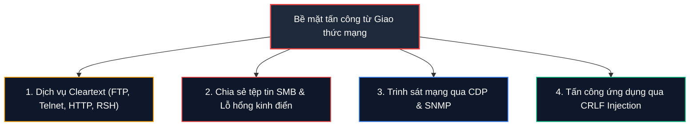

# Networking Key Terminology

Lĩnh vực Công nghệ thông tin (IT) ngày nay đã phát triển với quy mô khổng lồ, sánh ngang thậm chí vượt qua cả ngành y tế về mức độ phức tạp. Số lượng các ngôn ngữ lập trình, kiến trúc hệ thống, giao thức mạng, khu vực ứng dụng và các biến thể lỗ hổng phát sinh nhiều đến mức một kỹ sư có thể dành trọn cả sự nghiệp chỉ để nghiên cứu chuyên sâu vào 1 đến 2 mảng hẹp.

Tuy nhiên, dù đi theo hướng Tấn công (Red Team / Pentester) hay Phòng thủ (Blue Team / SOC Analyst), bạn không cần phải ghi nhớ mọi thứ ngay từ đầu. Điều cốt lõi là phải nắm vững **"bảng chữ cái thuật ngữ" (Key Terminology)** - những giao thức và khái niệm nền tảng xuất hiện liên tục trong mọi báo cáo bảo mật, log phân tích và công cụ giám sát.

Dưới đây là cẩm nang tổng hợp các giao thức và thuật ngữ mạng quan trọng nhất, được phân loại khoa học theo từng nhóm chức năng kèm theo cổng dịch vụ (Port) và góc nhìn thực chiến bảo mật.

---

## 1. Giao thức Dịch vụ Ứng dụng & Quản trị Hệ thống

Nhóm các giao thức tầng Application (Layer 7) chịu trách nhiệm truyền tải dữ liệu người dùng, chia sẻ tệp tin và quản lý thiết bị từ xa.

| Giao thức | Tên viết tắt | Port mặc định | Chức năng & Vai trò |
| :--- | :---: | :---: | :--- |
| **Hypertext Transfer Protocol** | **HTTP** | TCP 80 | Giao thức client-server nền tảng của World Wide Web, truyền tải siêu văn bản không mã hóa. |
| **Secure Shell** | **SSH** | TCP 22 | Giao thức mã hóa an toàn dùng để đăng nhập, mở shell điều khiển và thực thi dòng lệnh trên máy chủ từ xa. Thay thế cho Telnet và RSH. |
| **File Transfer Protocol** | **FTP** | TCP 20/21 | Giao thức truyền tệp tin giữa các máy chủ qua mạng. Dữ liệu và thông tin xác thực gửi dưới dạng văn bản thuần (Cleartext). |
| **Simple Mail Transfer Protocol** | **SMTP** | TCP 25/587 | Giao thức tiêu chuẩn chuyên dùng để chuyển phát thư điện tử (email) giữa các máy chủ mail. |
| **Server Message Block** | **SMB** | TCP 445 | Giao thức chia sẻ tệp tin, máy in và giao tiếp liên tiến trình (IPC) chủ lực trong môi trường mạng Windows Active Directory. |
| **Network File System** | **NFS** | TCP/UDP 2049 | Giao thức chia sẻ tệp tin phân tán phổ biến trong môi trường Linux/Unix, cho phép gắn (mount) ổ đĩa mạng như ổ cứng cục bộ. |
| **Simple Network Management Protocol** | **SNMP** | UDP 161/162 | Giao thức giám sát, thu thập thông số hoạt động và cấu hình các thiết bị mạng (Router, Switch, Server). |
| **Network Time Protocol** | **NTP** | UDP 123 | Giao thức đồng bộ hóa thời gian chính xác giữa các máy tính trong mạng, cực kỳ quan trọng đối với việc đối soát log điều tra số (Forensics). |
| **Network News Transfer Protocol** | **NNTP** | TCP 119 | Giao thức lưu ký và truyền tải các bài đăng trong các nhóm thảo luận tin tức (Usenet newsgroups). |
| **Remote Shell** | **RSH** | TCP 514 | Tiện ích dòng lệnh cổ điển trên Unix cho phép thực thi lệnh từ xa không cần mã hóa (đã lỗi thời và bị thay thế bởi SSH). |

---

## 2. Giao thức Mạng Không dây & Xác thực Danh tính

Bảo vệ môi trường sóng vô tuyến (Wi-Fi) và kiểm soát quyền truy cập mạng của người dùng.

| Giao thức | Tên viết tắt | Phân loại | Bản chất kỹ thuật & Độ an toàn |
| :--- | :---: | :---: | :--- |
| **Wired Equivalent Privacy** | **WEP** | Wireless Security | Chuẩn bảo mật Wi-Fi đời đầu (1997). Sử dụng thuật toán RC4 với khóa tĩnh, chứa nhiều lỗ hổng toán học chí mạng và có thể bị bẻ khóa chỉ trong vài phút. |
| **Wi-Fi Protected Access** | **WPA / WPA2** | Wireless Security | Chuẩn bảo mật Wi-Fi hiện đại thay thế WEP. WPA2 sử dụng mã hóa khối mạnh mẽ AES kết hợp cơ chế bắt tay 4 bước (**4-Way Handshake**). |
| **Temporal Key Integrity Protocol** | **TKIP** | Encryption Protocol | Giao thức mã hóa bọc ngoài RC4 được thiết kế tạm thời cho WPA để nâng cấp thiết bị WEP cũ; hiện đã bị coi là không an toàn. |
| **Extensible Authentication Protocol** | **EAP** | Auth Framework | Khung kiến trúc xác thực linh hoạt hỗ trợ nhiều phương thức khác nhau: Mật khẩu, Chứng chỉ số (Digital Certificate), OTP hoặc Public Key. |
| **Lightweight Extensible Authentication Protocol** | **LEAP** | Wireless Auth | Giao thức xác thực không dây độc quyền của Cisco phát triển dựa trên EAP; dễ bị tấn công vét cạn mật khẩu bằng từ điển (Dictionary attack). |
| **Protected Extensible Authentication Protocol** | **PEAP** | Wireless Auth | Giao thức bảo mật bọc toàn bộ tiến trình xác thực EAP bên trong một đường hầm mã hóa SSL/TLS, bảo vệ an toàn danh tính người dùng. |
| **Terminal Access Controller Access-Control System** | **TACACS / TACACS+** | AAA Protocol | Giao thức quản lý truy cập mạng tập trung cung cấp đầy đủ 3 thành phần AAA: Xác thực (Authentication), Phân quyền (Authorization), và Ghi nhận nhật ký (Accounting). |

---

## 3. Hạ tầng Chuyển mạch, Định tuyến & Dự phòng (Switching & Routing)

Các giao thức tầng Layer 2 và Layer 3 giúp tối ưu hóa luồng dữ liệu, ngăn ngừa lỗi vòng lặp và đảm bảo tính sẵn sàng cao (High Availability).

| Giao thức | Tên viết tắt | Tầng mạng | Đặc tính kỹ thuật |
| :--- | :---: | :---: | :--- |
| **Virtual Local Area Network** | **VLAN** | Layer 2 | Kỹ thuật chia switch vật lý thành nhiều mạng con logic độc lập, cô lập lưu lượng broadcast và tăng cường bảo mật. |
| **VLAN Trunking Protocol** | **VTP** | Layer 2 | Giao thức độc quyền của Cisco cho phép đồng bộ hóa và phân phối cấu hình danh sách VLAN tự động giữa các switch trong cùng một miền. |
| **Spanning Tree Protocol** | **STP** | Layer 2 | Giao thức chống lặp vòng (Loop-free). Tự động khóa các đường liên kết dự phòng để ngăn chặn thảm họa bão lặp gói tin (**Broadcast Storm**). |
| **Cisco Discovery Protocol** | **CDP** | Layer 2 | Giao thức phát hiện láng giềng độc quyền của Cisco, tự động chia sẻ thông tin thiết bị (tên máy, model, IP, cổng kết nối) với các thiết bị Cisco cắm trực tiếp kề cạnh. |
| **Routing Information Protocol** | **RIP** | Layer 3 | Giao thức định tuyến động nội bộ cổ điển dựa trên thuật toán Distance-Vector; sử dụng số bước nhảy (**Hop Count**, tối đa 15) để tính đường đi. |
| **Open Shortest Path First** | **OSPF** | Layer 3 | Giao thức định tuyến động hiện đại dựa trên trạng thái liên kết (**Link-State**), sử dụng thuật toán Dijkstra để tìm đường đi ngắn nhất trong cùng một vùng tự trị (AS). |
| **Interior Gateway Routing Protocol** | **IGRP** | Layer 3 | Giao thức định tuyến Distance-Vector do Cisco phát triển để khắc phục các hạn chế của RIP; hiện đã lỗi thời. |
| **Enhanced Interior Gateway Routing Protocol** | **EIGRP** | Layer 3 | Phiên bản nâng cấp kết hợp (Hybrid) của Cisco, hội tụ mạng cực nhanh và quản lý băng thông tối ưu. |
| **Hot Standby Router Protocol** | **HSRP** | Dự phòng L3 | Giao thức dự phòng Default Gateway độc quyền của Cisco, gom cụm nhiều router thành một IP ảo chung (Virtual IP); tự động chuyển đổi khi router chính gặp sự cố. |
| **Virtual Router Redundancy Protocol** | **VRRP** | Dự phòng L3 | Chuẩn mở quốc tế (tương tự HSRP của Cisco) cung cấp khả năng dự phòng Gateway tự động cho các thiết bị mạng đa hãng. |

---

## 4. Mạng riêng ảo & Đường hầm Bảo mật (VPN, NAT & Tunneling)

Tạo lập các đường hầm mã hóa và chuyển tiếp lưu lượng an toàn xuyên qua mạng công cộng Internet.

| Giao thức / Công nghệ | Viết tắt | Mục đích sử dụng cốt lõi |
| :--- | :---: | :--- |
| **Virtual Private Network** | **VPN** | Công nghệ thiết lập đường kết nối logic riêng tư và được mã hóa xuyên qua mạng công cộng Internet. |
| **Internet Protocol Security** | **IPsec** | Bộ giao thức tiêu chuẩn hoạt động ở Layer 3 cung cấp đầy đủ tính năng xác thực, tính toàn vẹn và mã hóa mạnh cho các kết nối VPN. |
| **Internet Key Exchange** | **IKE** | Giao thức nằm trong bộ IPsec chịu trách nhiệm đàm phán các tham số bảo mật và trao đổi khóa bí mật an toàn giữa hai đầu kết nối VPN. |
| **Point-to-Point Tunneling Protocol** | **PPTP** | Giao thức tạo đường hầm VPN cổ điển; sử dụng thuật toán mã hóa lỗi thời MS-CHAPv2 và hiện không còn được khuyến nghị sử dụng. |
| **Generic Routing Encapsulation** | **GRE** | Giao thức đóng gói đường hầm do Cisco phát triển, cho phép bọc nhiều loại gói tin giao thức mạng khác nhau bên trong liên kết IP (nhưng không tự mã hóa dữ liệu). |
| **Network Address Translation** | **NAT** | Kỹ thuật chuyển đổi các địa chỉ IP nội bộ riêng (Private IP) thành một hoặc nhiều địa chỉ IP công cộng (Public IP) để kết nối Internet. |

---

## 5. Viễn thông, Đa phương tiện & Hệ thống Giám sát Công nghiệp

| Giao thức / Khái niệm | Viết tắt | Ý nghĩa & Ứng dụng thực tế |
| :--- | :---: | :--- |
| **Voice Over IP** | **VOIP** | Công nghệ truyền tải giọng nói và cuộc gọi điện thoại qua giao thức mạng Internet thay thế đường truyền analog viễn thông cũ. |
| **Session Initiation Protocol** | **SIP** | Giao thức báo hiệu điều khiển (Signaling) chuyên dùng để thiết lập, duy trì và ngắt các phiên đa phương tiện thời gian thực (thoại, video, tin nhắn) trong VoIP. |
| **Supervisory Control and Data Acquisition** | **SCADA** | Hệ thống điều khiển giám sát và thu thập dữ liệu công nghiệp (ICS), vận hành các nhà máy điện, hệ thống cấp thoát nước, sản xuất và hạ tầng trọng yếu quốc gia. |
| **Systems Management Server** | **SMS** | Giải pháp quản trị hệ thống của Microsoft (tiền thân của SCCM / Microsoft Endpoint Configuration Manager) giúp quản lý tập trung mạng máy trạm và ứng dụng. |
| **Microsoft Baseline Security Analyzer** | **MBSA** | Công cụ đánh giá bảo mật miễn phí của Microsoft dùng để quét tìm các thiếu sót trong bản vá cập nhật và cấu hình sai lệch trên Windows. |
| **Pretty Good Privacy** | **PGP** | Chương trình mã hóa dữ liệu bất đối xứng kinh điển dùng để bảo vệ tính bảo mật và ký số xác thực cho email, tệp tin và tin nhắn văn bản. |

---

## 6. Chuẩn Web & Cấu trúc Dữ liệu

| Thuật ngữ | Viết tắt | Mô tả kỹ thuật |
| :--- | :---: | :--- |
| **Uniform Resource Identifier** | **URI** | Cú pháp chuỗi ký tự tiêu chuẩn dùng để định danh duy nhất một tài nguyên trên mạng Internet. |
| **Uniform Resource Locator** | **URL** | Một nhánh con phổ biến nhất của URI, vừa định danh vừa chỉ rõ phương thức truy cập tài nguyên (ví dụ: `https://academy.hackthebox.com`). |
| **Asynchronous JavaScript and XML** | **AJAX** | Kỹ thuật lập trình web phía client cho phép trình duyệt gửi/nhận dữ liệu bất đồng bộ từ máy chủ chạy nền mà không cần phải tải lại toàn bộ trang web. |
| **Internet Server API** | **ISAPI** | Tập hợp giao diện lập trình mở rộng hiệu năng cao của Microsoft dành riêng cho máy chủ web Internet Information Services (IIS). |
| **Carriage Return Line Feed** | **CRLF** | Cặp ký tự điều khiển ngắt dòng (`\r\n` hay mã Hex `0x0D 0x0A`), đánh dấu điểm kết thúc của một dòng văn bản trong giao thức HTTP/SMTP. |

---

## 7. Góc nhìn An toàn thông tin (Cybersecurity / Pentesting Context)

Dưới góc nhìn của một chuyên viên kiểm thử xâm nhập hoặc kỹ sư SOC, các giao thức mạng chính là các bề mặt tấn công (**Attack Surface**) hàng ngày:

1. **Hiểm họa từ các giao thức văn bản thuần (Cleartext Protocols):**
   - Các dịch vụ như `FTP (21)`, `HTTP (80)`, `Telnet (23)`, `RSH (514)` truyền tải toàn bộ thông tin đăng nhập và dữ liệu người dùng không mã hóa. Bất kỳ kẻ tấn công nào thực hiện bắt lén gói tin (Sniffing) trong cùng mạng LAN đều có thể đọc trọn vẹn tài khoản/mật khẩu. Bắt buộc thay thế bằng các phiên bản an toàn: `SFTP`, `HTTPS`, `SSH`.
2. **Khai thác dịch vụ SMB (Port 445):**
   - Là mục tiêu số một của tin tặc trong mạng doanh nghiệp Windows. Các lỗ hổng thực thi mã từ xa khét tiếng như **EternalBlue (MS17-010)** đã dẫn đến cuộc khủng hoảng Ransomware WannaCry toàn cầu. Ngoài ra, kỹ thuật tấn công chuyển tiếp xác thực **SMB Relay Attack** cho phép chiếm đoạt quyền quản trị miền nếu không bật tính năng ký số bắt buộc (**SMB Signing**).
3. **Thu thập tin tình báo qua CDP và SNMP:**
   - **CDP:** Mặc định gửi bản tin quảng bá không mã hóa. Kẻ tấn công cắm máy vào mạng nội bộ chỉ cần lắng nghe gói tin CDP là biết chính xác toàn bộ sơ đồ tên thiết bị switch của Cisco, phiên bản hệ điều hành IOS và cổng kết nối.
   - **SNMP:** Các phiên bản cũ (SNMPv1, SNMPv2c) sử dụng chuỗi xác thực văn bản thuần gọi là **Community String** (phổ biến là chuỗi mặc định `public` hoặc `private`). Tin tặc có thể đọc trọn vẹn danh sách tiến trình đang chạy, tài khoản người dùng và sơ đồ mạng nội bộ.
4. **Tấn công CRLF Injection trên ứng dụng Web:**
   - Kẻ tấn công chèn cặp ký tự ngắt dòng `\r\n` (CRLF) vào các tham số đầu vào của người dùng để can thiệp vào HTTP Response Header, dẫn đến các cuộc tấn công chia tách phản hồi HTTP (**HTTP Response Splitting**), giả mạo Cookie hoặc chèn mã độc Cross-Site Scripting (XSS).
