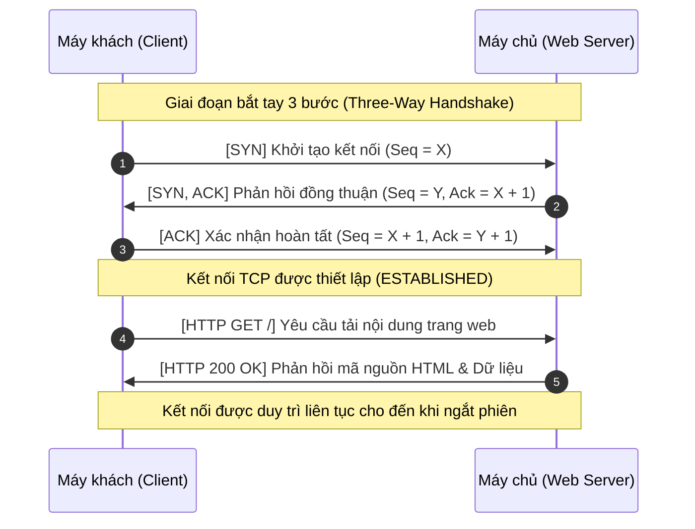
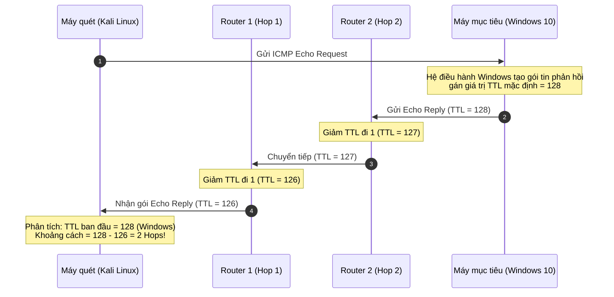
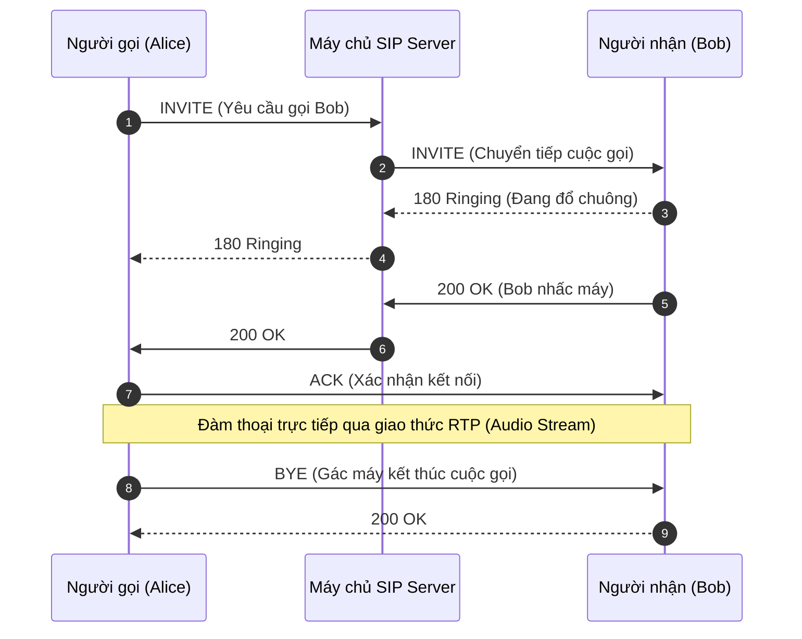

# Common Protocols

Các giao thức Internet là tập hợp các quy tắc và chuẩn mực kỹ thuật được chuẩn hóa quốc tế thông qua các tài liệu **RFC (Request for Comments)**, quy định cách thức các thiết bị trên mạng giao tiếp, định dạng và trao đổi dữ liệu với nhau một cách nhất quán, không phụ thuộc vào hệ điều hành hay phần cứng bên dưới.

Tại tầng giao vận (**Layer 4 - Transport Layer**), hầu hết mọi luồng truyền thông trên thế giới đều dựa vào hai phương thức kết nối nền tảng:
1. **TCP (Transmission Control Protocol):** Hướng kết nối (Connection-oriented), đảm bảo độ tin cậy tối đa.
2. **UDP (User Datagram Protocol):** Phi kết nối (Connectionless), tối ưu hóa tốc độ truyền tải tối đa.

Hiểu sâu về các giao thức phổ biến cùng số hiệu cổng dịch vụ (**Port Numbers**) và cách thức hoạt động của chúng là kỹ năng nền tảng của một chuyên viên phân tích an ninh mạng (SOC Analyst) hay kiểm thử xâm nhập (Pentester) khi thực hiện dò quét cổng (**Port Scanning**), phân tích nhật ký lưu lượng (**Traffic Analysis**) và khai thác lỗ hổng (**Vulnerability Exploitation**).

---

## 1. Transmission Control Protocol (TCP)

**TCP** là giao thức hướng kết nối. Trước khi truyền tải bất kỳ dữ liệu thực tế nào, TCP bắt buộc phải thiết lập một kết nối logic hai chiều tin cậy giữa hai máy tính thông qua tiến trình **bắt tay 3 bước (Three-Way Handshake)**:



* **Đặc tính kỹ thuật:** 
  - **Độ tin cậy cao (Reliable):** Mọi gói tin gửi đi đều phải có phản hồi xác nhận (**ACK**). Nếu gói tin bị thất lạc trên đường truyền, TCP sẽ tự động phát hiện và gửi lại (**Retransmission**).
  - **Đảm bảo thứ tự:** Các khối dữ liệu được đánh số tuần tự (**Sequence Numbers**) để bên nhận có thể ráp nối chính xác như ban đầu.
  - **Chi phí phụ trội (Overhead):** Do phải duy trì trạng thái kết nối và kiểm soát luồng, TCP có tốc độ chậm hơn UDP.

### Bảng các giao thức TCP tiêu biểu và Cổng dịch vụ

| Giao thức | Tên viết tắt | Port mặc định | Chức năng chính & Góc nhìn bảo mật |
| :--- | :---: | :---: | :--- |
| **Secure Shell** | **SSH** | TCP 22 | Đăng nhập và thực thi lệnh từ xa có mã hóa an toàn. |
| **Telnet** | **Telnet** | TCP 23 | Dịch vụ đăng nhập dòng lệnh cổ điển; truyền dữ liệu dạng văn bản thuần (**Cleartext**), cực kỳ nguy hiểm. |
| **File Transfer Protocol** | **FTP** | TCP 20, 21 | Truyền tệp tin (Port 21 gửi lệnh, Port 20 truyền data); không mã hóa mật khẩu. |
| **Simple Mail Transfer Protocol** | **SMTP** | TCP 25 | Chuyển phát thư điện tử giữa các máy chủ mail. |
| **Domain Name System** | **DNS** | TCP 53 | Phân giải tên miền (sử dụng TCP khi kích thước bản ghi lớn hoặc khi đồng bộ vùng dữ liệu **Zone Transfer**). |
| **HyperText Transfer Protocol** | **HTTP** | TCP 80 | Truyền tải siêu văn bản web không mã hóa. |
| **Kerberos** | **Kerberos** | TCP 88 | Giao thức xác thực vé (Ticket-based) cốt lõi trong Microsoft Active Directory. |
| **Post Office Protocol v3** | **POP3** | TCP 110 | Tải email từ máy chủ về máy khách. |
| **Network News Transfer Protocol** | **NNTP** | TCP 119 | Truy cập các nhóm tin tức thảo luận Usenet. |
| **Network Time Protocol** | **NTP** | TCP 123 | Đồng bộ thời gian hệ thống (thường chạy UDP nhưng có hỗ trợ TCP). |
| **Microsoft RPC Endpoint Mapper** | **RPC** | TCP 135 | Quản lý gọi thủ tục từ xa trên Windows; thường bị khai thác để dò quét dịch vụ nội bộ (**RPC Enumeration**). |
| **Internet Message Access Protocol** | **IMAP** | TCP 143 | Quản lý và đồng bộ hộp thư email trực tiếp trên máy chủ. |
| **SNMP Trap / Service** | **SNMP** | TCP 161, 162 | Quản trị và giám sát thiết bị mạng từ xa. |
| **Lightweight Directory Access Protocol** | **LDAP** | TCP 389 | Dịch vụ thư mục truy vấn thông tin người dùng và tài nguyên mạng Active Directory. |
| **HyperText Transfer Protocol Secure** | **HTTPS** | TCP 443 | Duyệt web an toàn có mã hóa qua SSL/TLS. |
| **Server Message Block** | **SMB** | TCP 445 | Chia sẻ file, máy in trong Windows; mục tiêu số một của mã độc tống tiền (EternalBlue). |
| **Remote Shell / Execution** | **REXEC / RLOGIN** | TCP 512, 513 | Dịch vụ thực thi lệnh và mở shell cổ điển trên Unix không có mã hóa. |
| **Oracle Database Listener** | **oracle-tns** | TCP 1521 | Cổng lắng nghe kết nối của cơ sở dữ liệu Oracle Database. |
| **Microsoft SQL Server** | **ms-sql-s** | TCP 1433 | Kết nối cơ sở dữ liệu Microsoft SQL Server. |
| **Point-to-Point Tunneling Protocol** | **PPTP** | TCP 1723 | Giao thức tạo đường hầm VPN cổ điển, chứa lỗ hổng bảo mật. |
| **Network File System** | **NFS** | TCP 2049 | Chia sẻ tệp tin mạng cho hệ điều hành Linux/Unix. |
| **Squid Web Proxy** | **http-proxy** | TCP 3128 | Cổng dịch vụ mặc định của máy chủ Squid Caching Proxy. |
| **Remote Desktop Protocol** | **RDP** | TCP 3389 | Kết nối điều khiển giao diện máy tính từ xa trên hệ điều hành Windows. |
| **Session Initiation Protocol** | **SIP** | TCP 5060 | Khởi tạo phiên truyền thông thoại và video qua Internet (VoIP). |
| **X Window System** | **X11** | TCP 6000 | Giao thức hiển thị giao diện đồ họa trên Unix/Linux qua mạng. |
| **IBM DB2 Database** | **DB2** | TCP 50000 | Hệ quản trị cơ sở dữ liệu quan hệ doanh nghiệp của IBM. |

---

## 2. User Datagram Protocol (UDP)

Khác với TCP, **UDP** là giao thức **phi kết nối (Connectionless)**. Thiết bị gửi sẽ đóng gói dữ liệu thành các **Datagram** và đẩy thẳng ra mạng đến địa chỉ máy nhận mà không cần thực hiện bắt tay chào hỏi trước, và cũng không cần biết máy nhận có thực sự nhận được gói tin hay không ("Fire-and-Forget"):

```mermaid
flowchart LR
    Sender["Máy phát luồng (Media / Gaming Server)"] -->|Đẩy luồng UDP liên tục (Không ACK)| Receiver["Máy nhận (Client)"]
    Loss["Gói tin thất lạc trên đường truyền"] -.->|Bị bỏ qua, không gửi lại| Trash["Hủy bỏ"]

    style Sender fill:#1E293B,stroke:#3B82F6,stroke-width:2px,color:#fff
    style Receiver fill:#1E293B,stroke:#10B981,stroke-width:2px,color:#fff
    style Loss fill:#EF4444,stroke:#fff,stroke-width:1px,color:#fff
    style Trash fill:#0F172A,stroke:#64748B,stroke-width:1px,color:#fff
```

* **Ưu thế then chốt:** Không có độ trễ bắt tay, tiêu thụ ít tài nguyên băng thông và CPU.
* **Trường hợp ứng dụng:** Phù hợp hoàn hảo cho các dịch vụ đòi hỏi **tốc độ thời gian thực (Real-time)** và có thể chấp nhận mất mát một lượng nhỏ dữ liệu mà không làm hỏng trải nghiệm người dùng: xem video trực tuyến (YouTube, Netflix), gọi điện thoại VoIP, chơi game online, và các truy vấn truy hồi nhanh (DNS Query, DHCP).

### Bảng các giao thức UDP tiêu biểu và Cổng dịch vụ

| Giao thức | Tên viết tắt | Port mặc định | Ứng dụng thực tế |
| :--- | :---: | :---: | :--- |
| **Domain Name System** | **DNS** | UDP 53 | Truy vấn phân giải tên miền nhanh chóng. |
| **BOOTP / DHCP Server & Client** | **DHCP** | UDP 67, 68 | Cấp phát thông số cấu hình mạng IP động cho máy trạm. |
| **Trivial File Transfer Protocol** | **TFTP** | UDP 69 | Giao thức truyền file cực kỳ tinh gọn, không cần xác thực; thường dùng để nạp firmware cho router/switch hoặc boot qua mạng (PXE). |
| **Network Time Protocol** | **NTP** | UDP 123 | Đồng bộ đồng hồ máy tính trong toàn mạng. |
| **NetBIOS Name Service** | **netbios-ns** | UDP 137 | Phân giải tên NetBIOS trong mạng nội bộ Windows. |
| **Simple Network Management Protocol** | **SNMP** | UDP 161 | Thu thập thông số giám sát thiết bị mạng. |
| **X Display Manager Control Protocol** | **XDMCP** | UDP 177 | Đăng nhập đồ họa từ xa trên các hệ thống X11. |
| **Syslog** | **SYSLOG** | UDP 514 | Thu thập và tập trung nhật ký hệ thống (log messages) về SIEM. |
| **Routing Information Protocol** | **RIP** | UDP 520 | Trao đổi thông điệp định tuyến động giữa các router. |
| **Internet Key Exchange** | **IKE / ISAKMP** | UDP 500, 4500 | Đàm phán khóa và thiết lập đường hầm bảo mật cho IPsec VPN. |
| **Microsoft SQL Server Browser** | **ms-sql-m** | UDP 1434 | Cung cấp thông tin phiên bản và số port của các thực thể SQL Server đang chạy. |
| **RADIUS Authentication & Accounting** | **RADIUS** | UDP 1812, 1813 | Xác thực và kiểm soát người dùng truy cập mạng doanh nghiệp / VPN. |
| **Universal Plug and Play** | **UPnP** | UDP 1900 | Tự động phát hiện và cấu hình chuyển tiếp cổng cho thiết bị trong gia đình. |

---

## 3. Internet Control Message Protocol (ICMP)

**ICMP** là giao thức hoạt động tại **Layer 3 (Network Layer)**, đóng vai trò như hệ thống "báo hiệu và chuẩn đoán lỗi" của thế giới mạng. Các thiết bị mạng sử dụng ICMP để gửi các thông điệp trạng thái và thông báo lỗi khi một gói tin không thể chuyển giao thành công.

* **ICMPv4:** Dành riêng cho môi trường mạng IPv4.
* **ICMPv6:** Thế hệ mới dành cho IPv6, tích hợp thêm nhiều tính năng quản lý láng giềng (**Neighbor Discovery Protocol - NDP**).

### Các loại thông điệp ICMP cốt lõi:

| Loại thông điệp | Phân loại | Mục đích sử dụng |
| :--- | :---: | :--- |
| **Echo Request (Type 8)** | Yêu cầu | Kiểm tra khả năng thông suốt của đường truyền mạng (lệnh `ping` và `traceroute`). |
| **Echo Reply (Type 0)** | Phản hồi | Phản hồi lại bản tin Echo Request khẳng định thiết bị đang hoạt động. |
| **Destination Unreachable (Type 3)** | Báo lỗi | Thông báo gói tin không thể chuyển tới đích (do đứt cáp, sai IP, hoặc cổng bị firewall chặn). |
| **Redirect (Type 5)** | Điều khiển | Router thông báo cho máy gửi biết có một router khác là đường đi tối ưu hơn. |
| **Time Exceeded (Type 11)** | Báo lỗi | Thông báo gói tin đã bị hủy bỏ do chỉ số TTL đã giảm về bằng `0`. |
| **Parameter Problem (Type 12)** | Báo lỗi | Tiêu đề gói tin (IP Header) bị lỗi cú pháp hoặc sai tham số. |
| **Source Quench (Type 4)** | Điều khiển | Yêu cầu bên gửi giảm tốc độ phát gói tin do bên nhận bị quá tải bộ đệm (hiện ít dùng). |

---

## 4. Giải mã Trường TTL và Nhận diện Hệ điều hành (OS Fingerprinting)

Trường **TTL (Time-To-Live)** trong tiêu đề gói tin IP là một con số giới hạn số chặng router mà gói tin được phép đi qua. Mỗi khi gói tin đi qua một router trung gian (**Hop**), router sẽ tự động giảm giá trị TTL đi 1 đơn vị:
* Nếu $\text{TTL} = 0$: Router lập tức hủy gói tin và gửi lại bản tin **ICMP Time Exceeded (Type 11)** về máy gửi. Cơ chế này giúp triệt tiêu hoàn toàn nguy cơ gói tin bay lặp vô tận trên mạng (**Routing Loop**).



### Kỹ thuật đoán hệ điều hành qua giá trị TTL mặc định:
Mỗi họ hệ điều hành có một giá trị TTL khởi tạo mặc định riêng biệt:

| Hệ điều hành | Giá trị TTL mặc định |
| :--- | :---: |
| **Linux / Android / macOS / iOS** | **64** |
| **Microsoft Windows (XP, 7, 10, 11, Server)** | **128** |
| **Solaris / Cisco Network Devices** | **255** |

*Ví dụ thực chiến:* Khi bạn thực hiện lệnh `ping 10.129.12.100` và nhận được phản hồi `ttl=122`:
$$\text{Số chặng router đã đi qua} = 128 - 122 = 6 \text{ hops}$$
Từ đó, chuyên viên pentest có thể kết luận máy mục tiêu nhiều khả năng là **hệ điều hành Windows**, nằm cách xa chúng ta 6 chặng định tuyến.

---

## 5. Truyền thông VoIP và Giao thức Báo hiệu SIP

**VoIP (Voice over IP)** là công nghệ truyền tải giọng nói, hình ảnh và truyền thông đa phương tiện qua hạ tầng mạng IP băng rộng thay cho mạng điện thoại analog truyền thống.

Giao thức báo hiệu điều khiển chủ lực của VoIP là **SIP (Session Initiation Protocol)**, hoạt động trên cổng **TCP/UDP 5060** (văn bản thuần) hoặc **TCP 5061** (mã hóa TLS).



### Các phương thức SIP cốt lõi:
* **INVITE:** Khởi tạo lời mời thiết lập cuộc gọi thoại/video.
* **ACK:** Xác nhận bên nhận đã tiếp nhận cuộc gọi thành công.
* **BYE:** Ngắt kết nối và kết thúc cuộc gọi.
* **CANCEL:** Hủy bỏ cuộc gọi khi đối phương chưa kịp nhấc máy.
* **REGISTER:** Máy nhánh (SIP User Agent) đăng ký số điện thoại và địa chỉ IP với tổng đài SIP Server.
* **OPTIONS:** Yêu cầu máy chủ hoặc máy nhánh phản hồi thông tin về tính năng, chuẩn nén âm thanh (codec) được hỗ trợ.

---

## 6. Góc nhìn An toàn thông tin đối với VoIP / SIP (Security & Enumeration)

1. **Dò quét và Trinh sát người dùng (SIP User Enumeration):**
   - Bằng cách gửi liên tục các bản tin `SIP OPTIONS` hoặc `INVITE` với các số máy nhánh khác nhau, kẻ tấn công có thể phân biệt được máy nhánh nào tồn tại (nhận được mã `200 OK` hoặc `401 Unauthorized`) và máy nhánh nào không tồn tại (mã `404 Not Found`).
   - Danh sách người dùng này sẽ trở thành mục tiêu cho các cuộc tấn công dò mật khẩu tổng đài (**SIP Brute-Force**).

2. **Rò rỉ tệp tin cấu hình điện thoại IP (Cisco SEP Files):**
   - Trong quá trình khởi động qua mạng (sử dụng TFTP), các điện thoại IP của Cisco thường tải về tệp tin cấu hình mang tên định dạng `SEP<MAC_Address>.cnf.xml` (trong đó `<MAC_Address>` là địa chỉ MAC của điện thoại).
   - Tệp tin này thường chứa rất nhiều thông tin nhạy cảm: địa chỉ IP máy chủ tổng đài nội bộ (Cisco Unified CallManager), phiên bản firmware, thông tin mạng nội bộ và đôi khi cả mật khẩu đăng nhập SIP dạng không mã hóa.
