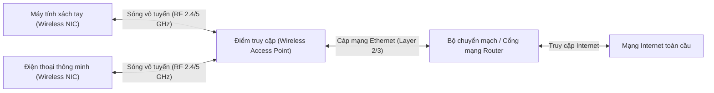
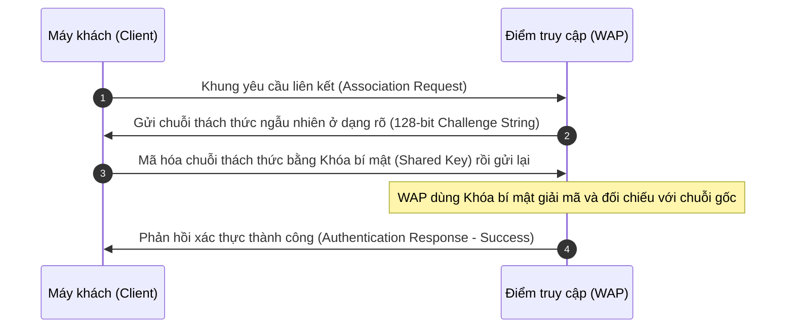
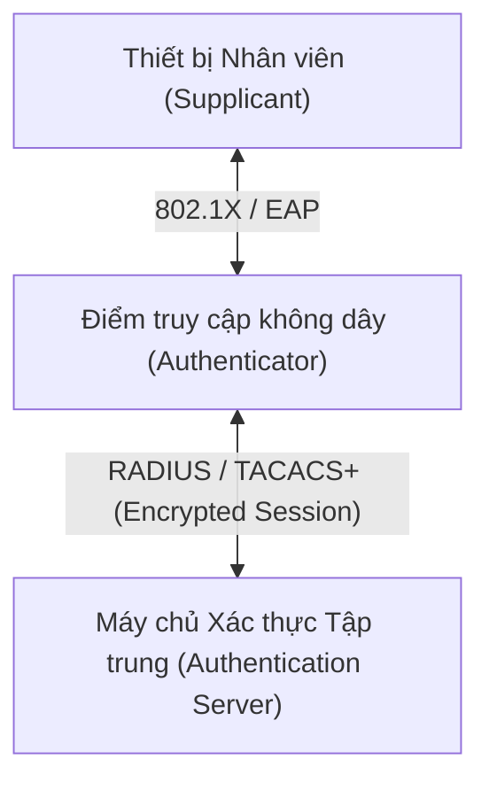
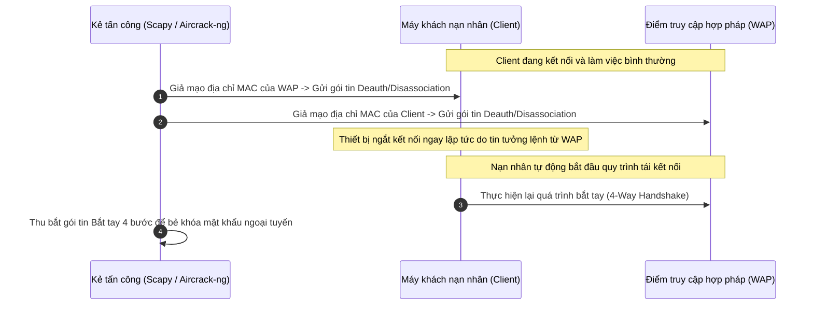

# Wireless Networks

Mạng không dây (**Wireless Networks**) là hệ thống mạng máy tính sử dụng sóng vô tuyến (**Radio Frequency - RF**) để thiết lập các liên kết dữ liệu giữa những nút mạng mà không cần sử dụng bất kỳ dây cáp vật lý nào. Mạng không dây cho phép các thiết bị đầu cuối như máy tính xách tay, điện thoại thông minh, máy tính bảng và thiết bị IoT tự do di chuyển trong phạm vi phủ sóng mà vẫn duy trì kết nối Internet và chia sẻ tài nguyên mạng nội bộ liên tục.

Trong thế giới an ninh mạng, sóng không dây lan tỏa tự do trong không gian vật lý, vượt ra ngoài ranh giới tường nhà hoặc văn phòng làm việc. Bất kỳ ai ở bãi đỗ xe, quán cà phê liền kề hay bên ngoài tòa nhà đều có thể thu bắt được các khung truyền vô tuyến. Do đó, việc nắm vững bản chất tầng vật lý, tiến trình bắt tay kết nối, các lỗ hổng mật mã học lịch sử (như WEP, LEAP) cùng các chiến lược phòng thủ nâng cao (như WPA3, EAP-TLS) là nền tảng tối quan trọng cho mọi chuyên viên phân tích an ninh mạng (SOC Analyst) và chuyên gia kiểm thử bảo mật không dây.

---

## 1. Bản chất Mạng không dây & Tần số Vô tuyến (RF)

Các mạng không dây hoạt động bằng cách chuyển đổi luồng dữ liệu kỹ thuật số thành tín hiệu sóng vô tuyến (**RF Signals**):

* **Bộ điều hợp không dây (Wireless Adapter):** Mỗi thiết bị khi tham gia mạng đều sở hữu một card mạng không dây (Wireless NIC) tích hợp ăng-ten, có nhiệm vụ chuyển đổi dữ liệu số thành tín hiệu sóng RF để truyền qua không gian và ngược lại (thu nhận sóng RF rồi giải điều chế thành dữ liệu nhị phân).
* **Phân loại theo phạm vi địa lý:**
  - **Mạng cục bộ không dây (WLAN - Wireless Local Area Network):** Phổ biến nhất là công nghệ **Wi-Fi**, có phạm vi phủ sóng từ vài chục mét đến vài trăm feet trong nhà hoặc khuôn viên nhỏ.
  - **Mạng diện rộng không dây (WWAN - Wireless Wide Area Network):** Sử dụng hạ tầng viễn thông di động (như 3G, 4G LTE, 5G), có khả năng phủ sóng trên quy mô một thành phố, một quốc gia hoặc toàn cầu.
* **Điểm truy cập không dây (WAP - Wireless Access Point):** Đây là thiết bị trung tâm đóng vai trò là chiếc cầu nối (Bridge) hoặc bộ định tuyến (Router), kết nối mạng không dây vào mạng cáp có dây (Wired Ethernet), đồng thời thực hiện điều phối quyền truy cập và kiểm soát lưu lượng trên mạng.

### Các dải tần vô tuyến Wi-Fi tiêu biểu

Trong mạng Wi-Fi, dữ liệu được truyền thông qua hai dải băng tần sóng vô tuyến chính:

1. **Băng tần 2.4 GHz:**
   - *Ưu điểm:* Bước sóng dài hơn, khả năng đâm xuyên qua tường và vật cản tốt hơn, phạm vi phủ sóng rộng.
   - *Nhược điểm:* Tốc độ truyền tải thấp hơn; dễ bị nhiễu sóng nghiêm trọng do có ít kênh không trùng lặp (chỉ có 3 kênh độc lập: kênh 1, 6, 11) và dùng chung tần số với lò vi sóng, thiết bị Bluetooth, điện thoại không dây.
2. **Băng tần 5 GHz:**
   - *Ưu điểm:* Băng thông rộng hơn nhiều, hỗ trợ tốc độ truyền dữ liệu rất cao, độ trễ thấp và có tới 24 kênh không trùng lặp, giảm thiểu tối đa hiện tượng nghẽn sóng.
   - *Nhược điểm:* Bước sóng ngắn nên phạm vi phủ sóng hẹp hơn, khả năng đâm xuyên qua bê tông hoặc vật cản cứng kém hơn dải 2.4 GHz.

> [!NOTE]
> **Các yếu tố ảnh hưởng đến tín hiệu RF:** Cường độ sóng và khoảng cách truyền tải phụ thuộc chặt chẽ vào công suất phát sóng của ăng-ten, sự hiện diện của các chướng ngại vật (kim loại, tường bê tông) và mật độ tạp âm vô tuyến trong môi trường xung quanh. Để duy trì kết nối ổn định, các chuẩn Wi-Fi áp dụng kỹ thuật truyền phổ rộng (**Spread Spectrum**) và các giải thuật sửa lỗi (**Error Correction**) để tự động phục hồi dữ liệu bị suy hao.

---

## 2. Tiến trình Kết nối Wi-Fi & Khung liên kết (Association Request)

Để một thiết bị đầu cuối kết nối thành công vào mạng Wi-Fi, thiết bị phải tuân thủ chuẩn giao tiếp không dây quốc tế **IEEE 802.11**.

Khi muốn gia nhập mạng, thiết bị máy khách sẽ gửi một gói tin đặc biệt đến WAP gọi là **Khung yêu cầu kết nối / Khung yêu cầu liên kết (Association Request Frame)**. Khung này chứa các thông tin thiết yếu sau:

* **Địa chỉ MAC (MAC Address):** Định danh vật lý duy nhất của card mạng không dây trên máy khách.
* **SSID (Service Set Identifier):** Tên định danh của mạng Wi-Fi mà thiết bị muốn kết nối vào (ví dụ: `Corporate-WiFi`).
* **Tốc độ truyền dữ liệu được hỗ trợ (Supported Data Rates):** Danh sách các mức tốc độ dữ liệu tối đa mà card mạng của thiết bị có thể xử lý (ví dụ: 54 Mbps, 150 Mbps, 866 Mbps).
* **Các kênh truyền thông hỗ trợ (Supported Channels):** Danh mục các kênh tần số mà thiết bị có thể giao tiếp.
* **Giao thức bảo mật được hỗ trợ (Supported Security Protocols):** Danh sách các cơ chế mã hóa và xác thực mà máy khách tương thích (như WPA2-Personal, WPA3-Enterprise).

Sau khi nhận được khung yêu cầu liên kết, nếu các thông số thỏa mãn chính sách của mạng, WAP sẽ phản hồi bằng khung **Association Response** để chấp thuận thiết bị. Ngay sau đó, các giao thức mạng khác (như DHCP để cấp phát địa chỉ IP nội bộ, ARP để phân giải địa chỉ và WPA2/WPA3 để mã hóa luồng dữ liệu) sẽ phối hợp để đưa thiết bị vào trạng thái sẵn sàng hoạt động.

---

## 3. Cơ chế Bắt tay WEP Challenge-Response & Lỗ hổng CRC Checksum

Trước khi có các chuẩn mã hóa hiện đại, chuẩn bảo mật nguyên thủy của Wi-Fi là **WEP (Wired Equivalent Privacy)** sử dụng quy trình bắt tay Thách thức - Phản hồi (**Challenge-Response Handshake**) dựa trên cơ chế khóa bí mật dùng chung (**Shared Secret Key**).

### Các bước trong quy trình bắt tay WEP Challenge-Response

| Bước | Phía thực hiện | Mô tả chi tiết tiến trình |
| :---: | :--- | :--- |
| **1** | **Client** | Gửi gói tin yêu cầu liên kết (**Association Request**) tới WAP để xin cấp quyền truy cập. |
| **2** | **WAP** | Phản hồi lại bằng một gói tin **Association Response**, bên trong chứa một chuỗi ngẫu nhiên bằng văn bản thuần (**Challenge String**). |
| **3** | **Client** | Sử dụng Khóa bí mật dùng chung (**Shared Key**) để mã hóa chuỗi thách thức đó, rồi gửi kết quả bản mã ngược lại cho WAP. |
| **4** | **WAP** | Sử dụng chính khóa bí mật đó để tự tính toán kết quả mong đợi. Nếu kết quả của Client khớp với tính toán của WAP, WAP gửi gói tin xác thực thành công cho phép kết nối. |

### Lỗ hổng Trọng yếu của Cơ chế Kiểm tra Toàn vẹn CRC Checksum trong WEP

Do môi trường truyền sóng vô tuyến dễ bị nhiễu và mất mát gói tin, WEP tích hợp mã kiểm tra dư thừa tuần hoàn **CRC (Cyclic Redundancy Check)** để phát hiện lỗi dữ liệu. Mỗi gói tin gửi đi đều được tính toán một giá trị checksum CRC và gắn vào header. Thiết bị nhận sẽ tính lại giá trị này và so khớp: nếu khớp nghĩa là dữ liệu toàn vẹn; nếu không khớp nghĩa là gói tin bị hỏng và cần truyền lại.

Tuy nhiên, cơ chế CRC trong WEP tồn tại một **lỗ hổng thiết kế mang tính chí mạng**:

> [!CAUTION]
> **Điểm yếu của CRC trong WEP:** Giá trị CRC được tính toán dựa trên **nội dung văn bản thuần (Plaintext)** trước khi mã hóa, chứ không phải dựa trên bản mã (Ciphertext). Hơn nữa, thuật toán CRC-32 là một hàm toán học có tính chất tuyến tính (Linear Function). 
> 
> Lợi dụng tính chất tuyến tính này kết hợp với thuật toán mã hóa dòng RC4, kẻ tấn công có thể thu bắt gói tin, chỉnh sửa các bit dữ liệu mong muốn và cập nhật lại giá trị CRC tương ứng một cách hợp lệ mà **hoàn toàn không cần biết khóa bí mật giải mã**. Thậm chí, kẻ tấn công có thể khôi phục lại nội dung bản rõ ban đầu của từng gói tin thông qua các kỹ thuật tấn công chèn gói tin giả mạo.

---

## 4. Các tính năng Bảo mật & Chuẩn Mã hóa Wi-Fi

Một hạ tầng mạng không dây tiêu chuẩn cần dựa trên ba trụ cột bảo vệ căn bản:

1. **Mã hóa (Encryption):** Bảo vệ tính bí mật (Confidentiality) của dữ liệu truyền qua sóng vô tuyến, ngăn chặn các đối tượng nghe lén đọc được thông tin nhạy cảm.
2. **Kiểm soát truy cập (Access Control):** Xác thực danh tính của thiết bị và người dùng trước khi cấp quyền truy cập vào mạng (sử dụng mật khẩu, chứng chỉ số hoặc địa chỉ MAC).
3. **Tường lửa (Firewall):** Hệ thống lọc lưu lượng mạng tích hợp ngay trên Router/WAP, ngăn chặn các luồng kết nối độc hại từ Internet thâm nhập vào mạng nội bộ.

### Sự sụp đổ của chuẩn WEP và Lỗ hổng 24-bit IV

Chuẩn WEP sử dụng thuật toán mã hóa dòng **RC4**. Khóa dùng để mã hóa mỗi gói tin được ghép từ hai thành phần: một giá trị ngẫu nhiên gọi là **Vector khởi tạo (IV - Initialization Vector)** và **Khóa bí mật (Secret Key)**.

Có hai phiên bản WEP phổ biến:
* **WEP-40 (thường được gọi là WEP-64):** Sử dụng khóa bí mật 40-bit kết hợp với IV 24-bit (tổng cộng 64-bit).
* **WEP-104 (thường gọi là WEP-128):** Sử dụng khóa bí mật 104-bit kết hợp với IV 24-bit (tổng cộng 128-bit).

| Giao thức | Độ dài Vector Khởi tạo (IV) | Độ dài Khóa Bí mật (Secret Key) | Tổng độ dài khóa thực tế |
| :--- | :---: | :---: | :---: |
| **WEP-40 / WEP-64** | 24-bit | 40-bit | 64-bit |
| **WEP-104** | 24-bit | 80-bit (hoặc 104-bit) | 104-bit đến 128-bit |

> [!WARNING]
> **Tại sao WEP bị bẻ khóa dễ dàng?** 
> 
> Vector khởi tạo (IV) trong chuẩn WEP chỉ dài **24-bit**, tương đương với chỉ khoảng **16.7 triệu (\(2^{24}\))** giá trị khả dĩ, và IV lại được truyền dưới dạng văn bản rõ (**Cleartext**) trong header của mỗi gói tin.
> 
> Trên một mạng Wi-Fi có lưu lượng truy cập trung bình, chỉ sau vài chục phút (hoặc vài phút nếu kẻ tấn công chủ động kích thích lưu lượng bằng kỹ thuật chèn gói ARP Replay), toàn bộ không gian 24-bit IV sẽ bị cạn kiệt và lặp lại (**IV Collision / IV Reuse**). Kết hợp với điểm yếu trong bộ sinh khóa của thuật toán RC4 (tấn công FMS, KoreK, PTW), kẻ tấn công chỉ cần thu thập một số lượng gói tin nhất định là có thể tính toán ngược ra khóa bí mật trong chưa đầy 60 giây bằng các công cụ như `aircrack-ng`.

### Bước tiến vượt bậc: WPA, WPA2 và WPA3

Nhận thấy WEP hoàn toàn mất an toàn, tổ chức Wi-Fi Alliance đã liên tục phát triển các thế hệ bảo mật kế tiếp:

* **WPA (Wi-Fi Protected Access):** Giải pháp tình thế tạm thời thay thế WEP, sử dụng giao thức **TKIP (Temporal Key Integrity Protocol)** để tự động thay đổi khóa mã hóa cho từng gói tin, khắc phục triệt để lỗi tái sử dụng IV của WEP.
* **WPA2 (Wi-Fi Protected Access 2):** Chuẩn bảo mật chính thức thay thế toàn diện WEP và WPA, sử dụng thuật toán mã hóa khối đối xứng **AES (Advanced Encryption Standard)** với độ dài khóa 128-bit thông qua cơ chế **CCMP (Counter Mode with Cipher Block Chaining Message Authentication Code Protocol)**. WPA2 cung cấp khả năng bảo mật cấp quân sự và là tiêu chuẩn phổ biến nhất trong nhiều năm qua.
* **WPA3 (Wi-Fi Protected Access 3):** Thế hệ bảo mật không dây mới nhất hiện nay. WPA3 trang bị giao thức xác thực tương đương **SAE (Simultaneous Authentication of Equals)**, ngăn chặn triệt để hình thức tấn công dò mật khẩu ngoại tuyến (**Offline Dictionary Attack**) ngay cả khi người dùng đặt mật khẩu yếu, đồng thời nâng cấp bộ mã hóa lên chuẩn 192-bit đối với các môi trường doanh nghiệp trọng yếu.

---

## 5. Khung Giao thức Xác thực Doanh nghiệp (Enterprise Authentication)

Trong môi trường doanh nghiệp hoặc các tổ chức lớn, việc chia sẻ chung một mật khẩu duy nhất cho hàng trăm nhân viên là điều tối kỵ về mặt an toàn thông tin. Khi đó, các giao thức xác thực tập trung được triển khai dựa trên khung **EAP (Extensible Authentication Protocol)**:

### 1. LEAP (Lightweight Extensible Authentication Protocol)
* Được phát triển bởi Cisco nhằm mục đích khắc phục các yếu điểm của WEP trước khi WPA2 ra đời.
* **Cơ chế:** Sử dụng cơ chế tên người dùng và mật khẩu để xác thực hai chiều giữa client và máy chủ thông qua giao thức MS-CHAPv2.
* **Rủi ro an ninh:** LEAP sử dụng một khóa bí mật chia sẻ (Shared Secret). Kẻ tấn công có thể nghe lén quá trình trao đổi xác thực qua sóng vô tuyến rồi thực hiện tấn công từ điển ngoại tuyến (**Offline Dictionary Attack**) để bẻ khóa mật khẩu người dùng một cách dễ dàng. Ngày nay, LEAP bị coi là lỗi thời và tuyệt đối không nên sử dụng.

### 2. PEAP (Protected Extensible Authentication Protocol)
* Do liên minh Microsoft, Cisco và RSA Security phát triển nhằm thay thế LEAP.
* **Cơ chế:** PEAP sử dụng công nghệ đường hầm bảo mật **TLS (Tunneled Transport Layer Security)**. Trước khi quá trình xác thực danh tính người dùng diễn ra, máy chủ xác thực sẽ xuất trình chứng chỉ số (**Digital Certificate**) để thiết lập một đường hầm mã hóa an toàn giữa máy khách và máy chủ.
* **Ưu điểm an ninh:** Toàn bộ thông tin đăng nhập (Username/Password) của người dùng được bảo vệ an toàn bên trong đường hầm mã hóa TLS, chống lại hoàn toàn nguy cơ bị nghe lén hoặc tấn công vét cạn qua không gian vô tuyến.

### 3. TACACS+ (Terminal Access Controller Access-Control System Plus)
* **TACACS+** là giao thức kiểm soát truy cập tập trung quản lý theo mô hình **AAA** (Authentication - Xác thực, Authorization - Phân quyền, Accounting - Ghi nhật ký kiểm toán), thường được triển khai để quản trị các thiết bị hạ tầng mạng như Router, Switch và WAP.
* **Điểm vượt trội về an ninh:** Khi WAP chuyển tiếp yêu cầu xác thực tới máy chủ TACACS+, **toàn bộ gói tin yêu cầu (bao gồm cả header và thông tin phiên làm việc)** sẽ được mã hóa an toàn. Đây là điểm cải tiến vượt trội so với giao thức đối thủ là RADIUS (vốn chỉ mã hóa riêng trường mật khẩu, để lộ các thông tin quản trị khác ở dạng rõ).

---

## 6. Véc-tơ Tấn công Mạng không dây: Tấn công Hủy liên kết (Disassociation Attack)

Một trong những đòn tấn công mạng không dây phổ biến và nguy hiểm nhất mà mọi nhà phân tích bảo mật cần hiểu rõ là **Tấn công hủy liên kết (Disassociation / Deauthentication Attack)**.

### Cơ chế hoạt động của cuộc tấn công

Trong chuẩn kết nối không dây nguyên thủy **IEEE 802.11**, các khung tin quản trị (**Management Frames**) như khung thông báo hủy liên kết (`Disassociation Frame`) hay hủy xác thực (`Deauthentication Frame`) được truyền phát công khai và **hoàn toàn không được ký số hay mã hóa**:

### Mục đích của kẻ tấn công khi tung đòn Deauth

1. **Gây gián đoạn dịch vụ (Denial of Service - DoS):** Kẻ tấn công liên tục xả một luồng khung Deauth giả mạo nhắm vào một thiết bị cụ thể hoặc địa chỉ phát sóng quảng bá (`Broadcast MAC: FF:FF:FF:FF:FF:FF`) để ngắt kết nối toàn bộ người dùng trong phòng làm việc.
2. **Bắt gói tin bắt tay 4 bước (Capture 4-Way Handshake):** Khi nạn nhân bị đá văng khỏi mạng, thiết bị sẽ tự động thực hiện tiến trình kết nối lại với WAP. Kẻ tấn công chờ sẵn khoảnh khắc này để thu bắt toàn bộ gói tin bắt tay 4 bước (**WPA/WPA2 4-Way Handshake**), sau đó trích xuất mã băm MIC/PMKID và đưa vào dàn máy tính GPU công suất cao để thực hiện tấn công dò mật khẩu ngoại tuyến (**Offline Wordlist/Brute-force Cracking**).
3. **Ép nạn nhân kết nối vào Điểm truy cập giả mạo (Evil Twin / Rogue AP):** Bằng cách gây nhiễu và ngắt kết nối nạn nhân khỏi trạm phát hợp pháp, kẻ tấn công dựng một trạm phát sóng giả mạo có cùng tên SSID nhưng với cường độ sóng mạnh hơn. Thiết bị của nạn nhân sẽ tự động chuyển sang bắt sóng của Rogue AP, từ đó kẻ tấn công nắm toàn quyền kiểm soát lưu lượng và thực hiện tấn công nghe lén trung gian (**Man-in-the-Middle - MITM**).

> [!TIP]
> **Giải pháp khắc phục:** Chuẩn sửa đổi **IEEE 802.11w** (Protected Management Frames - PMF) đã được chuẩn hóa và bắt buộc trên WPA3, giúp mã hóa và xác thực toàn vẹn các khung quản trị, vô hiệu hóa hoàn toàn kỹ thuật tấn công giả mạo Deauth này.

---

## 7. Chiến lược Làm cứng Bảo mật Mạng không dây (Wireless Hardening)

Để bảo vệ hạ tầng mạng không dây trước các kỹ thuật tấn công tinh vi, quản trị viên hệ thống cần áp dụng các biện pháp làm cứng (**Wireless Hardening**) sau:

### 1. Vô hiệu hóa quảng bá định danh mạng (Disabling SSID Broadcasting)
* **Cơ chế:** Cấu hình WAP ngừng phát các khung **Beacon Frame** chứa tên mạng SSID. Khi đó, mạng Wi-Fi sẽ ở trạng thái ẩn (Hidden Network) và không tự động xuất hiện trên danh sách quét sóng thông thường của các thiết bị xung quanh.
* **Góc nhìn thực tế của Chuyên viên Bảo mật:** 
  > Đây là hình thức "bảo mật thông qua sự mù mờ" (**Security through Obscurity**). Ẩn SSID chỉ gây khó khăn cho người dùng phổ thông, chứ không thể ngăn cản kẻ tấn công chuyên nghiệp. Khi một máy khách hợp lệ muốn kết nối vào một mạng ẩn, nó vẫn phải phát ra khung **Probe Request** chứa SSID thực sự, hoặc tên SSID sẽ xuất hiện rõ ràng trong gói tin xác thực (**Authentication Packet**). Kẻ tấn công chỉ cần lắng nghe đường truyền bằng công cụ chuyên dụng là tìm ra SSID trong vài giây.

### 2. Bộ lọc địa chỉ vật lý (MAC Filtering)
* **Cơ chế:** Thiết lập một danh sách trắng (**Whitelist**) trên WAP, chỉ cho phép các thiết bị có địa chỉ MAC nằm trong danh sách được phép gia nhập mạng.
* **Góc nhìn thực tế của Chuyên viên Bảo mật:**
  > Địa chỉ MAC luôn được truyền dưới dạng bản rõ trong tiêu đề của mọi khung vô tuyến 802.11 mà không được mã hóa. Bất kỳ ai sử dụng card mạng ở chế độ giám sát (**Monitor Mode**) đều có thể chụp được địa chỉ MAC của các thiết bị đang truyền nhận hợp lệ, sau đó sử dụng công cụ như `macchanger` để mạo danh (**MAC Spoofing**) địa chỉ đó và vượt qua bộ lọc MAC một cách nhanh chóng.

### 3. Nâng cấp chuẩn mã hóa lên WPA2-Enterprise hoặc WPA3
* Tuyệt đối khai tử các chuẩn bảo mật cổ điển như WEP, WPA (TKIP) và hạn chế sử dụng WPA-Personal (vốn sử dụng chung một mật khẩu chia sẻ PSK dễ bị tấn công từ điển khi bắt được 4-way handshake).
* Đối với doanh nghiệp, bắt buộc triển khai **WPA-Enterprise**. Mỗi người dùng sẽ có một tài khoản xác thực độc lập được quản lý tập trung thông qua máy chủ **RADIUS** hoặc **TACACS+**, giúp dễ dàng thu hồi quyền truy cập khi nhân viên nghỉ việc mà không cần đổi mật khẩu toàn bộ mạng.

### 4. Triển khai EAP-TLS với Hạ tầng Khóa Công khai (PKI)
* **EAP-TLS** là tiêu chuẩn vàng về an ninh cho các mạng không dây cấp doanh nghiệp.
* **Cơ chế:** Sử dụng chứng chỉ số (**Digital Certificates**) trên cả máy chủ xác thực và từng thiết bị máy khách (**Mutual Authentication - Xác thực lẫn nhau**) thông qua hạ tầng PKI.
* **Hiệu quả phòng thủ tuyệt đối:** Do không sử dụng mật khẩu tĩnh, EAP-TLS loại bỏ hoàn toàn các nguy cơ bị lộ thông tin đăng nhập, miễn nhiễm với các cuộc tấn công bẻ khóa từ điển ngoại tuyến, đồng thời ngăn chặn triệt để hình thức tấn công trạm phát giả mạo (Evil Twin) vì thiết bị người dùng sẽ lập tức từ chối kết nối nếu trạm phát không xuất trình được chứng chỉ số hợp lệ do tổ chức phát hành.

---

## 8. Bảng Tổng kết Kiến thức Trọng tâm

| Hạng mục / Giao thức | Phân loại | Điểm đặc trưng & Cơ chế kỹ thuật | Đánh giá Mức độ An toàn & Khuyến nghị |
| :--- | :---: | :--- | :--- |
| **Băng tần 2.4 GHz** | Tần số RF | Bước sóng dài, xuyên tường tốt, phạm vi rộng, tốc độ trung bình, dễ nhiễu sóng. | Thích hợp cho thiết bị IoT hoặc khu vực cần khoảng cách xa. |
| **Băng tần 5 GHz** | Tần số RF | Băng thông lớn, tốc độ cao, độ trễ thấp, ít nhiễu sóng, phạm vi ngắn hơn. | Tối ưu cho thiết bị văn phòng tốc độ cao. |
| **WEP** | Mã hóa | Sử dụng RC4 với IV 24-bit ngắn; lỗ hổng kiểm tra toàn vẹn CRC-32 tuyến tính. | **Cực kỳ nguy hiểm.** Bị bẻ khóa trong vài phút; cấm sử dụng. |
| **WPA (TKIP)** | Mã hóa | Thay đổi khóa động theo từng gói tin bằng TKIP; giải pháp tạm thời. | **Lỗi thời.** Hiện không còn an toàn trước các kỹ thuật tấn công hiện đại. |
| **WPA2 (AES-CCMP)** | Mã hóa | Mã hóa khối AES 128-bit kết hợp chuẩn CCMP; bảo vệ tính toàn vẹn cao. | **Khá an toàn.** Chuẩn mực phổ biến nhất hiện nay; nên bật kèm PMF (802.11w). |
| **WPA3 (SAE)** | Mã hóa | Bổ sung giao thức SAE chống tấn công từ điển ngoại tuyến; mã hóa 192-bit. | **Tối ưu nhất.** Khuyến nghị triển khai trên toàn bộ hệ thống thế hệ mới. |
| **LEAP** | Xác thực EAP | Xác thực người dùng qua MS-CHAPv2; dùng khóa chia sẻ chung. | **Nguy cơ cao.** Dễ bị bắt gói tin và vét cạn từ điển ngoại tuyến; không sử dụng. |
| **PEAP** | Xác thực EAP | Bảo vệ thông tin đăng nhập trong đường hầm mã hóa TLS có chứng chỉ số. | **An toàn cao.** Giải pháp xác thực doanh nghiệp kinh tế và phổ biến. |
| **EAP-TLS** | Xác thực EAP | Xác thực hai chiều giữa Client và Server bằng chứng chỉ số PKI. | **Bảo mật tuyệt đối.** Tiêu chuẩn vàng cho mạng không dây doanh nghiệp. |
| **TACACS+** | Giao thức AAA | Mã hóa toàn bộ gói tin yêu cầu xác thực và phân quyền cho thiết bị mạng. | **Rất an toàn.** Vượt trội hơn RADIUS về khả năng mã hóa dữ liệu đường truyền. |
| **Disassociation Attack** | Tấn công | Gửi khung hủy liên kết giả mạo để ngắt kết nối nạn nhân, nhằm bắt 4-way handshake. | Ngăn chặn bằng cách triển khai chuẩn bảo vệ khung quản trị **802.11w (PMF)**. |
| **Ẩn SSID / Lọc MAC** | Làm cứng | Ẩn tên mạng và chỉ cho phép danh sách MAC chỉ định kết nối. | **Bảo mật bề mặt.** Dễ bị vượt qua bằng các công cụ bắt gói tin cơ bản. |
