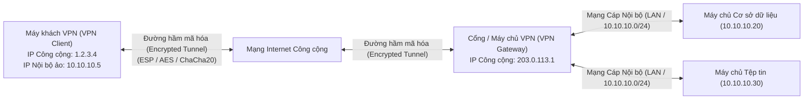
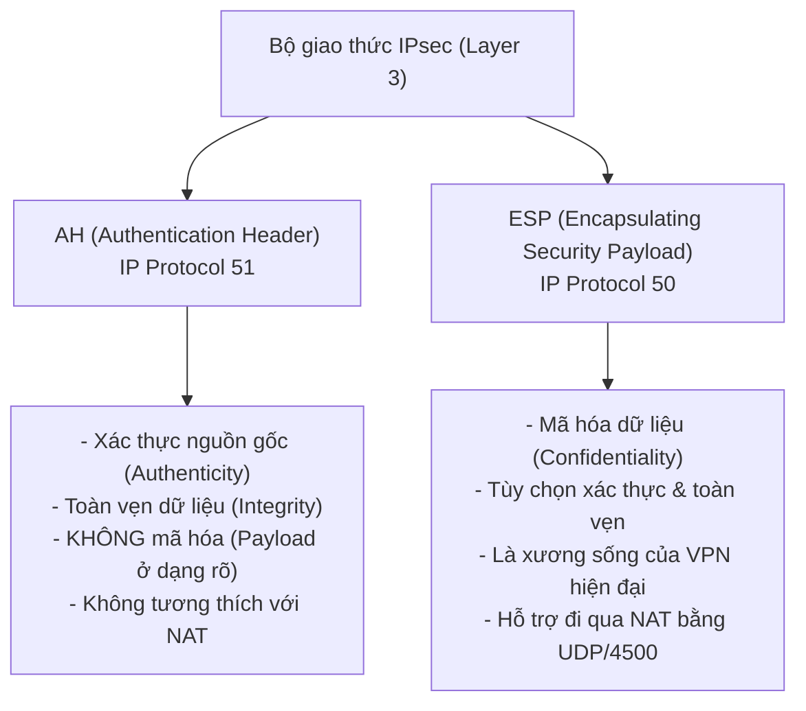
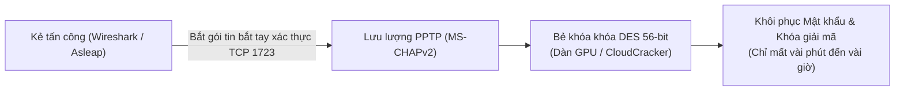

# Virtual Private Networks (VPN)

Mạng riêng ảo (**Virtual Private Network - VPN**) là công nghệ thiết lập một kết nối logic được mã hóa an toàn (**Encrypted Tunnel**) nối liền giữa một thiết bị từ xa (Remote Client) và một mạng nội bộ doanh nghiệp (Private Network) thông qua môi trường mạng công cộng không đáng tin cậy như Internet.

Trong mô hình mạng truyền thống, các máy chủ cơ sở dữ liệu, máy chủ tệp tin nội bộ hay giao diện quản trị hạ tầng quan trọng chỉ được phép truy cập từ dải mạng cục bộ (LAN) nhằm ngăn chặn kẻ tấn công trên Internet dò quét và khai thác. VPN chính là giải pháp an ninh tiêu chuẩn cho phép các kỹ sư quản trị hệ thống (SysAdmin) hay nhân viên làm việc từ xa (Remote / WFH) truy cập an toàn vào các tài nguyên nhạy cảm này: thiết bị từ xa kết nối tới máy chủ VPN, vượt qua quy trình xác thực nghiêm ngặt, nhận một địa chỉ IP nội bộ hợp lệ và truyền nhận dữ liệu qua một "đường hầm" mã hóa mà không một bên thứ ba nào (kể cả nhà cung cấp dịch vụ Internet - ISP hay kẻ nghe lén trên đường truyền) có thể giải mã được.

---

## 1. Kiến trúc và các thành phần cốt lõi của hệ thống VPN

Để thiết lập một kết nối VPN hoàn chỉnh qua mạng Internet công cộng, bốn thành phần và điều kiện tiên quyết sau đây bắt buộc phải hiện diện:

| Thành phần / yêu cầu | Vai trò kỹ thuật và cơ chế hoạt động |
| :--- | :--- |
| **Máy khách VPN (VPN Client)** | Phần mềm chuyên dụng cài đặt trên thiết bị đầu cuối của người dùng (như OpenVPN Client, WireGuard, Cisco AnyConnect hoặc trình VPN tích hợp sẵn của hệ điều hành), chịu trách nhiệm mã hóa dữ liệu trước khi gửi và giải mã dữ liệu nhận được từ máy chủ VPN. |
| **Máy chủ VPN (VPN Server / Gateway)** | Thiết bị phần cứng mạng chuyên dụng (Tường lửa, Router) hoặc máy chủ chuyên biệt chịu trách nhiệm tiếp nhận yêu cầu kết nối từ các máy khách, xác thực danh tính, cấp phát địa chỉ IP nội bộ và định tuyến lưu lượng giữa máy khách vào các máy chủ trong mạng LAN. |
| **Cơ chế mã hóa (Encryption)** | Các thuật toán và giao thức mật mã học hiện đại (như AES-256-GCM, ChaCha20-Poly1305, IPsec ESP) dùng để xáo trộn dữ liệu thành dạng bản mã không thể đọc được trên đường truyền Internet. |
| **Cơ chế xác thực (Authentication)** | Quy trình xác nhận danh tính lẫn nhau giữa máy khách và máy chủ VPN thông qua khóa bí mật dùng chung (Pre-Shared Key - PSK), chứng chỉ số công cộng (Digital Certificates PKI), tài khoản người dùng kết hợp xác thực đa yếu tố (MFA/2FA). |

### Lợi ích chiến lược của công nghệ VPN

1. **Bảo mật dữ liệu tuyệt đối trên đường truyền:** Toàn bộ lưu lượng (thư điện tử, tài liệu mật, thông tin xác thực) đều được bọc trong đường hầm mã hóa, vô hiệu hóa hoàn toàn các hình thức tấn công nghe lén (Sniffing) và tấn công trung gian (Man-in-the-Middle - MITM).
2. **Linh hoạt và tiết kiệm chi phí vượt trội:** Thay vì phải tốn hàng ngàn USD mỗi tháng để thuê các đường truyền cáp vật lý riêng biệt (Leased Lines / MPLS), doanh nghiệp tận dụng ngay hạ tầng Internet giá rẻ sẵn có mà vẫn đảm bảo tính riêng tư tương đương mạng riêng.
3. **Kết nối đa điểm (Site-to-Site VPN):** Cho phép kết nối liền mạch nhiều mạng nội bộ của các chi nhánh văn phòng đặt tại các quốc gia hoặc thành phố khác nhau thành một mạng logic duy nhất, giúp nhân viên truy cập tài nguyên lẫn nhau như đang ngồi cùng một tòa nhà.

---

## 2. Chuyên sâu về bộ giao thức IPsec (Internet Protocol Security)

**IPsec** là một bộ giao thức bảo mật hoạt động ở **tầng mạng (Layer 3 - Network Layer)** của mô hình OSI. Nhờ hoạt động ở tầng 3, IPsec có ưu điểm vượt trội là cung cấp khả năng mã hóa và xác thực độc lập, trong suốt với mọi ứng dụng tầng trên (Layer 4 đến Layer 7), không đòi hỏi ứng dụng phải thay đổi cấu hình hay hỗ trợ giao thức đặc biệt.

IPsec là sự kết hợp của hai giao thức an ninh cốt lõi:

### 1. Authentication Header (AH) - Giao thức IP số 51
* **Chức năng:** Cung cấp tính toàn vẹn (Integrity) và xác thực nguồn gốc (Authenticity) cho gói tin IP thông qua chữ ký băm mật mã học (Cryptographic Checksum).
* **Đặc tính:** AH **hoàn toàn không mã hóa dữ liệu** (phần tải dữ liệu Payload vẫn ở dạng văn bản rõ ràng).
* **Hạn chế kỹ thuật:** Do AH tính toán mã băm bao gồm cả phần tiêu đề IP (IP Header) để chống giả mạo, nó sẽ xung đột trực tiếp với các thiết bị định tuyến NAT (vốn luôn thay đổi địa chỉ IP trong header). Do đó, AH hầu như không còn được sử dụng trên mạng Internet ngày nay.

### 2. Encapsulating Security Payload (ESP) - Giao thức IP số 50
* **Chức năng:** Cung cấp khả năng **mã hóa bảo mật (Confidentiality)** cho dữ liệu, đồng thời tùy chọn cung cấp cả tính toàn vẹn và xác thực nguồn gốc tương tự AH.
* **Đặc tính:** ESP mã hóa toàn bộ dữ liệu người dùng và gắn thêm một tiêu đề ESP cùng mã băm kiểm tra tính toàn vẹn ở cuối gói tin. ESP là giao thức trung tâm của hầu hết mọi hệ thống VPN doanh nghiệp hiện nay.

---

## 3. Hai chế độ hoạt động của IPsec: Transport Mode vs Tunnel Mode

Tùy thuộc vào kịch bản triển khai, IPsec hỗ trợ hai chế độ hoạt động khác nhau:

```mermaid
graph TD
    subgraph "Gói tin IP Gốc (Original IP Packet)"
        OrigIP["IP Header Gốc<br/>(Src: 10.10.10.5 -> Dst: 10.10.10.20)"] --- OrigPayload["Dữ liệu Ứng dụng (TCP Data / Payload)"]
    end

    subgraph "Chế độ Truyền vận (Transport Mode) - Chỉ mã hóa Payload"
        T_OrigIP["IP Header Gốc (Không mã hóa)"] --- T_ESP["ESP Header"] --- T_EncPayload["Dữ liệu Ứng dụng ĐÃ MÃ HÓA"] --- T_ESPTrail["ESP Trailer / Auth"]
    end

    subgraph "Chế độ Đường hầm (Tunnel Mode) - Mã hóa Toàn bộ Gói tin Gốc"
        NewIP["IP Header MỚI (Gateway-to-Gateway)<br/>(Src: 1.2.3.4 -> Dst: 203.0.113.1)"] --- Tun_ESP["ESP Header"] --- Tun_EncOrigIP["IP Header GỐC (ĐÃ MÃ HÓA)"] --- Tun_EncPayload["Dữ liệu GỐC (ĐÃ MÃ HÓA)"] --- Tun_ESPTrail["ESP Trailer / Auth"]
    end
```

| Chế độ | Phạm vi mã hóa | Trường hợp sử dụng thực tế | Đánh giá an ninh |
| :--- | :--- | :--- | :--- |
| **Transport Mode (Chế độ Truyền vận)** | Chỉ mã hóa phần dữ liệu tải (**Data Payload**); phần tiêu đề IP Header gốc được **giữ nguyên không mã hóa**. | Kết nối trực tiếp giữa hai máy chủ đầu cuối (Host-to-Host communication) trong cùng một mạng nội bộ tin cậy. | Kẻ nghe lén vẫn nhìn thấy địa chỉ IP nguồn và đích thực sự của hai thiết bị đang truyền thông. |
| **Tunnel Mode (Chế độ Đường hầm)** | Mã hóa **toàn bộ gói tin IP gốc** (bao gồm cả IP Header nguồn/đích thực tế và Payload), sau đó bọc tất cả bên trong một **IP Header mới hoàn toàn**. | Kết nối giữa hai cổng mạng (Gateway-to-Gateway / Site-to-Site VPN) hoặc máy khách từ xa tới mạng công ty (Remote Access VPN). | **Bảo mật tối đa.** Kẻ tấn công trên Internet chỉ nhìn thấy địa chỉ IP của hai cổng VPN Gateway, hoàn toàn không thể xác định được cấu trúc và địa chỉ IP bên trong mạng nội bộ. |

---

## 4. Các cổng dịch vụ, giao thức và cấu hình tường lửa (Firewall Rules)

Để một luồng lưu lượng IPsec VPN từ máy khách bên ngoài có thể đi qua tường lửa (Firewall) vào máy chủ VPN bên trong, người quản trị mạng bắt buộc phải mở các giao thức và cổng dịch vụ đặc thù sau:

| Tên giao thức | Cổng / định danh giao thức | Chức năng kỹ thuật và vai trò |
| :--- | :---: | :--- |
| **Internet Protocol (IP)** | **IP Protocol 50 (ESP)** **IP Protocol 51 (AH)** | Giao thức tầng 3 chịu trách nhiệm truyền tải dữ liệu mã hóa. Lưu ý: Đây là số hiệu giao thức IP (**IP Protocol Number**), không phải số hiệu cổng TCP hay UDP thông thường. |
| **Internet Key Exchange (IKE)** | **UDP 500** | Giao thức thiết lập và duy trì kênh truyền thông an toàn giữa hai đầu kết nối dựa trên thuật toán trao đổi khóa **Diffie-Hellman**. IKE đàm phán các bộ thuật toán mã hóa (Cipher Suite) và tạo ra các khóa phiên dùng chung để ESP mã hóa dữ liệu. |
| **NAT Traversal (NAT-T)** | **UDP 4500** | Khi máy khách nằm sau thiết bị định tuyến NAT (như Router Wi-Fi gia đình), gói tin ESP thuần túy (IP Protocol 50) không có số hiệu cổng TCP/UDP nên thường bị router NAT làm hỏng hoặc chặn lại. Kỹ thuật NAT Traversal sẽ **bọc toàn bộ gói tin ESP bên trong một gói UDP cổng 4500**, giúp dữ liệu VPN vượt qua NAT mượt mà. |

> [!TIP]
> **IKEv1 so với IKEv2:** Trong các hệ thống hiện đại, chuẩn **IKEv2** được ưu tiên sử dụng thay thế cho IKEv1. IKEv2 hỗ trợ tính năng **MOBIKE (Mobility and Multihoming Protocol)**, cho phép người dùng chuyển đổi mạng liên tục (ví dụ: đang kết nối Wi-Fi văn phòng chuyển sang mạng di động 4G/5G) mà đường hầm VPN vẫn duy trì liên tục mà không bị ngắt kết nối hay phải xác thực lại từ đầu.

---

## 5. Lỗ hổng bảo mật của chuẩn PPTP (Point-to-Point Tunneling Protocol)

**PPTP** là một trong những giao thức VPN đời đầu do Microsoft cùng các liên minh phát triển, sử dụng cổng **TCP 1723** để điều khiển và giao thức **GRE (Generic Routing Encapsulation - IP Protocol 47)** để đóng gói dữ liệu. Mặc dù từng rất phổ biến nhờ tốc độ cao và được tích hợp sẵn trên hầu hết các phiên bản Windows cổ điển, ngày nay PPTP bị coi là **hoàn toàn mất an toàn** và bị khai tử khỏi mọi hệ thống tiêu chuẩn:

### Tại sao PPTP bị bẻ khóa dễ dàng?

1. **Phương thức xác thực MS-CHAPv2 đầy lỗ hổng:** Quy trình bắt tay xác thực của MS-CHAPv2 chia mật khẩu người dùng thành các phần nhỏ để mã hóa bằng thuật toán **DES đơn (Single DES 56-bit)**. Không gian khóa 56-bit là quá nhỏ bé đối với năng lực tính toán hiện nay.
2. **Dễ dàng bẻ khóa ngoại tuyến:** Kẻ tấn công chỉ cần nghe lén và thu bắt được gói tin bắt tay ban đầu trên cổng TCP 1723, sau đó đưa chuỗi phản hồi vào các công cụ như `asleap` hoặc các dịch vụ bẻ khóa đám mây để tìm ra mật khẩu gốc trong vòng chưa đầy một ngày với chi phí gần như bằng không.
3. **Các lựa chọn thay thế an toàn hiện nay:**
   - **OpenVPN:** Sử dụng thư viện OpenSSL, hoạt động linh hoạt trên cả TCP và UDP (thường dùng UDP 1194, hoặc ngụy trang trên TCP 443 như lưu lượng HTTPS để vượt qua các tường lửa kiểm duyệt nghiêm ngặt).
   - **WireGuard:** Giao thức VPN thế hệ mới cực kỳ tinh gọn (chỉ khoảng 4.000 dòng mã nguồn so với hàng trăm ngàn dòng của OpenVPN hay IPsec), sử dụng hệ mật mã tiên tiến nhất hiện nay (**ChaCha20, Poly1305, Curve25519**), mang lại tốc độ truyền tải vượt trội và độ trễ cực thấp.
   - **L2TP/IPsec hoặc IKEv2/IPsec:** Tận dụng độ bảo mật vững chắc của bộ giao thức IPsec.

---

## 6. Góc nhìn chuyên viên bảo mật: các rủi ro thực chiến liên quan đến VPN

Đối với một chuyên viên phân tích an ninh mạng (SOC Analyst) hay chuyên gia kiểm thử xâm nhập (Pentester), VPN không thể giải quyết mọi vấn đề bảo mật mà vẫn tồn tại các rủi ro sau:

### 1. Hiện tượng rò rỉ lưu lượng (VPN Leak)
Khi thiết bị bật VPN nhưng một phần dữ liệu vẫn bị truyền ra ngoài đường hầm mã hóa:
* **DNS Leak:** Trình duyệt gửi truy vấn tên miền tới máy chủ DNS của nhà mạng ISP thay vì máy chủ DNS an toàn trong đường hầm VPN, làm lộ toàn bộ lịch sử duyệt web của người dùng.
* **IPv6 Leak:** Phần mềm VPN chỉ định tuyến lưu lượng IPv4 qua đường hầm, bỏ quên lưu lượng IPv6 khiến dữ liệu IPv6 bị gửi thẳng ra Internet ở dạng rõ.
* **WebRTC Leak:** Tính năng truyền thông thời gian thực trên các trình duyệt hiện đại có thể làm lộ địa chỉ IP thật của máy khách dù đang bật VPN.

### 2. Nguy cơ từ thiết bị đầu cuối bị xâm nhập (Compromised Endpoint)
VPN chỉ bảo vệ đường truyền, không bảo vệ được thiết bị. Nếu một nhân viên làm việc tại nhà bị nhiễm mã độc tống tiền (Ransomware) hoặc mã độc đánh cắp thông tin (InfoStealer), khi họ bật VPN kết nối vào mạng công ty, máy tính nhiễm độc đó sẽ trở thành "cầu nối" giúp kẻ tấn công **di chuyển ngang (Pivoting)** sâu vào toàn bộ hệ thống máy chủ nội bộ.

### 3. Rủi ro đường hầm phân chia (Split Tunneling)
* **Split Tunneling:** Tính năng cho phép thiết bị chỉ gửi lưu lượng truy cập nội bộ công ty qua VPN, còn lưu lượng duyệt web thông thường (YouTube, báo chí) đi thẳng qua mạng Internet gia đình để giảm tải cho máy chủ VPN.
* **Mặt trái an ninh:** Nếu máy tính truy cập phải một trang web độc hại từ mạng gia đình, kẻ tấn công có thể xâm nhập máy và lợi dụng kết nối VPN đang mở để xâm nhập sâu vào mạng nội bộ công ty.

---

## 7. Bảng tổng kết kiến thức trọng tâm

| Giao thức / thành phần | Tầng OSI / cổng dịch vụ | Thuật toán và cơ chế hoạt động | Đánh giá mức độ an toàn và khuyến nghị |
| :--- | :---: | :--- | :--- |
| **IPsec AH** | Layer 3 (IP 51) | Băm toàn vẹn (MD5/SHA), xác thực nguồn gốc; không mã hóa. | **Không còn dùng.** Xung đột với NAT; chỉ dùng trong mạng nội bộ đặc biệt. |
| **IPsec ESP** | Layer 3 (IP 50) | Mã hóa khối (AES/3DES) bảo vệ tính bí mật; hỗ trợ xác thực. | **Rất an toàn.** Chuẩn mực bảo vệ mạng doanh nghiệp và hạ tầng Core Network. |
| **IKE / IKEv2** | UDP 500 | Đàm phán khóa Diffie-Hellman, quản lý phiên SA. | **Rất an toàn.** IKEv2 tối ưu cho thiết bị di động chuyển vùng mạng liên tục. |
| **NAT-T** | UDP 4500 | Bọc gói tin ESP bên trong UDP để vượt qua các thiết bị router NAT. | **Bắt buộc triển khai** cho người dùng làm việc từ xa kết nối qua mạng gia đình. |
| **PPTP** | TCP 1723 / IP 47 (GRE) | Xác thực MS-CHAPv2, mã hóa MPPE (DES 56-bit). | **Cực kỳ nguy hiểm.** Bị bẻ khóa dễ dàng; cấm sử dụng trong mọi trường hợp. |
| **OpenVPN** | Layer 4/7 (UDP 1194 / TCP 443) | Dựa trên OpenSSL (AES, RSA/ECDSA); linh hoạt, bọc qua HTTPS. | **An toàn cao.** Tương thích đa nền tảng, dễ dàng vượt tường lửa kiểm duyệt. |
| **WireGuard** | Layer 3 (UDP ngẫu nhiên) | Hệ mật mã hiện đại (ChaCha20, Curve25519); mã nguồn cực gọn. | **Tối ưu nhất hiện nay.** Tốc độ cực nhanh, bảo mật hiện đại, khuyến nghị sử dụng. |
