# Vendor Specific Information

Trong thế giới mạng doanh nghiệp và an ninh mạng thực chiến, bên cạnh các giao thức tiêu chuẩn mở quốc tế (như TCP/IP hay IEEE 802.3), các nhà sản xuất phần cứng mạng hàng đầu (đặc biệt là **Cisco**) đã phát triển những hệ điều hành, công nghệ độc quyền và cơ chế phân đoạn mạng chuyên sâu. 

Nắm vững các thông tin kỹ thuật đặc thù của nhà cung cấp (**Vendor Specific Information**), hệ điều hành **Cisco IOS**, cơ chế phân vùng mạng cục bộ ảo (**VLAN**), giao thức đóng gói **IEEE 802.1Q**, các giao thức khám phá tầng 2 như **CDP**, **STP**, giải pháp mở rộng trung tâm dữ liệu **VXLAN** cũng như các phương thức tấn công nhảy vùng (**VLAN Hopping**) là kiến thức bắt buộc đối với một chuyên viên phân tích an ninh mạng (SOC Analyst) và chuyên gia kiểm thử xâm nhập mạng (Network Pentester).

---

## 1. Hệ điều hành Cisco IOS (Internetwork Operating System)

**Cisco IOS** là hệ điều hành độc quyền chạy trên hầu hết các dòng thiết bị mạng như Bộ định tuyến (Router) và Bộ chuyển mạch (Switch) của Cisco. Hệ điều hành này quản lý toàn bộ tài nguyên phần cứng, định tuyến lưu lượng và cung cấp các dịch vụ mạng cao cấp:

* **Hỗ trợ IPv6 toàn diện:** Định tuyến và phân giải địa chỉ thế hệ mới.
* **Chất lượng dịch vụ (QoS - Quality of Service):** Ưu tiên băng thông cho các luồng dữ liệu nhạy cảm với độ trễ như thoại VoIP hoặc video họp trực tuyến.
* **Các tính năng an ninh tích hợp:** Mã hóa đường truyền, danh sách kiểm soát truy cập (ACL), xác thực 802.1X.
* **Công nghệ ảo hóa mạng:** 
  - **VPLS (Virtual Private LAN Service):** Dịch vụ mạng LAN ảo riêng trên nền MPLS.
  - **VRF (Virtual Routing and Forwarding):** Cho phép một router chạy nhiều bảng định tuyến độc lập đồng thời.

### Các phương thức quản trị Cisco IOS
Cisco IOS có thể được quản trị thông qua giao diện dòng lệnh (**CLI**) qua cổng Console vật lý, giao thức điều khiển từ xa (**SSH**, hoặc **Telnet** cổ điển) và một số dòng hỗ trợ giao diện đồ họa (**GUI / Cisco DNA Center**).

### Các nhóm giao thức cốt lõi hỗ trợ trên Cisco IOS

| Nhóm giao thức | Các giao thức tiêu biểu | Vai trò kỹ thuật & Chức năng |
| :--- | :--- | :--- |
| **Giao thức Định tuyến (Routing)** | **OSPF**, **BGP**, **EIGRP** | Trao đổi bảng định tuyến tự động, tìm đường đi tối ưu cho gói tin giữa các mạng con. |
| **Giao thức Chuyển mạch (Switching)** | **VTP** (VLAN Trunking Protocol), **STP** (Spanning Tree Protocol) | Quản lý đồng bộ cấu hình VLAN và chống lặp vòng lặp mạng (Loop) trên hệ thống switch. |
| **Dịch vụ Mạng (Network Services)** | **DHCP**, **DNS**, **NTP** | Tự động cấp phát địa chỉ IP, phân giải tên miền và đồng bộ thời gian hệ thống. |
| **Tính năng An ninh (Security)** | **ACL** (Access Control Lists) | Lọc và kiểm soát các luồng lưu lượng mạng đi qua thiết bị dựa trên IP, cổng dịch vụ. |

### Các cấp độ mật khẩu trong Cisco IOS

Cisco IOS phân cấp quyền truy cập thành các chế độ khác nhau với những cơ chế bảo vệ mật khẩu riêng biệt:

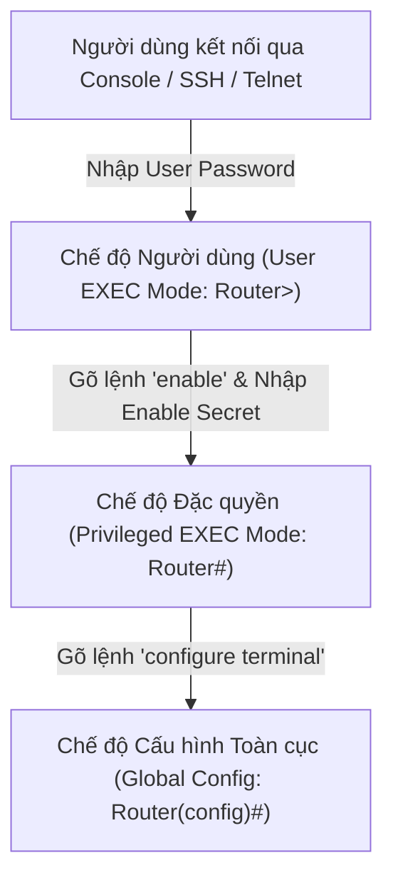

| Loại mật khẩu | Mục đích sử dụng | Đánh giá Mức độ An toàn & Thuật toán |
| :--- | :--- | :--- |
| **User Password** | Mật khẩu dùng để đăng nhập bước đầu vào chế độ người dùng (**User EXEC Mode**, dấu nhắc `Router>`). Hạn chế truy cập trái phép vào màn hình xem cơ bản. | Mức độ kiểm soát thấp, chỉ xem được các thông số trạng thái đơn giản. |
| **Enable Password** | Dùng để nâng quyền từ chế độ User EXEC lên chế độ đặc quyền (**Privileged EXEC Mode**, dấu nhắc `Router#`), nơi có toàn quyền cấu hình thiết bị. | **Kém an toàn.** Lưu trong cấu hình dưới dạng rõ hoặc mã hóa Type 7 (thuật toán Vigenère đảo chiều cực kỳ dễ giải mã). |
| **Secret** | Mật khẩu dùng để bảo vệ các dịch vụ cụ thể hoặc cổng truy cập từ xa (VTY Line). | An toàn hơn mật khẩu văn bản rõ thông thường. |
| **Enable Secret** | Mật khẩu nâng quyền đặc quyền cấp cao nhất, thay thế hoàn toàn cho `enable password`. | **Rất an toàn.** Được băm mật mã học (Type 5 dùng MD5, hoặc Type 8/9 trên các phiên bản mới dùng SHA-256), chống trích xuất từ file cấu hình. |

> [!NOTE]
> **Dấu hiệu nhận diện thiết bị Cisco qua mạng:** Khi kết nối Telnet hoặc SSH tới một thiết bị mạng Cisco, hệ thống sẽ phản hồi bằng một thông điệp banner đặc trưng: `User Access Verification`. Đây là dấu vết quan trọng giúp các chuyên viên bảo mật nhận diện hệ điều hành (**OS Fingerprinting**) của mục tiêu.

```shellsession
phat2007dhsp@htb[/htb]$ telnet 10.129.10.2
Trying 10.129.10.2...
Connected to 10.129.10.2.
Escape character is '^]'.

User Access Verification

Password:
```

---

## 2. Bản chất Mạng cục bộ Ảo (VLAN - Virtual Local Area Network)

### Bài toán Thực tế
Hãy hình dung kịch bản: Một công ty khởi nghiệp mang tên **XQ** thuê quản trị viên thiết kế hệ thống mạng văn phòng. Do ngân sách hạn chế, họ chỉ có thể mua **duy nhất 1 bộ chuyển mạch Switch và 1 Router**. Mạng này vừa phải chứa máy chủ web công cộng, máy chủ cơ sở dữ liệu nội bộ, vừa phục vụ các phòng ban: Ban giám đốc, Tài chính, Nhân sự, Marketing và Chăm sóc khách hàng.

Nếu cắm chung tất cả vào một switch thông thường, toàn bộ thiết bị sẽ nằm chung trong **một miền quảng bá (Single Broadcast Domain)**. Một kẻ xấu nội bộ (Insider Threat) hoặc máy tính nhiễm mã độc có thể:
1. Phát động bão quảng bá (**Broadcast Storm**) làm tê liệt switch.
2. Bật card mạng ở chế độ hỗn tạp (Promiscuous Mode) để **nghe lén toàn bộ lưu lượng (Sniffing)** của phòng Tài chính và Ban giám đốc.

Giải pháp tối ưu và bắt buộc là triển khai **Mạng cục bộ ảo (VLAN)**: chia tách một switch vật lý duy nhất thành nhiều "mini-switch" logic hoàn toàn độc lập.

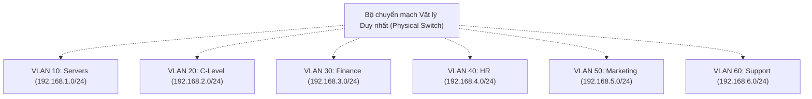

### Các Lợi ích Cốt lõi của VLAN
* **Tổ chức mạng khoa học:** Nhóm các thiết bị theo phòng ban hoặc chức năng bất kể vị trí cắm cáp vật lý.
* **Tăng cường an ninh tối đa:** Lưu lượng quảng bá và dữ liệu giữa các VLAN bị cô lập hoàn toàn ở tầng 2. Muốn đi từ VLAN này sang VLAN khác bắt buộc phải đi qua Router hoặc Tường lửa (Layer 3 Inter-VLAN Routing) để kiểm soát chính sách.
* **Tối ưu hóa hiệu năng mạng:** Thu hẹp phạm vi miền quảng bá, giảm thiểu lãng phí băng thông xử lý khung tin vô ích cho các máy trạm.

### Phân vùng Dải ID VLAN (1 đến 4094)
Một switch hỗ trợ các số định danh VLAN từ 1 đến 4094 (giá trị 0 và 4095 được dành riêng):
* **Normal-range VLANs (1 - 1005):**
  - **VLAN 1:** VLAN mặc định của hệ thống (**Default VLAN**), không thể xóa hay sửa đổi.
  - **VLAN 1002 - 1005:** Dành riêng cho các công nghệ cũ như Token Ring và FDDI.
  - Các cấu hình VLAN thông thường (từ 2 đến 1001) được lưu trong cơ sở dữ liệu Flash memory tại tệp tin `vlan.dat`.
* **Extended-range VLANs (1006 - 4094):** Dành cho các nhà mạng hoặc hạ tầng lớn, cấu hình được lưu trực tiếp trong tệp cấu hình đang chạy (`running-config`).

---

## 3. Cơ chế Gán Thành viên VLAN & Phân loại Cổng (Access vs Trunk)

### Gán thành viên VLAN Tĩnh (Static) vs Động (Dynamic)
* **Gán tĩnh (Static VLAN Assignment):** Quản trị viên chỉ định thủ công từng cổng vật lý của switch thuộc về một VLAN ID nhất định. Đây là phương thức an toàn và phổ biến nhất. Thiết bị đầu cuối cắm vào cổng này hoàn toàn không biết sự tồn tại của VLAN.
* **Gán động (Dynamic VLAN Assignment):** Switch tự động xác định VLAN cho thiết bị dựa trên địa chỉ MAC của card mạng thông qua máy chủ chính sách **VMPS (VLAN Membership Policy Server)**.
  > [!WARNING]
  > **Rủi ro an ninh của Dynamic VLAN:** Kẻ tấn công có thể dễ dàng sử dụng công cụ như `macchanger` để giả mạo địa chỉ MAC của một máy tính thuộc phòng Tài chính hoặc Ban giám đốc. Khi cắm vào bất kỳ cổng nào, switch sẽ tự động đưa kẻ tấn công vào đúng VLAN bảo mật đó!

### Phân loại Cổng Chuyển mạch: Access Port vs Trunk Port

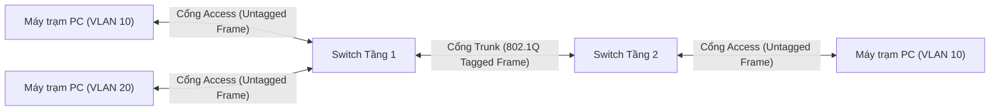

* **Cổng truy cập (Access Port):** Chỉ thuộc về và truyền tải lưu lượng của **duy nhất 1 VLAN** (ngoại lệ: có thể hỗ trợ thêm 1 Voice VLAN cho điện thoại IP). Mọi khung tin đi vào/ra khỏi cổng access đều là khung Ethernet chuẩn **không gắn thẻ (Untagged)**.
* **Cổng trung kế / đường truyền (Trunk Port):** Có khả năng vận chuyển đồng thời lưu lượng của **nhiều VLAN khác nhau** trên một sợi cáp vật lý duy nhất nối giữa hai Switch hoặc giữa Switch và Router. Khung tin đi qua đường Trunk bắt buộc phải được gắn thẻ định danh (**Tagged**).

---

## 4. Cơ chế Đóng gói & Định danh VLAN: ISL vs IEEE 802.1Q

Khung Ethernet chuẩn IEEE 802.3 ban đầu không có trường thông tin nào chứa VLAN ID. Do đó, cần có cơ chế gắn thẻ để switch nhận biết gói tin thuộc VLAN nào khi đi qua đường Trunk:

* **ISL (Inter-Switch Link):** Giao thức độc quyền cũ của Cisco. ISL đóng gói toàn bộ khung Ethernet gốc, gắn thêm một header 26 byte ở đầu và trailer 4 byte ở cuối. Hiện nay ISL đã bị loại bỏ (**Deprecated**) để chuyển sang chuẩn quốc tế.
* **IEEE 802.1Q (Dot1Q):** Tiêu chuẩn mở quốc tế được công bố năm 1998, tương thích với mọi hãng thiết bị. Thay vì bọc toàn bộ gói tin, 802.1Q chèn một thẻ định danh (**VLAN Tag**) dài **4 byte** vào ngay sau trường Source MAC Address của khung Ethernet gốc.

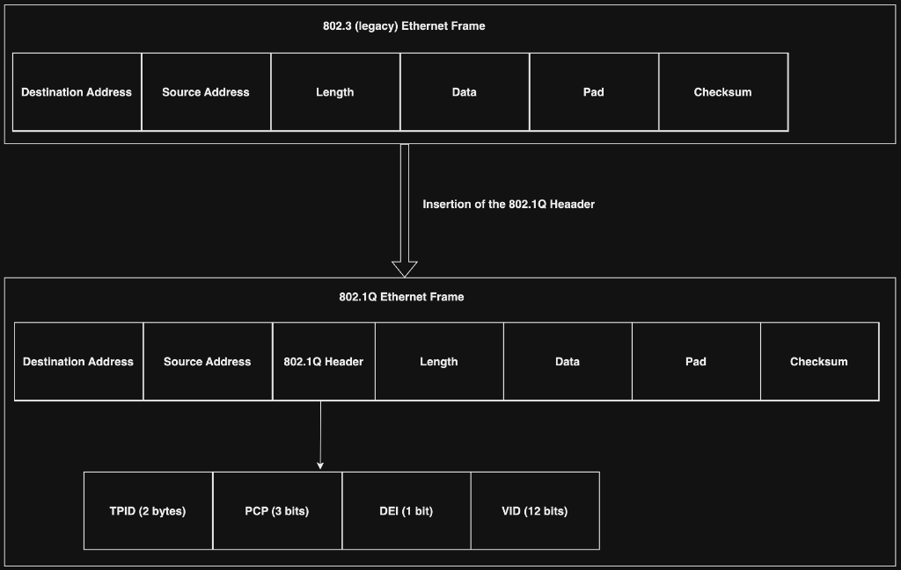

### Cấu trúc chi tiết của thẻ 802.1Q (4 byte = 32 bit):
1. **TPID (Tag Protocol Identifier - 16 bit):** Luôn cố định là giá trị hex `0x8100`, báo hiệu cho thiết bị nhận biết đây là khung Ethernet có gắn thẻ 802.1Q.
2. **TCI (Tag Control Information - 16 bit):** Bao gồm 3 trường con:
   - **PCP (Priority Code Point - 3 bit):** Xác định độ ưu tiên của gói tin (chuẩn 802.1p phục vụ QoS).
   - **DEI (Drop Eligible Indicator - 1 bit):** Đánh dấu gói tin có thể bị hủy nếu mạng nghẽn.
   - **VID (VLAN Identifier - 12 bit):** Định danh số hiệu VLAN. Với 12 bit, ta có \(2^{12} = 4096\) giá trị (sử dụng thực tế từ 1 đến 4094).

---

## 5. Cấu hình VLAN Tagging trên Card mạng Máy trạm (VLAN-Capable NICs)

Một số dòng card mạng máy chủ hoặc máy tính chuyên dụng hỗ trợ gắn thẻ VLAN trực tiếp từ hệ điều hành.

### Cấu hình trên Linux
Linux hỗ trợ tạo các giao diện ảo con (Sub-interface) gắn trực tiếp trên card mạng vật lý:

```shellsession
# 1. Nạp module 8021q vào nhân Linux
phat2007dhsp@htb[/htb]$ sudo modprobe 8021q
phat2007dhsp@htb[/htb]$ lsmod | grep 8021
8021q                  40960  0

# 2. Tạo sub-interface gán VLAN 20 trên card mạng vật lý eth0
phat2007dhsp@htb[/htb]$ sudo ip link add link eth0 name eth0.20 type vlan id 20

# 3. Gán địa chỉ IP và bật giao diện mạng vừa tạo
phat2007dhsp@htb[/htb]$ sudo ip addr add 192.168.1.1/24 dev eth0.20
phat2007dhsp@htb[/htb]$ sudo ip link set up eth0.20

# 4. Kiểm tra trạng thái giao diện
phat2007dhsp@htb[/htb]$ ip a | grep eth0.20
4: eth0.20@eth0: <BROADCAST,MULTICAST,UP,LOWER_UP> mtu 1500 qdisc noqueue state UP group default qlen 1000
    inet 192.168.1.1/24 scope global eth0.20
```

### Cấu hình trên Windows

#### Cách 1: Qua giao diện đồ họa (Device Manager)
1. Mở menu Start và tìm kiếm **Device Manager**:

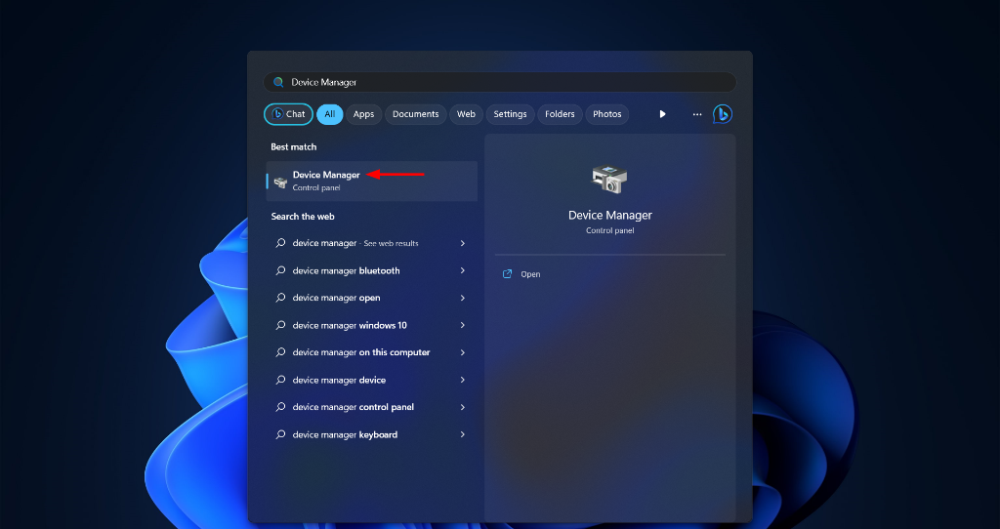

2. Tìm đến mục **Network adapters**, nhấn chuột phải vào card mạng Ethernet cần cấu hình và chọn **Properties**:

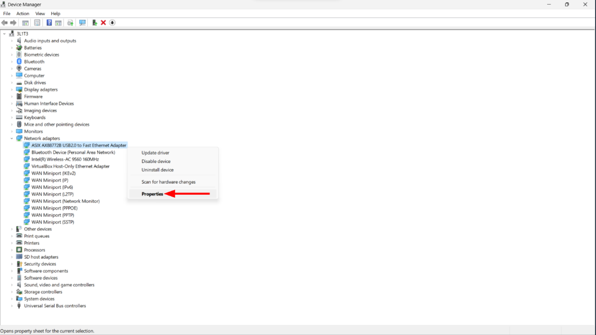

3. Trong thẻ **Advanced**, chọn thuộc tính **VLAN ID** và nhập giá trị VLAN cần gán (ví dụ: `10`):

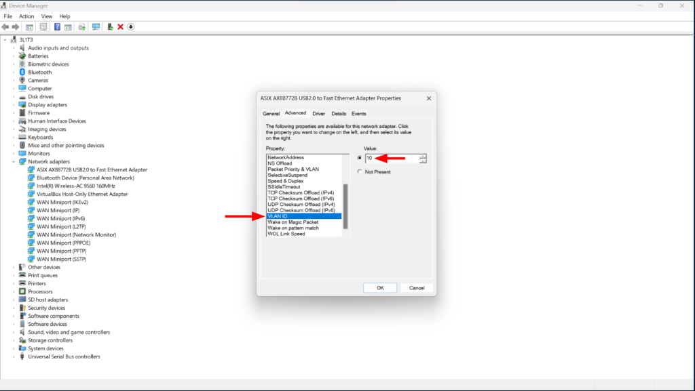

#### Cách 2: Qua PowerShell (Dành cho Quản trị viên)
```powershell
# Liệt kê danh sách các card mạng hiện có
PS C:\> Get-NetAdapter | Format-Table -AutoSize

# Xem giá trị VLAN ID hiện tại của card mạng "Ethernet 2"
PS C:\> Get-NetAdapterAdvancedProperty -DisplayName "vlan id"

# Gán VLAN ID 10 cho card mạng "Ethernet 2"
PS C:\> Set-NetAdapter -Name "Ethernet 2" -VlanID 10
```

---

## 6. Phân tích Lưu lượng VLAN bằng Wireshark & Tshark

Khi phân tích tệp bắt gói tin (**PCAP**), ta có thể sử dụng các bộ lọc chuyên biệt để phát hiện lưu lượng gắn thẻ VLAN:

* Sử dụng bộ lọc hiển thị `vlan` trên Wireshark để lọc ra tất cả các khung tin có gắn thẻ 802.1Q:

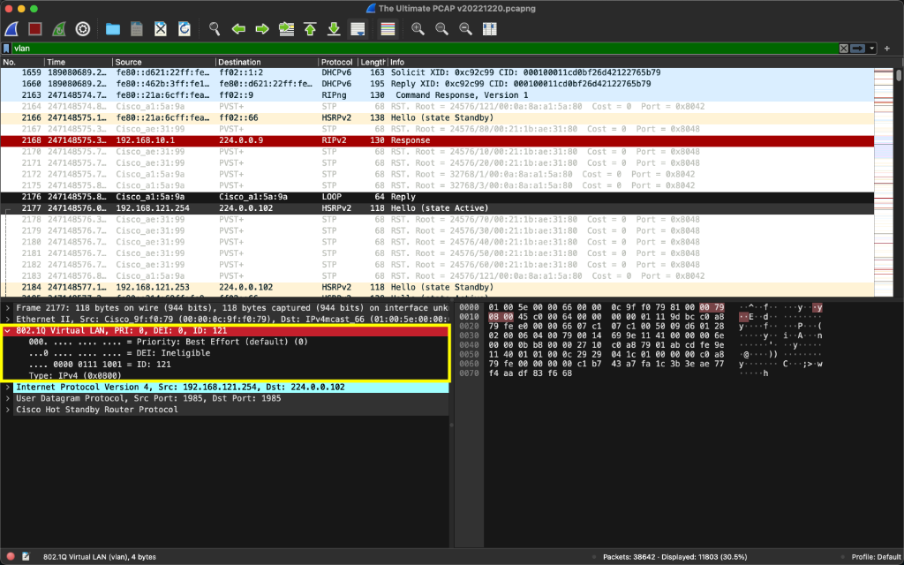

* Lọc chính xác các gói tin thuộc một VLAN cụ thể bằng bộ lọc `vlan.id == 10`:

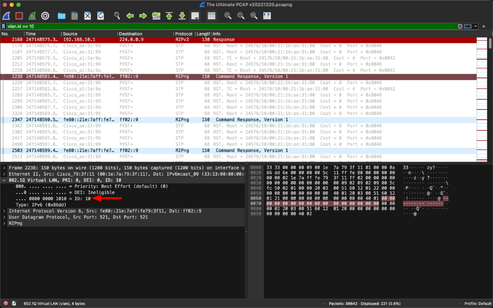

* Trích xuất nhanh toàn bộ danh sách các VLAN ID được sử dụng trong file PCAP bằng công cụ dòng lệnh **tshark**:

```shellsession
phat2007dhsp@htb[/htb]$ tshark -r "The Ultimate PCAP v20221220.pcapng" -T fields -e vlan.id | sort -n -u
1
2
3
7
10
20
30
40
50
60
70
80
90
121
125
224
```

---

## 7. Các Cuộc tấn công Nhảy VLAN (VLAN Hopping Attacks)

Mặc dù VLAN giúp cô lập lưu lượng rất tốt, kẻ tấn công vẫn có thể vượt qua rào cản này nếu hạ tầng switch không được làm cứng đúng cách:

### 1. Tấn công giả mạo Switch qua giao thức DTP (Switch Spoofing)
* **Cơ chế:** Giao thức **DTP (Dynamic Trunking Protocol)** của Cisco cho phép hai cổng switch tự động thương lượng để biến kết nối giữa chúng thành đường Trunk. Theo mặc định trên nhiều dòng switch cũ, các cổng đều ở trạng thái tự động đàm phán (`Dynamic Auto` hoặc `Dynamic Desirable`).
* **Khai thác:** Kẻ tấn công cắm máy tính vào switch, sử dụng công cụ như **Yersinia** để gửi các gói tin DTP giả mạo, đánh lừa switch rằng máy tính của hacker là một switch Cisco khác. Khi switch chấp thuận mở cổng Trunk, kẻ tấn công sẽ nhận được lưu lượng của **toàn bộ các VLAN** trên switch.

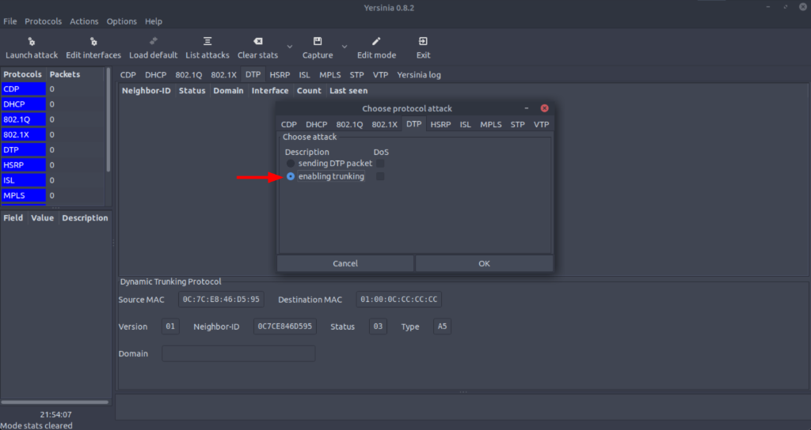

### 2. Tấn công Nhảy VLAN bằng Thẻ kép (Double-Tagging VLAN Hopping)
* **Điều kiện tấn công:** Kẻ tấn công phải kết nối vào một cổng thuộc cùng **Native VLAN** với đường Trunk của switch (thông thường là VLAN 1 hoặc VLAN 10).
* **Quy trình tấn công 3 bước:**

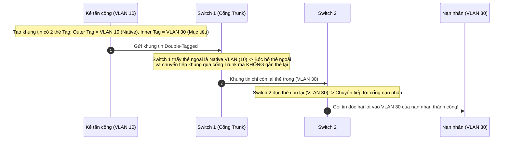

* Kẻ tấn công có thể thực hiện đòn tấn công Double Tagging bằng **Yersinia** hoặc thư viện lập trình mạng **Scapy** trong Python:

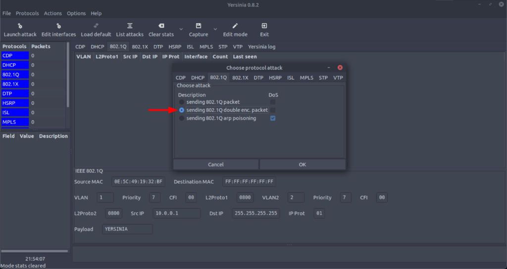

### Biện pháp Phòng chống Tấn công VLAN (Hardening):
1. **Tắt hoàn toàn giao thức DTP:** Cấu hình mọi cổng kết nối người dùng ở chế độ cố định: `switchport mode access` và tắt thương lượng bằng lệnh `switchport nonegotiate`.
2. **Thay đổi Native VLAN mặc định:** Không sử dụng VLAN 1 làm Native VLAN. Đổi Native VLAN của tất cả các đường Trunk sang một VLAN ID không sử dụng (ví dụ: VLAN 999).
3. **Bật tính năng gắn thẻ cho cả Native VLAN:** Cấu hình lệnh toàn cục `vlan dot1q tag native` để buộc switch gắn thẻ cả Native VLAN, vô hiệu hóa hoàn toàn đòn bóc thẻ của Double Tagging.

---

## 8. Mở rộng Trung tâm Dữ liệu Hiện đại: Công nghệ VXLAN (Virtual Extensible LAN)

Mặc dù chuẩn 802.1Q rất phổ biến, trong các môi trường Trung tâm dữ liệu (Data Center) và Điện toán đám mây (Cloud) khổng lồ, nó bộc lộ hai điểm yếu chết người:
1. **Giới hạn 4094 VLAN:** Con số 4094 là quá nhỏ đối với môi trường đa người thuê (Multi-tenant Cloud) chứa hàng chục ngàn máy ảo (VM) độc lập.
2. **Hạn chế của giao thức Spanning Tree Protocol (STP):** Để chống lặp vòng lặp ở tầng 2, STP bắt buộc phải khóa (Block) nhiều đường cáp dự phòng, làm lãng phí tới 50% băng thông hạ tầng mạng.

### Giải pháp VXLAN (Chuẩn RFC 7348)
**VXLAN** là công nghệ thiết lập mạng ảo phủ tầng 2 lên trên hạ tầng mạng tầng 3 (**Layer 2 Overlay on a Layer 3 Network**):
* **Cơ chế Encapsulation (MAC-in-UDP):** Toàn bộ khung Ethernet tầng 2 của máy ảo được bọc bên trong một gói tin **UDP (cổng 4789)** và định tuyến tự do qua hạ tầng mạng IP tầng 3.
* **Định danh phân đoạn mạng khổng lồ (VNI - VXLAN Network Identifier):** Thay vì trường 12-bit của 802.1Q, VNI sử dụng trường định danh dài tới **24-bit**, cho phép tạo ra tới **16 triệu phân đoạn mạng ảo** độc lập (\(2^{24} = 16.777.216\)).
* Loại bỏ sự phụ thuộc vào STP, cho phép khai thác tối đa băng thông đa đường dẫn ngang hàng (ECMP) trên toàn bộ trung tâm dữ liệu.

---

## 9. Các Giao thức Tầng 2 Bổ trợ: CDP và STP

### 1. Cisco Discovery Protocol (CDP)
* **Bản chất:** Giao thức độc quyền hoạt động ở tầng 2 của Cisco, giúp các thiết bị (Router, Switch) tự động thu thập và chia sẻ thông tin về các thiết bị láng giềng kết nối trực tiếp.
* **Dữ liệu trong gói tin CDP:** Tên thiết bị (Device-ID), địa chỉ IP, tên cổng kết nối (Port-ID), phiên bản hệ điều hành (OS Version String) và dòng phần cứng (Platform).

```shellsession
22:14:11.563654 CDPv2, ttl: 180s, checksum: 0xebc1 (incorrect -> 0x8b71), length: 180
  Device-ID (0x01), length: 14 bytes: 'router.inlanefreight.loc'
  Addresses (0x02), length: 8 bytes: IPv4 (0x01), length: 4: 10.129.100.1
  Port-ID (0x03), length: 9 bytes: 'Ethernet0/0'
  Capability (0x04), length: 4: (0x00000010): Router
  Version String (0x05), length: 27 bytes: 'Cisco IOS Software, C880 Software'
  Platform (0x06), length: 26 bytes: 'Cisco 881 (MPC8300) processor'
```

> [!CAUTION]
> **Rủi ro An ninh của CDP:** Do CDP phát quảng bá định kỳ không mã hóa, kẻ tấn công chỉ cần cắm máy tính vào một cổng switch bất kỳ và lắng nghe lưu lượng là có thể vẽ lại toàn bộ sơ đồ mạng nội bộ, biết chính xác model phần cứng và phiên bản hệ điều hành để tìm kiếm mã khai thác lỗ hổng (**CVE**). **Khuyến nghị:** Tắt CDP trên tất cả các cổng nối tới người dùng cuối bằng lệnh `no cdp enable`.

### 2. Spanning Tree Protocol (STP - IEEE 802.1D / 802.1w)
* **Bản chất:** Giao thức chống lặp vòng mạng tầng 2. Khi hệ thống có nhiều đường cáp nối dự phòng giữa các switch, các khung tin quảng bá (Broadcast) sẽ bị lặp vô tận tạo thành bão quảng bá làm tê liệt hệ thống. STP tự động tính toán cây cấu trúc và tạm khóa các cổng phụ để đảm bảo chỉ có duy nhất một đường truyền logic hoạt động tại một thời điểm.

```shellsession
22:14:11.563654 STP 802.1w, Rapid STP, Flags [Learn, Forward], bridge-id 8001.00:11:22:33:44:55.8000, length 43
  root-id 8001.AA:AA:AA:AA:AA:AA, cost 0, port-id 8001
  message-age 0.00s, max-age 20.00s, hello-time 2.00s, forward-delay 15.00s
```

---

## 10. Bảng Tổng kết Kiến thức Trọng tâm

| Khái niệm / Giao thức | Tầng OSI / Chuẩn kỹ thuật | Đặc tính Kỹ thuật & Cơ chế | Ý nghĩa An ninh & Khuyến nghị |
| :--- | :---: | :--- | :--- |
| **Cisco IOS** | Hệ điều hành thiết bị mạng | Quản trị CLI/GUI; hỗ trợ phân cấp mật khẩu User, Enable, Secret. | Luôn dùng `enable secret` (SHA-256), cấm dùng `enable password` (Type 7). |
| **VLAN** | Tầng 2 (Data Link) | Chia switch vật lý thành nhiều miền quảng bá độc lập; ID từ 1 đến 4094. | Ngăn chặn nghe lén nội bộ (Sniffing) và bão quảng bá giữa các phòng ban. |
| **IEEE 802.1Q** | Tầng 2 (Data Link) | Chèn thẻ Tag 4 byte (TPID 0x8100, TCI: PCP, DEI, VID 12-bit) vào khung Ethernet. | Chuẩn quốc tế cho đường Trunk; thay thế hoàn toàn chuẩn ISL cũ của Cisco. |
| **Access Port** | Tầng 2 (Data Link) | Cổng chỉ thuộc về 1 VLAN duy nhất; truyền khung không gắn thẻ (Untagged). | Cấu hình bắt buộc trên tất cả các cổng kết nối đến máy tính người dùng. |
| **Trunk Port** | Tầng 2 (Data Link) | Vận chuyển lưu lượng của nhiều VLAN giữa các switch; truyền khung có gắn thẻ. | Phải tắt tự động đàm phán DTP để tránh bị hacker mạo danh switch. |
| **VLAN Hopping (DTP)** | Tấn công Tầng 2 | Khai thác tính năng đàm phán tự động DTP để biến máy hacker thành trạm trung kế Trunk. | Khắc phục: Chạy lệnh `switchport nonegotiate` và khóa cứng cổng access. |
| **Double Tagging** | Tấn công Tầng 2 | Lồng 2 thẻ tag 802.1Q nhằm lợi dụng cơ chế bóc thẻ Native VLAN để gửi gói tin sang VLAN khác. | Khắc phục: Đổi Native VLAN mặc định, không trùng với VLAN người dùng. |
| **VXLAN** | Layer 2 Overlay trên Layer 3 | Bọc khung Ethernet trong gói UDP cổng 4789; định danh VNI 24-bit (16 triệu mạng ảo). | Đột phá cho Trung tâm dữ liệu và Điện toán đám mây; giải quyết giới hạn 4094 VLAN. |
| **CDP** | Tầng 2 (Cisco Proprietary) | Tự động phát hiện và chia sẻ thông tin model, OS, IP của thiết bị láng giềng. | Nguy cơ rò rỉ thông tin kiến trúc mạng; phải tắt trên cổng người dùng. |
| **STP** | Tầng 2 (IEEE 802.1D/w) | Chống lặp vòng lặp mạng bằng cách tự động khóa các liên kết cáp dư thừa. | Cần bật tính năng bảo vệ BPDU Guard trên cổng access để tránh tấn công chiếm Root Bridge. |
