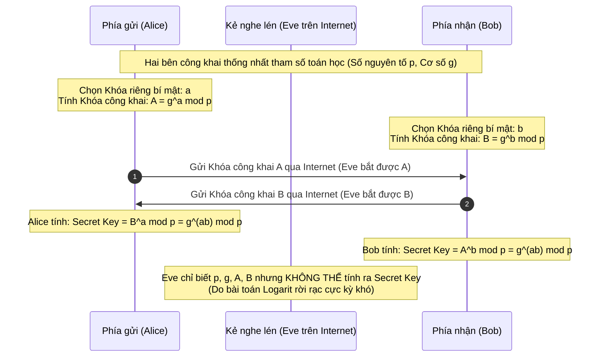
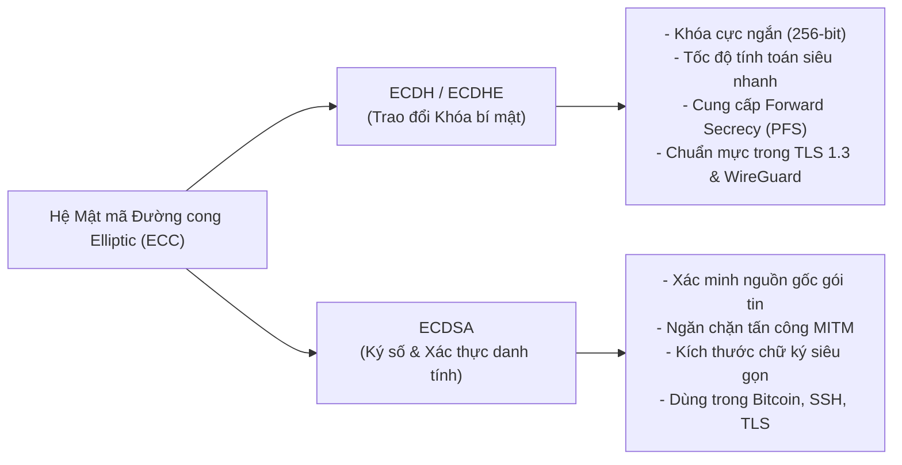
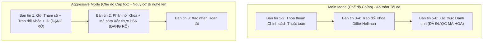

# Key Exchange Mechanisms

Trong lĩnh vực an toàn thông tin và mật mã học ứng dụng, bảo vệ tính bí mật của dữ liệu luôn dựa vào việc mã hóa luồng truyền thông bằng các khóa mật mã (**Cryptographic Keys**). Các thuật toán mã hóa đối xứng hiện đại (như AES hay ChaCha20) có khả năng mã hóa hàng gigabyte dữ liệu mỗi giây với độ an toàn cực cao, nhưng chúng lại đặt ra một bài toán hóc búa mang tính sống còn: **Làm thế nào để hai thực thể mạng có thể cùng thống nhất một khóa bí mật chung (Shared Secret Key) thông qua một môi trường Internet công cộng đầy rẫy kẻ nghe lén mà không để lộ chiếc chìa khóa đó?**

Đó chính là nhiệm vụ của các **Cơ chế Trao đổi Khóa (Key Exchange Mechanisms)**. Bằng cách ứng dụng các bài toán toán học một chiều (**Trapdoor One-Way Functions**), hai bên có thể tự do trao đổi các tham số công khai trên đường truyền không an toàn mà vẫn cùng nhau tính toán ra được một khóa phiên bí mật đồng nhất, mở đường cho việc thiết lập các đường hầm bảo vệ dữ liệu trong SSL/TLS hay IPsec VPN.

---

## 1. Giao thức Trao đổi Khóa Diffie-Hellman (DH)

Được công bố vào năm 1976 bởi hai nhà khoa học máy tính Whitfield Diffie và Martin Hellman, **Diffie-Hellman (DH)** là giao thức trao đổi khóa công khai đầu tiên trong lịch sử mật mã học, đặt nền móng cho cuộc cách mạng bảo mật Internet hiện đại.



### Cơ sở Toán học & Ẩn dụ Trộn Màu Sơn
* **Bài toán Logarit rời rạc (Discrete Logarithm Problem):** Dựa trên số học đồng dư trên trường hữu hạn (Finite Field), việc tính lũy thừa theo modulo rất dễ dàng và nhanh chóng, nhưng việc tìm ngược lại số mũ ban đầu là một bài toán bất khả thi về mặt tính toán với các số nguyên tố lớn.
* **Ẩn dụ màu sơn:** Alice và Bob thống nhất một màu sơn chung công khai (ví dụ màu Vàng). Mỗi người bí mật chọn một màu riêng (Alice chọn màu Đỏ, Bob chọn màu Xanh lam) và trộn vào màu công khai, sau đó gửi hỗn hợp màu đó cho nhau. Khi nhận được màu của đối phương, mỗi người chỉ cần thêm màu riêng của mình vào là cả hai sẽ cùng thu được một màu cuối cùng giống hệt nhau. Kẻ nghe lén đứng giữa dù nhìn thấy toàn bộ các thùng màu gửi qua lại cũng không thể nào tách riêng màu gốc ra được.

### Điểm yếu Chí mạng & Hạn chế của Diffie-Hellman

> [!WARNING]
> **1. Lỗ hổng tấn công trung gian (Man-in-the-Middle - MITM):** 
> Bản thân giao thức Diffie-Hellman thuần túy **hoàn toàn không có cơ chế xác thực danh tính gốc**. Kẻ tấn công Eve có thể đứng ở giữa, chặn khóa công khai A của Alice và gửi khóa giả của Eve cho Bob, đồng thời chặn khóa B của Bob và gửi khóa giả của Eve cho Alice. Kết quả là Alice nghĩ mình đang trao đổi khóa với Bob, nhưng thực chất đang thỏa thuận khóa với Eve, và Bob cũng vậy. Kẻ tấn công có thể giải mã, đọc lén và chỉnh sửa toàn bộ dữ liệu đi qua mà hai bên không hề hay biết.
> 
> *Giải pháp:* Trong các giao thức thực tế (như TLS hay IKE), Diffie-Hellman luôn bắt buộc phải đi kèm với chữ ký số (như RSA hoặc ECDSA) và chứng chỉ số (PKI) để xác minh danh tính đối tác trước khi trao đổi khóa.

* **2. Hiệu năng tính toán nặng nề:** Để đảm bảo an toàn trước năng lực tính toán hiện đại, khóa Diffie-Hellman truyền thống phải có độ dài tối thiểu từ **2048-bit đến 4096-bit**, gây tiêu hao đáng kể CPU và độ trễ truyền thông trên các thiết bị di động hoặc thiết bị IoT cấu hình yếu.

---

## 2. Thuật toán Mật mã Khóa công khai RSA (Rivest-Shamir-Adleman)

Ra đời năm 1977, **RSA** là thuật toán mã hóa bất đối xứng toàn năng dựa trên **độ khó của bài toán phân tích một hợp số cực lớn thành tích của hai số nguyên tố bí mật** (\(n = p \times q\)).

### Tính Đa dụng của RSA trong An ninh mạng
Không chỉ dùng để trao đổi khóa, RSA là trụ cột của hệ thống mật mã học nhờ khả năng hỗ trợ đồng thời cả hai nghiệp vụ:
1. **Mã hóa và Trao đổi khóa (Encryption & Key Transport):** Phía máy khách tự tạo ra một khóa phiên ngẫu nhiên (Pre-Master Secret), dùng khóa công khai (Public Key) của máy chủ để mã hóa và gửi đi. Chỉ duy nhất máy chủ sở hữu khóa riêng bí mật (Private Key) tương ứng mới có thể giải mã được gói tin này để lấy khóa phiên.
2. **Ký số và Xác thực danh tính (Digital Signatures):** Bên gửi dùng khóa riêng bí mật để ký băm một tài liệu số; bất kỳ ai có khóa công khai của bên gửi đều có thể xác minh được chữ ký đó để đảm bảo tính toàn vẹn (Integrity) và chống chối bỏ (Non-repudiation).
3. **Ứng dụng thực tế rộng khắp:** 
   - Bảo vệ luồng duyệt web trong SSL/TLS.
   - Giao thức **Kerberos PKINIT (RFC 4556)** dùng mã hóa khóa công khai RSA để xác thực người dùng ban đầu trong mạng Microsoft Active Directory.
   - Ký số văn bản điện tử và chứng thư số X.509.

> [!NOTE]
> **Hạn chế của RSA khi Trao đổi khóa:** Trong chuẩn bảo mật web **TLS 1.3**, cơ chế trao đổi khóa trực tiếp bằng RSA đã **bị loại bỏ**. Lý do là vì RSA không hỗ trợ tính năng **Bảo mật chuyển tiếp (Perfect Forward Secrecy - PFS)**: nếu máy chủ bị lộ khóa riêng (Private Key) trong tương lai, kẻ tấn công có thể dùng khóa đó để giải mã lại toàn bộ lưu lượng mạng đã thu thập từ trước.

---

## 3. Kỷ nguyên Mật mã học Đường cong Elliptic: ECDH và ECDSA

Nhằm khắc phục nhược điểm cồng kềnh và hao tốn tài nguyên của các thuật toán số học cổ điển, hệ mật mã đường cong Elliptic (**Elliptic Curve Cryptography - ECC**) đã trở thành tiêu chuẩn vàng thế hệ mới.



### 1. ECDH (Elliptic Curve Diffie-Hellman)
* **Cơ chế:** Là biến thể hiện đại của thuật toán Diffie-Hellman, thay thế các phép toán lũy thừa số nguyên lớn bằng **các phép cộng điểm trên đường cong Elliptic**.
* **Ưu thế vượt trội:** Một khóa ECC có độ dài chỉ **256-bit** cung cấp mức độ an toàn mật mã học tương đương với một khóa RSA hoặc DH cổ điển dài tới **3072-bit**! Nhờ đó, kích thước gói tin nhỏ hơn, tốc độ tính toán nhanh gấp hàng chục lần và tiêu thụ cực ít năng lượng.
* **Tính năng Bảo mật Chuyển tiếp (Perfect Forward Secrecy - PFS):** Khi triển khai biến thể tạm thời **ECDHE (Ephemeral)**, các cặp khóa chỉ được sinh ra và tồn tại duy nhất trong phiên làm việc đó rồi tự động hủy đi. Dù khóa dài hạn của máy chủ có bị hacker chiếm đoạt trong tương lai, mọi phiên trao đổi dữ liệu trong quá khứ vẫn an toàn tuyệt đối.

### 2. ECDSA (Elliptic Curve Digital Signature Algorithm)
* **Cơ chế:** Thuật toán tạo chữ ký số dựa trên đường cong Elliptic, được chuẩn hóa quốc tế.
* **Vai trò:** ECDSA cung cấp cơ chế xác thực danh tính cho các phiên trao đổi khóa ECDH. Máy chủ sử dụng ECDSA để ký số các tham số trao đổi khóa, chứng minh danh tính với máy khách và ngăn chặn nguy cơ bị tấn công Man-in-the-Middle.

### Bảng So sánh Toàn diện các Thuật toán Trao đổi Khóa & Ký số

| Thuật toán | Tên viết tắt | Bản chất Toán học | Đánh giá Mức độ An toàn & Hiệu năng | Trường hợp Sử dụng Thực tế |
| :--- | :---: | :--- | :--- | :--- |
| **Diffie-Hellman** | **DH** | Logarit rời rạc trên trường hữu hạn | An toàn khi dùng tham số khóa mạnh (2048-bit trở lên); tính toán chậm hơn nhiều so với ECDH; không có xác thực gốc. | Chuẩn trao đổi khóa kinh điển trong IKEv1, TLS cũ. |
| **Rivest-Shamir-Adleman** | **RSA** | Phân tích thừa số nguyên tố lớn | An toàn với kích thước khóa từ 2048-bit đến 4096-bit; tốn nhiều tài nguyên xử lý; không có PFS khi dùng làm key exchange. | Ký số chứng chỉ SSL/TLS, xác thực Kerberos PKINIT, mã hóa tệp tin. |
| **Elliptic Curve Diffie-Hellman** | **ECDH / ECDHE** | Phép toán cộng điểm trên đường cong Elliptic | **Rất an toàn và tốc độ cực cao.** Kích thước khóa nhỏ gọn, hỗ trợ Forward Secrecy; chuẩn mực tối ưu cho di động và IoT. | Giao thức TLS 1.3, IKEv2 trong VPN thế hệ mới, giao thức WireGuard. |
| **Elliptic Curve Digital Signature Algorithm** | **ECDSA** | Chữ ký số trên đường cong Elliptic | **Bảo mật cao, hiệu năng vượt trội.** Tạo và xác minh chữ ký nhanh, kích thước chữ ký nhỏ gọn hơn RSA rất nhiều. | Xác thực danh tính trong TLS, chứng thực SSH Key, công nghệ Blockchain. |

---

## 4. Giao thức Trao đổi Khóa Internet (IKE - Internet Key Exchange)

Trong các hệ thống mạng riêng ảo **IPsec VPN**, việc thiết lập các khóa mã hóa và chính sách an ninh cho từng gói tin ESP/AH được tự động hóa hoàn toàn thông qua giao thức **IKE (Internet Key Exchange)** chạy trên cổng **UDP 500**.

IKE là sự kết hợp chặt chẽ giữa thuật toán trao đổi khóa Diffie-Hellman (hoặc ECDH) với các thuật toán chữ ký số (RSA / ECDSA) và khóa bí mật chia sẻ trước (**PSK**) để đàm phán các **Hiệp hội An ninh (Security Associations - SA)** giữa hai cổng mạng VPN.

Trong chuẩn **IKEv1**, quá trình đàm phán giai đoạn 1 (Phase 1) có thể hoạt động ở một trong hai chế độ: **Main Mode** hoặc **Aggressive Mode**.



### 1. Main Mode (Chế độ Chính)
* **Tiến trình:** Thực hiện tuần tự qua **3 giai đoạn với tổng cộng 6 bản tin trao đổi** giữa hai thiết bị:
  1. *Bản tin 1 và 2:* Thỏa thuận bộ thuật toán mật mã (Encryption, Hash, Auth method, DH Group).
  2. *Bản tin 3 và 4:* Thực hiện bắt tay Diffie-Hellman để cùng tính ra khóa phiên bí mật.
  3. *Bản tin 5 và 6:* Xác thực danh tính của nhau (sử dụng chữ ký số hoặc mã băm PSK).
* **Ưu điểm an ninh vượt trội:** Do danh tính của hai bên được truyền trong bản tin 5 và 6 (thời điểm kênh truyền đã được mã hóa bởi khóa Diffie-Hellman vừa tạo), Main Mode cung cấp khả năng **Bảo vệ danh tính tuyệt đối (Identity Protection)**. Kẻ tấn công đứng trên đường truyền không thể biết được ai đang kết nối với ai.

### 2. Aggressive Mode (Chế độ Tích cực / Cấp tốc)
* **Tiến trình:** Rút gọn toàn bộ quá trình đàm phán xuống chỉ còn **2 giai đoạn với duy nhất 3 bản tin trao đổi**. Mọi thông tin về tham số bảo mật, giá trị trao đổi Diffie-Hellman và thông tin nhận dạng thiết bị (ID) đều bị nhồi nhét ngay vào bản tin đầu tiên.
* **Mục đích thiết kế ban đầu:** Tối ưu hóa tốc độ kết nối và hỗ trợ các máy khách có địa chỉ IP động kết nối vào VPN.

> [!CAUTION]
> **Lỗ hổng Chí mạng của IKE Aggressive Mode (Góc nhìn Pentester / SOC):**
> Do muốn rút gọn số lượng gói tin, Aggressive Mode **hoàn toàn không có tính năng bảo vệ danh tính (No Identity Protection)**! 
> 
> Khi sử dụng khóa chia sẻ trước (PSK), máy chủ VPN sẽ gửi phản hồi chứa mã băm xác thực của mật khẩu PSK (**PSK Hash**) về cho máy khách ở dạng văn bản rõ mà không có bất kỳ lớp mã hóa bảo vệ nào. Kẻ tấn công đứng trên đường truyền chỉ cần sử dụng công cụ dò quét chuyên dụng như `ike-scan` là có thể phát hiện cổng VPN đang chạy Aggressive Mode và thu bắt gói tin này:
> 
> ```shellsession
> phat2007dhsp@htb[/htb]$ sudo ike-scan -M -A -Phash.txt 10.129.10.2
> ```
> 
> Sau đó, kẻ tấn công nạp tệp `hash.txt` vào công cụ bẻ khóa công suất cao như **hashcat** (sử dụng chế độ `-m 5400 - IKE-PSK MD5` hoặc `SHA1`) để thực hiện tấn công dò mật khẩu ngoại tuyến (**Offline Dictionary Attack**). Một khi mật khẩu PSK bị bẻ khóa, kẻ tấn công có thể thâm nhập hoàn toàn vào mạng riêng ảo VPN nội bộ của doanh nghiệp!

---

## 5. Khóa Bí mật Chia sẻ Trước (Pre-Shared Keys - PSK)

Trong các kịch bản triển khai VPN vừa và nhỏ, **Pre-Shared Key (PSK)** là giá trị bí mật được người quản trị cấu hình sẵn trên cả máy khách và máy chủ VPN trước khi quá trình trao đổi khóa diễn ra.

* **Cơ chế hoạt động:** PSK được dùng làm bằng chứng xác thực danh tính để chứng minh hai thiết bị thuộc cùng một hệ thống quản trị, từ đó dẫn xuất ra các khóa mã hóa phiên tiếp theo.
* **Ưu điểm:** Cực kỳ đơn giản, dễ cài đặt, không đòi hỏi phải dựng máy chủ chứng thực số công cộng (CA Server) tốn kém.
* **Hạn chế & Rủi ro an ninh:**
  - **Khó khăn trong phân phối khóa:** Việc chia sẻ chuỗi PSK cho nhân viên qua email hoặc tin nhắn tiềm ẩn nguy cơ bị lộ lọt rất lớn.
  - **Thiếu tính linh hoạt:** Nếu một nhân viên nghỉ việc hoặc khóa PSK bị nghi ngờ rò rỉ, người quản trị bắt buộc phải đổi lại khóa trên máy chủ và cập nhật thủ công trên tất cả các thiết bị máy khách trong toàn bộ công ty.
  - **Nguy cơ mật khẩu yếu:** Nếu người quản trị đặt PSK ngắn hoặc dễ đoán và cấu hình kèm IKE Aggressive Mode, toàn bộ hệ thống VPN coi như bị phá vỡ hoàn toàn.

---

## 6. Bảng Tổng kết Kiến thức Trọng tâm

| Khái niệm / Giao thức | Phân loại | Cơ chế Hoạt động & Bản chất Mật mã | Đánh giá An ninh & Khuyến nghị Thực tế |
| :--- | :---: | :--- | :--- |
| **Diffie-Hellman (DH)** | Trao đổi Khóa | Logarit rời rạc trên trường hữu hạn; thỏa thuận khóa chung qua kênh mở. | **Dễ bị tấn công MITM** nếu không có chữ ký số xác thực; tính toán nặng ở khóa 2048+ bit. |
| **RSA** | Khóa công khai | Dựa trên độ khó của phân tích thừa số nguyên tố lớn; vừa mã hóa vừa ký số. | Đa dụng cho PKI, chữ ký số; **đã bị loại bỏ khỏi TLS 1.3** do không có Forward Secrecy. |
| **ECDH / ECDHE** | Trao đổi Khóa | Phép toán trên đường cong Elliptic; khóa ngắn (256-bit), hiệu năng cực cao. | **Tiêu chuẩn vàng hiện đại.** Cung cấp Perfect Forward Secrecy (PFS); bắt buộc trên TLS 1.3. |
| **ECDSA** | Chữ ký số | Ký số dựa trên đường cong Elliptic; kích thước chữ ký cực kỳ nhỏ gọn. | Chuẩn xác thực hiện đại, bảo vệ các phiên trao đổi khóa ECDH chống lại tấn công MITM. |
| **IKE Main Mode** | Chế độ VPN (IKEv1) | 6 gói tin trao đổi; mã hóa danh tính ở giai đoạn 3 sau khi đã có khóa DH. | **An toàn cao.** Cung cấp Identity Protection, bảo vệ danh tính thiết bị trước kẻ nghe lén. |
| **IKE Aggressive Mode** | Chế độ VPN (IKEv1) | 3 gói tin trao đổi; gửi thẳng thông tin nhận dạng và băm PSK ở dạng rõ. | **Cực kỳ nguy hiểm.** Để lộ mã băm PSK; dễ bị hacker dùng `ike-scan` và `hashcat` bẻ khóa. |
| **Pre-Shared Key (PSK)** | Phương thức Xác thực | Chuỗi khóa bí mật dùng chung được cấu hình sẵn trên cả hai đầu kết nối. | Chỉ an toàn khi chuỗi khóa đủ dài (trên 20 ký tự phức tạp) và kết hợp với IKE Main Mode hoặc IKEv2. |
