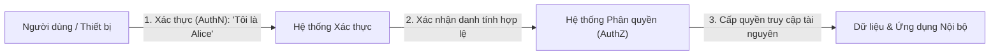
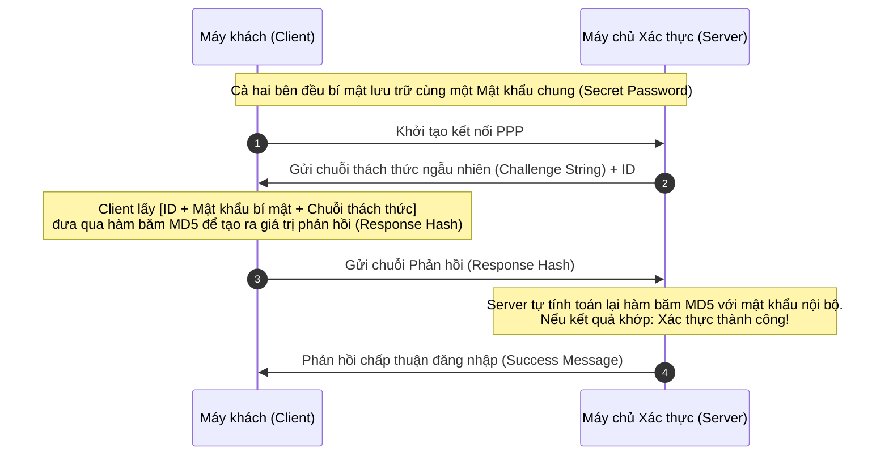
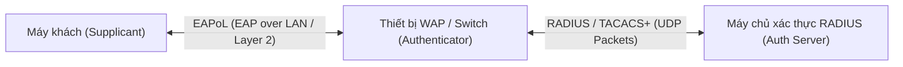
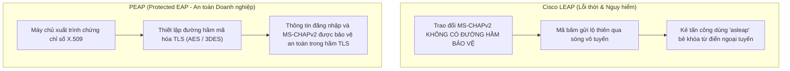

# Authentication Protocols

Trong bất kỳ kiến trúc mạng máy tính nào, việc kiểm soát truy cập luôn bắt đầu từ câu hỏi then chốt: **"Bạn là ai?"**. 

Các giao thức xác thực (**Authentication Protocols**) là tập hợp các quy tắc và chuẩn mực kỹ thuật cho phép các hệ thống mạng, máy chủ và thiết bị đầu cuối kiểm tra, chứng minh và xác nhận danh tính của người dùng hoặc thực thể phần cứng một cách đáng tin cậy. Nếu không có các giao thức xác thực an toàn, toàn bộ cơ chế bảo vệ của tổ chức sẽ sụp đổ: kẻ tấn công có thể dễ dàng mạo danh quản trị viên, đánh cắp phiên làm việc, chèn gói tin độc hại và kiểm soát toàn bộ hạ tầng mạng nội bộ.

---

## 1. Bản chất và ba yếu tố cốt lõi của xác thực (AuthN)

Cần phân biệt rõ ràng hai khái niệm nền tảng thường bị nhầm lẫn trong an ninh thông tin:
* **Xác thực (Authentication - AuthN):** Xác minh xem thực thể đang yêu cầu truy cập **thực sự là ai** (ví dụ: kiểm tra mật khẩu, quét vân tay, kiểm tra chứng chỉ số).
* **Phân quyền (Authorization - AuthZ):** Xác định thực thể đã được xác thực đó **có quyền làm những gì** trên hệ thống (ví dụ: quyền đọc tệp, quyền ghi cơ sở dữ liệu, quyền quản trị).

### Ba yếu tố xác thực kinh điển (Authentication Factors)
1. **Yếu tố tri thức (Something you know):** Những gì bạn biết trong đầu (mật khẩu - password, mã PIN, câu hỏi bảo mật).
2. **Yếu tố sở hữu (Something you have):** Những gì bạn nắm giữ về mặt vật lý (điện thoại nhận mã OTP qua SMS/ứng dụng, thẻ thông minh Smart Card, khóa bảo mật phần cứng FIDO/YubiKey).
3. **Yếu tố sinh trắc học (Something you are):** Đặc điểm sinh học duy nhất của cơ thể bạn (dấu vân tay, quét khuôn mặt FaceID, mống mắt, giọng nói).

* **Xác thực hai yếu tố (2FA) và đa yếu tố (MFA):** Bắt buộc người dùng phải cung cấp từ hai yếu tố thuộc các nhóm khác nhau trở lên, giúp triệt tiêu nguy cơ bị xâm nhập tài khoản ngay cả khi mật khẩu bị lộ lọt qua các cuộc tấn công Phishing.

---

## 2. Bảng danh mục các giao thức và công nghệ xác thực phổ biến

| Giao thức / công nghệ | Tên viết tắt | Phạm vi và môi trường hoạt động | Mô tả kỹ thuật và vai trò an ninh |
| :--- | :---: | :--- | :--- |
| **Kerberos** | **Kerberos** | Miền nội bộ (Active Directory / Linux Realm) | Giao thức xác thực dựa trên Trung tâm phân phối khóa (**KDC**) sử dụng cơ chế vé (**Tickets: TGT, TGS**) giúp người dùng đăng nhập một lần và truy cập tài nguyên mà không cần truyền mật khẩu qua mạng. |
| **Secure Remote Password** | **SRP** | Xác thực Client-Server qua kênh mở | Giao thức xác thực không tiết lộ mật khẩu (**Zero-Knowledge Password Proof**), cho phép xác minh mật khẩu mà máy chủ không cần lưu mật khẩu gốc hay hàm băm của nó, chống nghe lén và tấn công MITM. |
| **Transport Layer Security** | **TLS** | Tầng giao vận (Kế nhiệm của SSL) | Giao thức mật mã cung cấp kênh truyền thông được mã hóa và xác thực máy chủ/máy khách bằng chứng chỉ số X.509 trên toàn bộ mạng Internet. |
| **Open Authorization** | **OAuth 2.0** | Web, API, Ứng dụng di động | Chuẩn mở về **Ủy quyền (Authorization)**, cho phép người dùng cấp quyền cho ứng dụng bên thứ ba truy cập tài nguyên của họ (thông qua **Access Token**) mà không cần chia sẻ mật khẩu gốc. |
| **OpenID / OpenID Connect** | **OIDC** | Web & Ứng dụng đám mây | Lớp xác thực danh tính (**Identity Layer**) xây dựng trên nền OAuth 2.0, cho phép người dùng sử dụng một tài khoản duy nhất (như Google, Microsoft) để đăng nhập vào nhiều trang web khác nhau. |
| **Security Assertion Markup Language** | **SAML 2.0** | Doanh nghiệp & Ứng dụng SaaS | Chuẩn mở dựa trên định dạng XML dùng để trao đổi dữ liệu xác thực và phân quyền giữa Nhà cung cấp danh tính (**Identity Provider - IdP**) và Nhà cung cấp dịch vụ (**Service Provider - SP**). |
| **Single Sign-On** | **SSO** | Toàn bộ hạ tầng ứng dụng doanh nghiệp | Cơ chế cho phép người dùng chỉ cần đăng nhập thành công **một lần duy nhất** bằng một bộ thông tin xác thực để truy cập toàn bộ các ứng dụng và dịch vụ được liên kết trong tổ chức. |
| **FIDO Alliance / FIDO2** | **FIDO** | Trình duyệt Web & Hệ điều hành hiện đại | Chuẩn xác thực mạnh không dùng mật khẩu (**Passwordless**) dựa trên mật mã khóa công khai phần cứng (Passkeys, YubiKey), miễn nhiễm hoàn toàn với tấn công Phishing. |
| **Public Key Infrastructure** | **PKI** | Toàn bộ hạ tầng bảo mật số | Hệ thống quản lý chứng chỉ số, khóa công khai và khóa riêng tư thông qua các Nhà cấp phát chứng chỉ (**CA**), làm nền tảng xác thực cho SSL/TLS, VPN, IPsec và ký số. |
| **Password Authentication Protocol** | **PAP** | Giao thức điểm-điểm (PPP cổ điển) | Truyền trực tiếp tên đăng nhập và mật khẩu ở dạng **văn bản rõ ràng (Cleartext)** qua đường truyền mạng; cực kỳ mất an toàn. |
| **Challenge Handshake Auth Protocol** | **CHAP** | Kết nối mạng WAN, VPN, PPP | Sử dụng quy trình **bắt tay 3 bước** kết hợp chuỗi thách thức ngẫu nhiên và hàm băm mật mã để xác thực danh tính mà không bao giờ gửi mật khẩu thực qua mạng. |
| **Extensible Authentication Protocol** | **EAP** | Tầng liên kết dữ liệu (IEEE 802.1X) | Khung giao thức xác thực linh hoạt, cho phép đóng gói và hỗ trợ nhiều phương thức xác thực khác nhau (mật khẩu, mã OTP, chứng chỉ số) cho mạng Wi-Fi và VPN. |
| **Secure Shell** | **SSH** | Quản trị máy chủ từ xa (TCP 22) | Giao thức dòng lệnh an toàn, hỗ trợ xác thực bằng mật khẩu hoặc cặp khóa công khai/khóa riêng (**SSH Key Pair**) bên trong kênh truyền được mã hóa đối xứng. |
| **HyperText Transfer Protocol Secure** | **HTTPS** | Web an toàn (TCP 443) | Giao thức HTTP bọc trong đường hầm mã hóa SSL/TLS, sử dụng chứng chỉ số để xác thực danh tính máy chủ web với trình duyệt người dùng. |
| **Lightweight EAP** | **LEAP** | Mạng Wi-Fi Cisco (Lỗi thời) | Giao thức xác thực không dây độc quyền của Cisco dựa trên MS-CHAPv2 và mã hóa RC4; tồn tại lỗ hổng nghiêm trọng trước các cuộc tấn công bẻ khóa từ điển. |
| **Protected EAP** | **PEAP** | Mạng Wi-Fi & VPN Doanh nghiệp | Giao thức bọc luồng xác thực bên trong một **đường hầm mã hóa TLS** sử dụng chứng chỉ số của máy chủ; bảo vệ thông tin đăng nhập bằng các thuật toán mã hóa mạnh như AES. |
| **EAP-TLS** | **EAP-TLS** | Mạng Wi-Fi Doanh nghiệp & 802.1X | Tiêu chuẩn vàng cho xác thực không dây cấp doanh nghiệp; thực hiện **xác thực hai chiều (Mutual Authentication)** bằng chứng chỉ số PKI cho cả máy khách lẫn máy chủ. |

---

## 3. Sự tiến hóa của xác thực điểm-điểm: từ PAP đến CHAP

Trong các kết nối quay số hoặc đường truyền điểm-điểm (**Point-to-Point Protocol - PPP**), cơ chế xác thực đã trải qua bước ngoặt lớn về an ninh:

### 1. PAP (Password Authentication Protocol) - lỗ hổng truyền mật khẩu dạng rõ (Cleartext)
* **Cơ chế:** Máy khách gửi trực tiếp Username và Password dạng văn bản thuần (**Cleartext**) qua đường truyền cho máy chủ xác thực.
* **Nguy cơ an ninh:** Bất kỳ kẻ tấn công nào sử dụng công cụ bắt gói tin (như Wireshark) trên đường truyền đều có thể đọc được nguyên vẹn mật khẩu của người dùng mà không cần bẻ khóa.

### 2. CHAP (Challenge Handshake Authentication Protocol) - bắt tay thách thức
Để khắc phục điểm yếu chí mạng của PAP, giao thức **CHAP** ra đời với quy trình bắt tay 3 bước thông minh, đảm bảo mật khẩu thực sự **không bao giờ xuất hiện trên đường truyền mạng**:

> [!TIP]
> **Khả năng chống tấn công phát lại (Replay Attacks):** Mỗi lần kết nối, máy chủ CHAP sẽ sinh ra một chuỗi thách thức ngẫu nhiên hoàn toàn mới (**Nonce**). Do đó, chuỗi băm gửi đi ở mỗi phiên là hoàn toàn khác nhau; kẻ tấn công dù có bắt được chuỗi phản hồi của phiên trước cũng không thể dùng lại để đăng nhập vào phiên sau.

---

## 4. Khung xác thực mở rộng EAP và mạng không dây doanh nghiệp

Trong môi trường mạng không dây doanh nghiệp (**WPA-Enterprise**) hoặc cổng kết nối từ xa (**VPN**), các giao thức ứng dụng như SSH hay HTTPS không thể đáp ứng được. Lý do là vì thiết bị máy khách cần phải được kiểm soát và xác thực danh tính ngay tại **tầng liên kết dữ liệu (Layer 2)** trước khi được cấp phát địa chỉ IP và định tuyến vào mạng nội bộ.

Chuẩn kiểm soát truy cập cổng mạng **IEEE 802.1X** sử dụng khung giao thức **EAP (Extensible Authentication Protocol)** để đóng gói và vận chuyển các thông điệp xác thực giữa 3 thực thể:
1. **Supplicant (Máy khách):** Thiết bị của người dùng (Laptop, Smartphone).
2. **Authenticator (Điểm kiểm soát):** Thiết bị mạng trung gian (Switch hoặc Wireless Access Point - WAP).
3. **Authentication Server (Máy chủ xác thực):** Máy chủ tập trung chuyên biệt (như RADIUS hoặc TACACS+).

### So sánh chuyên sâu: Cisco LEAP vs PEAP vs EAP-TLS

| Tiêu chí kỹ thuật | Cisco LEAP | PEAP (Protected EAP) | EAP-TLS |
| :--- | :--- | :--- | :--- |
| **Cơ chế bảo vệ kênh** | Dựa trên khóa chia sẻ chung; dùng thuật toán mã hóa dòng **RC4** yếu. | Thiết lập **đường hầm mã hóa TLS** bảo vệ bằng chứng chỉ số của máy chủ. | Thiết lập **đường hầm mã hóa TLS** hai chiều bằng chứng chỉ số PKI. |
| **Xác thực máy chủ** | Không có chứng chỉ số máy chủ; dễ bị trạm phát giả mạo đánh lừa. | Máy khách xác minh danh tính máy chủ thông qua **chứng chỉ số công cộng**. | Máy khách xác minh máy chủ và máy chủ xác minh máy khách qua chứng chỉ. |
| **Bảo vệ thông tin xác thực** | **Rất kém.** Mã băm MS-CHAPv2 bị gửi lộ thiên qua không gian vô tuyến. | **Rất tốt.** Toàn bộ luồng xác thực người dùng được mã hóa bằng AES/3DES trong hầm TLS. | **Tuyệt đối.** Không sử dụng mật khẩu; danh tính chứng minh bằng khóa riêng bí mật. |
| **Rủi ro bị tấn công** | Dễ dàng bị bắt gói tin và **bẻ khóa mật khẩu từ điển ngoại tuyến** bằng `asleap`. | Có thể bị tấn công nếu máy khách tắt tính năng kiểm tra tính hợp lệ của chứng chỉ máy chủ. | Miễn nhiễm hoàn toàn với các cuộc tấn công bẻ khóa từ điển hay lừa đảo mật khẩu. |
| **Đánh giá và khuyến nghị** | **Cấm sử dụng.** Đã bị đào thải hoàn toàn khỏi các tiêu chuẩn hiện đại. | **Khá an toàn & Kinh tế.** Phổ biến nhất trong doanh nghiệp nhờ dễ quản lý tài khoản người dùng. | **Tiêu chuẩn vàng.** Bảo mật tuyệt đối nhất cho hạ tầng mạng không dây doanh nghiệp. |

---

## 5. Xác thực an toàn tầng giao vận và kênh vật lý: SSL/TLS và SSH

Đối với các kết nối tầng giao vận và ứng dụng qua Internet, **SSH** và **HTTPS (TLS)** là hai trụ cột bảo mật không thể thay thế:

* **Mã hóa mạnh mẽ hai đầu:** Cả hai giao thức đều sử dụng các thuật toán mã hóa khối đối xứng tiên tiến nhất (như AES-GCM hoặc ChaCha20-Poly1305) để bọc toàn bộ dữ liệu xác thực (Username, Password, Session Cookies). Điều này ngăn chặn hoàn toàn nguy cơ bị nghe lén (Sniffing) hoặc sửa đổi dữ liệu (Tampering) trên đường truyền.
* **Xác thực dựa trên hạ tầng khóa công khai (PKI):**
  - Trong **HTTPS**, máy chủ xuất trình chứng chỉ số X.509 được ký bởi các cơ quan cấp phát uy tín (**Certificate Authorities - CA**). Trình duyệt của người dùng sẽ kiểm tra chuỗi ủy thác (**Chain of Trust**). Nếu kẻ tấn công cố tình thực hiện tấn công Man-in-the-Middle bằng chứng chỉ giả, trình duyệt sẽ lập tức ngắt kết nối và hiển thị cảnh báo.
  - Trong **SSH**, quản trị viên có thể vô hiệu hóa hoàn toàn hình thức đăng nhập bằng mật khẩu truyền thống và chuyển sang sử dụng **cặp khóa SSH (SSH Key Pair: RSA 4096-bit hoặc Ed25519)**, loại bỏ triệt để nguy cơ bị tấn công dò mật khẩu tự động (**Brute-force SSH Attack**).

---

## 6. Bảng tổng kết kiến thức trọng tâm

| Giao thức / khái niệm | Tầng hoạt động | Bản chất mật mã và cơ chế | Ý nghĩa thực tế và khuyến nghị an ninh |
| :--- | :---: | :--- | :--- |
| **PAP** | Tầng 2 (PPP) | Gửi mật khẩu văn bản rõ ràng qua mạng. | **Cực kỳ nguy hiểm.** Cấm sử dụng trên mọi hệ thống mạng hiện đại. |
| **CHAP** | Tầng 2 (PPP) | Bắt tay 3 bước với chuỗi thách thức ngẫu nhiên và hàm băm MD5. | Chống tấn công phát lại (Replay Attacks); không truyền mật khẩu thực qua mạng. |
| **Kerberos** | Tầng Ứng dụng | Mô hình vé phân phối khóa KDC (TGT, TGS) có dấu thời gian. | Chuẩn xác thực cốt lõi của mạng miền Microsoft Active Directory. |
| **OAuth 2.0 / OIDC** | Tầng Ứng dụng (Web) | Ủy quyền qua Access Token (OAuth) và xác thực danh tính qua JWT (OIDC). | Chuẩn mực đăng nhập xã hội (Google, Apple ID) và bảo vệ API đám mây. |
| **SAML 2.0** | Tầng Ứng dụng (Web) | Trao đổi dữ liệu xác thực SSO dựa trên định dạng XML giữa IdP và SP. | Chuẩn đăng nhập một lần (SSO) hàng đầu cho hệ thống doanh nghiệp và phần mềm SaaS. |
| **FIDO2 / Passkeys** | Tầng Ứng dụng / Thiết bị | Xác thực không mật khẩu bằng mật mã khóa công khai phần cứng. | Đỉnh cao phòng thủ chống tấn công lừa đảo (Phishing-resistant authentication). |
| **Cisco LEAP** | Tầng 2 (Wi-Fi 802.1X) | Xác thực MS-CHAPv2 không có đường hầm bảo vệ; mã hóa RC4. | **Lỗi thời.** Bị bẻ khóa từ điển ngoại tuyến dễ dàng; bắt buộc khai tử. |
| **PEAP** | Tầng 2 (Wi-Fi 802.1X) | Bọc xác thực người dùng trong đường hầm TLS có chứng chỉ máy chủ. | Chuẩn mực an toàn, kinh tế và phổ biến cho mạng Wi-Fi văn phòng. |
| **EAP-TLS** | Tầng 2 (Wi-Fi 802.1X) | Xác thực hai chiều bằng chứng chỉ số PKI cho cả máy chủ và máy khách. | **Bảo mật tuyệt đối.** Tiêu chuẩn vàng cho mạng Wi-Fi và VPN cấp doanh nghiệp. |
| **SSH / HTTPS** | Tầng Giao vận & Ứng dụng | Sử dụng TLS / SSH tunnel mã hóa dữ liệu và xác thực máy chủ qua PKI. | Nền tảng an ninh bắt buộc cho quản trị máy chủ từ xa và duyệt web an toàn. |
