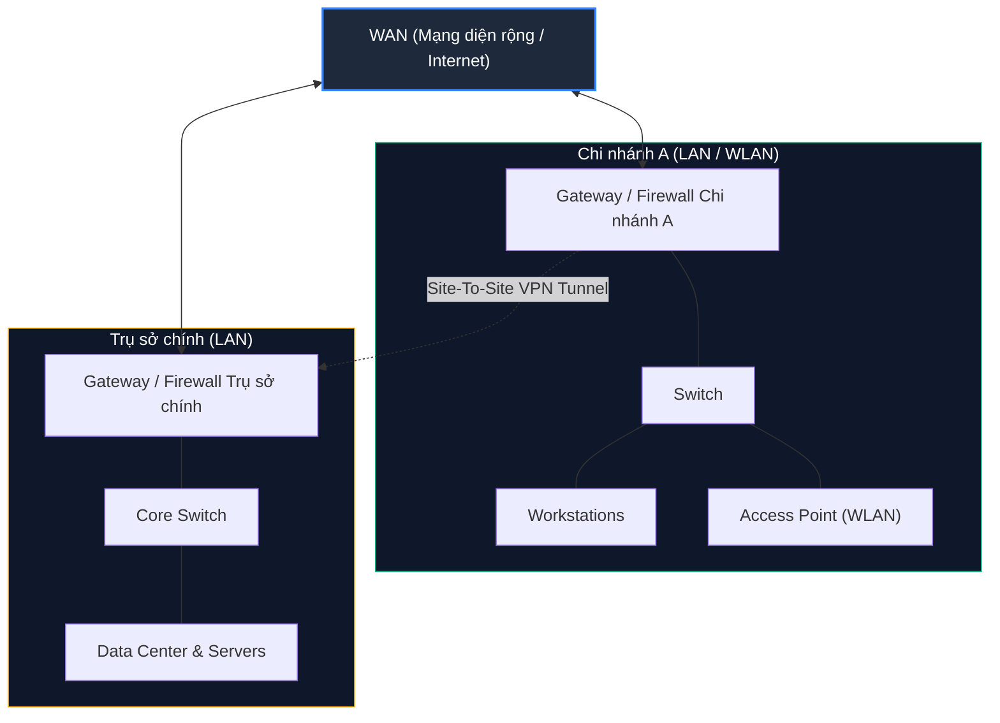
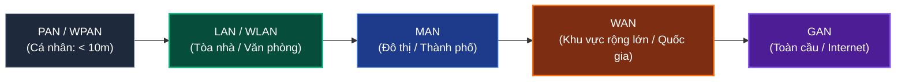

# Network Types

Mỗi hệ thống mạng máy tính đều được cấu trúc và thiết lập theo những cách thức riêng biệt tùy thuộc vào mục đích sử dụng và phạm vi địa lý. Để dễ dàng quản lý và chuẩn hóa, người ta đã đưa ra các khái niệm về **Network Types** (Các loại mạng) và **Network Topologies** (Cấu trúc liên kết mạng).

Khi đọc tài liệu chuyên ngành, người học rất dễ bị choáng ngợp bởi vô số thuật ngữ phân loại mạng. Trên thực tế, có những thuật ngữ xuất hiện hàng ngày trong công việc thực chiến, nhưng cũng có những thuật ngữ mang nặng tính học thuật lý thuyết trong sách vở (chỉ thường xuất hiện trong các bài thi chứng chỉ mạng). Vì vậy, bài học này sẽ được chia làm hai phần rõ ràng:
1. **Common Terminology (Thuật ngữ thực tế phổ biến):** Các thuật ngữ bạn sẽ liên tục gặp và sử dụng trong công việc an ninh mạng hàng ngày (WAN, LAN, WLAN, VPN).
2. **Book Terms (Thuật ngữ sách vở / Học thuật):** Các thuật ngữ phân loại theo phạm vi địa lý mở rộng (GAN, MAN, PAN, WPAN).

---

## 1. Common Terminology (Thuật ngữ thực tế phổ biến)

Bảng tổng hợp 4 loại mạng cốt lõi trong thực tế:

| Loại mạng | Tên đầy đủ | Định nghĩa & Ý nghĩa thực tế |
| :--- | :--- | :--- |
| **WAN** | Wide Area Network | Mạng diện rộng, thường được hiểu đồng nghĩa là **Internet**. |
| **LAN** | Local Area Network | Mạng cục bộ nội bộ (Ví dụ: Mạng gia đình, mạng văn phòng). |
| **WLAN** | Wireless Local Area Network | Mạng cục bộ nội bộ được truy cập thông qua sóng vô tuyến (**Wi-Fi**). |
| **VPN** | Virtual Private Network | Mạng riêng ảo kết nối nhiều địa điểm mạng khác nhau vào chung một LAN ảo qua môi trường Internet. |

---

### Wide Area Network (WAN)

**WAN (Mạng diện rộng)** thường được dùng để chỉ mạng **Internet toàn cầu**. Khi làm việc với các thiết bị mạng (như Router hay Firewall), bạn sẽ thường xuyên thấy hai cổng giao tiếp chính:
- **Cổng WAN (WAN Interface / WAN Address):** Địa chỉ IP công cộng dùng để giao tiếp ra bên ngoài Internet.
- **Cổng LAN (LAN Interface / LAN Address):** Địa chỉ IP nội bộ dùng để quản lý các thiết bị trong mạng gia đình hoặc doanh nghiệp.

Tuy nhiên, WAN không chỉ giới hạn ở Internet. Về bản chất, **WAN là sự liên kết của một số lượng lớn các mạng LAN lại với nhau**. Rất nhiều tập đoàn đa quốc gia hoặc cơ quan chính phủ duy trì một hệ thống "Internal WAN" (thường gọi là Intranet, hoặc Airgap Network hoàn toàn cách ly với Internet bên ngoài).

**Dấu hiệu nhận biết một mạng có phải là WAN hay không:**
1. **Giao thức định tuyến:** Thường sử dụng các giao thức định tuyến liên miền chuyên dụng cho WAN, tiêu biểu nhất là **BGP (Border Gateway Protocol)**.
2. **Không gian địa chỉ IP:** Dải địa chỉ IP sử dụng không nằm trong các dải Private IP theo chuẩn **RFC 1918**:
   - `10.0.0.0/8` (`10.0.0.0` - `10.255.255.255`)
   - `172.16.0.0/12` (`172.16.0.0` - `172.31.255.255`)
   - `192.168.0.0/16` (`192.168.0.0` - `192.255.255.255`)

---

### Local Area Network (LAN) & Wireless Local Area Network (WLAN)

- **LAN (Mạng cục bộ):** Kết nối các máy tính và thiết bị trong một phạm vi địa lý giới hạn (như một ngôi nhà, một văn phòng, hoặc một tòa nhà) thông qua cáp mạng Ethernet.
- **WLAN (Mạng cục bộ không dây):** Cung cấp các tính năng tương tự như LAN, nhưng cho phép thiết bị truyền nhận dữ liệu qua sóng vô tuyến (Wi-Fi) mà không cần dây cáp vật lý.

Cả LAN và WLAN thông thường đều cấp phát các địa chỉ IP nội bộ thuộc chuẩn **RFC 1918**. Trong một số trường hợp đặc biệt (như tại một số trường đại học lớn hoặc khách sạn cao cấp), thiết bị tham gia LAN có thể được cấp trực tiếp một địa chỉ IP Public có thể định tuyến trên Internet, nhưng trường hợp này ngày nay khá hiếm do sự khan hiếm của IPv4.

Về bản chất truyền tải dữ liệu, không có sự khác biệt về mặt logic giữa LAN và WLAN. Sự khác biệt lớn nhất nằm ở **tính chất bảo mật (Security Designation)**: Do sóng Wi-Fi lan tỏa trong không gian vật lý và có thể vượt ra ngoài phạm vi tòa nhà, WLAN luôn đòi hỏi các cơ chế xác thực và mã hóa khắt khe hơn (như WPA2/WPA3 Enterprise, 802.1X).

---

### Virtual Private Network (VPN)

Mục tiêu cốt lõi của **VPN (Mạng riêng ảo)** là tạo ra một đường hầm mã hóa (Encrypted Tunnel) an toàn xuyên qua Internet, giúp người dùng hoặc thiết bị cảm giác như đang cắm dây cáp trực tiếp vào một mạng nội bộ từ xa.

Có 3 mô hình VPN chính trong thực tế:

#### 1. Site-To-Site VPN
- **Cơ chế:** Cả hai đầu kết nối (Client và Server) đều là các thiết bị mạng chuyên dụng, thường là Router hoặc Firewall phần cứng.
- **Ứng dụng:** Kết nối toàn bộ dải mạng của các chi nhánh văn phòng về trụ sở chính qua Internet. Người dùng tại chi nhánh có thể truy cập máy chủ tại trụ sở hoàn toàn trong suốt như thể đang ngồi chung một tòa nhà.

#### 2. Remote Access VPN (Client-To-Site VPN)
- **Cơ chế:** Máy tính của người dùng cài đặt một phần mềm VPN Client. Phần mềm này tạo ra một card mạng ảo (**Virtual Interface / TUN Adapter**) trên máy tính.
- **Ví dụ thực tế:** Nền tảng Hack The Box sử dụng **OpenVPN**. Khi bạn khởi chạy tệp cấu hình `.ovpn`, OpenVPN tạo một card mạng ảo `tun0` trên máy bạn, cấp phát địa chỉ IP nội bộ phòng lab (ví dụ: `10.10.14.x`), cho phép bạn tương tác trực tiếp với các máy chủ mục tiêu.

> **Góc nhìn an ninh sống còn: Split-Tunnel vs. Full-Tunnel VPN**
>
> Khi tham gia một Remote Access VPN, bảng định tuyến (**Routing Table**) được cấu hình theo một trong hai cách:
>
> 1. **Split-Tunnel VPN:** VPN chỉ tạo tuyến đường định tuyến cho một số dải mạng đích cụ thể (ví dụ: chỉ chuyển tiếp lưu lượng hướng tới `10.10.10.0/24` vào VPN). Toàn bộ lưu lượng duyệt web, xem video cá nhân vẫn đi thẳng ra Internet qua nhà mạng thông thường của bạn.
>    - *Ưu điểm:* Rất tuyệt vời cho Hack The Box vì bảo đảm quyền riêng tư cho người học (HTB không theo dõi lưu lượng Internet cá nhân của bạn) và tiết kiệm băng thông lab.
>    - *Hạn chế đối với doanh nghiệp:* Doanh nghiệp thường **không khuyến khích** dùng Split-Tunnel. Nếu máy tính của nhân viên bị nhiễm mã độc, lưu lượng độc hại (C2 callback, data exfiltration) sẽ đi thẳng ra Internet gia đình thay vì đi qua các hệ thống giám sát an ninh (Firewall, NIDS) của công ty.
>
> 2. **Full-Tunnel VPN:** Bắt buộc 100% lưu lượng truy cập của máy tính (bao gồm cả Internet thông thường) phải đi qua đường hầm VPN về hệ thống mạng công ty để kiểm duyệt trước khi ra ngoài Internet.

#### 3. SSL VPN (Clientless VPN)
- **Cơ chế:** Hoạt động trực tiếp ngay trên trình duyệt web thông qua giao thức HTTPS/TLS mà không yêu cầu cài đặt phần mềm chuyên dụng trên máy người dùng.
- **Ứng dụng:** Thường dùng để truyền phát (stream) một ứng dụng cụ thể hoặc toàn bộ phiên làm việc đồ họa của hệ điều hành (Virtual Desktop).
- **Ví dụ điển hình:** **Hack The Box Pwnbox** - bạn có thể điều khiển trực tiếp một máy trạm Linux Parrot OS hoàn chỉnh ngay trong tab trình duyệt web của mình.

---

## 2. Book Terms (Thuật ngữ sách vở / Học thuật)

Bảng tổng hợp các thuật ngữ thường xuất hiện trong giáo trình và bài thi lý thuyết mạng:

| Thuật ngữ | Tên đầy đủ | Phạm vi địa lý | Công nghệ tiêu biểu |
| :--- | :--- | :--- | :--- |
| **GAN** | Global Area Network | Toàn cầu (Vượt qua nhiều quốc gia) | Cáp quang biển quốc tế, Vệ tinh |
| **MAN** | Metropolitan Area Network | Đô thị / Thành phố (Vài chục km) | Leased Lines, Cáp quang đô thị (Metro Ethernet) |
| **PAN** | Personal Area Network | Cá nhân (Dưới 10 mét, có dây) | Cáp USB, Cáp Thunderbolt |
| **WPAN** | Wireless Personal Area Network | Cá nhân (Dưới 10 mét, không dây) | Bluetooth, ZigBee, Z-Wave, Insteon |

---

### Global Area Network (GAN)
- **Khái niệm:** Mạng phủ sóng trên phạm vi toàn cầu. Mạng Internet chính là ví dụ lớn nhất của một GAN.
- **Đặc điểm:** Ngoài Internet công cộng, các tập đoàn đa quốc gia hoặc liên minh quân sự cũng sở hữu các GAN cô lập riêng biệt. GAN tận dụng hạ tầng cáp quang xuyên lục địa đặt dưới đáy biển (**Undersea Cables**) hoặc truyền dẫn vệ tinh quỹ đạo để liên kết các mạng WAN giữa các châu lục.

### Metropolitan Area Network (MAN)
- **Khái niệm:** Mạng viễn thông băng thông rộng kết nối nhiều mạng LAN trong cùng một phạm vi địa lý đô thị (thành phố hoặc một vùng đô thị lớn).
- **Đặc điểm:** Thường do các tập đoàn viễn thông lớn xây dựng và cung cấp dưới dạng các đường truyền thuê riêng (**Leased Lines**) hoặc Metro Ethernet. Nhờ sử dụng cáp quang chuyên dụng và bộ định tuyến hiệu năng cao, tốc độ truyền dẫn và thông lượng giữa hai điểm trong MAN cực kỳ nhanh, tiệm cận với tốc độ trao đổi dữ liệu trong mạng LAN nội bộ.

### Personal Area Network (PAN) & Wireless Personal Area Network (WPAN)
- **PAN (Mạng cá nhân):** Kết nối tức thời (ad-hoc) giữa các thiết bị cá nhân (điện thoại, máy tính bảng, máy tính xách tay) trong phạm vi vài mét bằng dây cáp (như cáp USB-C hoặc Thunderbolt).
- **WPAN (Mạng cá nhân không dây):** Phiên bản không dây của PAN, chủ yếu dựa trên sóng vô tuyến tầm ngắn như **Bluetooth** hoặc Wireless USB. Một mạng WPAN được thiết lập qua Bluetooth còn được gọi là **Piconet**. Do phạm vi chỉ vài mét, WPAN không phù hợp để kết nối các thiết bị giữa các phòng hay các tầng khác nhau.
- **Ứng dụng trong IoT & Smart Home:** Trong thế giới Internet of Things (IoT), WPAN được sử dụng để điều khiển các thiết bị tiêu thụ ít điện năng và lưu lượng truyền thấp. Các giao thức chuyên dụng cho nhà thông minh gồm có:
  - **ZigBee:** Chuẩn mạng mesh không dây tầm ngắn, tiêu thụ năng lượng cực thấp cho cảm biến và bóng đèn.
  - **Z-Wave:** Giao thức truyền thông RF mesh tầm ngắn được sử dụng rộng rãi trong khóa cửa thông minh, cảm biến an ninh.
  - **Insteon:** Công nghệ kết hợp giữa truyền dẫn vô tuyến và đường dây điện trong nhà.

---

## Tóm tắt kiến thức cốt lõi

- **Thực tế cần nhớ:** Tập trung cao độ vào **WAN**, **LAN**, **WLAN**, và **VPN**.
- **Dấu hiệu WAN:** Định tuyến BGP, dải IP Public nằm ngoài chuẩn RFC 1918.
- **VPN:** Nắm chắc sự khác biệt giữa **Site-To-Site**, **Remote Access** (OpenVPN), và **SSL VPN** (Pwnbox qua trình duyệt).
- **An ninh VPN:** Phân biệt **Split-Tunnel** (tiết kiệm băng thông, giữ quyền riêng tư cho lab) và **Full-Tunnel** (bắt buộc trong doanh nghiệp để kiểm duyệt mã độc).
- **Học thuật:** Nhớ các quy mô địa lý từ nhỏ đến lớn: `WPAN (Bluetooth/Piconet/Zigbee) -> LAN/WLAN -> MAN (Đô thị) -> WAN -> GAN (Toàn cầu)`.
