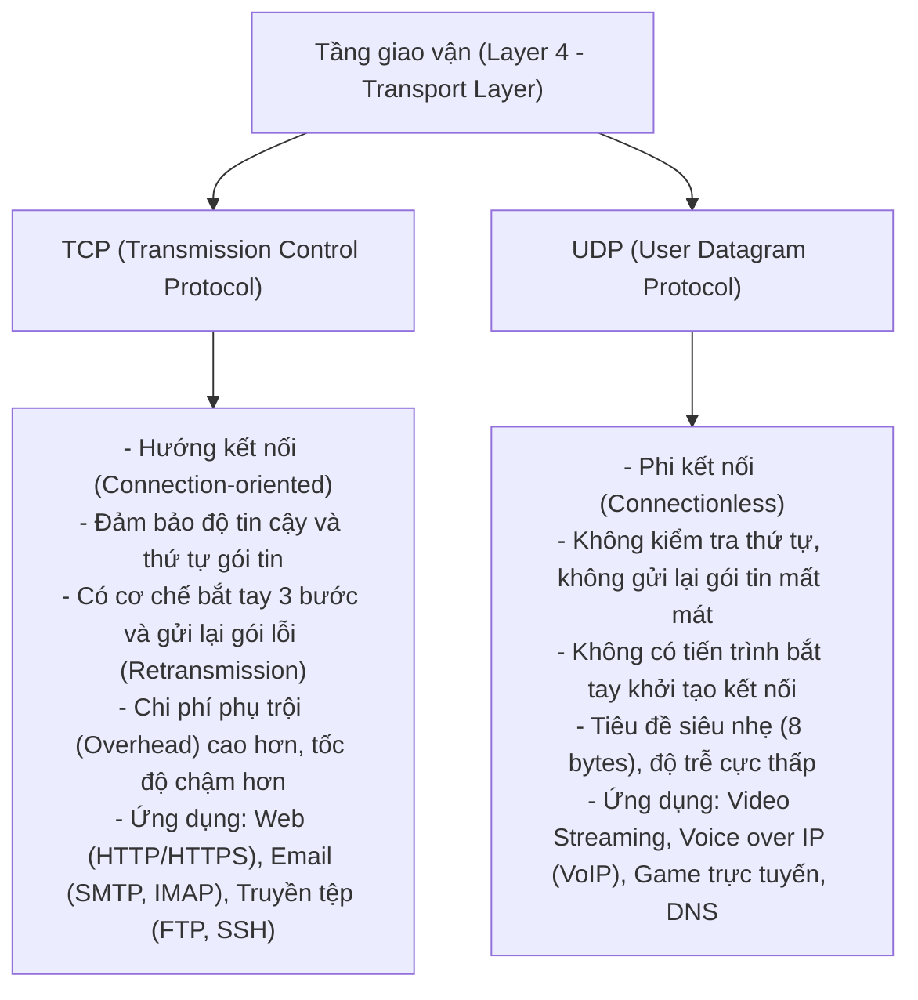
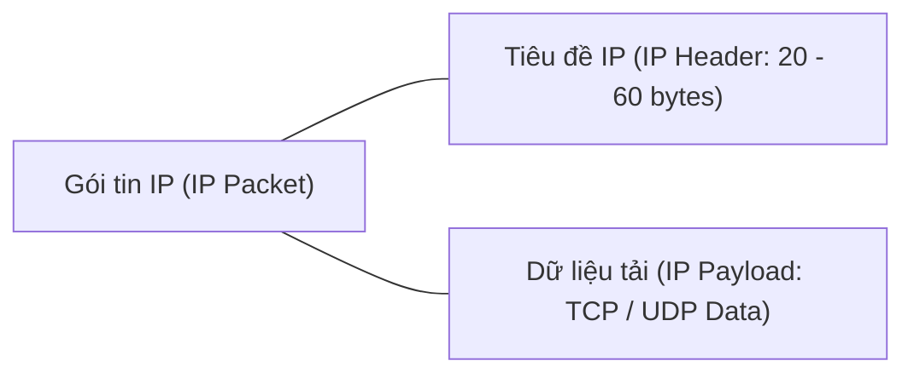
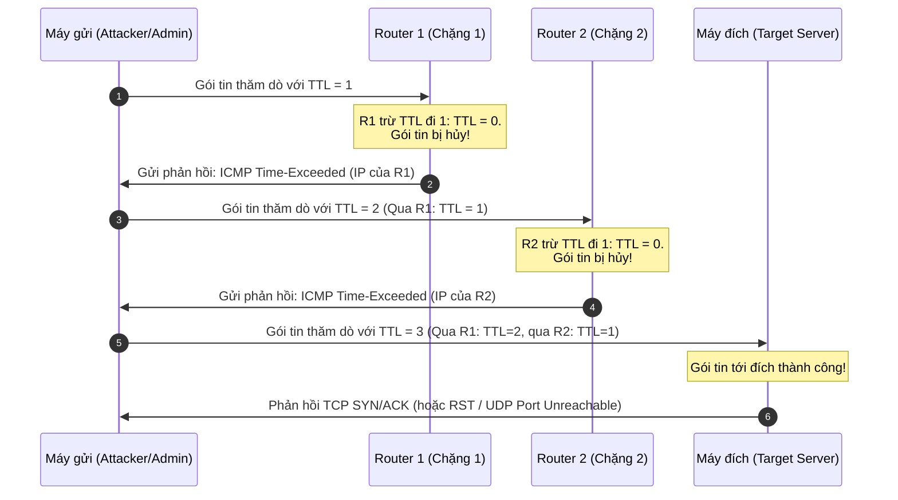
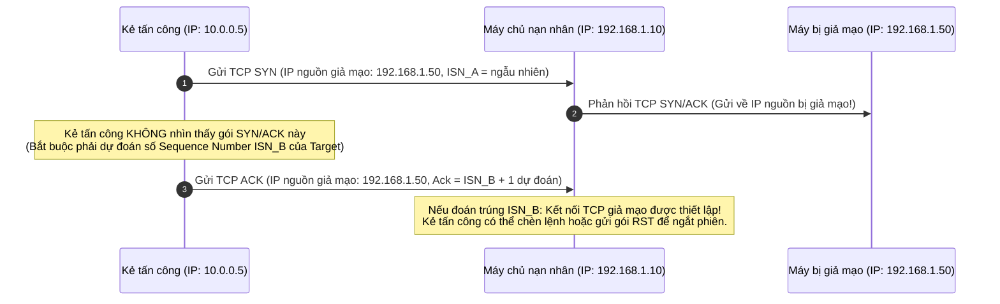

# TCP/UDP Connections

Tại tầng giao vận (**Layer 4 - Transport Layer**) của mô hình OSI và mô hình TCP/IP, hai giao thức nền tảng chịu trách nhiệm vận chuyển dữ liệu trên toàn bộ mạng Internet là **TCP (Transmission Control Protocol)** và **UDP (User Datagram Protocol)**. 

Trong khi TCP ưu tiên độ tin cậy và kiểm soát lỗi toàn diện, UDP lại tối ưu hóa tốc độ và độ trễ truyền tải. Hiểu rõ cấu trúc gói tin tầng mạng (**IP Packet**), cấu trúc dữ liệu tầng giao vận (**TCP Segment** và **UDP Datagram**), cũng như các kỹ thuật phân tích gói tin nâng cao (`IP ID`, `Record-Route`, `Traceroute`) và kỹ thuật tấn công giả mạo (`Blind Spoofing`) là kiến thức kỹ thuật quan trọng cho cả nhà phân tích phòng thủ (SOC Analyst) lẫn chuyên gia kiểm thử xâm nhập (Pentester).

---

## 1. So sánh tổng quan: TCP vs UDP



* **TCP (Transmission Control Protocol):** Hoạt động tương tự như một cuộc gọi thoại. Trước khi trao đổi dữ liệu, hai bên bắt buộc phải thiết lập đường kết nối logic thông qua tiến trình **bắt tay 3 bước (Three-Way Handshake)** và duy trì kết nối cho đến khi có lệnh ngắt phiên. Mọi khối dữ liệu gửi đi đều phải có phản hồi xác nhận (**ACK**); nếu bên nhận phát hiện gói tin bị mất mát hoặc lỗi, bên gửi sẽ tự động truyền lại (**Retransmission**).
* **UDP (User Datagram Protocol):** Hoạt động tương tự như việc gửi thư bưu chính thông thường. Bên gửi đẩy trực tiếp các khối dữ liệu (**Datagrams**) đến địa chỉ đích mà không cần thiết lập kết nối trước và cũng không yêu cầu bên nhận phản hồi xác nhận. Dù một số gói tin có thể bị rơi rụng trên đường truyền, việc loại bỏ thủ tục bắt tay và kiểm soát lỗi giúp UDP đạt tốc độ truyền tải tối đa và độ trễ thấp nhất.

---

## 2. Cấu trúc gói tin tầng mạng (IP packet)

Khi dữ liệu từ tầng giao vận đi xuống **tầng mạng (Layer 3 - Network Layer)**, nó được đóng gói thành một **gói tin IP (IP packet)**. Cấu trúc của gói tin IP bao gồm hai phần chính:
1. **Tiêu đề IP (IP Header):** Chứa các thông tin điều khiển định tuyến, địa chỉ nguồn, địa chỉ đích và các cờ quản lý truyền thông.
2. **Dữ liệu tải (IP Payload / IP Data):** Phần dữ liệu thực tế do các giao thức tầng trên (như TCP Segment hoặc UDP Datagram) chuyển xuống.



### Các trường thông tin trong tiêu đề IPv4 (IPv4 Header)

| Trường thông tin | Kích thước | Mô tả chức năng kỹ thuật |
| :--- | :---: | :--- |
| **Version** | 4 bits | Xác định phiên bản giao thức IP đang sử dụng (giá trị 4 cho IPv4, 6 cho IPv6). |
| **Internet Header Length (IHL)** | 4 bits | Độ dài của tiêu đề IP, tính theo đơn vị từ 32-bit (tối thiểu là 5 từ = 20 bytes khi không có Options). |
| **Type of Service (ToS / DiffServ)** | 8 bits | Xác định mức độ ưu tiên và chất lượng dịch vụ (QoS) của gói tin trên đường truyền. |
| **Total Length** | 16 bits | Tổng độ dài của toàn bộ gói tin IP (bao gồm cả Header và Payload) tính theo byte. |
| **Identification (IP ID)** | 16 bits | Định danh số học duy nhất (0 - 65535) dùng để ráp nối lại các mảnh khi gói tin bị phân mảnh (**Fragmentation**). |
| **Flags** | 3 bits | Các cờ kiểm soát phân mảnh: Reserved (luôn bằng 0), DF (Don't Fragment), MF (More Fragments). |
| **Fragment Offset** | 13 bits | Xác định vị trí tương đối của phân đoạn dữ liệu này so với gói tin ban đầu (tính theo đơn vị 8 bytes). |
| **Time to Live (TTL)** | 8 bits | Giới hạn số chặng (hop) tối đa mà gói tin được phép đi qua mạng nhằm ngăn chặn hiện tượng lặp vô tận. |
| **Protocol** | 8 bits | Định danh giao thức tầng trên nằm trong phần Payload (ví dụ: `6` cho TCP, `17` cho UDP, `1` cho ICMP). |
| **Header Checksum** | 16 bits | Giá trị kiểm tra tính toàn vẹn của riêng phần tiêu đề IP Header. |
| **Source IP Address** | 32 bits | Địa chỉ IP của thiết bị gửi gói tin. |
| **Destination IP Address** | 32 bits | Địa chỉ IP của thiết bị nhận gói tin. |
| **Options & Padding** | Thay đổi | Các tùy chọn mở rộng dùng cho bảo mật, định tuyến (như Record-Route) và phần đệm làm tròn 32-bit. |

---

## 3. Kỹ thuật phân tích gói tin nâng cao với trường IP ID

Trong thực tế điều tra mạng và phân tích lưu lượng (**Network Traffic Analysis**), trường **IP ID** là một dấu hiệu kỹ thuật rất hữu ích để nhận diện thiết bị. 

Theo chuẩn cài đặt ngăn xếp mạng trên nhiều hệ điều hành, giá trị trường IP ID của mỗi gói tin gửi đi từ một hệ thống sẽ được tăng tuần tự theo thời gian:

```shellsession
IP 10.129.1.100.5060 > 10.129.1.1.5060: SIP, length: 1329, id 1337
IP 10.129.1.100.5060 > 10.129.1.1.5060: SIP, length: 1329, id 1338
IP 10.129.1.100.5060 > 10.129.1.1.5060: SIP, length: 1329, id 1339
IP 10.129.2.200.5060 > 10.129.1.1.5060: SIP, length: 1329, id 1340
IP 10.129.2.200.5060 > 10.129.1.1.5060: SIP, length: 1329, id 1341
IP 10.129.2.200.5060 > 10.129.1.1.5060: SIP, length: 1329, id 1342
```

> [!NOTE]
> **Nhận diện thiết bị có nhiều IP (Multi-homed Host):** 
> Quan sát nhật ký `tcpdump` ở trên, ta thấy các gói tin được gửi từ hai địa chỉ IP nguồn hoàn toàn khác nhau (`10.129.1.100` và `10.129.2.200`). Tuy nhiên, giá trị trường `id` lại tăng liên tục không đứt đoạn: `1337 -> 1338 -> 1339 -> 1340 -> 1341 -> 1342`.
> 
> Dấu hiệu này cho thấy hai địa chỉ IP khác dải mạng này thực chất thuộc về **cùng một máy chủ vật lý** (máy chủ có nhiều card mạng hoặc nhiều IP ảo) dùng chung một bộ sinh số IP ID của hệ điều hành.

---

## 4. Ghi lại lộ trình với tùy chọn IP Record-Route

Tùy chọn **Record-Route (RR)** trong tiêu đề IP cho phép người gửi yêu cầu mọi thiết bị định tuyến (Router) trên đường truyền ghi lại địa chỉ IP của cổng xuất mà gói tin đi qua.

Khi thực hiện lệnh `ping` với cờ `-R`:

```shellsession
phat2007dhsp@htb[/htb]$ ping -c 1 -R 10.129.143.158
PING 10.129.143.158 (10.129.143.158) 56(124) bytes of data.
64 bytes from 10.129.143.158: icmp_seq=1 ttl=63 time=11.7 ms
RR:     10.10.14.38
        10.129.0.1
        10.129.143.158
        10.129.143.158
        10.10.14.1
        10.10.14.38

--- 10.129.143.158 ping statistics ---
1 packets transmitted, 1 received, 0% packet loss, time 0ms
rtt min/avg/max/mdev = 11.688/11.688/11.688/0.000 ms
```

Kết quả trả về hiển thị chính xác danh sách các cổng mạng trung gian mà gói tin đã đi qua trên đường tới đích và trên đường quay về. 

*Hạn chế kỹ thuật:* Trường tiêu đề IP chỉ có kích thước tối đa là 60 bytes (trong đó phần tiêu đề cố định chiếm 20 bytes), do đó vùng Options chỉ còn lại 40 bytes. Mỗi địa chỉ IPv4 chiếm 4 bytes, vì vậy tùy chọn Record-Route **chỉ có thể lưu trữ tối đa 9 địa chỉ IP**. Nếu lộ trình dài hơn 9 chặng, tùy chọn này sẽ không thể ghi lại đầy đủ.

---

## 5. Nguyên lý hoạt động của công cụ Traceroute

Để xác định lộ trình mạng chính xác và không bị giới hạn bởi 9 chặng, công cụ **Traceroute** được sử dụng. Traceroute kết hợp trường **TTL (Time to Live)** trong tiêu đề IP và thông điệp báo lỗi **ICMP Time-Exceeded (Type 11)**:



### Các phương thức thăm dò của Traceroute
1. **Traceroute bằng UDP (Mặc định trên Linux/Unix):**
   - Gửi các gói tin UDP tới các cổng đích có số hiệu rất cao và ít được sử dụng (ví dụ: cổng 33434 trở lên).
   - Khi gói tin tới được máy đích, hệ thống đích nhận thấy không có dịch vụ nào mở trên cổng đó, nó sẽ phản hồi lại thông điệp **ICMP Destination Unreachable - Port Unreachable (Type 3, Code 3)**. Dấu hiệu này báo hiệu lộ trình đã được hoàn tất.
2. **Traceroute bằng TCP SYN (Tùy chọn `-T` hoặc công cụ `tcptraceroute`):**
   - Gửi gói tin TCP mang cờ SYN nhắm vào các cổng dịch vụ web thông thường (như TCP 80 hoặc 443).
   - Phương thức này giúp vượt qua các tường lửa chặn gói tin UDP hoặc ICMP. Khi chạm tới máy đích, đích sẽ phản hồi `TCP SYN/ACK` (nếu cổng mở) hoặc `TCP RST` (nếu cổng đóng).

---

## 6. Cấu trúc tiêu đề tầng giao vận: TCP Segment & UDP Datagram

Dữ liệu của tầng giao vận được đóng gói bên trong phần Payload của gói tin IP:

### 1. TCP Segment (tầng 4)
Tiêu đề TCP có độ dài từ 20 đến 60 bytes, chứa các trường quản lý kết nối phức tạp:
* **Source Port / Destination Port (16 bits mỗi trường):** Cổng dịch vụ nguồn và đích.
* **Sequence Number (32 bits):** Số thứ tự của byte dữ liệu đầu tiên trong phân đoạn này, dùng để bên nhận ráp nối đúng thứ tự.
* **Acknowledgment Number (32 bits):** Số thứ tự xác nhận của byte tiếp theo mà bên nhận đang chờ đợi.
* **Data Offset (4 bits):** Độ dài của tiêu đề TCP.
* **Control Flags (9 bits):** Các cờ điều khiển trạng thái kết nối:
  - `SYN`: Khởi tạo kết nối.
  - `ACK`: Xác nhận đã nhận dữ liệu thành công.
  - `FIN`: Yêu cầu kết thúc kết nối bình thường.
  - `RST`: Buộc lập tức ngắt hoặc từ chối kết nối.
  - `PSH`: Yêu cầu đẩy dữ liệu ngay lên ứng dụng mà không cần chờ đầy bộ đệm.
  - `URG`: Báo hiệu trường Urgent Pointer đang mang dữ liệu ưu tiên khẩn cấp.
* **Window Size (16 bits):** Kích thước bộ đệm của bên nhận (dùng để kiểm soát luồng dữ liệu - Flow Control).
* **Checksum (16 bits):** Kiểm tra lỗi dữ liệu của cả tiêu đề và dữ liệu tải TCP.
* **Urgent Pointer (16 bits):** Trỏ tới vị trí dữ liệu khẩn cấp.

### 2. UDP Datagram (tầng 4)
Trái ngược với TCP, tiêu đề UDP cực kỳ tinh gọn, cố định đúng **8 bytes** với 4 trường thông tin:

| Trường thông tin | Kích thước | Chức năng kỹ thuật |
| :--- | :---: | :--- |
| **Source Port** | 16 bits (2 bytes) | Số hiệu cổng của ứng dụng gửi dữ liệu (tùy chọn, có thể bằng 0 nếu không cần phản hồi). |
| **Destination Port** | 16 bits (2 bytes) | Số hiệu cổng của ứng dụng nhận dữ liệu trên máy đích. |
| **Length** | 16 bits (2 bytes) | Tổng độ dài của gói UDP Datagram (bao gồm tiêu đề 8 bytes và Payload) tính theo byte. |
| **Checksum** | 16 bits (2 bytes) | Giá trị kiểm tra lỗi tiêu đề và dữ liệu (bắt buộc trên IPv6, tùy chọn trên IPv4). |

---

## 7. Kỹ thuật tấn công giả mạo mù (Blind Spoofing)

**Blind Spoofing** là kỹ thuật tấn công can thiệp dữ liệu trong đó kẻ tấn công gửi các gói tin có địa chỉ IP nguồn giả mạo (**Source IP Spoofing**) vào mạng mà **hoàn toàn không thể nhìn thấy các gói tin phản hồi** từ phía mục tiêu (do các gói phản hồi sẽ được định tuyến về địa chỉ IP nguồn giả mạo đó).



### Cơ chế tấn công Blind TCP Spoofing
1. Để thiết lập được kết nối TCP, hai bên phải hoàn tất bắt tay 3 bước với hai số thứ tự khởi tạo (**Initial Sequence Number - ISN**).
2. Khi kẻ tấn công gửi gói tin `SYN` giả mạo địa chỉ IP của một máy tin cậy, máy chủ đích sẽ gửi gói tin `SYN/ACK` về cho máy tin cậy đó.
3. Kẻ tấn công không bắt được gói `SYN/ACK` này, nên bắt buộc phải **dự đoán chính xác số ISN** do máy chủ đích sinh ra.
4. Nếu máy chủ đích sử dụng thuật toán sinh ISN có quy luật (như tăng tuyến tính theo thời gian trên một số hệ điều hành cũ), kẻ tấn công có thể tính toán được số ISN tiếp theo, gửi tiếp gói `ACK` giả mạo mang số xác nhận chính xác để hoàn tất bắt tay TCP mà không cần nhận phản hồi.

### Mục đích và tác hại của tấn công Blind Spoofing
* **Phá vỡ kết nối (Connection Reset Attack):** Gửi các gói tin giả mạo mang cờ `RST` với số Sequence Number dự đoán đúng trong cửa sổ nhận để buộc máy chủ ngắt các kết nối dịch vụ quan trọng (như ngắt phiên BGP giữa các router cốt lõi).
* **Vượt qua cơ chế xác thực dựa trên IP:** Lợi dụng các dịch vụ cũ (như RSH, RLOGIN) tin tưởng truy cập dựa trên danh sách địa chỉ IP để gửi lệnh thực thi mã từ xa.
* **Phòng chống:** Triển khai cơ chế sinh số ngẫu nhiên mật mã học cho ISN (**Cryptographically Secure PRNG for ISN**) trên hệ điều hành và áp dụng tính năng lọc địa chỉ IP nguồn không hợp lệ (**Anti-Spoofing / BCP 38**) tại các cổng router biên.

---

## 8. Bảng tổng kết kiến thức trọng tâm

| Khái niệm / giao thức | Tầng hoạt động | Đặc điểm kỹ thuật cốt lõi | Ý nghĩa bảo mật và ứng dụng |
| :--- | :---: | :--- | :--- |
| **TCP** | Layer 4 (Transport) | Hướng kết nối, bắt tay 3 bước, kiểm soát luồng, truyền lại gói tin lỗi. | Đảm bảo tính toàn vẹn và độ tin cậy tuyệt đối cho dữ liệu web, tệp tin và email. |
| **UDP** | Layer 4 (Transport) | Phi kết nối, tiêu đề 8 bytes cố định, không kiểm tra lỗi phân phối. | Tối ưu hóa tốc độ và độ trễ thấp cho streaming, thoại VoIP và game trực tuyến. |
| **IP Header** | Layer 3 (Network) | Chứa các trường Version, Total Length, IP ID, Flags, TTL, Protocol. | Điều phối định tuyến gói tin qua các mạng con trên Internet. |
| **IP ID** | Layer 3 (Network) | Trường 16-bit nhận diện phân mảnh gói tin; thường tăng tuần tự. | Dùng trong phân tích log mạng để phát hiện một máy chủ sở hữu nhiều địa chỉ IP. |
| **Record-Route (RR)** | Tùy chọn IP | Ghi nhận địa chỉ IP của các router trung gian trực tiếp vào tiêu đề gói tin. | Giới hạn tối đa 9 chặng do kích thước tiêu đề IP tối đa chỉ có 60 bytes. |
| **Traceroute** | Layer 3 / Layer 4 | Tăng dần TTL kết hợp thông điệp ICMP Time-Exceeded để vẽ lại lộ trình. | Công cụ khảo sát đường truyền và xác định cấu trúc mạng của mục tiêu. |
| **Blind Spoofing** | Tấn công Layer 3/4 | Giả mạo IP nguồn gửi gói tin mà không nhìn thấy phản hồi từ đích. | Nguy cơ ngắt kết nối TCP bằng cờ RST; phòng chống bằng cơ chế sinh ISN ngẫu nhiên. |
