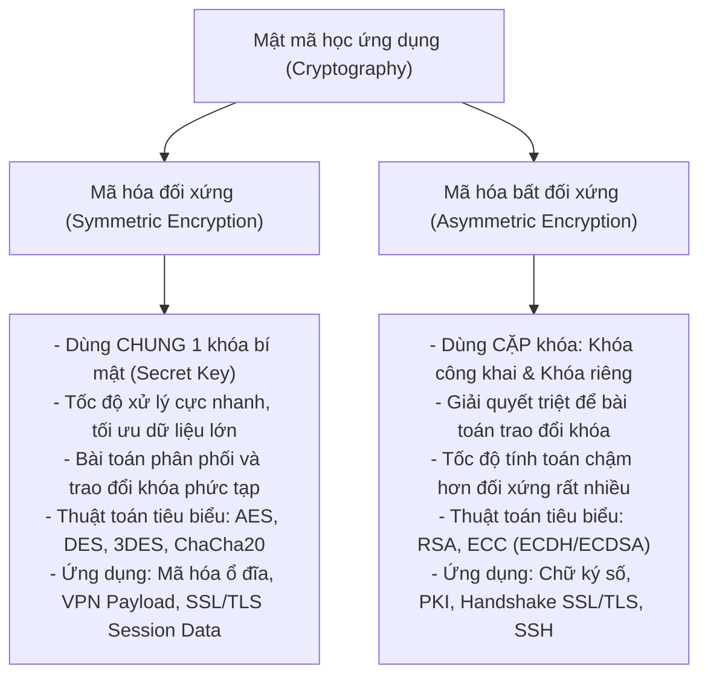
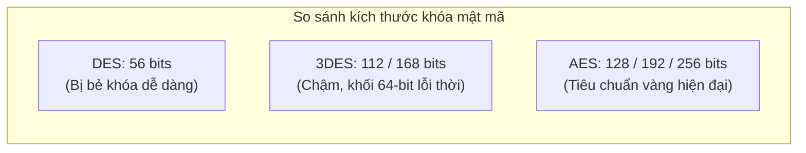
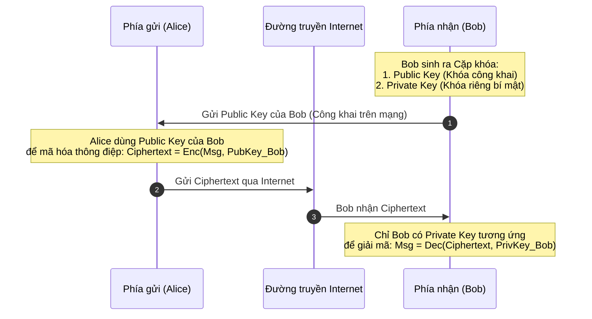
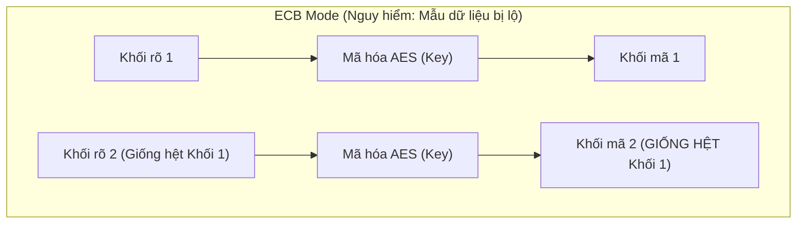
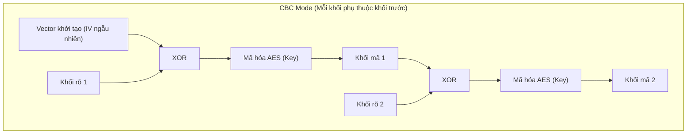

# Cryptography (Mật mã học)

Trong kỷ nguyên số, dữ liệu truyền tải qua mạng Internet (từ thông tin thẻ thanh toán, mật khẩu, thư điện tử đến dữ liệu định danh cá nhân) liên tục phải đối mặt với nguy cơ bị nghe lén, giả mạo và can thiệp trái phép. **Mật mã học (Cryptography)** là nền tảng cốt lõi của an toàn thông tin, sử dụng các thuật toán toán học phức tạp để chuyển đổi dữ liệu từ dạng rõ (**Plaintext**) sang dạng mã hóa không thể đọc được (**Ciphertext**), đảm bảo tính bí mật (**Confidentiality**) và tính toàn vẹn (**Integrity**) trên mọi đường truyền mạng.

Tùy thuộc vào phương thức sử dụng khóa mật mã (**Cryptographic Keys**), các giải pháp mã hóa hiện đại được phân thành hai trường phái chính: **mã hóa đối xứng (Symmetric Encryption)** và **mã hóa bất đối xứng (Asymmetric Encryption)**. Bên cạnh việc lựa chọn thuật toán, cách thức thuật toán mã hóa khối xử lý các khối dữ liệu (**Cipher Modes**) cũng đóng vai trò quyết định đến độ an toàn của toàn bộ hệ thống.

---

## 1. Tổng quan về mật mã học: mã hóa đối xứng vs. mã hóa bất đối xứng

* **Mã hóa đối xứng (Symmetric Encryption / Secret-Key Encryption):** Cả hai bên gửi và nhận đều sử dụng cùng một khóa bí mật duy nhất để mã hóa và giải mã dữ liệu. Nếu khóa bí mật này bị lộ hoặc bị kẻ tấn công đánh cắp trên đường truyền, toàn bộ dữ liệu mã hóa sẽ bị giải mã hoàn toàn. Thách thức lớn nhất của mã hóa đối xứng là làm sao để chuyển giao khóa bí mật giữa hai bên một cách an toàn (**Key Distribution Problem**).
* **Mã hóa bất đối xứng (Asymmetric Encryption / Public-Key Encryption):** Ra đời từ những năm 1970, phương pháp này sử dụng một cặp khóa toán học có mối liên hệ mật thiết nhưng không thể suy diễn ngược:
  - **Khóa công khai (Public Key):** Có thể công khai rộng rãi cho bất kỳ ai trên Internet. Bất kỳ ai cũng có thể dùng khóa công khai này để mã hóa dữ liệu gửi cho chủ sở hữu.
  - **Khóa riêng tư (Private Key):** Luôn được chủ sở hữu lưu trữ bí mật tuyệt đối trên thiết bị của mình. Chỉ duy nhất khóa riêng này mới có thể giải mã được dữ liệu đã mã hóa bằng khóa công khai tương ứng.

---

## 2. Mã hóa đối xứng: DES, 3DES và chuẩn AES hiện đại

Mã hóa đối xứng là lựa chọn hàng đầu khi cần mã hóa khối lượng dữ liệu khổng lồ (như tệp tin lưu trên ổ đĩa, lưu lượng video, cơ sở dữ liệu hoặc đường hầm VPN) nhờ tốc độ xử lý phần cứng vượt trội.

### 1. Data Encryption Standard (DES)
* **Bản chất kỹ thuật:** Được chuẩn hóa vào năm 1977 bởi Viện Tiêu chuẩn và Công nghệ Quốc gia Hoa Kỳ (NIST), DES là thuật toán mã hóa khối đối xứng (**Symmetric Block Cipher**). DES phân chia văn bản dạng rõ thành các khối cố định **64-bit** và sử dụng cấu trúc Feistel gồm 16 vòng biến đổi (kết hợp các phép hoán vị - Permutation và thay thế - Substitution).
* **Độ dài khóa thực tế chỉ 56-bit:** Mặc dù khóa DES có độ dài danh nghĩa là 64-bit, nhưng có 8-bit được dành riêng làm bit kiểm tra chẵn lẻ (**Parity Bits**). Do đó, không gian khóa thực tế của DES chỉ có đúng **56-bit** (\(2^{56} \approx 7.2 \times 10^{16}\) giá trị).
* **Tình trạng an ninh:** Với sức mạnh tính toán hiện nay, không gian khóa 56-bit là quá nhỏ. Kẻ tấn công có thể vét cạn toàn bộ không gian khóa DES trong vòng chưa đầy một ngày bằng các dàn máy tính GPU chuyên dụng. Vì vậy, DES đã bị khai tử hoàn toàn khỏi các tiêu chuẩn bảo mật.

### 2. Triple DES (3DES)
* **Bản chất kỹ thuật:** Nhằm tận dụng lại phần cứng DES sẵn có mà vẫn nâng cao độ an toàn, 3DES áp dụng thuật toán DES ba lần liên tiếp trên mỗi khối dữ liệu 64-bit theo chu trình **Encrypt - Decrypt - Encrypt (EDE)**:
  $$\text{Ciphertext} = E_{K3}(D_{K2}(E_{K1}(\text{Plaintext})))$$
* **Hạn chế của 3DES:** 
  - Tốc độ xử lý rất chậm (chậm gấp 3 lần DES do phải chạy qua 3 vòng mã hóa).
  - Vẫn sử dụng kích thước khối nhỏ **64-bit**, khiến 3DES dễ bị tổn thương trước các cuộc tấn công va chạm khối như **Sweet32** (tấn công sinh nhật trên các kết nối TLS/VPN sử dụng khối 64-bit truyền dữ liệu dung lượng lớn).
  - Ngày nay 3DES đã bị NIST chính thức bãi bỏ (**Deprecated**).

### 3. Advanced Encryption Standard (AES)
* **Bản chất kỹ thuật:** Được NIST công nhận làm tiêu chuẩn liên bang vào năm 2001 sau cuộc thi mật mã học quốc tế (thuật toán Rijndael do hai nhà mật mã học Bỉ thiết kế). AES là chuẩn mã hóa đối xứng hiện đại, an toàn và phổ biến nhất trên thế giới hiện nay.
* **Kích thước khối và độ dài khóa:** 
  - Kích thước khối luôn cố định là **128-bit** (16 bytes), giải quyết triệt để điểm yếu va chạm khối của DES/3DES.
  - Hỗ trợ 3 tùy chọn độ dài khóa: **128-bit (AES-128)**, **192-bit (AES-192)** và **256-bit (AES-256)**.
* **Cấu trúc mạng thay thế - hoán vị (SPN - Substitution-Permutation Network):** Thay vì dùng cấu trúc Feistel như DES, AES biến đổi dữ liệu qua ma trận trạng thái \(4 \times 4\) byte với nhiều vòng xử lý (10 vòng cho AES-128, 12 vòng cho AES-192, 14 vòng cho AES-256). Cấu trúc này cho phép tối ưu hóa song song hóa trên phần cứng (tập lệnh CPU Intel AES-NI / ARM Crypto), giúp AES đạt tốc độ mã hóa cực nhanh.
* **Ứng dụng thực tế của AES:** Mạng Wi-Fi WPA2/WPA3 (CCMP/AES), đường hầm IPsec VPN, giao thức SSH, mã hóa ổ đĩa (BitLocker, LUKS), thư viện OpenSSL, bảo mật cơ sở dữ liệu.

### Bảng đối chiếu kỹ thuật: DES vs. 3DES vs. AES

| Tiêu chí | DES | 3DES (Triple DES) | AES (Advanced Encryption Standard) |
| :--- | :---: | :---: | :---: |
| **Năm công bố** | 1977 | 1998 | 2001 |
| **Kích thước khối (Block Size)** | 64 bits | 64 bits | 128 bits |
| **Độ dài khóa thực tế** | 56 bits | 112 bits hoặc 168 bits | 128, 192 hoặc 256 bits |
| **Cấu trúc giải thuật** | Feistel Network (16 vòng) | Feistel Network (48 vòng) | Substitution-Permutation Network (10-14 vòng) |
| **Tốc độ xử lý** | Trung bình | Rất chậm | Cực nhanh (hỗ trợ phần cứng AES-NI) |
| **Đánh giá an ninh** | **Mất an toàn.** Đã bị bẻ khóa hoàn toàn. | **Lỗi thời.** Dễ bị tấn công Sweet32. | **Bảo mật tuyệt đối.** Chuẩn mực toàn cầu hiện nay. |

---

## 3. Mã hóa bất đối xứng: cơ chế và ứng dụng thực tiễn

Mã hóa bất đối xứng giải quyết triệt để điểm yếu chí mạng của mã hóa đối xứng: **không cần truyền khóa bí mật qua mạng**.

### Các ưu thế vượt trội của mã hóa bất đối xứng
1. **Loại bỏ nguy cơ lộ khóa khi truyền thông:** Khóa công khai có thể gửi tự do qua Internet hoặc tải lên các máy chủ chứng thực số công cộng. Kẻ nghe lén bắt được khóa công khai cũng không thể dùng nó để giải mã thông điệp.
2. **Hỗ trợ xác thực và chữ ký số (Digital Signatures):** Bằng cách đảo ngược quy trình (người gửi dùng **khóa riêng** của mình để mã hóa chuỗi băm thông điệp), bất kỳ ai có khóa công khai của người gửi cũng có thể kiểm tra chữ ký để đảm bảo tính xác thực (**Authenticity**) và chống chối bỏ (**Non-repudiation**).
3. **Các thuật toán bất đối xứng tiêu biểu:**
   - **RSA (Rivest-Shamir-Adleman):** Dựa trên độ khó của việc phân tích thừa số nguyên tố lớn. Độ dài khóa tiêu chuẩn từ 2048-bit đến 4096-bit.
   - **ECC (Elliptic Curve Cryptography):** Dựa trên các phép toán đại số trên đường cong Elliptic. Cung cấp mức an toàn tương đương RSA nhưng với kích thước khóa siêu nhỏ (256-bit ECC tương đương 3072-bit RSA), tối ưu cho thiết bị di động và IoT.
   - **PGP / GPG (Pretty Good Privacy):** Chuẩn mã hóa dữ liệu bất đối xứng phổ biến nhất dùng để bảo vệ thư điện tử và tệp tin.

### Các ứng dụng thực tế phổ biến
* **Chữ ký số (E-Signatures):** Xác nhận tính hợp pháp của tài liệu điện tử, hợp đồng và mã nguồn phần mềm.
* **Giao thức SSL/TLS (HTTPS):** Xác thực danh tính máy chủ web và thương lượng an toàn khóa phiên đối xứng.
* **Hạ tầng khóa công khai (PKI):** Quản lý chứng chỉ số X.509 cho toàn bộ hệ thống doanh nghiệp.
* **Mạng riêng ảo (VPNs):** Xác thực danh tính thiết bị qua chứng chỉ trước khi dựng hầm mã hóa IPsec/OpenVPN.
* **Quản trị từ xa (SSH Key Pair):** Đăng nhập máy chủ Linux không cần mật khẩu thông qua cặp khóa RSA/Ed25519.
* **Điện toán đám mây (Cloud Security):** Quản lý quyền truy cập danh tính và tài nguyên đám mây thông qua các cặp khóa API/KMS.

---

## 4. Các chế độ hoạt động của mã hóa khối (Cipher Modes)

Các thuật toán mã hóa khối (như AES hay DES) chỉ có thể mã hóa từng khối dữ liệu có kích thước cố định (64-bit hoặc 128-bit). Tuy nhiên, thông điệp thực tế (như tệp tin, gói tin mạng, hình ảnh) luôn có độ dài tùy ý và thường dài hơn rất nhiều so với một khối.

**Chế độ mã hóa khối (Cipher Mode of Operation)** là giải thuật định nghĩa cách thức kết hợp, xử lý và lặp lại thuật toán mã hóa khối trên một chuỗi các khối dữ liệu liên tiếp để bảo vệ một thông điệp có độ dài bất kỳ.

### 1. ECB (Electronic Code Book)
* **Cơ chế hoạt động:** Mỗi khối văn bản rõ 128-bit được đưa trực tiếp vào thuật toán mã hóa với cùng một khóa bí mật để tạo ra một khối bản mã độc lập.
* **Điểm yếu chí mạng:** Nếu hai khối văn bản rõ có nội dung giống hệt nhau, chúng sẽ luôn sinh ra hai khối bản mã giống hệt nhau.
* **Đánh giá an ninh:** **Cực kỳ nguy hiểm và không được khuyến nghị sử dụng.** Kẻ tấn công có thể nhận diện được các mẫu dữ liệu lặp lại trong gói tin (ví dụ: các tiêu đề HTTP cố định, pixel hình ảnh) thông qua phân tích tần suất thống kê, từ đó đoán được một phần hoặc toàn bộ nội dung bản rõ.

### 2. CBC (Cipher Block Chaining)
* **Cơ chế hoạt động:** Khắc phục điểm yếu của ECB bằng cách áp dụng phép toán logic **XOR** giữa khối bản rõ hiện tại với **khối bản mã của bước trước đó** trước khi đưa vào hàm mã hóa. Khối đầu tiên được XOR với một **vector khởi tạo ngẫu nhiên (IV - Initialization Vector)**.
* **Ưu điểm:** Hai khối văn bản rõ giống hệt nhau sẽ cho ra hai khối bản mã hoàn toàn khác nhau nhờ chuỗi phụ thuộc lẫn nhau.
* **Ứng dụng:** Mã hóa đĩa cứng (TrueCrypt, VeraCrypt), giao thức SSL/TLS cũ, mã hóa email.
* **Hạn chế:** Không thể song song hóa quá trình mã hóa (khối sau phải chờ khối trước mã hóa xong); dễ bị tổn thương trước các cuộc tấn công thay đổi dữ liệu đệm (**Padding Oracle Attacks**) nếu không đi kèm mã xác thực toàn vẹn độc lập (MAC).

### 3. CFB (Cipher Feedback)
* **Cơ chế hoạt động:** Biến đổi thuật toán mã hóa khối thành một bộ **mã hóa dòng (Stream Cipher)**. Khối bản mã trước đó (hoặc IV ở bước đầu) được đưa qua hàm mã hóa AES, sau đó kết quả được XOR với khối bản rõ để tạo ra bản mã.
* **Đặc tính:** Dữ liệu có thể được xử lý theo từng khối nhỏ (byte hoặc bit) theo thời gian thực mà không cần phải chờ đủ 128-bit dữ liệu để đệm (Padding).
* **Ứng dụng:** Mã hóa luồng truyền thông thời gian thực trong mạng, chuẩn PKCS, Microsoft BitLocker.

### 4. OFB (Output Feedback)
* **Cơ chế hoạt động:** Tương tự CFB nhưng có điểm cải tiến quan trọng: hàm mã hóa AES liên tục mã hóa đầu ra của chính nó để sinh ra một chuỗi khóa giả ngẫu nhiên tuần tự (**Keystream**), hoàn toàn độc lập với dữ liệu bản rõ. Sau đó chuỗi khóa này được XOR với bản rõ để tạo ra bản mã.
* **Ưu điểm:** Chuỗi khóa (Keystream) có thể được tính toán trước khi dữ liệu thực sự đến, giảm thiểu độ trễ tối đa. Nếu một bit bản mã bị lỗi trên đường truyền, lỗi đó chỉ làm hỏng đúng một bit tương ứng khi giải mã mà không làm hỏng toàn bộ các khối tiếp theo.
* **Ứng dụng:** Giao thức truyền thông vệ tinh, SSH, PKCS.

### 5. CTR (Counter Mode)
* **Cơ chế hoạt động:** Biến mã hóa khối thành mã hóa dòng bằng cách mã hóa một giá trị bộ đếm tăng dần (**Nonce + Counter**), sau đó XOR giá trị đầu ra với khối bản rõ.
* **Ưu điểm vượt trội:**
  - **Khả năng xử lý song song tuyệt đối:** Do giá trị bộ đếm của mỗi khối là độc lập và biết trước, phần cứng có thể mã hóa/giải mã đồng thời hàng chục khối dữ liệu trên nhiều lõi CPU cùng lúc, mang lại thông lượng dữ liệu cực cao.
  - Không cần cơ chế thêm đệm (**No Padding**).
* **Ứng dụng:** Đường hầm bảo mật IPsec, mã hóa tệp tin lưu trữ, Microsoft BitLocker.

### 6. GCM (Galois/Counter Mode) - Tiêu chuẩn vàng AEAD
* **Bản chất kỹ thuật:** Là chế độ mã hóa tiên tiến nhất hiện nay, kết hợp chế độ đếm **CTR** (đảm bảo tính bí mật và xử lý song song tốc độ cao) với cơ chế xác thực toàn vẹn Galois (**Galois Authentication Tag**) dựa trên số học trường hữu hạn.
* **Khái niệm AEAD (Authenticated Encryption with Associated Data):** GCM không chỉ mã hóa dữ liệu mà còn sinh ra một thẻ xác thực (**Authentication Tag / MAC**). Khi nhận gói tin, bên nhận vừa giải mã vừa kiểm tra xem dữ liệu có bị chỉnh sửa dù chỉ 1 bit trên đường truyền hay không. Nếu phát hiện bị can thiệp, gói tin sẽ bị hủy ngay lập tức trước khi đưa vào ứng dụng.
* **Ứng dụng:** Bắt buộc trong chuẩn giao thức an toàn thế hệ mới **TLS 1.3**, mạng không dây WPA3, giao thức WireGuard VPN, IPsec hiện đại.

---

## 5. Bảng so sánh tổng hợp các chế độ mã hóa khối (Cipher Modes)

| Chế độ mã hóa | Bản chất kỹ thuật | Hỗ trợ song song | Cần đệm (Padding) | Đánh giá an ninh và rủi ro | Trường hợp sử dụng thực tế |
| :--- | :--- | :---: | :---: | :--- | :--- |
| **ECB** (Electronic Code Book) | Mã hóa từng khối độc lập bằng cùng một khóa. | Có (khi mã hóa) | Có | **Cực kỳ nguy hiểm.** Để lộ mẫu dữ liệu; cấm sử dụng. | Kiểm tra thuật toán sơ bộ trong nghiên cứu; không dùng trong sản xuất. |
| **CBC** (Cipher Block Chaining) | XOR bản rõ với bản mã khối trước; dùng IV ngẫu nhiên. | Chỉ khi giải mã | Có | **Khá an toàn** nếu dùng IV ngẫu nhiên; nguy cơ tấn công Padding Oracle nếu thiếu MAC. | Mã hóa ổ đĩa cũ, giao thức SSL/TLS đời trước (TLS 1.0 - 1.2). |
| **CFB** (Cipher Feedback) | Mã hóa dòng dựa trên phản hồi của bản mã trước. | Chỉ khi giải mã | Không | **An toàn.** Tự đồng bộ hóa luồng dữ liệu; phù hợp xử lý dữ liệu streaming. | Mã hóa dữ liệu truyền tải thời gian thực, tiêu chuẩn PKCS. |
| **OFB** (Output Feedback) | Sinh keystream độc lập bằng cách lặp hàm mã hóa. | Không | Không | **An toàn.** Lỗi đường truyền không bị lan truyền sang khối kế tiếp. | Truyền thông thời gian thực, liên lạc vệ tinh, SSH. |
| **CTR** (Counter Mode) | Mã hóa bộ đếm tăng dần rồi XOR với bản rõ. | **Có** (cả mã hóa và giải mã) | Không | **Rất an toàn và tốc độ cao.** Yêu cầu nghiêm ngặt: không bao giờ tái sử dụng cặp Nonce/Counter. | Hạ tầng mạng tốc độ cao, IPsec, BitLocker. |
| **GCM** (Galois/Counter Mode) | Kết hợp CTR với thẻ xác thực toàn vẹn Galois (AEAD). | **Có** (tối ưu hóa phần cứng cao nhất) | Không | **Tiêu chuẩn vàng hiện đại.** Vừa bảo vệ tính bí mật vừa chống giả mạo toàn vẹn. | Chuẩn bắt buộc trong TLS 1.3, VPN thế hệ mới, Wi-Fi WPA3. |

---

## 6. Góc nhìn chuyên viên an toàn thông tin (SOC & Pentester)

Đối với các chuyên viên phân tích an ninh (SOC) và chuyên gia kiểm thử xâm nhập (Pentester), việc phân tích thuật toán mật mã và chế độ mã hóa mang lại nhiều phát hiện quan trọng:

1. **Hiệu ứng chim cánh cụt ECB (ECB Penguin Effect):**
   - Một thử nghiệm kinh điển chứng minh sự nguy hiểm của chế độ ECB là mã hóa tệp hình ảnh chim cánh cụt Linux Tux dạng đồ họa điểm (Bitmap). Do tệp ảnh có nhiều mảng màu đồng nhất cạnh nhau, khi mã hóa bằng ECB, bản mã kết quả vẫn hiển thị rõ đường viền và hình dáng chim cánh cụt dù các byte màu đã bị xáo trộn.
   - *Bài học thực chiến:* Không bao giờ chấp nhận các ứng dụng web hoặc API sử dụng chế độ `AES-ECB` để lưu trữ mã phiên (Session Tokens) hoặc cookie xác thực.
2. **Kỹ thuật tấn công đệm giải mã (Padding Oracle Attack trên CBC):**
   - Khi ứng dụng sử dụng chế độ CBC mà không xác thực tính toàn vẹn (không có MAC), kẻ tấn công có thể thay đổi các byte trong vector khởi tạo IV hoặc khối bản mã, sau đó gửi tới máy chủ và quan sát các thông báo lỗi trả về liên quan đến dữ liệu đệm (**Padding Error**).
   - Bằng cách phân tích phản hồi lỗi, kẻ tấn công có thể khôi phục lại toàn bộ nội dung bản rõ ban đầu mà không cần biết khóa giải mã.
3. **Tiêu chuẩn bắt buộc AEAD trong các giao thức hiện đại:**
   - Trong quá khứ, các giao thức thường triển khai mã hóa riêng và kiểm tra toàn vẹn riêng (mô hình MAC-then-Encrypt hoặc Encrypt-then-MAC), dẫn đến nhiều lỗ hổng thực thi nghiêm trọng (như BEAST, POODLE, Lucky Thirteen trên TLS).
   - Vì lý do này, trong chuẩn **TLS 1.3**, toàn bộ các chế độ mã hóa truyền thống (bao gồm cả CBC và RC4) đều đã bị loại bỏ hoàn toàn, chỉ duy nhất các chế độ mã hóa có tích hợp xác thực **AEAD** (như `AES-GCM` hoặc `ChaCha20-Poly1305`) mới được phép hoạt động.

---

## 7. Bảng tổng kết kiến thức trọng tâm

| Khái niệm / Thuật toán | Phân loại | Đặc điểm kỹ thuật cốt lõi | Ý nghĩa bảo mật và ứng dụng |
| :--- | :---: | :--- | :--- |
| **Mã hóa đối xứng** | Trường phái mật mã | Dùng chung 1 khóa bí mật; tốc độ cực nhanh, xử lý dữ liệu lớn. | Tối ưu hóa cho mã hóa ổ cứng, tệp tin và lưu lượng mạng đường dài. |
| **Mã hóa bất đối xứng** | Trường phái mật mã | Dùng cặp khóa công khai và riêng tư; giải quyết bài toán phân phối khóa. | Nền tảng cho chữ ký số, xác thực danh tính, PKI và bắt tay SSL/TLS. |
| **DES** | Thuật toán đối xứng | Khối 64-bit, khóa thực tế 56-bit; cấu trúc Feistel 16 vòng. | **Mất an toàn.** Đã bị bẻ khóa hoàn toàn; cấm sử dụng. |
| **3DES** | Thuật toán đối xứng | Chạy DES 3 lần liên tiếp; khóa 112/168-bit; khối 64-bit. | **Lỗi thời.** Xử lý chậm, tồn tại rủi ro tấn công Sweet32; đã bị loại bỏ. |
| **AES** | Thuật toán đối xứng | Khối 128-bit, khóa 128/192/256-bit; cấu trúc mạng SPN. | **Tiêu chuẩn vàng hiện đại.** Hiệu năng cao, bảo vệ an toàn toàn bộ dữ liệu số. |
| **RSA / ECC** | Thuật toán bất đối xứng | Dựa trên bài toán số nguyên tố (RSA) hoặc đường cong Elliptic (ECC). | Xác thực an toàn cho HTTPS, VPN, SSH và hợp đồng điện tử. |
| **Cipher Modes** | Cơ chế mã hóa khối | Phương pháp lặp và xâu chuỗi khối dữ liệu để mã hóa thông điệp dài. | Quyết định trực tiếp đến tính bảo mật của thuật toán mã hóa khối. |
| **ECB Mode** | Chế độ mã hóa khối | Mã hóa từng khối độc lập; không xáo trộn mẫu dữ liệu lặp lại. | **Cực kỳ nguy hiểm.** Không che giấu được cấu trúc dữ liệu; cấm sử dụng. |
| **CBC Mode** | Chế độ mã hóa khối | XOR khối hiện tại với khối mã trước đó; cần vector khởi tạo IV. | Phổ biến trong mã hóa đĩa; nguy cơ tấn công Padding Oracle nếu thiếu MAC. |
| **GCM Mode (AEAD)** | Chế độ mã hóa khối | Kết hợp chế độ đếm CTR với cơ chế xác thực toàn vẹn Galois. | **Tiêu chuẩn tối ưu nhất hiện nay.** Bắt buộc trên TLS 1.3 và mạng hiện đại. |
