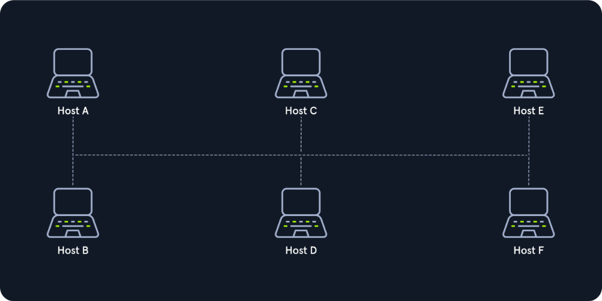
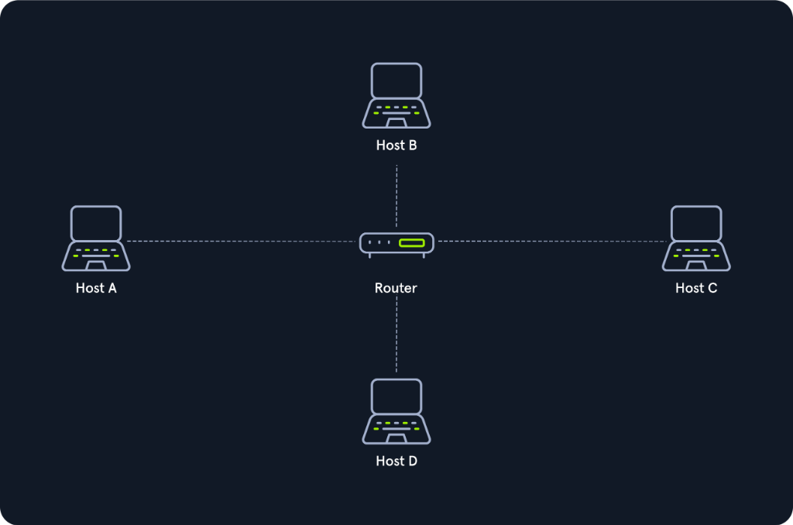
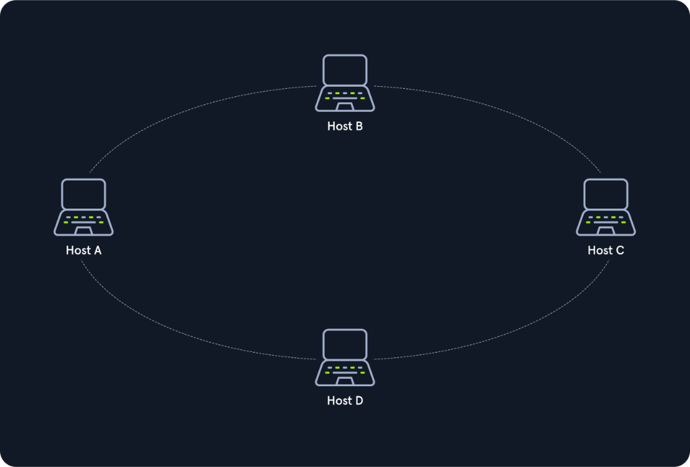
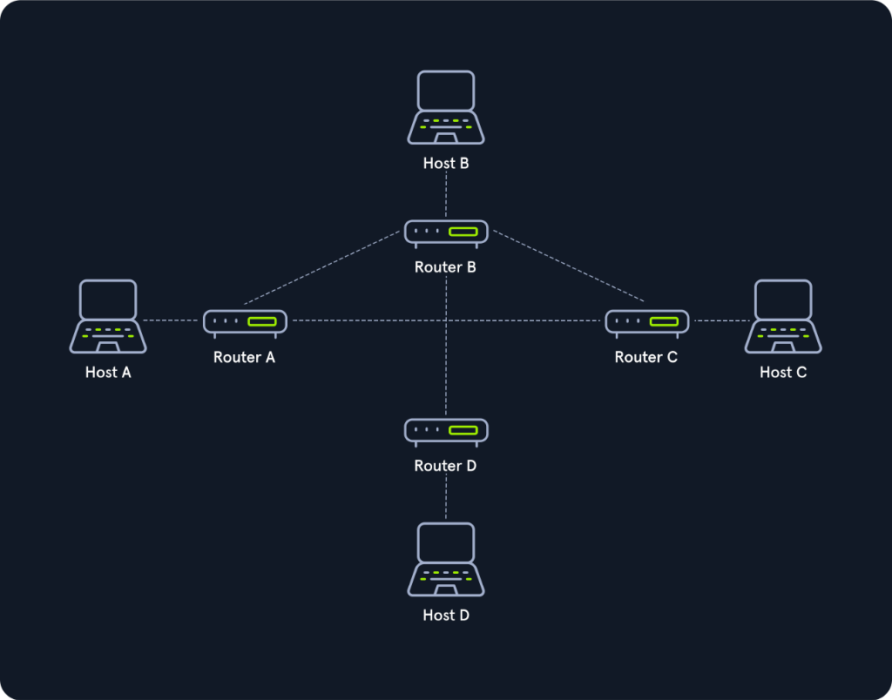
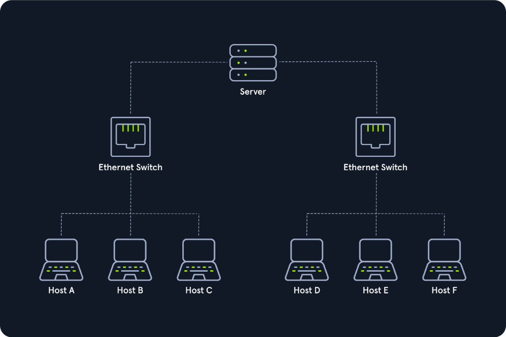
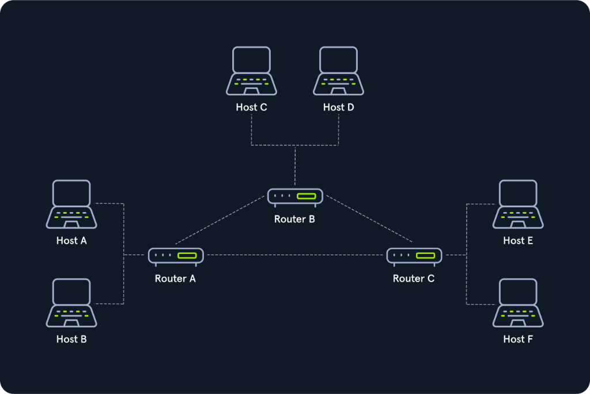
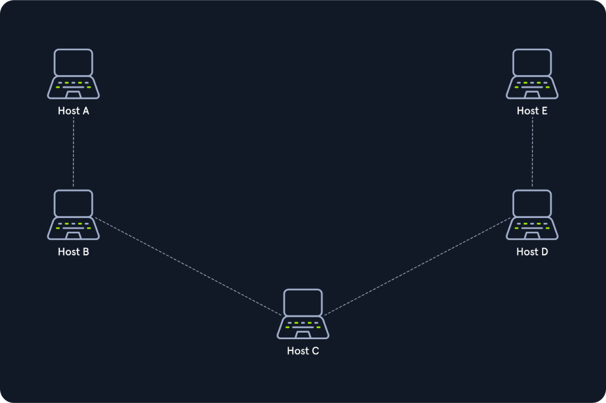

# Networking Topologies

**Network Topology** (Cấu trúc liên kết mạng) là sơ đồ bố trí điển hình và phương thức kết nối vật lý hoặc logic giữa các thiết bị trong một hệ thống mạng.

Trong mạng máy tính:
- **Hosts (Máy chủ & Thiết bị đầu cuối):** Gồm máy khách (Clients) và máy chủ (Servers) trực tiếp sử dụng dịch vụ mạng.
- **Network Components (Thành phần điều phối mạng):** Gồm Switch, Bridge, Router... đóng vai trò phân phối, định tuyến và đảm bảo tất cả các host có thể thiết lập kết nối logic thông suốt với nhau.

Cấu trúc liên kết mạng quyết định loại thiết bị cần trang bị cũng như phương thức truy cập vào môi trường truyền dẫn (Transmission Media).

---

## 1. Physical Topology vs. Logical Topology (Cấu trúc vật lý và Cấu trúc logic)

Cần phân biệt rõ ràng hai khái niệm liên kết mạng:

| Khái niệm | Định nghĩa | Ý nghĩa thực tế |
| :--- | :--- | :--- |
| **Physical Topology** (Cấu trúc vật lý) | Cách bố trí môi trường truyền dẫn vật lý để nối các thiết bị lại với nhau. | Bao gồm sơ đồ đi dây cáp (cáp đồng, cáp quang), vị trí đặt các node mạng, và các cổng cắm kết nối vật lý thực tế. |
| **Logical Topology** (Cấu trúc logic) | Cách thức các tín hiệu vận hành trên môi trường mạng và cách dữ liệu thực sự được truyền từ thiết bị này sang thiết bị khác. | Không nhất thiết phải trùng với sơ đồ vật lý. Ví dụ: Các máy tính trong phòng ngủ có thể được xếp thành hình tròn, nhưng liên kết mạng thực tế hoàn toàn không phải là cấu trúc Ring. |

---

## 2. Ba thành phần cấu thành không gian Topology

Chúng ta có thể chia toàn bộ lĩnh vực cấu trúc liên kết mạng thành 3 phần cốt lõi:

### 1. Connections
- **Wired connections (Kết nối có dây):** Cáp đồng trục (Coaxial), Cáp quang (Fiber optic), Cáp xoắn đôi (Twisted-pair: Cat5e, Cat6, Cat7).
- **Wireless connections (Kết nối không dây):** Wi-Fi, Cellular (4G/5G), Satellite, Microwave.

### 2. Nodes (NICs)
- **Network Nodes** là các điểm kết nối giữa môi trường truyền dẫn với bộ thu phát tín hiệu.
- Một node mạng có thể là một máy tính, một vi điều khiển (Microcontroller) trong IoT, hoặc các thiết bị mạng:
  - **Repeater** (Layer 1)
  - **Hub** (Layer 1)
  - **Bridge** (Layer 2)
  - **Switch** (Layer 2/3)
  - **Router / Modem** (Layer 3)
  - **Gateway**
  - **Firewall**

### 3. Classifications
Một topology là cấu trúc logic hoặc vật lý của network. Cấu trúc vật lý không nhất thiết phải trùng với cấu trúc logic.

Network topology được chia thành **8 dạng cơ bản**:

---

## 3. 8 dạng Network Topology cơ bản

---

### 1. Point-to-Point Topology

Đây là dạng cấu trúc đơn giản nhất, thiết lập một kết nối chuyên dụng duy nhất giữa hai thiết bị (Host A và Host B). Hai thiết bị sở hữu một đường truyền vật lý trực tiếp và độc quyền để trao đổi thông tin với nhau.

> **Phân biệt quan trọng:** Point-to-point topology là mô hình cơ bản của hệ thống điện thoại truyền thống, và không được nhầm lẫn với kiến trúc phần mềm **Peer-to-Peer (P2P)**.

- **Ưu điểm:** Băng thông độc quyền tuyệt đối, cấu hình đơn giản, độ trễ tối thiểu.
- **Nhược điểm:** Khả năng mở rộng kém (chỉ nối được đúng 2 điểm).

---

### 2. Bus Topology

Trong cấu trúc Bus, tất cả các host đều kết nối chung vào một đường truyền dẫn duy nhất (thường là cáp đồng trục Coaxial). Mọi host đều có quyền truy cập vào đường truyền và lắng nghe các tín hiệu chạy trên đó mà không cần thiết bị mạng trung tâm điều phối.

Do môi trường truyền dẫn bị chia sẻ hoàn toàn (**Shared Medium**), tại một thời điểm **chỉ có duy nhất một host được phép truyền dữ liệu**. Tất cả các host còn lại chỉ có nhiệm vụ nhận, đọc thông tin và tự kiểm tra xem dữ liệu đó có gửi cho mình hay không.

- **Ưu điểm:** Tiết kiệm chiều dài cáp, dễ triển khai cho mạng nhỏ.
- **Nhược điểm:** Dễ xảy ra va chạm dữ liệu (**Collision**); nếu đường cáp chính bị đứt gãy tại bất kỳ điểm nào, toàn bộ hệ thống mạng sẽ tê liệt.

---

### 3. Star Topology

Trong cấu trúc Star, tất cả các host đều kết nối độc lập qua các đường liên kết riêng biệt về một **thiết bị mạng trung tâm** (thường là Switch, Router hoặc Hub). Thiết bị trung tâm này chịu trách nhiệm tiếp nhận, phân loại và chuyển tiếp các data packet tới đích.

Lưu lượng truyền tải qua thiết bị trung tâm là rất lớn vì mọi kết nối trong mạng đều phải đi qua nó.

- **Ưu điểm:** Rất linh hoạt và đáng tin cậy. Nếu một đường dây nối tới một máy trạm bị hỏng, các máy khác vẫn hoạt động bình thường.
- **Nhược điểm:** Tốn nhiều dây cáp; nếu thiết bị trung tâm (Switch/Router) bị hỏng, toàn bộ mạng sẽ mất kết nối (**Single Point of Failure**).

---

### 4. Ring Topology

Trong cấu trúc Ring vật lý, mỗi host được nối với vòng mạng bằng **hai sợi cáp riêng biệt**:
- Một sợi cáp dành cho tín hiệu đi vào (**incoming signals**).
- Một sợi cáp dành cho tín hiệu đi ra (**outgoing signals**).

Cấu trúc Ring vật lý thường không yêu cầu thiết bị mạng chủ động ở trung tâm. Quyền kiểm soát đường truyền được điều phối thông qua một giao thức chung. Tín hiệu di chuyển theo một chiều xác định dọc theo vòng tròn.

Cơ chế truy cập đường truyền thường dựa trên **Token Passing**: Token là một chuỗi bit liên tục luân chuyển qua từng nút mạng. Máy tính nào muốn gửi dữ liệu phải đợi bắt được token rảnh (Free Token), gắn dữ liệu vào rồi mới phát đi.

> **Ring logic trên Star vật lý:** Trong thực tế hiện đại (Token Ring của IBM), cấu trúc Ring thường được triển khai dưới dạng Star vật lý, trong đó thiết bị trung tâm (MAU - Multistation Access Unit) sẽ mô phỏng vòng tròn bằng cách chuyển tiếp token từ cổng này sang cổng kế tiếp.

- **Ưu điểm:** Không xảy ra xung đột va chạm gói tin (Collision-free) nhờ cơ chế Token; hiệu suất ổn định dưới tải cao.
- **Nhược điểm:** Tốc độ truyền bị ảnh hưởng bởi số lượng nút trên vòng; nếu một nút hoặc đoạn cáp bị đứt, cả vòng mạng có thể bị gián đoạn.

---

### 5. Mesh Topology

Trong cấu trúc Mesh, các nút mạng chủ động đưa ra quyết định về đường truyền vật lý và định tuyến logic. Cấu trúc lưới không có một khuôn mẫu cố định nào, và được chia thành hai dạng cơ bản:

#### Fully Meshed (Full Mesh)
- Mỗi nút mạng đều có kết nối trực tiếp đến **tất cả** các nút mạng còn lại.
- Nếu có $n$ nút mạng, số lượng kết nối sẽ là:
  $$\text{Số kết nối} = \frac{n(n - 1)}{2}$$
- **Ứng dụng:** Thường dùng trong mạng đường trục WAN hoặc MAN giữa các trung tâm dữ liệu lớn để đảm bảo độ sẵn sàng cực cao (**High Availability**). Nếu một Router bị sập, lưu lượng ngay lập tức được chuyển hướng qua các router khác mà không gây gián đoạn dịch vụ.

#### Partially Meshed (Partial Mesh)
- Một số nút mạng quan trọng được nối với nhiều nút khác, trong khi các nút thông thường chỉ có một hoặc hai kết nối trỏ về các nút lân cận.
- **Ưu điểm:** Cân bằng hoàn hảo giữa chi phí lắp đặt cáp và khả năng chịu lỗi (Fault Tolerance).

---

### 6. Tree Topology

Cấu trúc Tree thực chất là một cấu trúc Star mở rộng đa tầng (Hierarchical Star). Đây là kiến trúc xương sống cho các mạng doanh nghiệp quy mô lớn hiện nay:
- Một hoặc nhiều server / Core Switch đặt ở tầng gốc (Root).
- Tầng gốc phân nhánh kết nối tới các Distribution Switch ở tầng giữa.
- Các Distribution Switch tiếp tục phân nhánh nối tới các Access Switch tại các tầng của tòa nhà, nơi các máy trạm (Host A đến F) cắm vào.

Mô hình này tuân thủ các giao thức chống loop như **Spanning Tree Protocol (STP)** và phương pháp đi dây cáp có cấu trúc (Structured Cabling).

- **Ưu điểm:** Cực kỳ dễ mở rộng (Scalability), phân cấp quản lý rõ ràng, dễ khoanh vùng và khắc phục sự cố theo từng nhánh.
- **Nhược điểm:** Nếu thiết bị ở tầng gốc (Root Switch) bị tê liệt, các nhánh con bên dưới sẽ mất kết nối với nhau.

---

### 7. Hybrid Topology

Cấu trúc Hybrid là sự kết hợp của **từ hai cấu trúc mạng cơ bản khác nhau trở lên** (ví dụ: kết hợp Star với Bus, hoặc Star với Ring). Khi đó, mạng tạo thành sẽ mang các đặc tính tổng hợp mà không còn là một dạng chuẩn đơn lẻ.

> **Lưu ý phân biệt:** Một mạng Tree nối với một mạng Tree khác về mặt lý thuyết vẫn chỉ là một mạng Tree lớn hơn. Mạng chỉ được gọi là Hybrid khi nó dung hợp các dạng hình học mạng khác loại với nhau.

- **Ưu điểm:** Tận dụng được điểm mạnh và bù đắp điểm yếu của từng loại topology; thiết kế linh hoạt tối đa theo hiện trạng mặt bằng tòa nhà.
- **Nhược điểm:** Thiết kế và bảo trì phức tạp; đòi hỏi thiết bị mạng đa dạng.

---

### 8. Daisy Chain Topology

Trong cấu trúc Daisy Chain, các thiết bị được kết nối nối tiếp với nhau: cáp đi từ máy này sang máy kế tiếp theo một chuỗi thẳng (Series).

Tín hiệu được chuyển tiếp tuần tự qua từng nút trung gian để đến được hệ thống đích. Cấu trúc này rất phổ biến trong công nghệ tự động hóa công nghiệp (như mạng **CAN Bus** trên ô tô hoặc nhà máy sản xuất).

- **Ưu điểm:** Lắp đặt cực nhanh, tốn rất ít dây dẫn giữa các máy đứng cạnh nhau.
- **Nhược điểm:** Bất kỳ một mắt xích trung gian nào bị đứt hoặc lỗi nguồn sẽ làm mất liên lạc với toàn bộ các mắt xích đứng sau nó.

---

## Bảng so sánh tổng hợp các loại Topology

| Topology | Độ phức tạp | Khả năng chịu lỗi (Fault Tolerance) | Chi phí cáp & Thiết bị | Ứng dụng phổ biến |
| :--- | :--- | :--- | :--- | :--- |
| **Point-to-Point** | Rất thấp | Thấp (Đứt dây là ngắt kết nối) | Rất thấp | Đường truyền leased-line nối 2 tòa nhà |
| **Bus** | Thấp | Rất thấp (Đứt cáp chính là sập toàn mạng) | Thấp | Mạng cáp đồng trục truyền thống |
| **Star** | Trung bình | Cao (Hỏng 1 cáp máy trạm không ảnh hưởng mạng) | Trung bình | Mạng LAN văn phòng hiện đại |
| **Ring** | Trung bình | Thấp đến Trung bình | Trung bình | Mạng cáp quang công nghiệp Token/FDDI |
| **Mesh** | Rất cao | Cực cao (Có nhiều tuyến dự phòng) | Rất cao | Mạng Internet, WAN giữa các Data Center |
| **Tree** | Cao | Cao (Cô lập lỗi theo từng nhánh) | Cao | Mạng doanh nghiệp nhiều tầng |
| **Hybrid** | Rất cao | Rất cao (Tùy biến theo thiết kế) | Rất cao | Mạng khuôn viên trường học, tập đoàn |
| **Daisy Chain** | Thấp | Rất thấp (Hỏng 1 nút làm ngắt chuỗi sau) | Rất thấp | Dây chuyền công nghiệp, CAN bus, sensor |
