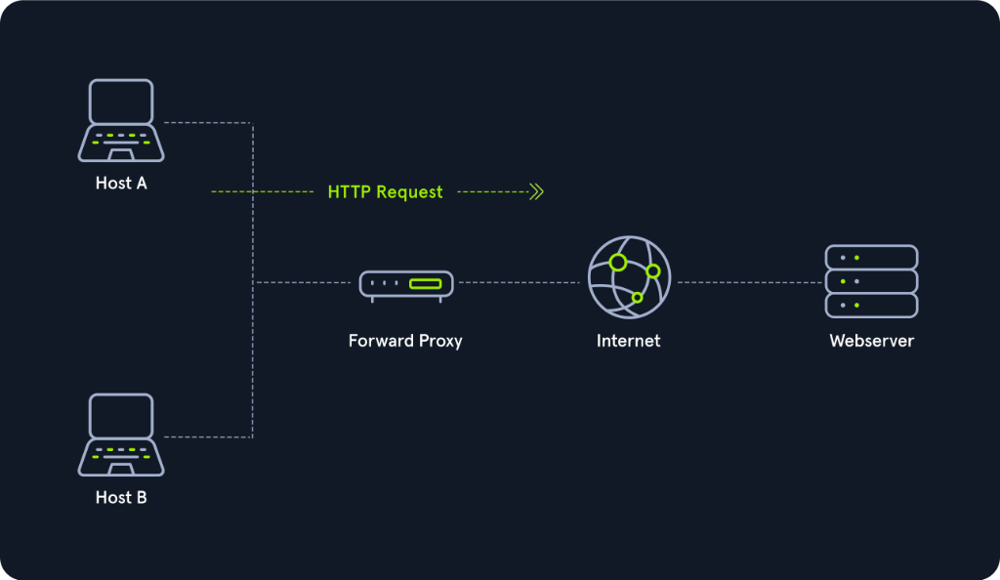
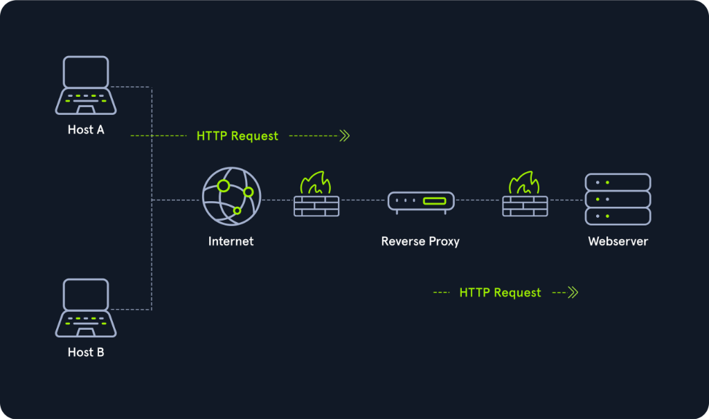
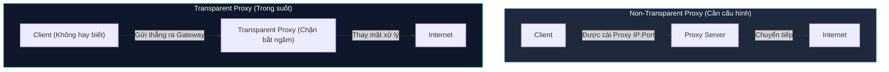

# Proxies

Thuật ngữ **Proxy** thường mang nhiều ý nghĩa và góc nhìn khác nhau tùy thuộc vào đối tượng bạn trao đổi:
- **Chuyên gia an ninh mạng (Security Professionals):** Thường nghĩ ngay đến các HTTP Proxy (như Burp Suite) dùng để bắt và chỉnh sửa gói tin, hoặc kỹ thuật xoay vòng mạng (**Pivoting**) thông qua SOCKS / SSH Proxy (bằng các công cụ như Chisel, ptunnel, sshuttle).
- **Lập trình viên web (Web Developers):** Nhắc đến Proxy là nghĩ tới Cloudflare hoặc ModSecurity dùng để lọc lưu lượng độc hại bảo vệ máy chủ web.
- **Người dùng phổ thông:** Thường nghĩ Proxy là công cụ đổi IP để "vượt rào", ẩn danh vị trí địa lý hoặc truy cập kho phim Netflix ở quốc gia khác.
- **Cơ quan thực thi pháp luật:** Thường gắn mác Proxy với các hành vi che giấu danh tính phi pháp trên mạng.

Tuy nhiên, không phải mọi cách hiểu trên đều hoàn toàn chính xác.

---

## 1. Bản chất cốt lõi của Proxy (Mediator)

Về mặt kỹ thuật, một **Proxy** là một thiết bị hoặc dịch vụ phần mềm đứng ở vị trí chính giữa của một kết nối mạng và đóng vai trò như một **thành phần trung gian (Mediator)**:

> **Điểm khác biệt quyết định:**  
> Một thiết bị được gọi là Proxy khi và chỉ khi nó có **khả năng phân tích, kiểm tra và can thiệp sâu vào nội dung của luồng dữ liệu (Inspect traffic contents)** đi qua nó.  
> Nếu một thiết bị đứng ở giữa chỉ đơn thuần định tuyến, đổi địa chỉ IP hoặc chuyển tiếp gói tin mà không có năng lực kiểm tra ngữ cảnh dữ liệu, thiết bị đó về mặt kỹ thuật chỉ là một **Gateway** hoặc một **Router/NAT**, chứ không phải là một Proxy!

Nhiều người dùng nhầm lẫn khi nghĩ rằng cứ đổi địa chỉ IP là dùng Proxy, trong khi thực tế họ chỉ đang kết nối qua một VPN. Đa phần các dịch vụ Proxy chuẩn mực đều hoạt động ở **Layer 7 (Application Layer)** của mô hình OSI.

Có nhiều biến thể proxy khác nhau, nhưng trong thế giới an ninh mạng có 3 phân loại chính yếu:
1. **Dedicated Proxy / Forward Proxy**
2. **Reverse Proxy**
3. **Transparent Proxy & Non-Transparent Proxy**

---

## 2. Dedicated Proxy / Forward Proxy

**Forward Proxy** chính là mô hình mà hầu hết mọi người hình dung khi nhắc đến từ "Proxy":  
- Client gửi một yêu cầu truy cập (request) đến máy chủ Proxy.
- Máy chủ Proxy sẽ thay mặt Client thực hiện yêu cầu đó ra ngoài Internet, nhận phản hồi về rồi chuyển lại cho Client.

### Ứng dụng trong phòng thủ doanh nghiệp (Defense against Malware)
Trong mạng doanh nghiệp, các máy tính lưu trữ dữ liệu nhạy cảm thường bị chặn hoàn toàn quyền truy cập trực tiếp ra Internet. Để truy cập một trang web, máy trạm bắt buộc phải đi qua một Forward Proxy (hoặc Web Content Filter).

Đây là một tầng phòng thủ vô cùng kiên cố chống lại mã độc (**Malware**):
- Mã độc khi lây nhiễm vào máy trạm không chỉ phải vượt qua cơ chế lọc web (Web Filter) mà còn phải **nhận biết được Proxy (Proxy-Aware)** hoặc phải sử dụng **Non-traditional Command and Control - C2**.
- Các trình duyệt web như Internet Explorer, Microsoft Edge hoặc Google Chrome theo mặc định đều tự động tuân thủ cấu hình **System Proxy** của Windows. Nếu mã độc sử dụng API mạng gốc của Windows (**WinSock API**), mã độc sẽ tự động kế thừa cấu hình proxy này.
- Tuy nhiên, trình duyệt **Mozilla Firefox** không sử dụng WinSock mà sử dụng thư viện **libcurl**, cho phép nó chạy cùng một bộ mã nguồn trên mọi hệ điều hành. Điều này đồng nghĩa với việc mã độc sẽ phải chủ động tìm kiếm tệp cấu hình của Firefox để trích xuất thiết lập proxy - một hành vi rất hiếm khi mã độc thông thường được lập trình để làm.
- Nếu mã độc chuyển sang sử dụng giao thức DNS làm kênh C2 bí mật (**DNS Tunneling**), đội ngũ an ninh có thể dễ dàng giám sát và tóm gọn lưu lượng này thông qua các công cụ giám sát như **Sysmon** (System Monitor).

### Ví dụ điển hình: Burp Suite
Đối với các chuyên gia bảo mật và Pentester, **Burp Suite** là công cụ Forward Proxy kinh điển: nó đứng giữa trình duyệt của tester và máy chủ web mục tiêu, cho phép bắt giữ, xem xét và chỉnh sửa từng tham số HTTP/HTTPS Request theo ý muốn trước khi đẩy đi.

---

## 3. Reverse Proxy

Nếu như Forward Proxy được thiết kế để bảo vệ và đại diện cho Client (người gửi yêu cầu), thì **Reverse Proxy** làm điều hoàn toàn ngược lại: **bảo vệ và đại diện cho Server (máy chủ tiếp nhận yêu cầu)**.

Mục tiêu phổ biến nhất của Reverse Proxy là lắng nghe các kết nối từ bên ngoài Internet và phân phối chúng vào các máy chủ nằm sâu trong một mạng nội bộ cách ly an toàn.

### Ứng dụng thực tế của Reverse Proxy

#### 1. Chống tấn công từ chối dịch vụ (DDoS Mitigation) & Phân phối tải:
Nhiều tập đoàn lớn sử dụng dịch vụ của **Cloudflare**. Cloudflare đóng vai trò là một Reverse Proxy toàn cầu khổng lồ với khả năng hấp thụ và thanh lọc các đợt tấn công DDoS nghìn gigabit, chỉ chuyển tiếp những luồng dữ liệu sạch về máy chủ gốc của doanh nghiệp.

#### 2. Tường lửa ứng dụng web (Web Application Firewall - WAF):
Các Reverse Proxy như **ModSecurity** tích hợp WAF có khả năng soi chiếu từng tham số trong HTTP Request để phát hiện các mẫu tấn công web nguy hiểm (như SQL Injection, Cross-Site Scripting - XSS) và lập tức hủy gói tin độc hại trước khi nó kịp chạm tới backend.  
*(Ghi chú: Cloudflare cũng có thể đóng vai trò WAF, nhưng yêu cầu doanh nghiệp phải chia sẻ chứng chỉ SSL để Cloudflare giải mã lưu lượng HTTPS).*

#### 3. Ứng dụng trong tấn công mạng (Offensive Tactics / Evasion):
Các Pentester hoặc kẻ tấn công tinh vi thường thiết lập Reverse Proxy trên các máy nạn nhân đã bị chiếm quyền kiểm soát (Compromised Endpoint):
- Máy nạn nhân sẽ mở một cổng lắng nghe. Khi kẻ tấn công gửi lưu lượng đến, máy nạn nhân sẽ chuyển tiếp lưu lượng này ngược vào sâu trong mạng nội bộ.
- Kỹ thuật này giúp kẻ tấn công **vượt tường lửa (Bypass Firewall)** và **né tránh hệ thống phát hiện xâm nhập (Evade IDS)**: Nếu tổ chức chỉ giám sát các luồng web HTTP từ Internet, kẻ tấn công có thể luồn lưu lượng qua một đường hầm SSH ngầm được bọc bởi Reverse Proxy, khiến IDS hoàn toàn bị mù.

---

## 4. Transparent Proxy vs. Non-Transparent Proxy

Dù là Forward Proxy hay Reverse Proxy, các dịch vụ này đều vận hành dưới một trong hai trạng thái:

### 1. Transparent Proxy (Proxy trong suốt)
- **Đặc điểm:** Người dùng và máy trạm (Client) **hoàn toàn không hay biết** về sự hiện diện của Proxy.
- **Cơ chế hoạt động:** Thiết bị mạng (như Router hoặc Firewall biên) sẽ tự động chặn bắt (intercept) toàn bộ lưu lượng web của người dùng và bí mật chuyển hướng vào Proxy Server.
- **Ưu điểm:** Quản trị viên không cần phải đến từng máy tính để cài đặt cấu hình; người dùng không thể tự ý tắt hoặc thay đổi proxy để lách luật.

### 2. Non-Transparent Proxy (Proxy không trong suốt)
- **Đặc điểm:** Người dùng và hệ điều hành bắt buộc phải được thông báo và cấu hình rõ ràng về sự tồn tại của Proxy (nhập IP và Port của Proxy vào mục cài đặt mạng hoặc trình duyệt).
- **Cơ chế hoạt động:** Máy trạm chủ động gửi gói tin trực tiếp tới địa chỉ của Proxy Server.
- **Tác động:** Nếu phần mềm hoặc máy tính không được cấu hình đúng thông số Proxy, mọi nỗ lực kết nối ra Internet sẽ bị cắt đứt hoàn toàn, vì Proxy thường là con đường duy nhất được phép đi qua để ra ngoài mạng.

---

## Bảng so sánh tổng hợp các loại Proxy

| Tiêu chí | Forward Proxy | Reverse Proxy | Transparent Proxy |
| :--- | :--- | :--- | :--- |
| **Bảo vệ đối tượng nào?** | Bảo vệ **Client** (Người dùng nội bộ) | Bảo vệ **Server** (Máy chủ dịch vụ) | Có thể áp dụng cho cả Client hoặc Server |
| **Vị trí đứng** | Đứng trước Client, đại diện Client ra Internet | Đứng trước Server, đón nhận traffic từ Internet | Đứng ngầm trên đường truyền (Inline / Gateway) |
| **Mục đích chính** | Kiểm soát truy cập web, ngăn chặn mã độc C2, ẩn danh Client | Chống DDoS, cân bằng tải, WAF lọc mã độc web | Ép buộc toàn bộ mạng tuân thủ chính sách mà không cần cấu hình client |
| **Ví dụ thực tế** | BlueCoat, Squid Proxy, Burp Suite (Interception) | Cloudflare, Nginx Reverse Proxy, ModSecurity | Proxy tại các quán cà phê công cộng, cổng Captive Portal trường học |

---

## Tóm tắt kiến thức cốt lõi

- **Proxy vs. Gateway:** Proxy phải là một **Mediator** có khả năng kiểm tra nội dung gói tin ở **Layer 7**, khác với Gateway/NAT chỉ đơn thuần đổi IP ở Layer 3/4.
- **Forward Proxy:** Đại diện cho Client đi ra Internet. Đóng vai trò là bức tường chặn đứng mã độc giao tiếp C2 trong doanh nghiệp.
- **Reverse Proxy:** Đại diện cho Web Server đón nhận lưu lượng từ bên ngoài. Dùng để cân bằng tải, chống DDoS (Cloudflare) và kiểm duyệt lỗ hổng ứng dụng web (WAF / ModSecurity).
- **Transparent vs. Non-Transparent:** Transparent Proxy chặn bắt lưu lượng ngầm mà không cần Client cấu hình; Non-Transparent Proxy bắt buộc Client phải thiết lập IP:Port rõ ràng mới có thể kết nối Internet.
