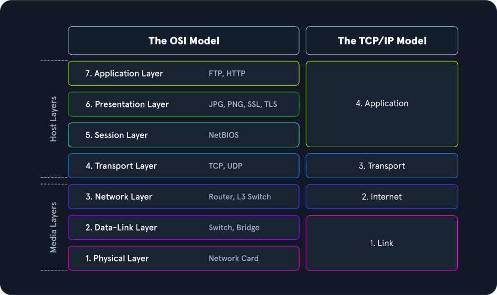
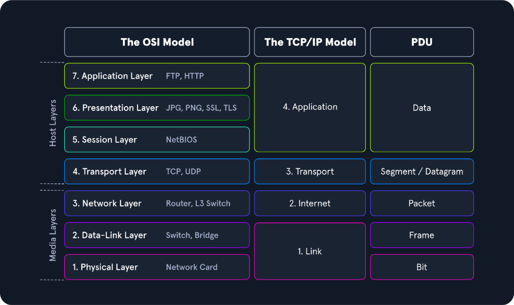
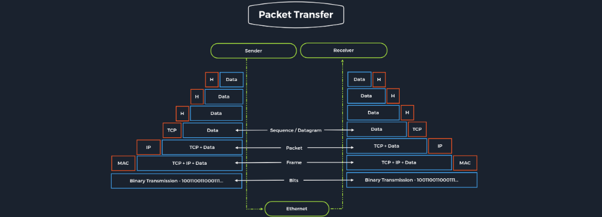
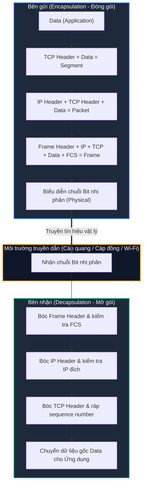

# Networking Models

Để mô tả cách thức giao tiếp và truyền tải dữ liệu giữa các máy chủ trên mạng máy tính, hai mô hình chuẩn hóa kinh điển được sử dụng trên toàn cầu: **Mô hình ISO/OSI (7 tầng)** và **Mô hình TCP/IP (4 tầng)**.

Các mô hình này trừu tượng hóa quá trình truyền dẫn: biểu diễn chuỗi các bit nhị phân thô (`0` và `1`) di chuyển trên đường truyền vật lý thành các tầng chức năng logic, giúp con người dễ dàng đọc hiểu, thiết kế và khắc phục sự cố mạng.

---

## 1. Mô hình OSI (The OSI Model)

Mô hình **OSI (Open Systems Interconnection)**, thường được gọi là mô hình phân tầng **ISO/OSI**, là mô hình kiến trúc tham chiếu tiêu chuẩn được công bố bởi Tổ chức Tiêu chuẩn hóa Quốc tế (**ISO**) và Liên minh Viễn thông Quốc tế (**ITU**).

Mô hình OSI chia toàn bộ quá trình giao tiếp mạng thành **7 tầng riêng biệt**, mỗi tầng đảm nhiệm những nhiệm vụ và trách nhiệm được phân định rõ ràng:

1. **Layer 7 - Application Layer:** Giao tiếp trực tiếp với các ứng dụng mạng của người dùng (HTTP, FTP, DNS, SMTP).
2. **Layer 6 - Presentation Layer:** Đảm nhận định dạng, mã hóa dữ liệu (Encryption/Decryption) và nén dữ liệu.
3. **Layer 5 - Session Layer:** Thiết lập, duy trì, đồng bộ và đóng các session giữa các ứng dụng.
4. **Layer 4 - Transport Layer:** Đảm bảo truyền tải dữ liệu đầu - cuối (End-to-End), kiểm soát luồng và sửa lỗi (TCP, UDP).
5. **Layer 3 - Network Layer:** Định tuyến đường đi logic cho các packet xuyên qua các mạng khác nhau (IP, ICMP, Routers).
6. **Layer 2 - Data Link Layer:** Truyền tải dữ liệu tin cậy giữa hai nút mạng kề nhau trên cùng một môi trường vật lý, quản lý địa chỉ MAC và frame (Ethernet, Switches).
7. **Layer 1 - Physical Layer:** Truyền tải chuỗi bit nhị phân thô qua môi trường vật lý (Cáp quang, cáp xoắn đôi, sóng vô tuyến).

---

## 2. Mô hình TCP/IP (The TCP/IP Model)

**TCP/IP (Transmission Control Protocol / Internet Protocol)** là mô hình mạng thực tế điều hành toàn bộ mạng Internet toàn cầu ngày nay. 

Mặc dù mang tên hai giao thức nổi bật nhất là TCP và IP, nhưng TCP/IP thực chất là một **bộ giao thức (Protocol Suite / Family)** bao gồm hàng trăm giao thức hỗ trợ khác nhau (như UDP, ICMP, ARP, DHCP, DNS, HTTP, v.v.). Bộ giao thức này cung cấp đầy đủ chức năng chuyển mạch và vận chuyển các packet trong cả mạng nội bộ lẫn mạng Internet công cộng.

Mô hình TCP/IP gom nhóm các chức năng thành **4 tầng thực dụng**:
1. **Application Layer:** Tích hợp chức năng của 3 tầng trên cùng trong OSI (Application, Presentation, Session).
2. **Transport Layer:** Tương đương tầng Transport trong OSI, điều phối truyền dữ liệu bằng TCP hoặc UDP.
3. **Internet Layer:** Tương đương tầng Network trong OSI, chịu trách nhiệm đóng gói địa chỉ IP và định tuyến packet qua Internet.
4. **Link Layer (Network Access Layer):** Gộp hai tầng Data Link và Physical của OSI, xử lý việc truyền frame và tín hiệu vật lý trên card mạng.

---

## 3. So sánh ISO/OSI vs. TCP/IP

| Tiêu chí | Mô hình ISO/OSI | Mô hình TCP/IP |
| :--- | :--- | :--- |
| **Số lượng tầng** | 7 tầng | 4 tầng |
| **Bản chất** | Là mô hình **tham chiếu lý thuyết** (Reference Model). | Là bộ giao thức **triển khai thực tế** (Implementation Model). |
| **Tính linh hoạt** | Quy định ranh giới giữa các tầng rất nghiêm ngặt, chuẩn mực. | Quy tắc linh hoạt hơn, tập trung vào hiệu năng kết nối thực tế trên Internet. |
| **Phát triển** | Xây dựng mô hình lý thuyết trước rồi mới phát triển giao thức. | Các giao thức (TCP, IP) được phát triển và kiểm nghiệm thành công trước rồi mới đúc kết thành mô hình. |
| **Tầng trên cùng** | Tách riêng Application, Presentation, và Session. | Gộp chung toàn bộ thành Application Layer. |
| **Tầng dưới cùng** | Tách riêng Data Link và Physical. | Gộp chung thành Link Layer (hoặc Network Access Layer). |

---

## 4. Quá trình truyền gói tin và PDU (Packet Transfers & Protocol Data Units)

Trong hệ thống phân tầng, mỗi tầng xử lý và trao đổi dữ liệu dưới một định dạng cấu trúc chuẩn được gọi là **Protocol Data Unit (PDU)**:

### Bảng đối chiếu các tầng và PDU tương ứng

| Tầng OSI (7 Layers) | Tầng TCP/IP (4 Layers) | Đơn vị dữ liệu (PDU) | Thành phần điều khiển chính (Header) |
| :--- | :--- | :--- | :--- |
| **Layer 7: Application** **Layer 6: Presentation** **Layer 5: Session** | **Application Layer** | **Data** (Dữ liệu thô) | Application Header (HTTP, FTP, DNS...) |
| **Layer 4: Transport** | **Transport Layer** | **Segment** (với TCP) **Datagram** (với UDP) | TCP Header (Port nguồn/đích, Sequence Number) UDP Header (Port nguồn/đích) |
| **Layer 3: Network** | **Internet Layer** | **Packet** | IP Header (Source IP, Destination IP, TTL) |
| **Layer 2: Data Link** | **Link Layer** | **Frame** | Frame Header (Source MAC, Destination MAC) + FCS/CRC |
| **Layer 1: Physical** | | **Bit** | Xung điện, xung ánh sáng, sóng vô tuyến (`0` và `1`) |

---

### Quá trình Đóng gói (Encapsulation) và Mở gói (Decapsulation)

Quá trình dữ liệu di chuyển từ máy gửi (**Sender**) sang máy nhận (**Receiver**) diễn ra tuần tự qua hai tiến trình đối xứng:

1. **Encapsulation (Đóng gói tại bên gửi):**
   - Ứng dụng tạo ra dữ liệu (**Data**).
   - Tầng Transport nhận Data và bổ sung thêm **TCP/UDP Header** vào phía trước, tạo thành **Segment** (hoặc Datagram).
   - Tầng Internet/Network nhận Segment và bọc thêm **IP Header**, tạo thành **Packet**.
   - Tầng Link/Data Link nhận Packet và gắn thêm **Frame Header** (chứa địa chỉ MAC) ở đầu cùng đuôi kiểm tra lỗi **FCS/Trailer** ở cuối, tạo thành **Frame**.
   - Tầng Physical chuyển đổi toàn bộ Frame thành các xung tín hiệu **Bit** nhị phân để đẩy ra dây cáp hoặc sóng không dây.

2. **Decapsulation (Mở gói tại bên nhận):**
   - Bên nhận tiếp nhận các tín hiệu vật lý và tái tạo thành chuỗi bit.
   - Tại mỗi tầng, card mạng và hệ điều hành sẽ kiểm tra thông tin điều khiển trong Header tương ứng: nếu hợp lệ, nó sẽ **bóc bỏ (strip away) Header** của tầng đó và đẩy phần payload bên trong lên tầng cao hơn tiếp theo.
   - Quá trình tiếp diễn cho đến khi ứng dụng người dùng nhận được trọn vẹn dữ liệu gốc ban đầu.

---

## 5. Tầm quan trọng đối với Chuyên gia kiểm thử xâm nhập (Penetration Tester)

Đối với một chuyên gia an ninh mạng hoặc Pentester, cả hai mô hình đều là công cụ tư duy vô giá:

- **Mô hình TCP/IP:** Cung cấp cái nhìn toàn cảnh nhanh chóng về cách thức một kết nối mạng được thiết lập trong thực tế (IP nào đang nói chuyện với IP nào, đi qua cổng port nào, giao thức TCP hay UDP).
- **Mô hình ISO/OSI:** Giúp chúng ta "mổ xẻ" bóc tách gói tin thành từng mảnh chi tiết nhỏ nhất khi thực hiện bắt và phân tích lưu lượng mạng (**Packet Sniffing & Network Traffic Analysis**) trên các công cụ như Wireshark hay tcpdump:
  - Phân tích xem lỗi hoặc dấu vết tấn công xuất phát từ đâu: lỗi ở tầng cáp/tín hiệu (Layer 1), tấn công giả mạo ARP (Layer 2), tấn công quét mạng/IP spoofing (Layer 3), tấn công SYN Flood (Layer 4), hay tấn công tiêm mã độc vào payload HTTP (Layer 7).

Việc hiểu sâu và ghi nhớ nằm lòng cả hai mô hình này là nền tảng cốt lõi để bạn bước tiếp vào các kỹ năng phân tích lưu lượng mạng chuyên sâu.
