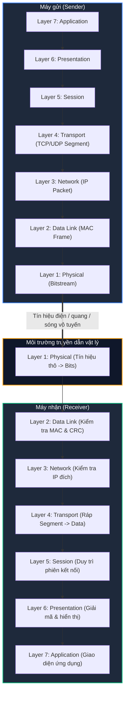

# The OSI Model

Mục tiêu cốt lõi khi xây dựng tiêu chuẩn **ISO/OSI** là tạo ra một mô hình kiến trúc tham chiếu (**Reference Model**), cho phép các hệ thống kỹ thuật đa dạng có thể giao tiếp thông suốt với nhau thông qua nhiều loại thiết bị và công nghệ khác nhau mà vẫn đảm bảo tính tương thích tuyệt đối.

Để hiện thực hóa mục tiêu này, mô hình OSI sử dụng **7 tầng (layers)** được xếp chồng theo thứ tự phân cấp bậc. Mỗi tầng đại diện cho một giai đoạn cụ thể trong quá trình thiết lập kết nối mà các gói tin truyền đi phải trải qua. Nhờ cấu trúc này, các kỹ sư và chuyên gia an ninh mạng có thể trực quan hóa và theo dõi cách một kết nối được hình thành và vận hành.

---

## 1. Chi tiết 7 tầng trong Mô hình OSI

| Tầng (Layer) | Chức năng chính (Function) | Thiết bị / Giao thức tiêu biểu |
| :--- | :--- | :--- |
| **7. Application Layer** | Kiểm soát việc nhập và xuất dữ liệu, cung cấp các hàm chức năng mạng trực tiếp cho ứng dụng của người dùng cuối. | HTTP/HTTPS, FTP, SMTP, DNS, SSH, Telnet |
| **6. Presentation Layer** | Chuyển đổi cách biểu diễn dữ liệu phụ thuộc vào từng hệ thống sang một định dạng chung độc lập với ứng dụng; đảm nhận mã hóa dữ liệu (Encryption) và nén dữ liệu (Compression). | SSL/TLS, ASCII, Unicode, JPEG, PNG |
| **5. Session Layer** | Kiểm soát kết nối logic giữa hai hệ thống (phiên làm việc), xử lý việc đồng bộ hóa dữ liệu, duy trì và ngăn ngừa việc đứt gãy kết nối giữa chừng. | NetBIOS, RPC, Sockets, PPTP |
| **4. Transport Layer** | Kiểm soát truyền tải dữ liệu đầu - cuối (End-to-End control). Chịu trách nhiệm phân mảnh dữ liệu (Segmentation), kiểm soát luồng (Flow Control), phát hiện và tránh tình trạng nghẽn mạng (Congestion Control). | TCP, UDP, Ports (Cổng logic) |
| **3. Network Layer** | Thiết lập kết nối trong mạng chuyển mạch kênh (Circuit-switched) và định tuyến/chuyển tiếp gói tin trong mạng chuyển mạch gói (Packet-switched); truyền tải dữ liệu xuyên suốt toàn mạng từ máy gửi đến máy nhận. | IP (IPv4/IPv6), ICMP, Routers, L3 Switches |
| **2. Data Link Layer** | Đảm bảo truyền tải dữ liệu tin cậy và không có lỗi trên từng môi trường truyền dẫn vật lý; chia luồng bit thô từ Layer 1 thành các khung dữ liệu (**Frames**) và quản lý địa chỉ vật lý. | Ethernet, Wi-Fi (802.11), Switches, Bridges, MAC Address |
| **1. Physical Layer** | Truyền tải tín hiệu vật lý thô qua đường truyền có dây hoặc không dây bằng các kỹ thuật như tín hiệu điện (Electrical), tín hiệu quang (Optical), hoặc sóng điện từ (Electromagnetic waves). | Cáp quang, cáp UTP (Cat5e/Cat6), Hubs, Network Card (NIC) |

---

## 2. Phân nhóm các tầng (Layer Classification)

Mô hình 7 tầng của OSI thường được chia thành hai nhóm định hướng lớn:

1. **Application-oriented Layers (Tầng định hướng ứng dụng: Layers 5 - 7):**
   - Bao gồm **Session Layer (Layer 5)**, **Presentation Layer (Layer 6)**, và **Application Layer (Layer 7)** (thường gọi là *Host Layers*).
   - Nhóm này tập trung hoàn toàn vào việc phục vụ các ứng dụng phần mềm, giao diện người dùng, cấu trúc dữ liệu và logic phiên kết nối. Các tầng này chủ yếu được xử lý trực tiếp bởi hệ điều hành và phần mềm ứng dụng trên máy chủ/máy trạm.

2. **Transport-oriented / Media Layers (Tầng định hướng truyền tải / Môi trường truyền dẫn: Layers 1 - 4):**
   - Bao gồm **Physical Layer (Layer 1)**, **Data Link Layer (Layer 2)**, **Network Layer (Layer 3)**, và **Transport Layer (Layer 4)**.
   - Nhóm này đảm nhiệm việc phân mảnh dữ liệu, quản lý địa chỉ mạng logic (IP), địa chỉ vật lý (MAC), định tuyến và chuyển tải các tín hiệu vật lý qua môi trường mạng từ nút mạng này đến nút mạng khác.

---

## 3. Nguyên lý giao tiếp giữa các tầng (Layer Interaction)

Trong mô hình OSI, mỗi tầng thực hiện các nhiệm vụ được định nghĩa chuẩn xác và có các giao diện (**Interfaces**) liên kết chặt chẽ với các tầng lân cận:

* **Quan hệ Dịch vụ Cung cấp - Sử dụng:** Mỗi tầng cung cấp các dịch vụ chuyên biệt cho tầng nằm trực tiếp ngay phía trên nó. Để cung cấp được những dịch vụ đó, bản thân nó phải sử dụng các dịch vụ do tầng nằm trực tiếp ngay phía dưới cung cấp, đồng thời thực thi trọn vẹn các tác vụ nội tại của tầng mình.
* **Nguyên tắc Độc lập:** Bất kỳ thay đổi hoặc nâng cấp công nghệ nào ở một tầng (ví dụ: chuyển từ cáp đồng sang cáp quang ở Layer 1, hoặc chuyển từ IPv4 sang IPv6 ở Layer 3) đều không làm thay đổi cách thức hoạt động hay phá vỡ chức năng của các tầng còn lại.

---

## 4. Dòng dữ liệu hai chiều giữa hai hệ thống (Two-Way Communication Flow)

Khi hai hệ thống máy tính giao tiếp với nhau, toàn bộ **7 tầng của mô hình OSI sẽ được thực thi ít nhất hai lần**: một lần tại máy gửi (**Sender**) và một lần tại máy nhận (**Receiver**).

* **Tại phía gửi (Sender - Encapsulation):**
  * Ứng dụng khởi tạo dữ liệu ở **Layer 7**.
  * Dữ liệu di chuyển dần từ **Layer 7 xuống Layer 1**.
  * Tại mỗi tầng đi qua, hệ thống sẽ gắn thêm thông tin điều khiển tương ứng (**Header** và ở Layer 2 có thêm **Trailer**) để đóng gói dữ liệu.
* **Tại phía nhận (Receiver - Decapsulation):**
  * Card mạng tiếp nhận tín hiệu vật lý ở **Layer 1** và chuyển đổi thành chuỗi bit.
  * Gói tin được đẩy ngược tuần tự từ **Layer 1 lên Layer 7**.
  * Tại mỗi tầng, hệ thống sẽ phân tích, kiểm tra tính toàn vẹn và **bóc tách (strip)** thông tin Header của tầng đó ra, trước khi bàn giao phần dữ liệu lõi (**Payload**) cho tầng cao hơn xử lý.

---

## 5. Góc nhìn An toàn thông tin (Security & Troubleshooting)

Đối với một chuyên gia an toàn thông tin hoặc chuyên viên phân tích mạng (SOC / Pentester):

1. **Phương pháp khắc phục sự cố theo từng tầng (Layer-by-Layer Troubleshooting):**
   * **Bottom-Up:** Kiểm tra từ Layer 1 (đèn cáp mạng, kết nối Wi-Fi) lên Layer 2 (Switch, địa chỉ MAC), Layer 3 (Ping IP, Default Gateway), Layer 4 (Port có bị firewall chặn không), cho đến Layer 7 (dịch vụ web, cấu hình máy chủ).
   * **Top-Down:** Bắt đầu kiểm tra từ ứng dụng người dùng trước, sau đó truy dần xuống các tầng mạng bên dưới.
2. **Bản đồ các mối đe dọa bảo mật theo tầng OSI:**
   * **Layer 1:** Cắt cáp vật lý, nghe lén tín hiệu cáp (Wiretapping), gây nhiễu sóng không dây (Wireless Jamming).
   * **Layer 2:** Giả mạo địa chỉ MAC (MAC Spoofing), nhiễm độc bảng chuyển mạch (MAC Flooding), tấn công ngộ độc ARP (ARP Poisoning).
   * **Layer 3:** Tấn công từ chối dịch vụ (DDoS Smurf attack), giả mạo IP (IP Spoofing), tấn công ICMP Flood.
   * **Layer 4:** Quét cổng (Port Scanning), tấn công làm tràn bộ đệm kết nối TCP (SYN Flood).
   * **Layer 7:** Tấn công ứng dụng web (SQL Injection, Cross-Site Scripting, HTTP Flood), lừa đảo (Phishing), khai thác lỗ hổng xác thực.
