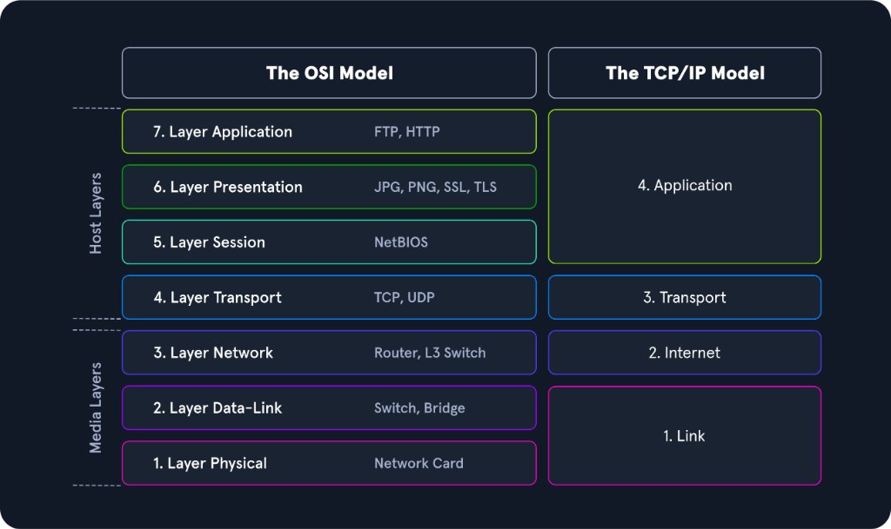
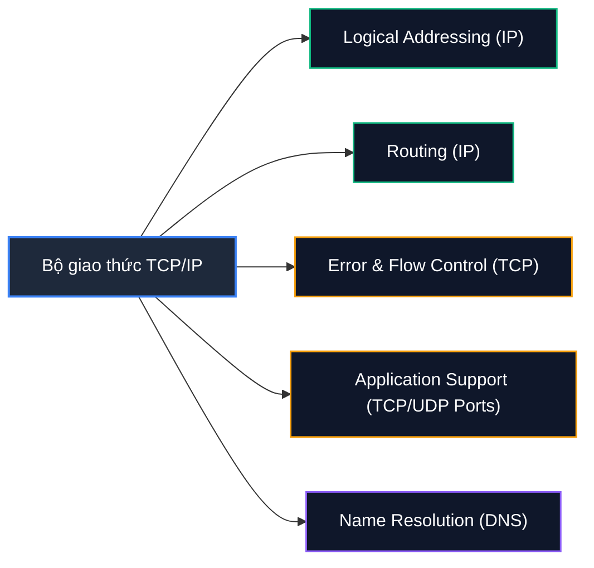

# The TCP/IP Model

Mô hình **TCP/IP** (Transmission Control Protocol / Internet Protocol), thường được gọi là **Internet Protocol Suite (Bộ giao thức Internet)**, là mô hình kiến trúc phân tầng điều hành toàn bộ mạng Internet toàn cầu và hầu hết các mạng doanh nghiệp hiện đại ngày nay.

Tên gọi TCP/IP được đặt theo hai giao thức nền tảng và cốt lõi nhất của bộ giao thức:
- **IP (Internet Protocol):** Nằm tại **Layer 2 (Internet Layer)** của TCP/IP, tương ứng với Network Layer (Layer 3) trong mô hình tham chiếu OSI.
- **TCP (Transmission Control Protocol):** Nằm tại **Layer 3 (Transport Layer)** của TCP/IP, tương ứng với Transport Layer (Layer 4) trong mô hình tham chiếu OSI.

Khác với mô hình OSI thuần túy mang tính chất lý thuyết và tiêu chuẩn hóa hàn lâm, mô hình TCP/IP được thiết kế dựa trên thực tiễn triển khai: ưu tiên tính thực dụng, khả năng mở rộng cao và khả năng tương thích linh hoạt với mọi công nghệ truyền dẫn vật lý.

---

## 1. Bốn tầng trong Mô hình TCP/IP (The 4 Layers of TCP/IP)

Mô hình TCP/IP tinh gọn toàn bộ tiến trình truyền thông thành **4 tầng**:

| Tầng (Layer) | Tên gọi (Name) | Chức năng cốt lõi (Core Function) | Giao thức & Công nghệ tiêu biểu |
| :--- | :--- | :--- | :--- |
| **Layer 4** | **Application Layer** | Cho phép các ứng dụng truy cập trực tiếp vào dịch vụ của các tầng bên dưới; định nghĩa các quy tắc chuẩn hóa mà ứng dụng sử dụng để trao đổi dữ liệu qua mạng. | HTTP/HTTPS, FTP, DNS, DHCP, SSH, Telnet, SMTP |
| **Layer 3** | **Transport Layer** | Cung cấp dịch vụ quản lý phiên kết nối tin cậy (**TCP session**) hoặc dịch vụ chuyển phát dữ liệu nhanh không kết nối (**UDP datagram**) cho tầng Application. | TCP, UDP, SCTP |
| **Layer 2** | **Internet Layer** | Chịu trách nhiệm định danh địa chỉ logic cho các host (**Host Addressing**), đóng gói dữ liệu thành packet và định tuyến (**Routing**) xuyên qua các mạng khác nhau. | IP (IPv4, IPv6), ICMP, ARP, IGMP |
| **Layer 1** | **Link Layer** *(Network Access)* | Chịu trách nhiệm đưa các gói tin TCP/IP lên môi trường truyền dẫn vật lý và tiếp nhận các packet từ môi trường mạng vào thiết bị. Được thiết kế độc lập với phương thức truy cập mạng, định dạng frame và môi trường truyền dẫn. | Ethernet, Wi-Fi (802.11), PPP, Network Interface Card (NIC) |

---

## 2. So sánh Kiến trúc: OSI (7 Tầng) vs. TCP/IP (4 Tầng)

Điểm khác biệt căn bản nhất giữa hai mô hình nằm ở số lượng tầng và mức độ gom nhóm chức năng:
* **Gộp các tầng ứng dụng (Layers 5, 6, 7 OSI -> Layer 4 TCP/IP):** Mô hình TCP/IP gom toàn bộ các tác vụ giao diện người dùng, mã hóa/nén dữ liệu (Presentation) và quản lý phiên làm việc (Session) vào duy nhất một tầng **Application Layer**.
* **Gộp các tầng truyền dẫn vật lý (Layers 1, 2 OSI -> Layer 1 TCP/IP):** Mô hình TCP/IP gộp chức năng định địa chỉ MAC, đóng khung frame (Data Link) cùng với các tín hiệu điện/quang/sóng vô tuyến (Physical) vào duy nhất một tầng **Link Layer** (còn gọi là *Network Access Layer*).

Nhờ kiến trúc này, mọi ứng dụng trong mô hình TCP/IP đều có thể truyền và trao đổi dữ liệu thông suốt qua bất kỳ loại mạng vật lý nào:
- **IP** đảm bảo dữ liệu tìm được đường đi chính xác từ nguồn đến máy đích (bất kể vị trí địa lý của máy nhận ở đâu).
- **TCP** kiểm soát độ tin cậy của việc truyền tải, quản lý luồng dữ liệu và duy trì sự toàn vẹn của kết nối giữa ứng dụng và mạng.

---

## 3. Các nhiệm vụ cốt lõi của Bộ giao thức TCP/IP (Key Tasks)

Để đảm bảo hàng tỷ thiết bị trên toàn cầu có thể kết nối đồng thời mà không bị xung đột, bộ giao thức TCP/IP thực thi 5 nhiệm vụ trọng yếu sau:

### Bảng phân tích chi tiết các nhiệm vụ

| Nhiệm vụ (Task) | Giao thức (Protocol) | Chi tiết kỹ thuật & Cơ chế hoạt động |
| :--- | :--- | :--- |
| **Logical Addressing** *(Định địa chỉ logic)* | **IP** | Số lượng host trên thế giới là khổng lồ và thuộc nhiều vùng mạng khác nhau. Giao thức IP thiết lập hệ thống địa chỉ logic duy nhất (IPv4/IPv6) cho từng node mạng. Nhờ các phương pháp như phân lớp mạng (**Network Classes**), chia mạng con (**Subnetting**), và kỹ thuật định tuyến liên miền không phân lớp (**CIDR - Classless Inter-Domain Routing**), các packet chỉ được chuyển đến đúng phân vùng mạng cần thiết. |
| **Routing** *(Định tuyến đường đi)* | **IP** | Tại mỗi trạm trung gian (Router / L3 Switch) trên đường đi từ máy gửi đến máy nhận, giao thức IP xác định nút mạng tiếp theo (**Next Hop**). Gói tin sẽ được chuyển tiếp qua từng chặng cho đến khi đến đích cuối cùng, ngay cả khi bên gửi hoàn toàn không hề biết vị trí địa lý thực tế hay cấu trúc mạng nội bộ của bên nhận. |
| **Error & Control Flow** *(Kiểm soát lỗi & luồng truyền)* | **TCP** | Bên gửi và bên nhận thiết lập một kết nối ảo (**Virtual Connection**) hai chiều. Hai bên liên tục gửi các thông điệp điều khiển (Control Messages, TCP Flags, ACKs, Window Size) để giám sát trạng thái kết nối, phát hiện gói tin bị mất mát để gửi lại (Retransmission) và tự động giảm tốc độ khi mạng xảy ra nghẽn (Congestion Control). |
| **Application Support** *(Hỗ trợ phân biệt ứng dụng)* | **TCP / UDP** | Trên một máy tính có thể có hàng chục dịch vụ mạng chạy cùng lúc. TCP và UDP cung cấp một cơ chế trừu tượng hóa phần mềm thông qua các số hiệu cổng (**Ports**, từ 1 đến 65535) để phân tách lưu lượng của từng ứng dụng riêng biệt (ví dụ: HTTP port 80, HTTPS port 443, SSH port 22). |
| **Name Resolution** *(Phân giải tên miền)* | **DNS** | Con người dễ ghi nhớ tên gọi hơn các dãy số IP phức tạp. DNS đảm nhận vai trò dịch tên miền đầy đủ (**FQDN - Fully Qualified Domain Name**, ví dụ: `academy.hackthebox.com`) thành địa chỉ IP tương ứng, cho phép người dùng truy cập chính xác máy chủ mong muốn chỉ bằng tên gọi. |

---

## 4. Tầm quan trọng đối với Chuyên viên phân tích An toàn thông tin (Security Analyst / SOC)

Hiểu rõ bản chất hoạt động của từng tầng trong mô hình TCP/IP là nền tảng để phát hiện và ngăn chặn các mối đe dọa an ninh mạng:

1. **Phân tích lưu lượng mạng (Packet Inspection):**
   * **Phân tích IP Header (Internet Layer):** Giúp phát hiện kỹ thuật quét mạng rà soát mục tiêu, các gói tin giả mạo IP nguồn (**IP Spoofing**) hoặc các kỹ thuật né tránh hệ thống phát hiện xâm nhập bằng cách phân mảnh gói tin quá mức (**IP Fragmentation Attack**).
   * **Phân tích TCP Header (Transport Layer):** Giúp nhận diện các kỹ thuật quét cổng bí mật của kẻ tấn công thông qua các cờ TCP Flags (như `SYN Scan`, `FIN Scan`, `Null Scan`, `XMAS Scan`), hoặc phát hiện các đòn tấn công từ chối dịch vụ cạn kiệt tài nguyên máy chủ (**TCP SYN Flood**).

2. **Bảo vệ dịch vụ phân giải tên miền (DNS Security):**
   * Do DNS đóng vai trò định hướng mọi kết nối ứng dụng, kẻ tấn công thường nhắm vào giao thức này thông qua các kỹ thuật như **DNS Spoofing / Cache Poisoning** (đầu độc bộ nhớ cache DNS để chuyển hướng người dùng đến trang web lừa đảo) hoặc **DNS Tunneling** (lợi dụng các truy vấn DNS để bí mật tuồn dữ liệu nhạy cảm ra ngoài qua mặt Firewall).
