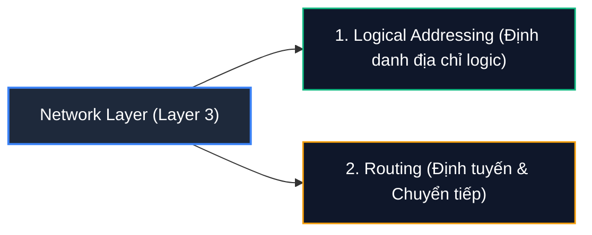
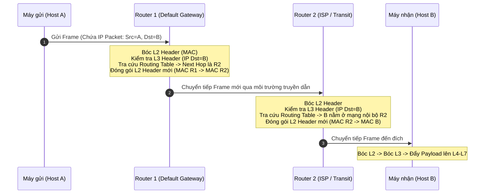

# Network Layer

**Network Layer (Layer 3)** trong mô hình OSI chịu trách nhiệm điều phối và kiểm soát việc trao đổi các gói tin dữ liệu (**Packets**) giữa các hệ thống mạng khác nhau. 

Trong phần lớn các trường hợp thực tế, bên gửi (**Sender**) và bên nhận (**Receiver**) không kết nối trực tiếp với nhau mà nằm ở các phân vùng mạng (Subnets) hoặc thậm chí là các châu lục khác nhau. Do đó, các gói tin dữ liệu không thể chuyển thẳng một bước tới đích, mà phải đi qua các nút mạng trung gian (**Routing Nodes / Routers**) theo từng chặng (**Hop-by-hop**) cho đến khi đến được đích cuối cùng.

---

## 1. Hai chức năng cốt lõi của Network Layer

Tại tầng mạng, hai nhiệm vụ quan trọng nhất được thực thi độc lập nhưng bổ trợ chặt chẽ cho nhau:

### 1. Logical Addressing (Định danh địa chỉ logic)
- Để dữ liệu không bị gửi nhầm lẫn giữa hàng tỷ thiết bị trên toàn cầu, Network Layer cung cấp cơ chế định địa chỉ logic duy nhất cho từng nút mạng (phổ biến nhất là địa chỉ **IPv4** và **IPv6**).
- Khác với địa chỉ vật lý MAC (gắn cứng vào phần cứng card mạng), địa chỉ logic IP có tính phân cấp và có thể cấu hình linh hoạt theo từng vùng địa lý hoặc sơ đồ mạng doanh nghiệp thông qua kỹ thuật chia mạng con (**Subnetting**) và **CIDR**.

### 2. Routing (Định tuyến & Chuyển tiếp)
- Dựa trên địa chỉ IP nguồn và IP đích trong gói tin, các thiết bị định tuyến (**Routers**) sẽ tra cứu bảng định tuyến (**Routing Table**) để xác định nút mạng kế tiếp (**Next Hop**) tối ưu nhất.
- Router thiết lập, quản lý và hủy các kênh kết nối, đồng thời kiểm soát luồng dữ liệu để tránh tắc nghẽn trên toàn bộ hạ tầng mạng.

---

## 2. Cơ chế chuyển tiếp từng chặng (Hop-by-Hop Packet Forwarding)

Một nguyên lý nền tảng cần ghi nhớ: **Các router trung gian trên đường truyền chỉ xử lý gói tin đến tối đa tầng Layer 3 (Network Layer) chứ không bao giờ giải mã lên các tầng cao hơn (Layer 4 đến Layer 7).**

* **Tiến trình xử lý tại từng chặng Router:**
  1. Khi một router nhận được frame từ cáp mạng hoặc sóng không dây, nó bóc tách phần Header của Layer 2 để lấy ra gói tin Layer 3 (**IP Packet**).
  2. Router đọc địa chỉ IP đích trong **IP Header** và kiểm tra với bảng định tuyến (**Routing Table**).
  3. Router giảm chỉ số thời gian sống của gói tin (**TTL - Time To Live**) đi 1 đơn vị nhằm chống hiện tượng lặp vô tận (Routing Loop).
  4. Router gán một địa chỉ vật lý trung gian mới (Destination MAC của Next Hop) vào Header Layer 2 và phát gói tin tiếp tục ra cổng tương ứng.
  5. Nội dung dữ liệu ứng dụng bên trong gói tin (ở các tầng trên như TCP, HTTP) hoàn toàn được giữ nguyên vẹn và không bị đụng tới.

---

## 3. Các giao thức tiêu biểu tại Network Layer

Mỗi tầng trong mô hình OSI đều sở hữu tập hợp các quy tắc chuẩn hóa (gọi là giao thức) để trao đổi thông tin. Các giao thức tại Network Layer hoạt động độc lập (transparent) với các tầng nằm trên hoặc dưới nó:

| Giao thức | Tên đầy đủ | Vai trò & Mục đích sử dụng |
| :--- | :--- | :--- |
| **IPv4** | Internet Protocol version 4 | Giao thức định địa chỉ 32-bit kinh điển, đặt nền móng cho Internet toàn cầu. |
| **IPv6** | Internet Protocol version 6 | Thế hệ địa chỉ IP 128-bit mới, giải quyết triệt để tình trạng cạn kiệt địa chỉ IPv4 và hỗ trợ tự động cấu hình (SLAAC). |
| **IPsec** | Internet Protocol Security | Bộ giao thức mã hóa và xác thực dữ liệu tại Layer 3, tạo đường hầm an toàn cho các kết nối VPN (Virtual Private Network). |
| **ICMP** | Internet Control Message Protocol | Giao thức truyền thông báo điều khiển và chuẩn đoán lỗi mạng (được sử dụng bởi các lệnh `ping` và `traceroute`). |
| **IGMP** | Internet Group Management Protocol | Giao thức quản lý việc tham gia vào các nhóm truyền tin đa hướng (**Multicast**) cho các ứng dụng như truyền hình IPTV, stream video. |
| **RIP** | Routing Information Protocol | Giao thức định tuyến động nội bộ dựa trên thuật toán Distance-Vector (sử dụng số hop đếm bước nhảy). |
| **OSPF** | Open Shortest Path First | Giao thức định tuyến động nội bộ hiện đại dựa trên trạng thái liên kết (Link-State), sử dụng thuật toán Dijkstra để tìm đường đi ngắn nhất. |

---

## 4. Định tuyến giữa các Subnet khác nhau (Inter-Subnet Routing)

Network Layer đảm bảo việc luân chuyển các packet từ nguồn tới đích dù hai bên cùng nằm trong một mạng cục bộ hay thuộc hai mạng con (**Subnets**) hoàn toàn độc lập:

- **Các Subnet có sơ đồ định địa chỉ khác nhau:** Hai mạng con có thể sử dụng dải IP nội bộ khác nhau (ví dụ: `192.168.1.0/24` và `10.10.10.0/24`) hoặc thậm chí sử dụng công nghệ truyền dẫn khác nhau (một bên Ethernet cáp đồng, một bên mạng cáp quang đường dài).
- **Vai trò của Default Gateway:** Khi máy gửi nhận thấy địa chỉ IP đích không nằm cùng dải mạng con cục bộ với mình, nó sẽ tự động gửi gói tin đến cổng mặc định (**Default Gateway** - cổng Router gần nhất). Router này sau đó sẽ chịu trách nhiệm chuyển tiếp gói tin xuyên qua mạng rộng lớn (WAN) đến subnet của người nhận.

---

## 5. Góc nhìn thực chiến Cybersecurity (Pentester & SOC Analyst)

Đối với người làm an toàn thông tin, Network Layer là một trong những mặt trận rực lửa nhất trong cả tấn công lẫn phòng thủ:

1. **Phân tích IP Header & Giả mạo nguồn (IP Spoofing):**
   - Kẻ tấn công có thể chỉnh sửa trường Source IP trong IP Header để giả danh một máy chủ tin cậy hoặc phát động các cuộc tấn công khuếch đại từ chối dịch vụ (**DDoS Amplification Attacks** như DNS Amplification, NTP Amplification).
   - Chuyên viên SOC cần phân tích log tường lửa và cấu hình các quy tắc lọc gói tin chống giả mạo như **BCP 38 / Reverse Path Forwarding (uRPF)**.

2. **Dò quét mạng & Dấu vân tay hệ điều hành (OS Fingerprinting qua TTL):**
   - Giá trị **TTL (Time to Live)** mặc định trong IP Header tiết lộ thông tin về hệ điều hành của máy mục tiêu:
     - Linux / Android: Thường có TTL mặc định là `64`.
     - Windows: Thường có TTL mặc định là `128`.
     - Thiết bị mạng Cisco / Network Appliance: Thường có TTL mặc định là `255`.
   - Bằng cách trừ đi số router mà gói tin đã đi qua, các công cụ quét mạng như `Nmap` có thể đoán chính xác hệ điều hành mục tiêu.

3. **Lạm dụng giao thức chẩn đoán (ICMP Exploits):**
   - **ICMP Tunneling:** Kẻ tấn công bọc dữ liệu nhạy cảm hoặc shell điều khiển vào trường dữ liệu Payload của gói tin `ICMP Echo Request / Reply` (vốn thường bị các quản trị viên mạng bỏ qua và không chặn) để lén lút tuồn dữ liệu ra ngoài (**Data Exfiltration**).
   - **Ping of Death & ICMP Flood:** Gửi các gói tin ICMP kích thước dị thường hoặc tần suất cực lớn làm tê liệt thiết bị nhận.

4. **Tấn công giao thức định tuyến (Routing Protocol Attacks):**
   - Giả mạo thông điệp cập nhật định tuyến OSPF/RIP (Rogue Routing Update) để chuyển hướng toàn bộ lưu lượng mạng của doanh nghiệp đi qua máy của tin tặc nhằm thực hiện nghe lén (**Man-in-the-Middle**).
