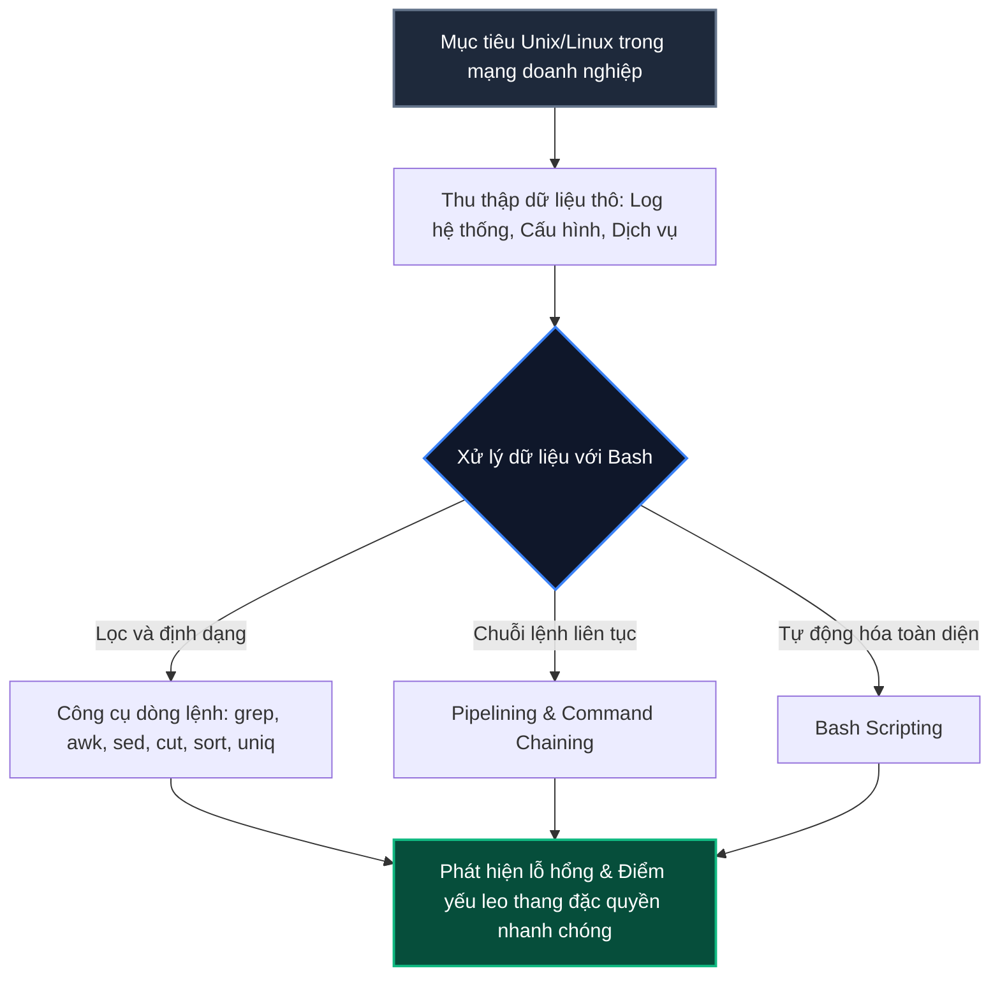
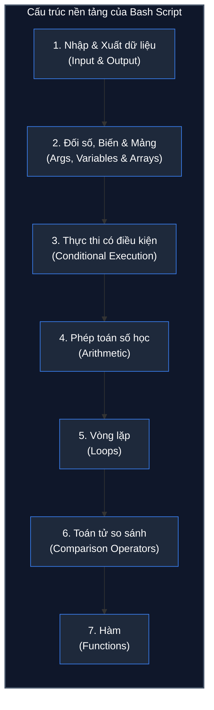

# 1. Bourne Again Shell

Bash (Bourne Again Shell) là ngôn ngữ kịch bản (scripting language) và shell dòng lệnh mặc định được sử dụng phổ biến nhất để tương tác, điều khiển hệ điều hành nền Unix/Linux. Kể từ tháng 5 năm 2019, Microsoft đã tích hợp WSL (Windows Subsystem for Linux), cho phép các kỹ sư bảo mật và quản trị viên sử dụng trực tiếp môi trường Bash nguyên bản ngay trên hệ điều hành Windows mà không cần cài đặt máy ảo độc lập. Việc làm chủ ngôn ngữ kịch bản này là kỹ năng bắt buộc để làm việc hiệu quả và tối ưu hóa quy trình trong an toàn thông tin.

Điểm khác biệt cốt lõi giữa ngôn ngữ kịch bản (Scripting Language) và ngôn ngữ lập trình (Programming Language) nằm ở quy trình thực thi mã nguồn:
- **Ngôn ngữ lập trình (như C, C++, Rust, Go):** Mã nguồn bắt buộc phải trải qua quá trình biên dịch (compilation) thông qua trình biên dịch (compiler) để chuyển đổi toàn bộ mã nguồn thành mã máy nhị phân (binary/machine code) tương ứng với kiến trúc phần cứng trước khi thực thi.
- **Ngôn ngữ kịch bản (như Bash, Python, Perl):** Không cần biên dịch trước thành tệp nhị phân độc lập. Mã nguồn được trình thông dịch (interpreter) đọc, phân tích cú pháp và thực thi trực tiếp từng dòng lệnh tại thời điểm chạy (runtime).

---

## 1. Vai trò của Bash scripting trong kiểm thử xâm nhập

Là một chuyên gia kiểm thử xâm nhập (Penetration Tester) hoặc kỹ sư phân tích an ninh (SOC Analyst), khả năng tương tác linh hoạt trên cả hai hệ điều hành phổ biến nhất - Windows và Unix/Linux - là yêu cầu bắt buộc. Mức độ hiệu quả trong công việc phụ thuộc lớn vào sự hiểu biết sâu sắc về hệ thống đích, đặc biệt là trong giai đoạn leo thang đặc quyền (Privilege Escalation).

Trên các hệ thống Unix/Linux, kỹ năng thao tác thuần thục với thiết bị đầu cuối (terminal), xử lý và lọc dữ liệu (data filtering), cùng khả năng tự động hóa các quy trình là nhân tố phân định năng lực:



1. **Xử lý khối lượng dữ liệu khổng lồ trong mạng doanh nghiệp:**
   - Trong hạ tầng mạng doanh nghiệp lớn, chuyên gia an ninh thường xuyên phải đối mặt với hàng chục gigabyte dữ liệu nhật ký (system log, web access log, auth log) hoặc tệp cấu hình phức tạp.
   - Việc mở tệp thủ công là bất khả thi. Thay vào đó, việc kết hợp Bash với các tiện ích lọc văn bản mạnh mẽ giúp trích xuất các dấu hiệu bất thường, tài khoản bị nghi ngờ hoặc lỗ hổng tiềm ẩn chỉ trong vài giây.
2. **Tự động hóa quy trình rà soát và leo thang đặc quyền:**
   - Khi đã chiếm được shell ban đầu trên máy nạn nhân, việc kiểm tra thủ công từng tiến trình, quyền tệp SUID/SGID, cron jobs hoặc phiên bản nhân (kernel version) tốn rất nhiều thời gian và dễ bỏ sót thông tin.
   - Hầu hết các công cụ rà soát leo thang đặc quyền kinh điển trong giới an ninh mạng (như `LinPEAS`, `LinEnum`, `Linux Smart Enumeration`) bản chất đều là những tập lệnh Bash script thuần túy, được thiết kế để tự động hóa hàng trăm phép kiểm tra liên tiếp.
3. **Kết hợp linh hoạt các công cụ độc lập thông qua pipeline:**
   - Sức mạnh đặc trưng của Unix là triết lý *"mỗi công cụ làm tốt một việc"*. Bash scripting đóng vai trò chất keo kết dính, cho phép chuyển tiếp đầu ra của công cụ này thành đầu vào của công cụ khác thông qua đường ống (`|`) và xử lý kết quả trả về theo ý muốn.

---

## 2. Cấu trúc cốt lõi của một kịch bản Bash

Tương tự như một ngôn ngữ lập trình hoàn chỉnh, Bash script sở hữu đầy đủ các thành phần cấu trúc cơ bản phục vụ xây dựng logic xử lý phức tạp:



1. **Nhập và xuất dữ liệu (Input & Output):**
   - Đọc dữ liệu từ bàn phím hoặc tệp (`read`), in dữ liệu ra màn hình terminal (`echo`, `printf`).
   - Kiểm soát các luồng dữ liệu tiêu chuẩn: Luồng đầu vào chuẩn (`stdin` - File Descriptor 0), luồng đầu ra chuẩn (`stdout` - File Descriptor 1) và luồng báo lỗi chuẩn (`stderr` - File Descriptor 2).
   - Chuyển hướng luồng dữ liệu bằng các toán tử `<`, `>`, `>>`, `2>`, `&>`.
2. **Đối số, biến và mảng (Arguments, Variables & Arrays):**
   - Biến lưu trữ dữ liệu chuỗi hoặc số nguyên (ví dụ: `target="example.com"`).
   - Tham số vị trí truyền qua dòng lệnh: `$0` (tên kịch bản), `$1`, `$2` (các tham số thứ tự), `$#` (tổng số lượng tham số), `$@` (toàn bộ danh sách tham số).
   - Mảng chỉ số (Indexed Arrays) và mảng kết hợp (Associative Arrays) dùng để quản lý tập hợp dữ liệu.
3. **Thực thi có điều kiện (Conditional execution):**
   - Cấu trúc điều kiện rẽ nhánh: `if-then-elif-else-fi`.
   - Cấu trúc chọn lựa đa trường hợp: `case...esac`.
   - Toán tử điều kiện ngắn gọn: toán tử AND (`&&` - chỉ chạy lệnh sau nếu lệnh trước thành công) và toán tử OR (`||` - chỉ chạy lệnh sau nếu lệnh trước thất bại).
4. **Phép toán số học (Arithmetic):**
   - Thực hiện tính toán số học trên số nguyên thông qua cú pháp mở rộng `$(( biểu thức ))` hoặc lệnh `let`, `expr`.
   - Các phép tính cơ bản: cộng (`+`), trừ (`-`), nhân (`*`), chia lấy phần nguyên (`/`), chia lấy dư (`%`), tăng dần (`++`), giảm dần (`--`).
5. **Vòng lặp (Loops):**
   - Lặp qua một danh sách phần tử xác định bằng `for...in...do...done`.
   - Lặp theo điều kiện logic đúng bằng `while...do...done`.
   - Lặp cho đến khi điều kiện trở nên đúng bằng `until...do...done`.
   - Kiểm soát vòng lặp với lệnh ngắt `break` và lệnh chuyển tiếp `continue`.
6. **Toán tử so sánh (Comparison operators):**
   - So sánh số học: `-eq` (bằng), `-ne` (khác), `-lt` (nhỏ hơn), `-le` (nhỏ hơn hoặc bằng), `-gt` (lớn hơn), `-ge` (lớn hơn hoặc bằng).
   - So sánh chuỗi: `=` hoặc `==` (bằng), `!=` (khác), `-z` (chuỗi rỗng), `-n` (chuỗi không rỗng).
   - Kiểm tra tệp tin: `-f` (là tệp tin thông thường), `-d` (là thư mục), `-e` (tệp tồn tại), `-r` (có quyền đọc), `-w` (có quyền ghi), `-x` (có quyền thực thi), `-s` (kích thước tệp lớn hơn 0).
7. **Hàm (Functions):**
   - Đóng gói các khối lệnh logic lặp lại thành một hàm có tên gọi xác định (`function_name() { ... }`).
   - Hỗ trợ truyền tham số riêng cục bộ cho hàm, khai báo biến phạm vi nội bộ (`local`), và trả về mã trạng thái bằng lệnh `return`.

---

## 3. Cơ chế thực thi kịch bản (Script execution)

Một tệp kịch bản thông thường bản thân nó không tự sinh ra một tiến trình mới trong bảng tiến trình hệ thống nếu không có một chương trình nhị phân đóng vai trò trình thông dịch (interpreter) tiếp nhận và thực thi. Trong trường hợp này, trình thông dịch chính là chương trình nhị phân Bash (`/bin/bash`).

Để một kịch bản được thực thi, chúng ta phải chỉ định rõ trình thông dịch nào sẽ chịu trách nhiệm phân tích cú pháp tệp kịch bản đó. Có ba phương pháp chính để gọi thực thi một tệp kịch bản:

```console
phat2007dhsp@htb[/htb]$ bash script.sh <optional arguments>
phat2007dhsp@htb[/htb]$ sh script.sh <optional arguments>
phat2007dhsp@htb[/htb]$ ./script.sh <optional arguments>
```

### So sánh chi tiết 3 phương pháp thực thi

| Phương pháp gọi lệnh | Trình thông dịch sử dụng | Yêu cầu quyền tệp (File Permissions) | Vai trò của dòng Shebang (`#!`) | Đánh giá kỹ thuật và trường hợp sử dụng |
| :--- | :--- | :---: | :---: | :--- |
| `bash script.sh` | `/bin/bash` | Chỉ cần quyền đọc (`r`) | Bị bỏ qua | Chạy trực tiếp bằng Bash; hữu ích khi người dùng không có quyền cấp phép thực thi `chmod +x` trên tệp (ví dụ trên phân vùng `noexec`). |
| `sh script.sh` | Trình thông dịch `sh` chuẩn POSIX (thường liên kết tới `dash` trên Debian/Ubuntu) | Chỉ cần quyền đọc (`r`) | Bị bỏ qua | Ép buộc chạy ở chế độ tương thích POSIX. Nếu mã nguồn sử dụng các cú pháp đặc thù của Bash (Bashisms như `[[ ]]` hay mảng), câu lệnh sẽ báo lỗi cú pháp. |
| `./script.sh` | Phụ thuộc vào đường dẫn khai báo tại dòng Shebang ở đầu tệp | Bắt buộc phải có cả quyền đọc (`r`) và quyền thực thi (`x`) | **Bắt buộc** | Cách gọi chuẩn nhất. Nhân hệ điều hành sẽ đọc dòng Shebang (`#!/bin/bash`) để tự động khởi tạo đúng trình thông dịch mà tác giả kịch bản chỉ định. |

> [!NOTE]
> Để thực thi kịch bản bằng cú pháp `./script.sh`, bạn phải gán quyền thực thi cho tệp tin bằng lệnh:
> ```bash
> chmod +x script.sh
> ```
> Ký tự `./` trước tên tệp báo cho shell biết cần tìm và thực thi tệp tin ngay tại thư mục làm việc hiện tại, thay vì tìm kiếm trong các thư mục được liệt kê trong biến môi trường `$PATH`.

---

## 4. Phân tích kịch bản mẫu thực tế: CIDR.sh

Để hiểu cách các thành phần cấu trúc kết hợp với nhau trong một bài toán trinh sát (reconnaissance) thực chiến, chúng ta xem xét kịch bản `CIDR.sh`. Kịch bản này nhận một tên miền mục tiêu, tự động truy vấn địa chỉ IP, tra cứu dải mạng (CIDR/NetRange) của tổ chức sở hữu, và kiểm tra trạng thái hoạt động của các máy chủ trong dải đó.

### Minh họa kết quả chạy kịch bản trên terminal

```console
phat2007dhsp@htb[/htb]$ ./CIDR.sh inlanefreight.com
Discovered IP address(es):
165.22.119.202

Additional options available:
	1) Identify the corresponding network range of target domain.
	2) Ping discovered hosts.
	3) All checks.
	*) Exit.

Select your option: 3

NetRange for 165.22.119.202:
NetRange:       165.22.0.0 - 165.22.255.255
CIDR:           165.22.0.0/16

Pinging host(s):
165.22.119.202 is up.

1 out of 1 hosts are up.
```

### Toàn bộ mã nguồn kịch bản `CIDR.sh`

```bash
#!/bin/bash

# 1. Kiem tra doi so dau vao
if [ $# -eq 0 ]
then
    echo -e "You need to specify the target domain.\n"
    echo -e "Usage:"
    echo -e "\t$0 <domain>"
    exit 1
else
    domain=$1
fi

# 2. Xac dinh dai mang tuong ung voi dia chi IP phat hien
function network_range {
    for ip in $ipaddr
    do
        netrange=$(whois $ip | grep "NetRange\|CIDR" | tee -a CIDR.txt)
        cidr=$(whois $ip | grep "CIDR" | awk '{print $2}')
        cidr_ips=$(prips $cidr)
        echo -e "\nNetRange for $ip:"
        echo -e "$netrange"
    done
}

# 3. Gui goi tin ping kiem tra trang thai may chu
function ping_host {
    hosts_up=0
    hosts_total=0
    echo -e "\nPinging host(s):"
    for host in $cidr_ips
    do
        stat=1
        while [ $stat -eq 1 ]
        do
            ping -c 2 $host > /dev/null 2>&1
            if [ $? -eq 0 ]
            then
                echo "$host is up."
                ((stat--))
                ((hosts_up++))
                ((hosts_total++))
            else
                echo "$host is down."
                ((stat--))
                ((hosts_total++))
            fi
        done
    done
    echo -e "\n$hosts_up out of $hosts_total hosts are up."
}

# 4. Phan giai dia chi IP cua ten mien muc tieu
hosts=$(host $domain | grep "has address" | cut -d" " -f4 | tee discovered_hosts.txt)
echo -e "Discovered IP address:\n$hosts\n"
ipaddr=$(host $domain | grep "has address" | cut -d" " -f4 | tr "\n" " ")

# 5. Menu dieu huong lua chon tuong tac
echo -e "Additional options available:"
echo -e "\t1) Identify the corresponding network range of target domain."
echo -e "\t2) Ping discovered hosts."
echo -e "\t3) All checks."
echo -e "\t*) Exit.\n"

read -p "Select your option: " opt

case $opt in
    "1") network_range ;;
    "2") ping_host ;;
    "3") network_range && ping_host ;;
    "*") exit 0 ;;
esac
```

---

## 5. Phân tích chi tiết từng khối logic trong kịch bản

Kịch bản `CIDR.sh` được module hóa thành năm phần rõ rệt, kết hợp chặt chẽ giữa xử lý chuỗi dòng lệnh và cấu trúc điều khiển:

### Khối 1: Kiểm tra đối số đầu vào (Input validation)

```bash
if [ $# -eq 0 ]
then
    echo -e "You need to specify the target domain.\n"
    echo -e "Usage:"
    echo -e "\t$0 <domain>"
    exit 1
else
    domain=$1
fi
```

- `$#` là biến đặc biệt chứa tổng số lượng đối số người dùng truyền vào từ dòng lệnh khi gọi script.
- Toán tử `[ $# -eq 0 ]` kiểm tra xem người dùng có quên không truyền tên miền hay không.
- Nếu không có đối số nào được truyền vào, script in ra thông báo lỗi và hướng dẫn sử dụng thông qua `$0` (chứa chính tên tệp script đang chạy), sau đó kết thúc ngay lập tức bằng lệnh `exit 1` (mã trạng thái khác 0 báo hiệu chương trình kết thúc với lỗi).
- Nếu có đối số, giá trị của đối số thứ nhất (`$1`) được gán vào biến người dùng `domain`.

### Khối 2: Phân giải địa chỉ IP của tên miền mục tiêu

```bash
hosts=$(host $domain | grep "has address" | cut -d" " -f4 | tee discovered_hosts.txt)
echo -e "Discovered IP address:\n$hosts\n"
ipaddr=$(host $domain | grep "has address" | cut -d" " -f4 | tr "\n" " ")
```

- Đây là khối lệnh thực thi tuyến tính đầu tiên khi script bắt đầu chạy:
  1. `host $domain`: Thực hiện truy vấn DNS để tìm các bản ghi liên quan đến tên miền mục tiêu.
  2. `grep "has address"`: Lọc chỉ lấy các dòng kết quả chứa địa chỉ IPv4 (ví dụ: `inlanefreight.com has address 165.22.119.202`).
  3. `cut -d" " -f4`: Dùng dấu khoảng trắng làm ký tự phân tách trường (`-d" "`), lấy trường thứ 4 (`-f4`) là địa chỉ IP thô.
  4. `tee discovered_hosts.txt`: Ghi danh sách IP này vào tệp `discovered_hosts.txt` đồng thời vẫn giữ luồng hiển thị để gán vào biến `hosts`.
  5. `tr "\n" " "`: Chuyển đổi ký tự xuống dòng thành khoảng trắng để lưu vào biến `ipaddr`, giúp vòng lặp `for ip in $ipaddr` ở hàm phía sau duyệt qua từng IP một cách dễ dàng.

### Khối 3: Xác định phạm vi mạng cho địa chỉ IP (Hàm `network_range`)

```bash
function network_range {
    for ip in $ipaddr
    do
        netrange=$(whois $ip | grep "NetRange\|CIDR" | tee -a CIDR.txt)
        cidr=$(whois $ip | grep "CIDR" | awk '{print $2}')
        cidr_ips=$(prips $cidr)
        echo -e "\nNetRange for $ip:"
        echo -e "$netrange"
    done
}
```

- Hàm được khai báo bằng từ khóa `function network_range { ... }`.
- Vòng lặp `for ip in $ipaddr`: Duyệt qua từng địa chỉ IP đã thu thập được từ bước phân giải DNS.
- `whois $ip`: Truy vấn cơ sở dữ liệu WHOIS của tổ chức quản lý địa chỉ IP (ARIN, RIPE, APNIC, v.v.) để lấy thông tin đăng ký sở hữu.
- `grep "NetRange\|CIDR"`: Lọc dòng thông tin chứa phạm vi mạng (`NetRange`) hoặc ký hiệu mạng con (`CIDR`).
- `tee -a CIDR.txt`: Lưu nối tiếp (`-a` - append) thông tin vào tệp `CIDR.txt`.
- `awk '{print $2}'`: Lấy giá trị chuỗi CIDR ở cột thứ hai (ví dụ: `165.22.0.0/16`).
- `prips $cidr`: Tiện ích dòng lệnh Linux chuyên dụng nhận vào một dải CIDR và in ra toàn bộ các địa chỉ IP hợp lệ nằm trong dải mạng đó, lưu vào biến `cidr_ips`.

### Khối 4: Ping kiểm tra trạng thái máy chủ (Hàm `ping_host`)

```bash
function ping_host {
    hosts_up=0
    hosts_total=0
    echo -e "\nPinging host(s):"
    for host in $cidr_ips
    do
        stat=1
        while [ $stat -eq 1 ]
        do
            ping -c 2 $host > /dev/null 2>&1
            if [ $? -eq 0 ]
            then
                echo "$host is up."
                ((stat--))
                ((hosts_up++))
                ((hosts_total++))
            else
                echo "$host is down."
                ((stat--))
                ((hosts_total++))
            fi
        done
    done
    echo -e "\n$hosts_up out of $hosts_total hosts are up."
}
```

- Khởi tạo hai biến đếm số nguyên: `hosts_up=0` (số máy chủ đang hoạt động) và `hosts_total=0` (tổng số máy chủ đã quét).
- Vòng lặp `for host in $cidr_ips`: Duyệt qua từng IP trong toàn bộ danh sách IP thuộc dải CIDR.
- `stat=1` và `while [ $stat -eq 1 ]`: Thiết lập một cờ lặp (flag) để kiểm soát việc gửi gói tin kiểm tra.
- `ping -c 2 $host > /dev/null 2>&1`:
  - Gửi 2 gói tin ICMP Echo Request (`-c 2`) tới máy chủ mục tiêu.
  - Chuyển hướng toàn bộ đầu ra chuẩn (`stdout`) vào thiết bị ảo `/dev/null` (bỏ đi dữ liệu không cần thiết).
  - Cú pháp `2>&1` chuyển hướng tiếp toàn bộ luồng báo lỗi (`stderr` - 2) vào cùng vị trí với `stdout` (1), giúp màn hình hoàn toàn sạch sẽ, không bị làm phiền bởi thông tin ping chi tiết.
- `if [ $? -eq 0 ]`:
  - Biến `$?` chứa mã thoát (exit status) của lệnh gần nhất vừa được thực thi (lệnh `ping`).
  - Trong Linux, mã thoát `0` đồng nghĩa với thành công (máy chủ có phản hồi ICMP Echo Reply). Mã khác 0 nghĩa là thất bại hoặc máy chủ không phản hồi.
- Cú pháp `((stat--))`, `((hosts_up++))`, `((hosts_total++))`: Thao tác tăng giảm số học trên biến trong môi trường Bash.

### Khối 5: Menu điều hướng tùy chọn (Available options)

```bash
echo -e "Additional options available:"
echo -e "\t1) Identify the corresponding network range of target domain."
echo -e "\t2) Ping discovered hosts."
echo -e "\t3) All checks."
echo -e "\t*) Exit.\n"

read -p "Select your option: " opt

case $opt in
    "1") network_range ;;
    "2") ping_host ;;
    "3") network_range && ping_host ;;
    "*") exit 0 ;;
esac
```

- `read -p "Select your option: " opt`: Hiển thị lời nhắc (prompt) và tạm dừng chương trình để nhận một chuỗi ký tự do người dùng nhập từ bàn phím, lưu giá trị đó vào biến `opt`.
- Cấu trúc `case $opt in ... esac`:
  - Nếu người dùng nhập `1`: Gọi hàm `network_range`.
  - Nếu người dùng nhập `2`: Gọi hàm `ping_host`.
  - Nếu người dùng nhập `3`: Thực thi kết hợp cả hai hàm `network_range && ping_host` bằng toán tử AND logic (chỉ gọi hàm ping nếu hàm tra cứu dải mạng kết thúc thành công).
  - Ký tự đại diện `*`: Khớp với mọi trường hợp còn lại (nhập ký tự bất kỳ khác hoặc nhấn Enter), gọi lệnh `exit 0` để thoát chương trình một cách an toàn.

---

## 6. Góc nhìn bảo mật và tối ưu hóa kịch bản

Từ góc độ của một chuyên viên an toàn thông tin (SOC Analyst và Penetration Tester), việc viết và phân tích các kịch bản Bash đòi hỏi sự chú ý đặc biệt đến tính an toàn và hiệu năng:

1. **Nguy cơ lỗ hổng Command Injection qua tham số đầu vào:**
   - Trong đoạn mã `CIDR.sh`, biến `$domain` nhận giá trị trực tiếp từ người dùng (`domain=$1`) và được truyền thẳng vào lệnh `host $domain` mà không qua bất kỳ cơ chế làm sạch (sanitization) hay xác thực định dạng (validation) nào.
   - Nếu kẻ tấn công hoặc người dùng truyền vào tham số có chứa ký tự điều khiển lệnh:
     ```bash
     ./CIDR.sh "inlanefreight.com; cat /etc/passwd"
     ```
   - Câu lệnh thực tế sẽ biến thành `host inlanefreight.com; cat /etc/passwd`. Hệ thống sẽ phân giải tên miền xong rồi thực thi tiếp lệnh đọc tệp mật khẩu `/etc/passwd`.
   - *Quy tắc an toàn:* Luôn kiểm tra định dạng đầu vào bằng biểu thức chính quy (Regex) trước khi đưa biến vào các câu lệnh hệ thống.
2. **Kỹ thuật bao bọc biến trong dấu ngoặc kép (Quoting Variables):**
   - Trong Bash, nếu một biến chứa khoảng trắng hoặc ký tự đặc biệt (`*`, `?`, `[`), việc gọi `$var` trần trụi sẽ gây ra hiện tượng phân tách từ (word splitting) hoặc thay thế tên tệp (globbing).
   - Hãy luôn bọc biến trong cặp ngoặc kép: `"$domain"`, `"$ip"`, `"$cidr"`.
3. **Quản lý công cụ phụ thuộc (Dependencies Check):**
   - Kịch bản trên phụ thuộc vào các công cụ bên ngoài: `host`, `whois`, `prips`, `ping`. Nếu máy trạm chưa cài đặt gói `prips` hoặc `whois`, script sẽ báo lỗi âm thầm hoặc sinh ra chuỗi rỗng làm hỏng vòng lặp kế tiếp.
   - Một kịch bản chuyên nghiệp nên kiểm tra sự hiện diện của công cụ bằng lệnh `command -v`:
     ```bash
     command -v prips >/dev/null 2>&1 || { echo "Loi: Cong cu prips chua duoc cai dat. Vui long cai dat truoc khi chay script."; exit 1; }
     ```
4. **Tối ưu hóa hiệu năng mạng (Network Scanning Performance):**
   - Việc duyệt tuần tự từng địa chỉ IP trong một dải mạng lớn (ví dụ dải `/16` chứa tới 65,534 IP) bằng vòng lặp `for` và gửi 2 gói ping nối tiếp nhau sẽ mất hàng giờ đồng hồ để hoàn thành.
   - Để tối ưu hóa tốc độ trong thực chiến, các chuyên gia an ninh mạng thường kết hợp chạy ngầm nhiều tiến trình con song song thông qua ký tự `&`, hoặc sử dụng các công cụ chuyên dụng như `nmap`, `masscan` hay `fping`.

---

## 7. Bảng tổng kết kiến thức trọng tâm

| Khái niệm / Lệnh | Phân loại | Cú pháp / Cách dùng | Ý nghĩa kỹ thuật trong kịch bản |
| :--- | :---: | :--- | :--- |
| **Shebang** | Khai báo môi trường | `#!/bin/bash` | Chỉ định đường dẫn tuyệt đối tới trình thông dịch sẽ nạp và thực thi script. |
| **Tham số vị trí** | Biến đặc biệt | `$0`, `$1`, `$#`, `$@` | `$0`: tên script; `$1`: đối số đầu tiên; `$#`: tổng số đối số truyền vào; `$@`: tất cả đối số. |
| **Mã thoát (Exit status)** | Biến hệ thống | `$?` | Trả về mã kết thúc của lệnh vừa thực thi (`0` = thành công, khác `0` = thất bại). |
| **Toán tử số học** | Cú pháp Bash | `((biểu thức))` | Thực hiện tính toán và tăng/giảm giá trị biến nguyên: `((var++))`, `((var--))`. |
| **Chuyển hướng luồng** | I/O Redirection | `> /dev/null 2>&1` | Chuyển toàn bộ `stdout` và `stderr` vào hố đen `/dev/null`, làm sạch màn hình terminal. |
| **Điều kiện `if-then-else`** | Cấu trúc điều khiển | `if [ điều_kiện ]; then ... fi` | Kiểm tra điều kiện logic để quyết định rẽ nhánh luồng thực thi. |
| **Rẽ nhánh `case...esac`** | Cấu trúc điều khiển | `case $biến in "mẫu") ... ;; esac` | Tạo menu điều hướng trực quan, xử lý đa lựa chọn người dùng nhập vào. |
| **Lệnh `read -p`** | Tương tác người dùng | `read -p "Thong bao: " var` | In ra lời nhắc và tạm dừng chờ người dùng nhập giá trị lưu vào biến. |
| **Lệnh `tee`** | Tiện ích dòng lệnh | `tee [-a] file.txt` | Vừa in dữ liệu ra terminal (`stdout`), vừa ghi lưu đồng thời vào tệp tin. |
| **Lệnh `prips`** | Tiện ích mạng | `prips <CIDR>` | Liệt kê toàn bộ danh sách địa chỉ IP hợp lệ nằm trong một dải mạng CIDR. |
