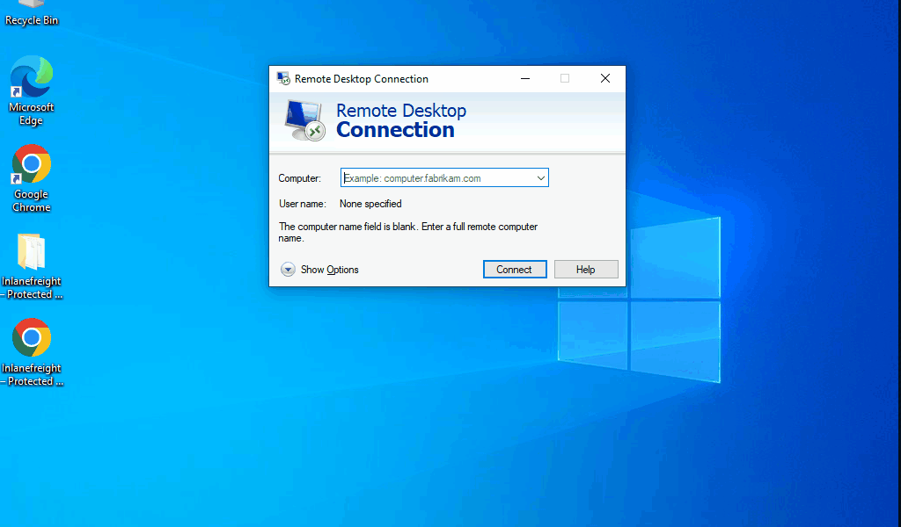
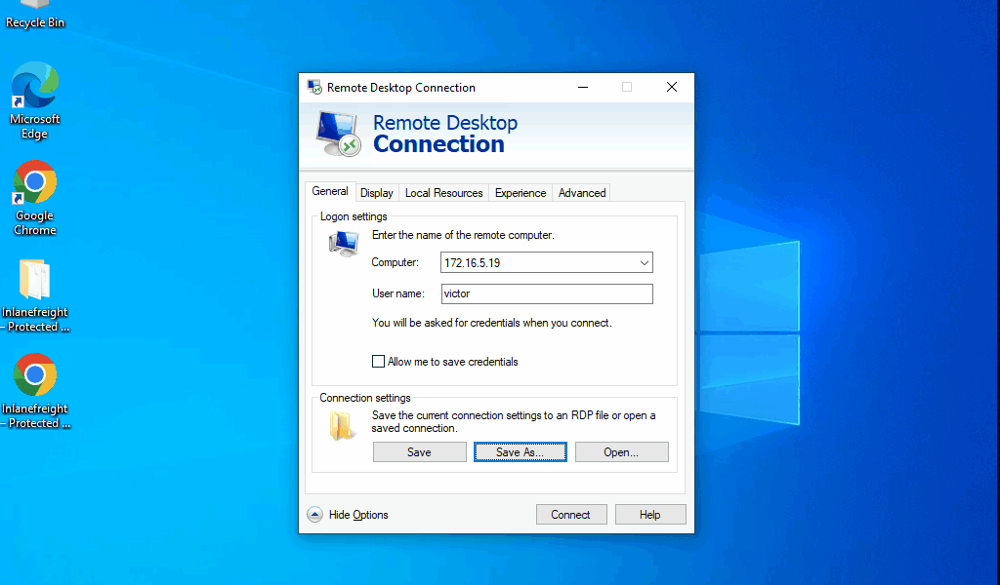
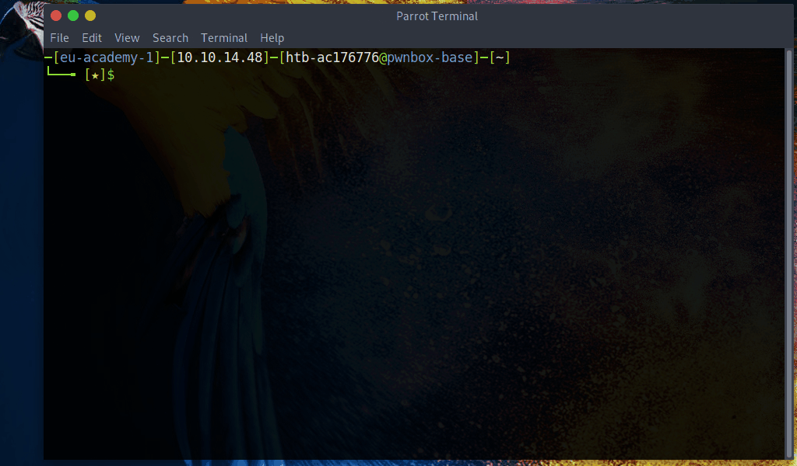

# Introduction to Windows

Là một chuyên gia kiểm thử xâm nhập (Penetration Tester), việc trang bị kiến thức sâu rộng về nhiều công nghệ khác nhau là điều vô cùng quan trọng. Hiểu biết thấu đáo về hai hệ điều hành Windows và Linux sẽ mang lại lợi thế lớn trong hầu hết các loại hình đánh giá bảo mật. Phần lớn các hệ thống mà chúng ta tiếp xúc trong thực tế (dù triển khai tại chỗ hay trên nền tảng đám mây) đều vận hành dựa trên hai hệ điều hành này. Do đó, việc nắm vững cách tấn công, phòng thủ cũng như cách tận dụng từng hệ điều hành làm nền tảng cho các hoạt động kiểm thử tiếp theo là yêu cầu thiết yếu.

---

## The Windows Operating System

Microsoft lần đầu giới thiệu hệ điều hành Windows vào ngày 20 tháng 11 năm 1985. Phiên bản đầu tiên thực chất là một giao diện đồ họa (graphical operating system shell) chạy trên nền MS-DOS. Các phiên bản Windows Desktop sau đó lần lượt bổ sung thêm các tiện ích như Windows File Manager, Program Manager và Print Manager.

Windows 95 đánh dấu sự tích hợp hoàn chỉnh đầu tiên giữa Windows và DOS, đồng thời cung cấp sẵn khả năng hỗ trợ kết nối Internet ngay từ đầu. Phiên bản này cũng ra mắt trình duyệt web Internet Explorer. Kể từ bản phát hành đầu tiên, Microsoft đã tung ra hơn một chục phiên bản Windows khác nhau như Windows XP, Vista, Windows 8 cho đến phiên bản hiện tại là Windows 11. Qua từng thời kỳ, Microsoft cũng cung cấp nhiều ấn bản (editions) khác nhau cho mỗi dòng Windows Desktop để phục vụ đa dạng đối tượng từ người dùng phổ thông đến khách hàng doanh nghiệp.

Dòng Windows Server xuất hiện lần đầu vào năm 1993 với phiên bản Windows NT 3.1 Advanced Server. Windows NT trải qua nhiều đợt nâng cấp trong suốt nhiều năm, bổ sung hàng loạt công nghệ như Internet Information Services (IIS), nhiều giao thức mạng, Administrative Wizards hỗ trợ công việc quản trị cùng nhiều tính năng khác. Với sự ra mắt của Windows 2000, Microsoft giới thiệu Active Directory, ban đầu nhằm hỗ trợ quản trị viên hệ thống thiết lập chia sẻ tệp tin, mã hóa dữ liệu, VPN... Windows Server 2000 cũng tích hợp sẵn Microsoft Management Console (MMC) và hỗ trợ ổ đĩa động (dynamic disk volumes).

Windows Server 2003 tiếp nối với mô hình vai trò máy chủ (server roles), tường lửa tích hợp sẵn, dịch vụ Volume Shadow Copy Service và nhiều cải tiến khác. Windows Server 2008 mang đến tính năng cụm chuyển đổi dự phòng (failover clustering), nền tảng ảo hóa Hyper-V, chế độ Server Core, Event Viewer cùng những nâng cấp lớn cho Active Directory. Trong các năm tiếp theo, Microsoft tiếp tục phát hành các phiên bản Server 2012, Server 2016 và gần đây là Server 2019 với khả năng hỗ trợ Kubernetes, Linux containers cùng nhiều tính năng bảo mật nâng cao.

Khi các phiên bản Windows mới ra đời, những phiên bản cũ hơn dần bị ngừng hỗ trợ và không còn nhận được bản cập nhật từ Microsoft (trừ một số trường hợp mua gói hỗ trợ dài hạn). Windows Server 2008 và 2012 đã chính thức ngừng nhận bản vá bảo mật (end of life) vào ngày 14 tháng 1 năm 2020. Hiện tại, chỉ từ Server 2012 R2 trở về sau mới nằm trong diện hỗ trợ. Tuy nhiên, trong vài năm trở lại đây, Microsoft vẫn buộc phải tung ra các bản vá khẩn cấp ngoài lịch trình (out-of-band patches) cho các phiên bản Windows cũ do sự xuất hiện của lỗ hổng SMBv1 cực kỳ nghiêm trọng (EternalBlue).

Nhiều phiên bản Windows hiện bị xếp vào nhóm hệ thống cũ (legacy) và không còn được hỗ trợ. Tuy nhiên, nhiều tổ chức vẫn phải duy trì các hệ điều hành cũ này để vận hành các ứng dụng trọng yếu hoặc vì lý do vận hành và ngân sách. Một chuyên gia đánh giá bảo mật cần hiểu rõ sự khác biệt giữa từng phiên bản cũng như các lỗi cấu hình sai và lỗ hổng đặc trưng của chúng.

---

## Windows Versions

Dưới đây là danh sách các hệ điều hành Windows chính kèm theo số hiệu phiên bản tương ứng:

| Tên hệ điều hành (Operating System Names) | Số phiên bản (Version Number) |
| :--- | :---: |
| Windows NT 4 | 4.0 |
| Windows 2000 | 5.0 |
| Windows XP | 5.1 |
| Windows Server 2003, 2003 R2 | 5.2 |
| Windows Vista, Server 2008 | 6.0 |
| Windows 7, Server 2008 R2 | 6.1 |
| Windows 8, Server 2012 | 6.2 |
| Windows 8.1, Server 2012 R2 | 6.3 |
| Windows 10, Server 2016, Server 2019 | 10.0 |

Chúng ta có thể sử dụng [cmdlet](https://docs.microsoft.com/en-us/powershell/scripting/developer/cmdlet/cmdlet-overview?view=powershell-7) [`Get-WmiObject`](https://docs.microsoft.com/en-us/powershell/module/microsoft.powershell.management/get-wmiobject?view=powershell-5.1) để tra cứu thông tin về hệ điều hành. Cmdlet này dùng để truy xuất các thực thể của lớp WMI hoặc thông tin về các lớp WMI khả dụng. Có nhiều cách để xem số hiệu phiên bản và số bản dựng (build number) của hệ thống. Chúng ta có thể lấy nhanh thông tin này bằng lớp `win32_OperatingSystem`, kết quả bên dưới cho thấy máy đang chạy Windows 10 với số build là `19041`:

```powershell
PS C:\htb> Get-WmiObject -Class win32_OperatingSystem | select Version,BuildNumber

Version    BuildNumber
-------    -----------
10.0.19041 19041
```

Một số lớp hữu ích khác có thể dùng kèm `Get-WmiObject` bao gồm `Win32_Process` để liệt kê danh sách tiến trình, `Win32_Service` để liệt kê các dịch vụ hệ thống và `Win32_Bios` để lấy thông tin [Basic Input/Output System](https://en.wikipedia.org/wiki/BIOS) (BIOS). BIOS là phần sụn (firmware) cài đặt trên bo mạch chủ của máy tính nhằm điều khiển các chức năng thiết yếu như quản lý nguồn điện, giao diện nhập/xuất và cấu hình hệ thống. Chúng ta cũng có thể dùng tham số `ComputerName` để truy vấn thông tin từ các máy tính từ xa. Ngoài ra, `Get-WmiObject` còn hỗ trợ khởi động hoặc dừng dịch vụ trên cả máy cục bộ lẫn máy từ xa. Bạn có thể tham khảo thêm về cmdlet này [tại đây](https://ss64.com/ps/get-wmiobject.html) và [tại đây](https://adamtheautomator.com/get-wmiobject/).

---

## Accessing Windows

### Local Access Concepts

Nếu bạn đang đọc những dòng chữ này, nghĩa là bạn đang có quyền truy cập cục bộ (local access) vào một thiết bị máy tính nào đó (điện thoại thông minh, máy tính bảng, laptop, Raspberry Pi hay máy tính để bàn). Truy cập cục bộ là hình thức tiếp cận phổ biến nhất đối với mọi máy tính, bao gồm cả máy chạy Windows. Dữ liệu đầu vào thường đi qua bàn phím, bàn di chuột (trackpad) hoặc chuột, còn đầu ra hiển thị qua màn hình. Các tổ chức có văn phòng làm việc thường xây dựng chính sách và biện pháp kiểm soát an ninh xoay quanh mô hình nhân viên làm việc tại chỗ trên máy tính do công ty cấp. Tuy nhiên, xu hướng hỗ trợ làm việc từ xa cho cả nhân sự kỹ thuật lẫn phi kỹ thuật ngày càng trở nên phổ biến. Với những người làm việc trong ngành CNTT, phát triển phần mềm và an toàn thông tin, việc hàng ngày phải truy cập đồng thời nhiều máy tính cả cục bộ lẫn từ xa là chuyện hoàn toàn quen thuộc.

### Remote Access Concepts

Truy cập từ xa (Remote Access) là việc kết nối và điều khiển một máy tính thông qua mạng. Để có thể truy cập từ xa vào một máy tính khác, trước tiên chúng ta vẫn cần truy cập cục bộ vào thiết bị của chính mình. Hiện có vô số phương thức truy cập từ xa. Trong mô-đun này, chúng ta chủ yếu sử dụng các phương thức truy cập từ xa để kết nối và tương tác với hệ điều hành Windows. Sự phát triển của công nghệ mạng và Internet đã khai sinh ra cả những ngành công nghiệp phụ thuộc hoàn toàn vào quản trị và truy cập hệ thống từ xa.

Điển hình là các nhà cung cấp dịch vụ quản lý ([MSPs](https://www.techtarget.com/searchitchannel/definition/managed-service-provider)) và nhà cung cấp dịch vụ bảo mật quản lý ([MSSPs](https://www.gartner.com/en/information-technology/glossary/mssp-managed-security-service-provider)) - cả hai mô hình này đều vận hành dựa trên việc quản lý từ xa hệ thống máy tính của khách hàng. Khả năng này giúp tập trung hóa công tác quản trị, chuẩn hóa công nghệ sử dụng, tự động hóa hàng loạt tác vụ, hỗ trợ làm việc từ xa và đảm bảo thời gian phản ứng nhanh chóng khi xảy ra sự cố hoặc phát sinh mối đe dọa bảo mật. Không chỉ riêng MSPs hay MSSPs, đội ngũ CNTT, lập trình viên và chuyên gia bảo mật tại các tổ chức cũng sử dụng công cụ truy cập từ xa hàng ngày để xây dựng ứng dụng, quản lý máy chủ và hỗ trợ máy trạm nhân viên. Một số công nghệ truy cập từ xa phổ biến nhất bao gồm:

- Virtual Private Networks (VPN)
- Secure Shell (SSH)
- File Transfer Protocol (FTP)
- Virtual Network Computing (VNC)
- Windows Remote Management hay PowerShell Remoting (WinRM)
- Remote Desktop Protocol (RDP)

Trong mô-đun này, chúng ta sẽ tập trung chủ yếu vào giao thức RDP.

### Remote Desktop Protocol (RDP)

RDP hoạt động theo kiến trúc máy khách/máy chủ (client/server), trong đó ứng dụng phía client dùng để chỉ định địa chỉ IP hoặc tên máy chủ (hostname) của máy tính đích có bật dịch vụ RDP trên mạng. Máy tính đích cho phép kết nối từ xa qua RDP đóng vai trò là server. Một điểm cần ghi nhớ là RDP mặc định lắng nghe trên cổng logic `3389`. Hãy nhớ rằng địa chỉ IP là định danh logic của một máy tính trong mạng, còn cổng logic (logical port) là định danh gán cho một ứng dụng cụ thể. Nói một cách dễ hiểu, chúng ta có thể hình dung một mạng con (subnet) như một con phố trong thị trấn (mạng doanh nghiệp), địa chỉ IP gán cho máy chủ giống như một ngôi nhà trên con phố đó và các cổng logic chính là những cánh cửa hoặc cửa sổ dùng để đi vào ngôi nhà.

Khi một yêu cầu (được đóng gói bên trong gói tin) đi đến máy tính đích thông qua địa chỉ IP, yêu cầu đó sẽ được định tuyến tới đúng ứng dụng đang chạy trên máy dựa vào số cổng được chỉ định trong phần tiêu đề (header) của gói tin. Kiến thức về địa chỉ IP và đóng gói giao thức đã được trình bày chi tiết trong mô-đun [Introduction to Networking](https://academy.hackthebox.com/module/details/34). Ở góc độ mạng trong mô-đun này, chúng ta chỉ cần nắm rõ rằng mỗi máy tính đều có địa chỉ IP để giao tiếp qua mạng và các ứng dụng chạy trên máy đích sẽ lắng nghe trên các cổng logic tương ứng.

Chúng ta có thể sử dụng RDP để kết nối tới mục tiêu Windows từ máy tấn công chạy Linux hoặc Windows. Khi kết nối từ máy Windows sang một máy Windows khác, chúng ta có thể dùng ứng dụng RDP tích hợp sẵn mang tên Remote Desktop Connection ([`mstsc.exe`](https://docs.microsoft.com/en-us/windows-server/administration/windows-commands/mstsc)). Hãy xem đoạn minh họa cách sử dụng cơ bản bên dưới:



Để kết nối thành công, quyền truy cập từ xa phải được [bật cho phép](https://docs.microsoft.com/en-us/windows-server/remote/remote-desktop-services/clients/remote-desktop-allow-access) trước trên hệ thống Windows đích. Theo mặc định, Windows không cho phép truy cập từ xa. Đội ngũ HTB Academy đã cấu hình sẵn nhiều máy mục tiêu Windows cho phép kết nối RDP ngay khi chúng ta kết nối vào mạng lab thông qua VPN.

Remote Desktop Connection cũng cho phép lưu lại các hồ sơ kết nối (connection profiles). Đây là thói quen khá phổ biến của các quản trị viên hệ thống nhằm giúp việc kết nối tới các máy chủ từ xa trở nên thuận tiện hơn:



> [!TIP]
> Với vai trò là chuyên gia kiểm thử xâm nhập, việc tìm kiếm các tệp Remote Desktop (`.rdp`) được lưu sẵn trên hệ thống trong quá trình đánh giá có thể mang lại nhiều thông tin giá trị.

Ngoài `mstsc.exe`, còn có nhiều ứng dụng Remote Desktop client khác được Microsoft tổng hợp trong bài viết [Remote Desktop clients](https://docs.microsoft.com/en-us/windows-server/remote/remote-desktop-services/clients/remote-desktop-clients).

### Using xfreerdp

Từ máy tấn công nền Linux, chúng ta có thể sử dụng công cụ [`xfreerdp`](https://linux.die.net/man/1/xfreerdp) để truy cập từ xa vào các mục tiêu Windows. Bạn sẽ thấy `xfreerdp` xuất hiện xuyên suốt nhiều mô-đun nhờ sự đơn giản, đầy đủ tính năng, thao tác nhanh gọn qua dòng lệnh và hiệu năng ổn định. Hãy xem đoạn minh họa cách sử dụng cơ bản từ Pwnbox bên dưới:



Lưu ý rằng chúng ta có thể sao chép và dán trực tiếp câu lệnh `xfreerdp` vào dòng lệnh thay vì nhập thủ công từng tùy chọn. Công cụ `xfreerdp` còn hỗ trợ nhiều tùy chọn hữu ích như chuyển hướng ổ đĩa (drive redirection) giúp truyền tệp tin qua lại giữa máy tấn công và máy mục tiêu - đây là kỹ năng rất đáng thực hành và sẽ được đề cập kỹ hơn ở các mô-đun khác trên HTB Academy.

Ngoài ra còn có các phần mềm RDP client khác trên Linux như [Remmina](https://remmina.org/) và [rdesktop](http://www.rdesktop.org/). Bạn nên trải nghiệm thêm để chọn công cụ phù hợp nhất với mình. Bây giờ, hãy áp dụng những kiến thức vừa học bằng cách khởi chạy máy mục tiêu và kết nối qua RDP với thông tin đăng nhập được cung cấp.

### Connecting to the Windows Target

Kết nối tới máy mục tiêu qua Remote Desktop (RDP) bằng câu lệnh sau:

```shellsession
phat2007dhsp@htb[/htb]$ xfreerdp /v:<targetIp> /u:htb-student /p:Password
```

> [!NOTE]
> Hệ thống có thể mất khoảng 1-2 phút để khởi tạo hoàn tất máy mục tiêu.
