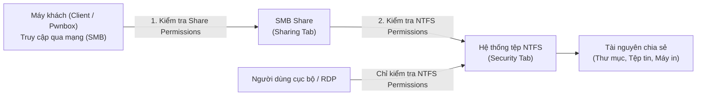
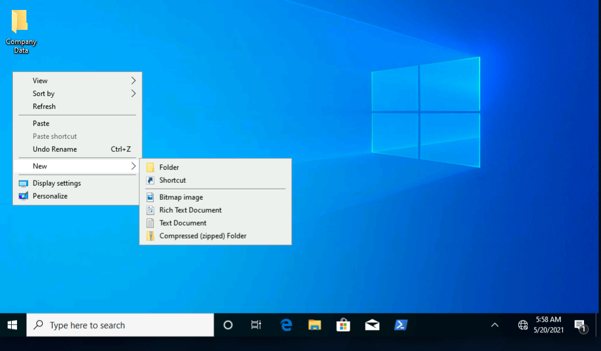
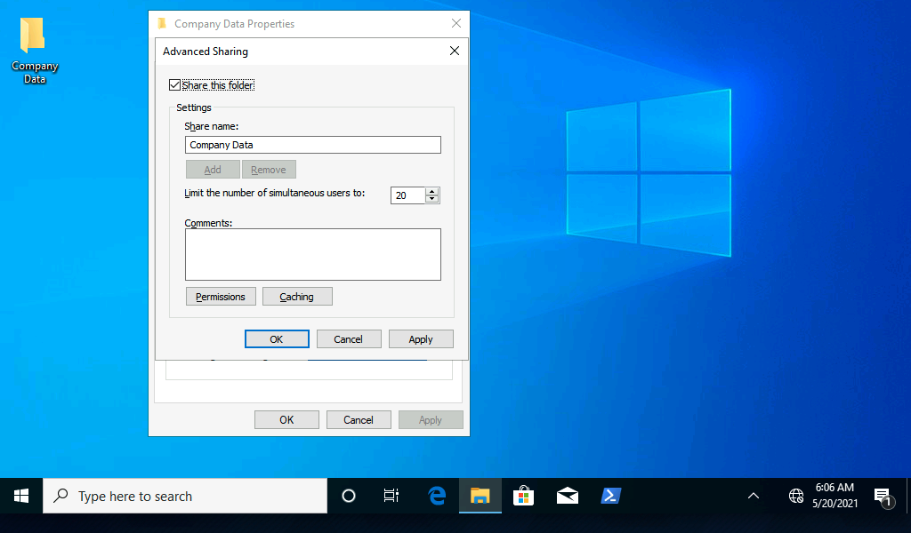
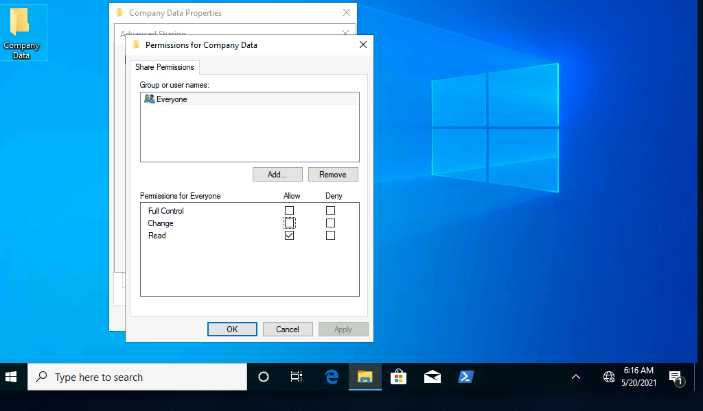
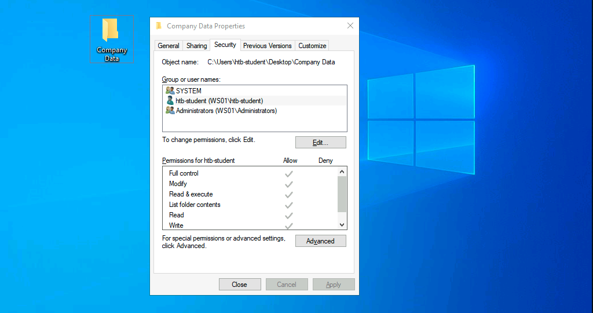
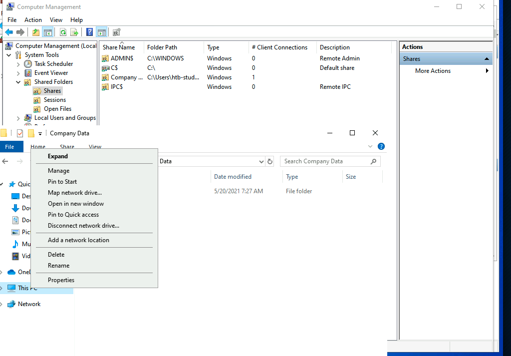
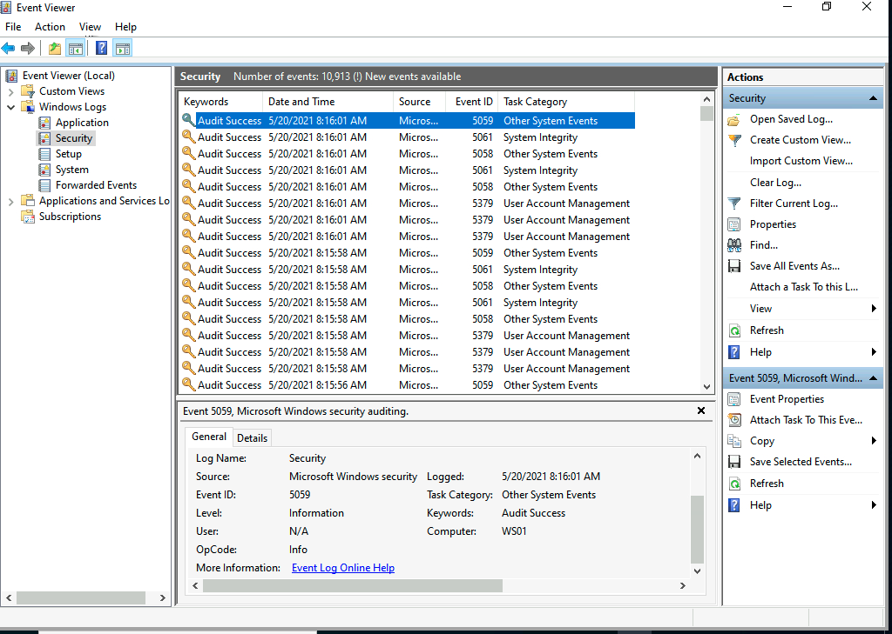

# NTFS vs. Share Permissions

Microsoft nắm giữ hơn [70%](https://gs.statcounter.com/os-market-share/desktop/worldwide/#monthly-201804-202104) thị phần hệ điều hành máy tính để bàn trên toàn cầu với Windows. Điều này lý giải vì sao phần lớn các tác giả mã độc lựa chọn phát triển mã độc cho Windows và vì sao nhiều người có cảm giác Windows kém an toàn hơn các hệ điều hành khác. Xét trên khía cạnh kinh tế, việc đầu tư nguồn lực để viết mã độc nhắm vào Windows là hoàn toàn có cơ sở vì đây là mục tiêu mang lại giá trị rất cao. Quan niệm cho rằng bất kỳ hệ điều hành nào miễn nhiễm với mã độc đều là một ngộ nhận về mặt kỹ thuật: hễ có thể viết phần mềm cho một hệ điều hành thì cũng có thể viết virus cho hệ điều hành đó. Hãy nhớ rằng về bản chất, virus là phần mềm được viết với mục đích xấu và có thể tồn tại trên bất kỳ hệ điều hành nào. Nhiều biến thể mã độc trên Windows có khả năng lây lan qua mạng thông qua các thư mục chia sẻ (network shares) được cấu hình phân quyền lỏng lẻo. Ngoài ra, cho đến tận ngày nay, lỗ hổng EternalBlue khét tiếng vẫn tiếp tục đe dọa các hệ thống Windows chưa được vá lỗi đang chạy `SMBv1`, thường mở đường cho ransomware làm tê liệt toàn bộ tổ chức.

Giao thức **Server Message Block (SMB)** được sử dụng trên Windows để kết nối các tài nguyên chia sẻ như tệp tin và máy in trong các môi trường doanh nghiệp từ quy mô nhỏ đến lớn:



> [!NOTE]
> Bất cứ khi nào gặp sơ đồ minh họa một khái niệm, hãy dành thời gian nghiên cứu thật kỹ vì một hình ảnh trực quan có giá trị tương đương hàng nghìn từ giải thích nhưng lại rất dễ bị bỏ qua khi đọc lướt.

Quyền NTFS (NTFS permissions) và quyền chia sẻ (share permissions) thường bị hiểu nhầm là giống nhau. Thực tế chúng hoàn toàn khác biệt, dù thường cùng được áp dụng lên chung một tài nguyên chia sẻ. Hãy cùng xem xét chi tiết từng loại quyền có thể thiết lập để bảo vệ hoặc cấp quyền truy cập vào một thư mục chia sẻ mạng trên Windows sử dụng hệ thống tệp NTFS.

### Share Permissions

| Quyền (Permission) | Mô tả (Description) |
| :--- | :--- |
| **Full Control** | Cho phép người dùng thực hiện mọi hành động của quyền `Change` và `Read`, đồng thời thay đổi quyền NTFS cho tệp tin và thư mục con. |
| **Change** | Cho phép người dùng đọc, chỉnh sửa, xóa và thêm mới tệp tin cũng như thư mục con. |
| **Read** | Cho phép người dùng xem nội dung tệp tin và thư mục con. |

### NTFS Basic Permissions

| Quyền (Permission) | Mô tả (Description) |
| :--- | :--- |
| **Full Control** | Cho phép người dùng thêm, sửa, di chuyển, xóa tệp tin và thư mục cũng như thay đổi quyền NTFS áp dụng trên toàn bộ thư mục được phép. |
| **Modify** | Cho phép hoặc từ chối quyền xem và chỉnh sửa tệp tin, thư mục (bao gồm thêm mới hoặc xóa tệp). |
| **Read & Execute** | Cho phép hoặc từ chối quyền đọc nội dung tệp tin và thực thi chương trình. |
| **List folder contents** | Cho phép hoặc từ chối quyền xem danh sách tệp tin và thư mục con. |
| **Read** | Cho phép hoặc từ chối quyền đọc nội dung tệp tin. |
| **Write** | Cho phép hoặc từ chối quyền ghi thay đổi vào tệp tin và thêm tệp mới vào thư mục. |
| **Special Permissions** | Tập hợp các tùy chọn phân quyền nâng cao chi tiết hơn. |

### NTFS Special Permissions

| Quyền (Permission) | Mô tả (Description) |
| :--- | :--- |
| **Full control** | Cho phép hoặc từ chối quyền thêm, sửa, di chuyển, xóa tệp tin và thư mục cũng như thay đổi quyền NTFS trên mọi thư mục được phép. |
| **Traverse folder / execute file** | Cho phép hoặc từ chối truy cập vào thư mục con bên trong cấu trúc thư mục ngay cả khi người dùng bị từ chối quyền xem nội dung ở thư mục cha; đồng thời kiểm soát quyền thực thi chương trình. |
| **List folder / read data** | Cho phép hoặc từ chối xem danh sách tệp tin và thư mục trong thư mục cha, cũng như mở và xem nội dung tệp. |
| **Read attributes** | Cho phép hoặc từ chối xem các thuộc tính cơ bản của tệp tin hoặc thư mục (như system, archive, read-only, hidden). |
| **Read extended attributes** | Cho phép hoặc từ chối xem các thuộc tính mở rộng của tệp tin hoặc thư mục (tùy thuộc vào từng chương trình). |
| **Create files / write data** | Cho phép hoặc từ chối tạo tệp tin mới trong thư mục và chỉnh sửa nội dung tệp. |
| **Create folders / append data** | Cho phép hoặc từ chối tạo thư mục con bên trong thư mục; có thể ghi nối tiếp dữ liệu vào cuối tệp nhưng không được ghi đè nội dung đã có sẵn. |
| **Write attributes** | Cho phép hoặc từ chối thay đổi thuộc tính cơ bản của tệp tin (không cấp quyền tạo tệp hay thư mục). |
| **Write extended attributes** | Cho phép hoặc từ chối thay đổi thuộc tính mở rộng của tệp tin hoặc thư mục (tùy thuộc vào từng chương trình). |
| **Delete subfolders and files** | Cho phép hoặc từ chối xóa thư mục con và tệp tin (thư mục cha sẽ không bị xóa). |
| **Delete** | Cho phép hoặc từ chối xóa thư mục cha, thư mục con và tệp tin. |
| **Read permissions** | Cho phép hoặc từ chối đọc danh sách phân quyền của thư mục. |
| **Change permissions** | Cho phép hoặc từ chối thay đổi phân quyền của tệp tin hoặc thư mục. |
| **Take ownership** | Cho phép hoặc từ chối giành quyền sở hữu (ownership) của tệp tin hoặc thư mục. Chủ sở hữu tệp luôn có toàn quyền thay đổi mọi phân quyền trên đối tượng đó. |

Hãy ghi nhớ rằng quyền NTFS được áp dụng trực tiếp trên hệ thống lưu trữ thư mục và tệp tin đó. Theo mặc định, các thư mục tạo trên phân vùng NTFS sẽ kế thừa quyền từ thư mục cha (chúng ta có thể tắt tính năng kế thừa để thiết lập quyền tùy chỉnh trên thư mục cha và thư mục con). Trong khi đó, quyền chia sẻ (share permissions) chỉ áp dụng khi thư mục được truy cập thông qua giao thức SMB, thường là từ một hệ thống khác qua mạng. Điều này đồng nghĩa với việc người đăng nhập trực tiếp tại máy hoặc qua RDP có thể truy cập thư mục và tệp tin đó bằng cách điều hướng trên hệ thống tệp cục bộ và chỉ chịu sự kiểm soát của quyền NTFS. Phân quyền ở mức NTFS mang lại cho quản trị viên khả năng kiểm soát chi tiết hơn rất nhiều đối với các hành động người dùng được phép thực hiện trên tệp tin và thư mục.

---

## Creating a Network Share

Để nắm vững kiến thức nền tảng về SMB và mối liên hệ với NTFS, chúng ta sẽ tự tạo một thư mục chia sẻ mạng trên máy mục tiêu Windows 10.

> [!NOTE]
> Trải nghiệm học tập lý tưởng nhất là mở Pwnbox toàn màn hình trên một màn hình riêng để một màn hình hiển thị tài liệu bài học và màn hình còn lại dành riêng cho việc thao tác máy mục tiêu. Nếu chỉ có một màn hình, bạn có thể dùng máy tính để thao tác thực hành và xem tài liệu trên điện thoại hoặc máy tính bảng.

Trong ví dụ này, chúng ta sẽ tạo một thư mục chia sẻ bằng cách tạo thư mục mới ngay trên màn hình Desktop của Windows 10. Cần lưu ý rằng trong hầu hết các môi trường doanh nghiệp lớn, các thư mục chia sẻ thường được tạo trên hệ thống lưu trữ SAN (Storage Area Network), thiết bị NAS (Network Attached Storage) hoặc một phân vùng ổ đĩa riêng trên hệ điều hành máy chủ như Windows Server. Nếu chúng ta bắt gặp thư mục chia sẻ trên một hệ điều hành máy trạm desktop, đó có thể là môi trường doanh nghiệp nhỏ hoặc một máy bàn đạp (beachhead system) do pentester hay kẻ tấn công dựng lên để tập kết và trích xuất dữ liệu.

Chúng ta sẽ thực hiện quy trình này bằng giao diện đồ họa (GUI) trên Windows.

### Creating the Folder



Tiếp theo, chúng ta sử dụng tùy chọn `Advanced Sharing` để cấu hình chia sẻ thư mục.

### Making the Folder a Share



Hãy chú ý rằng tên chia sẻ (`Share name`) tự động lấy mặc định theo tên thư mục. Ngoài ra, chúng ta cũng có thể giới hạn số lượng người dùng kết nối đồng thời vào thư mục chia sẻ này. Trong môi trường thực tế, quản trị viên nên đặt giới hạn này phù hợp với số lượng người dùng thực sự cần truy cập thường xuyên vào tài nguyên đó.

Tương tự như quyền NTFS, tài nguyên chia sẻ cũng có một danh sách kiểm soát truy cập (Access Control List - ACL), có thể hiểu là danh sách quyền SMB. Hãy nhớ rằng đối với tài nguyên chia sẻ trên Windows, cả hai danh sách quyền SMB và NTFS đều cùng được áp dụng. Một ACL chứa các mục kiểm soát truy cập (Access Control Entries - ACEs), thường bao gồm các tài khoản người dùng và nhóm (còn gọi là security principals) nhằm quản lý và theo dõi quyền truy cập một cách hiệu quả.

Hãy quan sát mục kiểm soát truy cập và thiết lập quyền mặc định bên dưới:

### Share Permissions ACL (Sharing Tab)



Trước mắt, chúng ta sẽ áp dụng nguyên thiết lập mặc định này để kiểm tra tác dụng thực tế của ACL. Chúng ta sẽ kiểm tra kết nối từ Pwnbox bằng cách mở terminal và sử dụng công cụ `smbclient`.

> [!NOTE]
> Về mặt kỹ thuật, máy chủ (server) là một thành phần phần mềm có chức năng phục vụ yêu cầu từ máy khách (client). Trong tình huống này, Pwnbox đóng vai trò là client còn máy mục tiêu Windows 10 là server.

#### Liệt kê các thư mục chia sẻ bằng smbclient (Using smbclient to list available shares)

```shellsession
phat2007dhsp@htb[/htb]$ smbclient -L SERVER_IP -U htb-student
Enter WORKGROUP\htb-student's password: 

	Sharename       Type      Comment
	---------       ----      -------
	ADMIN$          Disk      Remote Admin
	C$              Disk      Default share
	Company Data    Disk      
	IPC$            IPC       Remote IPC
```

#### Kết nối vào thư mục chia sẻ Company Data (Connecting to the Company Data share)

```shellsession
phat2007dhsp@htb[/htb]$ smbclient '\\SERVER_IP\Company Data' -U htb-student
Password for [WORKGROUP\htb-student]:
Try "help" to get a list of possible commands.
smb: \>
```

Nếu mọi thông tin đăng nhập đều chính xác và nhóm `Everyone` đã có ít nhất quyền `Read`, điều gì vẫn có thể chặn chúng ta truy cập vào thư mục chia sẻ này?

---

## Windows Defender Firewall Considerations

Chính **Windows Defender Firewall** có thể là nguyên nhân chặn truy cập vào thư mục chia sẻ SMB. Vì chúng ta đang kết nối từ một hệ thống nền Linux, tường lửa có thể chặn truy cập từ bất kỳ thiết bị nào không thuộc cùng một nhóm làm việc (workgroup). Một kiến thức quan trọng khác cần nhớ là khi một máy Windows thuộc mô hình workgroup, mọi yêu cầu xác thực (`netlogon`) đều được đối chiếu với cơ sở dữ liệu `SAM` cục bộ của máy đó. Ngược lại, khi máy Windows gia nhập môi trường Windows Domain, toàn bộ yêu cầu xác thực sẽ được đối chiếu với cơ sở dữ liệu mạng tập trung là `Active Directory`. Chúng ta cần nắm rõ điểm khác biệt này (workgroup dùng cơ sở dữ liệu SAM cục bộ còn domain dùng Active Directory) khi tiến hành đăng nhập và xác thực với máy Windows, cũng như xác định xem tài khoản `htb-student` đang tồn tại ở đâu để kết nối chính xác.

Để kiểm tra xem tường lửa có đang chặn kết nối hay không, có thể tắt tạm thời từng hồ sơ tường lửa trên Windows hoặc bật các quy tắc kết nối đến (inbound firewall rules) định sẵn trong phần cài đặt nâng cao của Windows Defender Firewall. Giống như hầu hết các tường lửa khác, Windows Defender Firewall cho phép hoặc từ chối lưu lượng đi vào (inbound) và đi ra (outbound).

Các quy tắc inbound và outbound được gắn với từng hồ sơ tường lửa khác nhau trong Windows Defender:

**Các hồ sơ Windows Defender Firewall (Windows Defender Firewall Profiles):**
- `Public`
- `Private`
- `Domain`

Nguyên tắc chuẩn bảo mật là chỉ bật các quy tắc định sẵn cần thiết hoặc thêm ngoại lệ tùy chỉnh thay vì tắt hoàn toàn tường lửa. Đáng tiếc là trong thực tế, tường lửa rất hay bị tắt hẳn vì sự tiện lợi hoặc do thiếu hiểu biết. Trên các máy trạm gia nhập Windows Domain, các quy tắc tường lửa có thể được quản lý tập trung thông qua Group Policy (khái niệm này nằm ngoài phạm vi mô-đun hiện tại).

Khi các quy tắc inbound phù hợp đã được bật, chúng ta sẽ kết nối thành công vào thư mục chia sẻ. Hãy nhớ rằng chúng ta kết nối được là vì tài khoản `htb-student` thuộc nhóm `Everyone`. Do quyền chia sẻ của nhóm `Everyone` hiện đang để ở mức `Read`, chúng ta chỉ có thể đọc tệp tin trên thư mục chia sẻ này. Khi đã thiết lập được kết nối, chúng ta có thể gắn kết (mount) thư mục chia sẻ từ Pwnbox vào hệ thống tệp của máy mục tiêu Windows 10 - và đây là lúc quyền NTFS phát huy tác dụng song song với quyền chia sẻ. Hãy quay lại phiên `xfreerdp` trên máy Windows 10 để kiểm tra quyền NTFS của thư mục `Company Data`.

### NTFS Permissions ACL (Security Tab)



Quyền NTFS cung cấp khả năng kiểm soát chi tiết hơn cho từng người dùng và nhóm. Bất cứ khi nào thấy dấu tích màu xám bên cạnh một quyền, điều đó có nghĩa là quyền này được kế thừa từ thư mục cha. Theo mặc định, mọi quyền NTFS đều kế thừa từ thư mục cha. Trong hệ sinh thái Windows, ổ đĩa `C:\` là thư mục cha cấp cao nhất chi phối toàn bộ các thư mục bên dưới, trừ khi quản trị viên hệ thống tắt tính năng kế thừa trong phần cài đặt `Advanced` của tab `Security`.

Trong phần lớn trường hợp, quản trị viên hệ thống của tổ chức là người quyết định người dùng hay nhóm nào được cấp quyền gì trên tài nguyên mạng. Đây cũng là lý do nhiều chiến dịch tấn công giả mạo có chủ đích (spear-phishing) nhắm thẳng vào quản trị viên hệ thống và các lãnh đạo CNTT, bởi họ nắm quyền kiểm soát hạ tầng còn lớn hơn cả các lãnh đạo cấp cao không chuyên về kỹ thuật (C-level). Chẳng hạn trong bệnh viện, bác sĩ hay giám đốc điều hành sẽ không có quyền quản trị mạng, nhưng quản trị viên hệ thống thì có.

Bây giờ, hãy cấp quyền `Full Control` cho nhóm `Everyone` ở tầng chia sẻ (share level) và kiểm thử tác động bằng cách tạo điểm gắn kết (mount point) tới thư mục chia sẻ từ Desktop trên Pwnbox:

#### Gắn kết thư mục chia sẻ (Mounting to the Share)

```shellsession
phat2007dhsp@htb[/htb]$ sudo mount -t cifs -o username=htb-student,password=Academy_WinFun! //ipaddoftarget/"Company Data" /home/user/Desktop/
```

Nếu câu lệnh trên không hoạt động, hãy kiểm tra lại cú pháp. Nếu cú pháp đã đúng nhưng vẫn lỗi, có thể hệ thống chưa cài đặt gói `cifs-utils`. Chúng ta có thể cài đặt bằng lệnh sau:

#### Cài đặt tiện ích CIFS (Installing CIFS Utilities)

```shellsession
phat2007dhsp@htb[/htb]$ sudo apt-get install cifs-utils
```

Sau khi gắn kết thành công điểm mount trên Desktop của Pwnbox, chúng ta hãy xem xét một số công cụ tích hợp sẵn trong Windows giúp theo dõi và giám sát những hoạt động vừa thực hiện.

Lệnh `net share` cho phép xem toàn bộ các thư mục đang được chia sẻ trên hệ thống. Hãy chú ý đến thư mục chúng ta vừa tạo cũng như ổ đĩa `C:\`.

Bạn có nhớ mình từng chia sẻ ổ `C:\` không?

Chúng ta hoàn toàn không tự tay chia sẻ ổ `C:`. Ổ đĩa quan trọng nhất chứa các tệp tin cốt lõi của Windows thực chất đã được tự động chia sẻ qua SMB ngay từ khi cài đặt hệ điều hành. Điều này có nghĩa là bất kỳ ai có đủ quyền truy cập phù hợp đều có thể truy cập từ xa vào toàn bộ ổ `C:\` của từng máy Windows trong mạng.

#### Hiển thị các thư mục chia sẻ bằng net share (Displaying Shares using net share)

```cmd
C:\Users\htb-student> net share

Share name   Resource                        Remark

-------------------------------------------------------------------------------
C$           C:\                             Default share
IPC$                                         Remote IPC
ADMIN$       C:\WINDOWS                      Remote Admin
Company Data C:\Users\htb-student\Desktop\Company Data
The command completed successfully.
```

**Computer Management** là một công cụ khác giúp chúng ta nhận diện và giám sát các tài nguyên chia sẻ trên hệ thống Windows.

### Monitoring Shares from Computer Management



Chúng ta có thể kiểm tra sâu hơn trong các mục `Shares`, `Sessions` và `Open Files` để nắm bắt những thông tin mà hệ thống ghi nhận. Trong trường hợp phải hỗ trợ cá nhân hoặc tổ chức ứng phó sự cố xâm nhập liên quan đến giao thức SMB, đây là những vị trí cực kỳ hữu ích để bắt đầu điều tra xem cuộc tấn công đã diễn ra như thế nào và kẻ tấn công để lại dấu vết gì.

### Viewing Share access logs in Event Viewer



**Event Viewer** là một công cụ quan trọng khác để điều tra các hành động đã thực hiện trên Windows. Hầu hết mọi hệ điều hành đều có cơ chế ghi nhật ký (logging) cùng tiện ích để đọc các nhật ký đã thu thập. Nhật ký (log) có thể được ví như một cuốn sổ nhật ký của máy tính, ghi chép lại mọi tác vụ đã diễn ra kèm nhiều thông tin chi tiết liên quan. Chúng ta có thể xem lại nhật ký của mọi hành động vừa thực hiện khi truy cập máy mục tiêu Windows 10, cũng như quá trình tạo, chỉnh sửa và truy cập thư mục chia sẻ.
