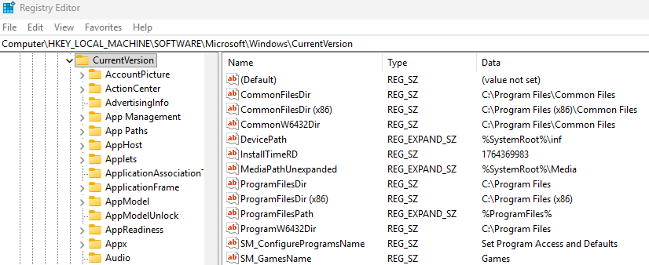
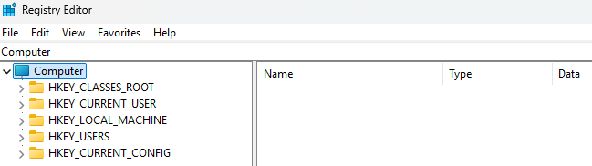
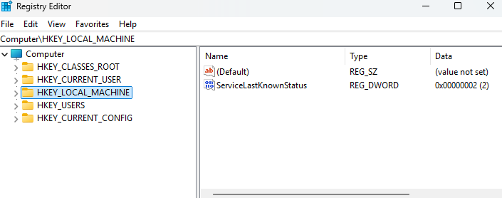
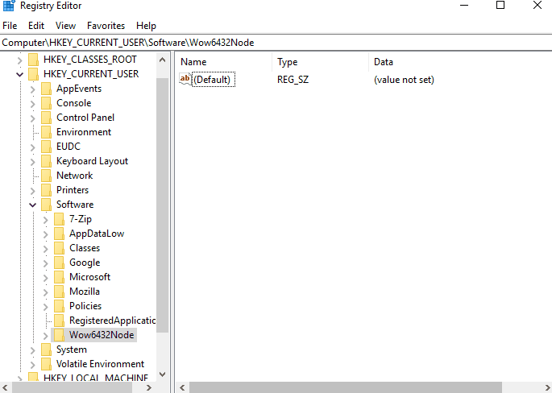
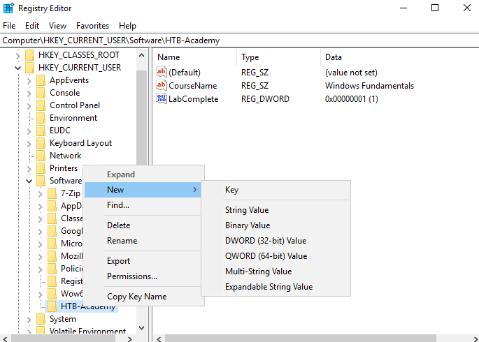
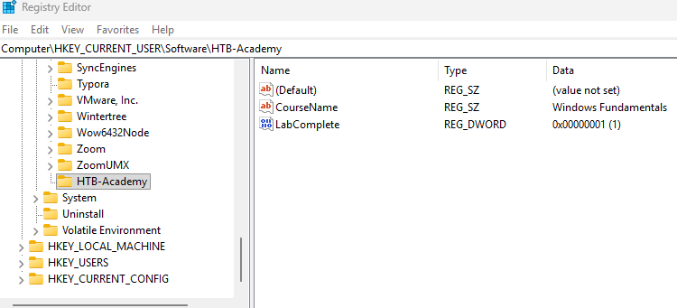

# Windows Registry

[Windows Registry](https://learn.microsoft.com/en-us/troubleshoot/windows-server/performance/windows-registry-advanced-users) là một cơ sở dữ liệu phân cấp được Windows và nhiều ứng dụng đã cài đặt sử dụng để lưu trữ thông tin cấu hình. Nó chứa các thiết lập liên quan đến hồ sơ người dùng, phần mềm, phần cứng, dịch vụ, chính sách bảo mật và bản thân hệ điều hành.

Một máy Windows có thể dùng Registry để xác định ứng dụng nào chạy khi người dùng đăng nhập, một dịch vụ khởi động như thế nào hoặc một tính năng bảo mật có được bật hay không. Quản trị viên hệ thống thường dùng Registry khi cấu hình hệ thống, triển khai phần mềm và khắc phục sự cố.

Sai sót khi làm việc với Registry có thể khiến ứng dụng hoặc các thành phần cốt lõi của Windows ngừng hoạt động vì Registry chứa những thiết lập quan trọng. Cần hiểu rõ mục đích của một thiết lập trước khi sửa đổi nó và nên thử nghiệm trong môi trường lab trước nếu có thể.

---

## Cấu trúc Registry (Registry Structure)

Registry được tổ chức thành các hive, key, subkey và value. Các thành phần này tạo thành một hệ thống phân cấp tương tự thư mục, thư mục con và tệp trong hệ thống tệp của Windows.

| Thành phần | Mô tả |
| :--- | :--- |
| Hive | Một phần cấp cao nhất của Registry, chứa các loại thiết lập khác nhau như cấu hình toàn hệ thống hoặc thiết lập của người dùng hiện tại. |
| Key | Một vùng chứa bên trong hive, tương tự một thư mục. Một key có thể chứa các key và value khác. |
| Subkey | Một key nằm bên dưới một key khác. Subkey dùng để tổ chức các thiết lập liên quan thành một hệ thống phân cấp. |
| Value | Một thiết lập riêng lẻ được lưu trong một key. Mỗi value có tên, kiểu dữ liệu và dữ liệu đi kèm. |

Ví dụ với đường dẫn registry sau:

```text
HKEY_LOCAL_MACHINE\SOFTWARE\Microsoft\Windows\CurrentVersion
```

Trong ví dụ này:

- `HKEY_LOCAL_MACHINE` là hive.
- `SOFTWARE` là một key nằm trong hive.
- `Microsoft`, `Windows` và `CurrentVersion` là các subkey bên dưới nó.

Khi chọn `CurrentVersion` trong Registry Editor, các value được lưu trong key đó sẽ hiển thị.



Các value của Registry xuất hiện ở ngăn bên phải của Registry Editor. Mỗi value gồm ba thành phần chính:

| Thành phần | Mô tả |
| :--- | :--- |
| Name | Xác định thiết lập. |
| Type | Xác định loại dữ liệu mà value có thể lưu. |
| Data | Chứa thông tin cấu hình. |

Dưới đây là một số hive chính của Registry có trong mọi hệ điều hành Windows, hiển thị khi thu gọn tất cả các hive.



| Hive | Viết tắt | Mục đích |
| :--- | :--- | :--- |
| `HKEY_CURRENT_USER` | `HKCU` | Lưu thiết lập của người dùng đang đăng nhập. |
| `HKEY_LOCAL_MACHINE` | `HKLM` | Lưu các thiết lập phần cứng, phần mềm và hệ điều hành trên toàn hệ thống. |
| `HKEY_CLASSES_ROOT` | `HKCR` | Lưu các liên kết tệp (file association) và thông tin đăng ký ứng dụng. |
| `HKEY_USERS` | `HKU` | Chứa các hồ sơ người dùng đang được nạp trên hệ thống. |
| `HKEY_CURRENT_CONFIG` | `HKCC` | Chứa thông tin về cấu hình phần cứng hiện tại. |

Hai hive chúng ta tương tác nhiều nhất là `HKCU` và `HKLM`. Thay đổi trong `HKCU` thường chỉ ảnh hưởng đến người dùng hiện tại, còn thay đổi trong `HKLM` thường ảnh hưởng đến toàn bộ máy tính và cần quyền quản trị để chỉnh sửa.



Các value của Registry có thể lưu nhiều kiểu dữ liệu. Dưới đây là một số ví dụ phổ biến:

| Kiểu | Mô tả |
| :--- | :--- |
| `REG_SZ` | Chuỗi văn bản tiêu chuẩn. |
| `REG_DWORD` | Số 32-bit, thường dùng cho các thiết lập bật hoặc tắt. |
| `REG_QWORD` | Số 64-bit. |
| `REG_MULTI_SZ` | Nhiều chuỗi văn bản. |
| `REG_BINARY` | Dữ liệu nhị phân thô. |

---

## Registry Editor

Windows có một công cụ đồ họa gọi là Registry Editor, hay `regedit.exe`, dùng để duyệt và chỉnh sửa Registry.

Chúng ta có thể mở Registry Editor bằng cách gõ `regedit` vào menu Start hoặc nhấn `Win + R`, nhập `regedit` rồi chọn OK.

Registry Editor được chia thành hai ngăn chính: ngăn bên trái hiển thị hệ thống phân cấp Registry và ngăn bên phải hiển thị các value nằm trong key đang chọn. Thanh địa chỉ hiển thị đường dẫn đầy đủ của key đang chọn.



Chúng ta có thể mở rộng các key bằng các mũi tên ở ngăn bên trái hoặc dán một đường dẫn registry bắt đầu bằng tên hive vào thanh địa chỉ.

### Tạo key thực hành (Creating a Practice Key)

Trước khi sửa một thiết lập hiện có của Windows, hãy tạo một key thực hành trong hồ sơ của người dùng hiện tại.

Điều hướng đến:

```text
HKEY_CURRENT_USER\Software
```

Nhấp chuột phải vào key `Software` và chọn `New` → `Key`. Đặt tên cho key mới là:

```text
HTB-Academy
```



Chọn key mới, nhấp chuột phải vào vùng trống ở ngăn bên phải và chọn `New` → `String Value`. Đặt tên value là `CourseName`.

Nhấp đúp vào `CourseName`, nhập dữ liệu sau rồi chọn OK:

```text
Windows Fundamentals
```

Tạo value thứ hai bằng cách chọn `New` → `DWORD (32-bit) Value`. Đặt tên là `LabComplete`, sau đó nhấp đúp vào nó và đặt giá trị bằng `1`.



Dưới đây là bản ghi từng bước của bài thực hành này:

> [!NOTE]
> Chưa có ảnh động (GIF) cho phần này.

Chúng ta có thể sửa một value bằng cách nhấp đúp vào nó hoặc nhấp chuột phải để mở menu các tùy chọn. Các key và value cũng có thể bị xóa bằng tùy chọn `Delete`.

Registry Editor yêu cầu xác nhận trước khi xóa dữ liệu nhưng không kiểm tra xem Windows hoặc ứng dụng khác có phụ thuộc vào key đã chọn hay không, vì vậy mọi thao tác xóa cần được thực hiện cẩn thận.

---

## Tương tác với Registry bằng reg.exe

Windows cũng có sẵn tiện ích dòng lệnh `reg.exe`, dùng để truy vấn và sửa đổi Registry từ terminal trên máy Windows, trong script hoặc trong các phiên quản trị từ xa.

Chúng ta có thể xem các thao tác khả dụng bằng lệnh:

```cmd
C:\htb> reg /?

REG Operation [Parameter List]

  Operation  [ QUERY   | ADD    | DELETE  | COPY    |
               SAVE    | LOAD   | UNLOAD  | RESTORE |
               COMPARE | EXPORT | IMPORT  | FLAGS ]

Return Code: (Except for REG COMPARE)

  0 - Successful
  1 - Failed

For help on a specific operation type:

  REG Operation /?

Examples:

  REG QUERY /?
  REG ADD /?
  REG DELETE /?
  REG COPY /?
  REG SAVE /?
  REG RESTORE /?
  REG LOAD /?
  REG UNLOAD /?
  REG COMPARE /?
  REG EXPORT /?
  REG IMPORT /?
  REG FLAGS /?
```

Các thao tác phổ biến gồm `query`, `add`, `delete`, `export` và `import`. Chúng ta có thể xem trợ giúp cho một thao tác cụ thể bằng lệnh như:

```cmd
C:\htb> reg query /?

REG QUERY KeyName [/v [ValueName] | /ve] [/s]
          [/f Data [/k] [/d] [/c] [/e]] [/t Type] [/z] [/se Separator]
          [/reg:32 | /reg:64]

  KeyName    [\\Machine\]FullKey
    Machine  - Name of remote machine, omitting defaults to the current machine.
               Only HKLM and HKU are available on remote machines
    FullKey  - in the form of ROOTKEY\SubKey name
      ROOTKEY  - [ HKLM | HKCU | HKCR | HKU | HKCC ]
      SubKey   - The full name of a registry key under the selected ROOTKEY

  /v         Queries for a specific registry key values.
             If omitted, all values for the key are queried.
             Argument to this switch can be optional only when specified
             along with /f switch. This specifies to search in valuenames only.

  /ve        Queries for the default value or empty value name (Default).

  /s         Queries all subkeys and values recursively (like dir /s).

  /se        Specifies the separator (length of 1 character only)
             in data string for REG_MULTI_SZ. Defaults to "\0" as the separator.

  /f         Specifies the data or pattern to search for.
             Use double quotes if a string contains spaces. Default is "*".

  /k         Specifies to search in key names only.

  /d         Specifies the search in data only.

  /c         Specifies that the search is case sensitive.
             The default search is case insensitive.

  /e         Specifies to return only exact matches.
             By default all the matches are returned.

  /t         Specifies registry value data type.
             Valid types are:
             REG_SZ, REG_MULTI_SZ, REG_EXPAND_SZ,
             REG_DWORD, REG_QWORD, REG_BINARY, REG_NONE
             Defaults to all types.

  /z         Verbose: Shows the numeric equivalent for the type of the valuename.

  /reg:32    Specifies the key should be accessed using the 32-bit registry view.

  /reg:64    Specifies the key should be accessed using the 64-bit registry view.

Examples:

  REG QUERY HKLM\Software\Microsoft\ResKit /v Version
    Displays the value of the registry value Version

  REG QUERY \\ABC\HKLM\Software\Microsoft\ResKit\Nt\Setup /s
    Displays all subkeys and values under the registry key Setup
    on remote machine ABC

  REG QUERY HKLM\Software\Microsoft\ResKit\Nt\Setup /se #
    Displays all the subkeys and values with "#" as the seperator
    for all valuenames whose type is REG_MULTI_SZ.

  REG QUERY HKLM /f SYSTEM /t REG_SZ /c /e
    Displays Key, Value and Data with case sensitive and exact occurrences
    of "SYSTEM" under HKLM root for the data type REG_SZ

  REG QUERY HKCU /f 0F /d /t REG_BINARY
    Displays Key, Value and Data for the occurrences of "0F" in data
    under HKCU root for the data type REG_BINARY

  REG QUERY HKLM\SOFTWARE /ve
    Displays Value and Data for the empty value (Default) under HKLM\SOFTWARE
```

### Truy vấn dữ liệu Registry (Querying Registry Data)

Lệnh `reg query` hiển thị các value và subkey nằm trong một key. Hãy truy vấn key `HTB-Academy` mẫu mà chúng ta đã tạo ở trên.

```cmd
C:\htb> reg query "HKCU\Software\HTB-Academy"

HKEY_CURRENT_USER\Software\HTB-Academy
    CourseName    REG_SZ    Windows Fundamentals
    LabComplete    REG_DWORD    0x1
```

Để lấy một value cụ thể, chúng ta có thể dùng tham số `/v`:

```cmd
C:\htb> reg query "HKCU\Software\HTB-Academy" /v CourseName

HKEY_CURRENT_USER\Software\HTB-Academy
    CourseName    REG_SZ    Windows Fundamentals
```

### Thêm và sửa value (Adding and Modifying Values)

Lệnh `reg add` có thể dùng để tạo key, tạo value hoặc sửa một value hiện có.

Một số tham số thường dùng:

| Tham số | Mục đích |
| :--- | :--- |
| `/v` | Chỉ định tên value. |
| `/t` | Chỉ định kiểu value. |
| `/d` | Chỉ định dữ liệu cần lưu. |
| `/f` | Thực hiện thao tác mà không yêu cầu xác nhận. |

Lệnh sau tạo một string value mới có tên `CreatedBy`:

```cmd
C:\htb> reg add "HKCU\Software\HTB-Academy" /v CreatedBy /t REG_SZ /d "reg.exe" /f

The operation completed successfully.
```

Chúng ta cũng có thể sửa DWORD value hiện có để đổi từ 1 sang 0.

```cmd
C:\htb> reg add "HKCU\Software\HTB-Academy" /v LabComplete /t REG_DWORD /d 0 /f

The operation completed successfully.
```

Sau đó, chúng ta có thể kiểm tra cả hai thay đổi bằng `reg query`:

```cmd
C:\htb> reg query "HKCU\Software\HTB-Academy"

HKEY_CURRENT_USER\Software\HTB-Academy
    CourseName    REG_SZ    Windows Fundamentals
    LabComplete    REG_DWORD    0x0
    CreatedBy    REG_SZ    reg.exe
```

### Xóa dữ liệu Registry (Deleting Registry Data)

Lệnh `reg delete` có thể xóa một value riêng lẻ hoặc toàn bộ một key.

Lệnh sau chỉ xóa value `CreatedBy`:

```cmd
C:\htb> reg delete "HKCU\Software\HTB-Academy" /v CreatedBy /f

The operation completed successfully.
```

Lệnh sau xóa key thực hành và tất cả value bên dưới nó:

```cmd
C:\htb> reg delete "HKCU\Software\HTB-Academy" /f

The operation completed successfully.
```

Cần kiểm tra kỹ đường dẫn trước khi dùng `reg delete`, đặc biệt khi có tùy chọn `/f`, vì một sai sót có thể gây hư hại nghiêm trọng cho hệ thống.

---

## Quyền truy cập Registry (Registry Permissions)

Các key Registry có quyền truy cập (permission) xác định người dùng và nhóm nào có thể đọc hoặc sửa chúng.

Một người dùng tiêu chuẩn thường có thể sửa các thiết lập trong những phần thuộc hive `HKCU` của chính họ. Các key toàn hệ thống bên dưới `HKLM` bị hạn chế hơn và thường cần một cửa sổ terminal hoặc phiên Registry Editor được nâng quyền (elevated).

Nếu tiến trình hiện tại không đủ quyền, Windows có thể trả về lỗi `Access is denied` hoặc `The requested operation requires elevation`.

---

## User Account Control và Registry

User Account Control, hay UAC, giúp ngăn các ứng dụng thực hiện thay đổi quản trị khi chưa được chấp thuận.

Windows lưu các giá trị chính sách UAC chính tại:

```text
HKEY_LOCAL_MACHINE\SOFTWARE\Microsoft\Windows\CurrentVersion\Policies\System
```

Một value trong key này là `EnableLUA`. Đây là value kiểu `REG_DWORD`:

- `1` nghĩa là UAC được bật.
- `0` nghĩa là UAC bị tắt.

Chúng ta có thể truy vấn giá trị hiện tại của nó mà không thay đổi gì:

```cmd
C:\htb> reg query "HKLM\SOFTWARE\Microsoft\Windows\CurrentVersion\Policies\System" /v EnableLUA

HKEY_LOCAL_MACHINE\SOFTWARE\Microsoft\Windows\CurrentVersion\Policies\System
    EnableLUA    REG_DWORD    0x1
```

Việc thay đổi thiết lập này cần quyền quản trị và thường cần khởi động lại máy để thay đổi có hiệu lực hoàn toàn. Chỉ nên tắt UAC trong môi trường lab cô lập, trừ khi thực sự bắt buộc.
